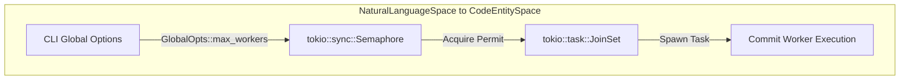
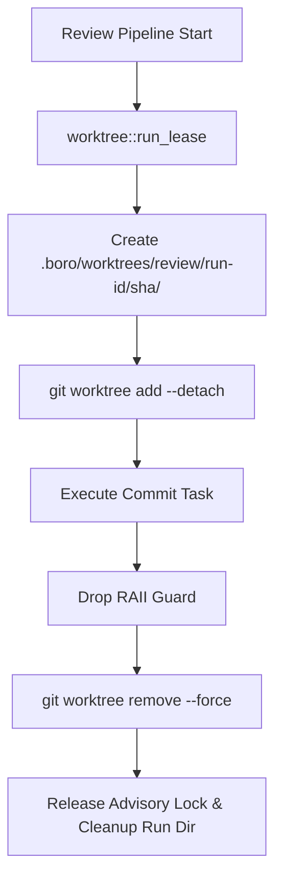
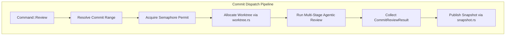
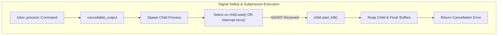

<!-- source: DeepWiki mcp.deepwiki.com · repo NVIDIA/boro · page 2.1 Orchestration and Commit Workers · fetched 2026-10-26 -->

# Orchestration and Commit Workers

Relevant source files

The following files were used as context for generating this wiki page:

- [src/main.rs](src/main.rs)
- [src/process.rs](src/process.rs)
- [src/progress.rs](src/progress.rs)
- [src/verbose.rs](src/verbose.rs)
- [src/worktree.rs](src/worktree.rs)
- [tests/apply_range_cli.rs](tests/apply_range_cli.rs)

## Purpose and Scope

This page documents the concurrency, orchestration, worktree isolation, task dispatch, and progress reporting subsystems of `boro`. Specifically, it covers how `boro` executes parallel operations across commit ranges, controls concurrency limits via semaphore pools, isolates individual commit executions using ephemeral git worktrees with RAII-based cleanup, dispatches tasks, and tracks run totals and snapshots.

Sources: `src/main.rs:177-185` [src/main.rs:177-185](), `src/worktree.rs:1-21` [src/worktree.rs:1-21]()

---

## Concurrency Management and Semaphore Pool

Concurrency in `boro` is regulated by command-line arguments and asynchronous primitives from `tokio`. The global options struct `GlobalOpts` exposes the `-j` / `--max-workers` parameter, which determines the maximum number of concurrent commit workers [src/main.rs:177-185](). 

By default, review commands allocate up to 8 concurrent workers, while destructive or build/test commands serialize execution (`max_workers` = 1). Internally, orchestration uses `tokio::sync::Semaphore` to bound task entry and `tokio::task::JoinSet` to manage asynchronous worker lifecycle and collect results [src/main.rs:40-41]().

*Figure 1: Concurrency management flow linking CLI options to Tokio task primitives.*

Sources: `src/main.rs:40-41` [src/main.rs:40-41](), `src/main.rs:177-185` [src/main.rs:177-185]()

---

## Worktree Isolation and RAII Lifecycle

To prevent parallel review or build passes from conflicting with the user's active checkout, `boro` isolates each commit execution inside a dedicated git worktree. Managed by `src/worktree.rs`, worktrees ensure that each parallel worker operates on a working tree pinned precisely to its commit's SHA [src/worktree.rs:1-13]().

### Directory Layout
Worktrees are created under the main repository using the following deterministic path schema:
`.boro/worktrees/<command>/<run-id>/<sha>/`
- `<command>`: Identifies the subsystem (`review`, `build`, or `test`) [src/worktree.rs:7-10]().
- `<run-id>`: Combines the operating system process ID with a nanosecond epoch timestamp (`process_run_id()`), preventing collisions between concurrent `boro` instances [src/worktree.rs:40-49]().
- `<sha>`: The target git commit hash [src/worktree.rs:7-10]().

### Lifecycle and Cleanup
Worktree handles are wrapped in an RAII guard struct. When a task completes or aborts (such as via cancellation or a panic), the `Drop` implementation executes `git worktree remove --force` [src/worktree.rs:15-20](). 

Concurrency and locking across runs are coordinated via `RunLease`, which creates a `.boro-run.lock` file inside the run directory and acquires an advisory file lock (`file.try_lock()`) to support stale sweep routines [src/worktree.rs:104-135]().

*Figure 2: Worktree lifecycle sequence from lease acquisition to RAII cleanup.*

Sources: `src/worktree.rs:1-184` [src/worktree.rs:1-184]()

---

## Commit Task Dispatch and Pipeline Execution

When reviewing a commit range (`COMMIT_RANGE`), `boro` resolves the list of commits, allocates worktree checkouts, and dispatches individual review tasks into the concurrency pool. 

Each commit review produces a structured result containing findings, validation contexts, and token usage metrics, captured in internal data structures like `CommitReviewResult` and `ValidationPayloadOwned` [src/main.rs:125-145]().

*Figure 3: Commit task dispatch and execution pipeline.*

Sources: `src/main.rs:125-145` [src/main.rs:125-145](), `src/main.rs:211-216` [src/main.rs:211-216]()

---

## Progress UI, Spinners, and Run Totals

Progress reporting is decoupled from standard output (`stdout`), which is strictly reserved for machine-readable JSON payloads when `--json` is specified [src/main.rs:199-202](). Human-readable progress, animated spinners, and status messages are rendered to standard error (`stderr`) via `src/progress.rs` [src/progress.rs:3-12]().

### `MultiPatchSpinner` and Worker UI
- **Terminal Detection:** Spinners automatically disable themselves when `stderr` is not a TTY (such as in CI pipelines or script piping) [src/progress.rs:67-72]().
- **Multi-Progress Rows:** `MultiPatchSpinner` allocates one progress row per active commit worker using `indicatif::MultiProgress`, allowing independent stages to update simultaneously [src/progress.rs:9-15]().
- **Footer Totals:** A run-wide footer bar aggregates prompt tokens, completion tokens, and prompt caching statistics across all concurrent workers [src/progress.rs:13-15](), [src/progress.rs:161-189]().

Sources: `src/progress.rs:1-189` [src/progress.rs:1-189]()

---

## Subprocess Execution and Signal Safety

Subprocess execution (such as invoking `git`, `b4`, or `vng`) is managed through wrapper utilities in `src/process.rs` [src/process.rs:1-55](). The core function `cancellable_output` spawns asynchronous child processes with piped I/O and configures `kill_on_drop(true)` [src/process.rs:11-19]().

*Figure 4: Subprocess execution flow with cooperative SIGINT cancellation.*

Sources: `src/process.rs:1-55` [src/process.rs:1-55]()

---

