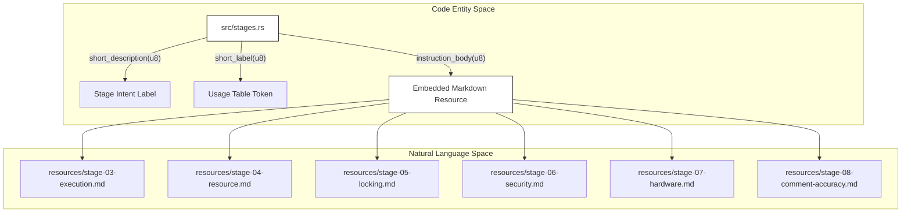
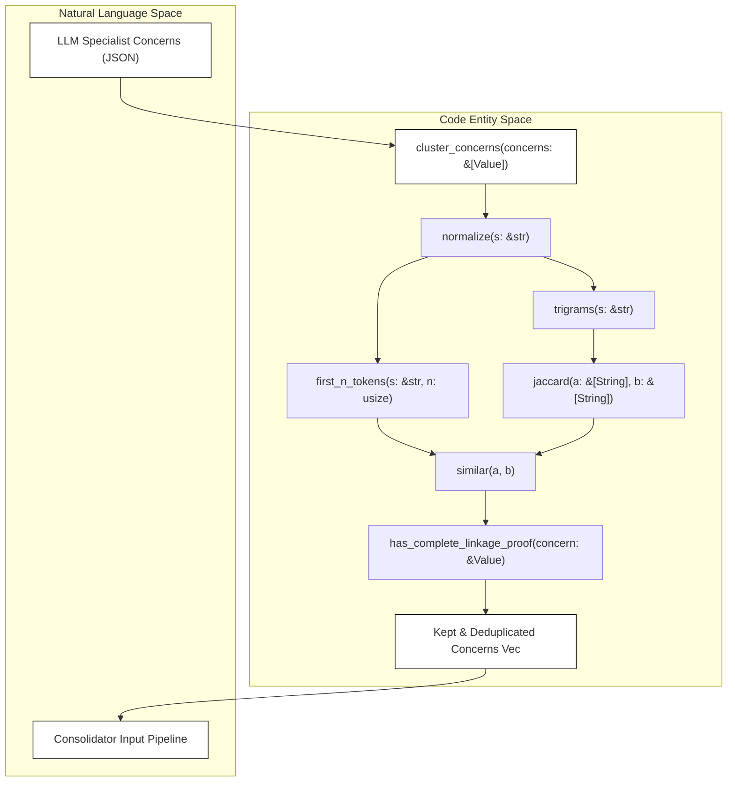

<!-- source: DeepWiki mcp.deepwiki.com · repo NVIDIA/boro · page 2.2 Specialist Stages and Concern Clustering · fetched 2026-10-26 -->

# Specialist Stages and Concern Clustering

Relevant source files

The following files were used as context for generating this wiki page:

- [resources/stage-03-execution.md](resources/stage-03-execution.md)
- [resources/stage-07-hardware.md](resources/stage-07-hardware.md)
- [src/cluster.rs](src/cluster.rs)
- [src/stages.rs](src/stages.rs)

## Purpose and Scope
This page details the multi-stage specialist analysis pipeline and the post-processing clustering mechanism used by boro. It covers the instruction bodies for review stages 3 through 8 as managed by `src/stages.rs`, the deep-dive logic for validation provenance and configuration linkage audits, and the trigram- and token-based concern deduplication engine implemented in `src/cluster.rs`.

Sources: `[src/stages.rs:1-41](), [src/cluster.rs:1-65]()`

---

## Specialist Stages Architecture (`src/stages.rs`)

The boro review engine executes multiple focused specialist stages per commit. `src/stages.rs` acts as the registry for instruction bodies (Stages 3 through 8), providing metadata labels for progress UIs and usage tables.

- `short_description(stage: u8)`: Returns a human-readable label indicating the intent of the stage (e.g., "Execution flow verification", "Security") `[src/stages.rs:6-16]()`.
- `short_label(stage: u8)`: Returns a single lowercase word used in per-step usage reporting tables (`execution`, `resource`, `locking`, `security`, `hardware`, `comments`) `[src/stages.rs:18-29]()`.
- `instruction_body(stage: u8)`: Dynamically loads the embedded markdown prompt corpora (`resources/stage-03-execution.md` through `resources/stage-08-comment-accuracy.md`) via the `include_str!` macro `[src/stages.rs:31-41]`.

Sources: `[src/stages.rs:1-41]()`

---

## Deep Dive: Execution (Stage 3) and Portability (Stage 7)

Stages 3 and 7 enforce strict semantic checks with formal verification constraints defined in their respective markdown instruction files.

### Stage 3: Execution Flow Verification (`resources/stage-03-execution.md`)
Stage 3 traces control flow, branch conditions, error-handling paths (`goto cleanup;`), and null pointer dereferences. It enforces two strict sub-rules:
1. **Validation Provenance and Candidate Substitution**: A validation applies strictly to the object checked. If a helper replaces a candidate with an alias, sibling, parent, or first set bit, membership in the same set or domain does not transfer liveness, availability, or permissions. A concrete witness state must be constructible where the scanned object passes a stronger predicate while the substituted object satisfies only a weaker predicate `[resources/stage-03-execution.md:14-42]()`.
2. **Preprocessor Expansion**: Before emitting a concern, macro invocation chains must be expanded token by token, resolving formal parameters, stringification, and variadic arguments. Conclusions must be drawn from the final expanded token stream rather than unexpanded spelling `[resources/stage-03-execution.md:43-57]()`.

### Stage 7: Build, Configuration, and Hardware Portability (`resources/stage-07-hardware.md`)
Stage 7 splits output concerns into two mandatory machine-enforced categories via the `"category"` JSON key:
- `"category": "configuration-linkage"`: Used for Kconfig, Kbuild, declarations, definitions, exports, stubs, symbols, or callers `[resources/stage-07-hardware.md:11-14]()`.
- `"category": "hardware-architecture"`: Used strictly for hardware or architecture behavior concerns `[resources/stage-07-hardware.md:15-16]()`.

Configuration and linkage concerns require a structured `proof` object containing four mandatory string fields:
1. `failing_config`: A valid failing configuration state (e.g., `CONFIG_SCHED_SMT=n`) `[resources/stage-07-hardware.md:67-69]()`.
2. `caller_condition`: The exact preprocessor, Kconfig, or Kbuild condition guarding the caller `[resources/stage-07-hardware.md:70-72]()`.
3. `provider_condition`: The exact condition guarding the provider declaration or fallback stub `[resources/stage-07-hardware.md:72-73]()`.
4. `failure`: The concrete consequence, such as an unresolved symbol or undeclared identifier `[resources/stage-07-hardware.md:74-75]()`.

Sources: `[resources/stage-03-execution.md:1-57](), [resources/stage-07-hardware.md:1-114](), [src/stages.rs:43-105]()`

---

## Concern Clustering and Deduplication (`src/cluster.rs`)

To prevent the consolidator from seeing near-duplicate entries generated across multiple specialist stages, `src/cluster.rs` provides local clustering primitives (`cluster_concerns`) that deduplicate findings without requiring an additional model call `[src/cluster.rs:1-7]`.

### Data Flow and Normalization Logic
1. **Extraction and Filtering**: Each concern's `description` field is trimmed and normalized. Concerns with empty or missing descriptions are bypassed and passed through unchanged `[src/cluster.rs:20-39]()`.
2. **Signature Generation**: For each valid description, `cluster_concerns` computes:
   - A normalized character trigram bag-of-words vector (`trigrams`) `[src/cluster.rs:37,93-106]()`.
   - The first 10 normalized whitespace-separated tokens (`first_n_tokens`) `[src/cluster.rs:37,108-114]()`.
3. **Similarity Comparison (`similar`)**: Two concerns are marked as near-duplicates if either:
   - Their first 10 tokens match exactly (`a.1 == b.1`) `[src/cluster.rs:86-89]`.
   - Their trigram Jaccard similarity exceeds `0.6` (`jaccard(&a.0, &b.0) > 0.6`) `[src/cluster.rs:90]()`.
4. **Linkage Proof Preference**: When a near-duplicate is encountered, if the newly evaluated concern carries a complete configuration/linkage proof (`has_complete_linkage_proof`) while the previously retained concern does not, the engine replaces the retained entry with the new one, ensuring specialist evidence is not lost `[src/cluster.rs:51-56,67-84]()`.

Sources: `[src/cluster.rs:9-147]()`

---

