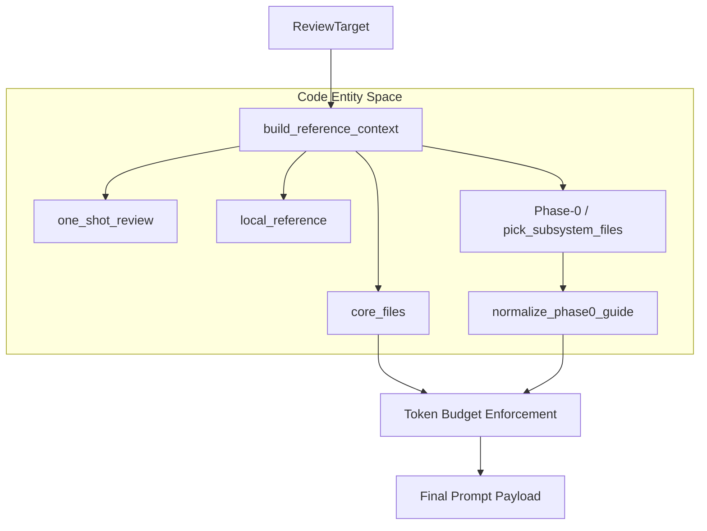
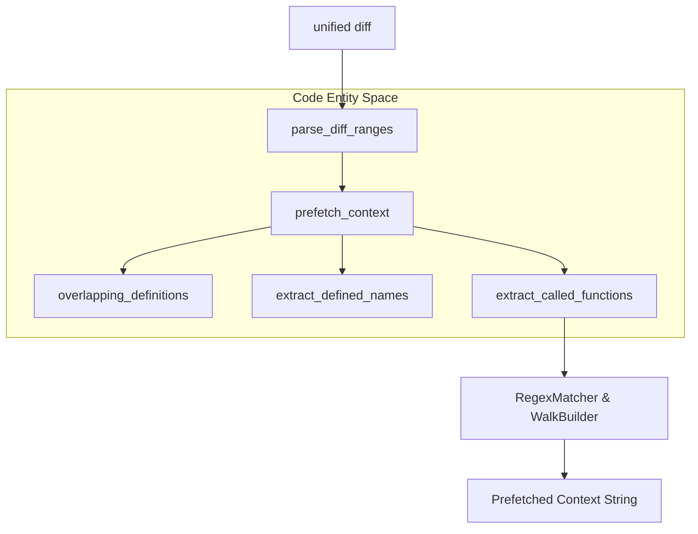
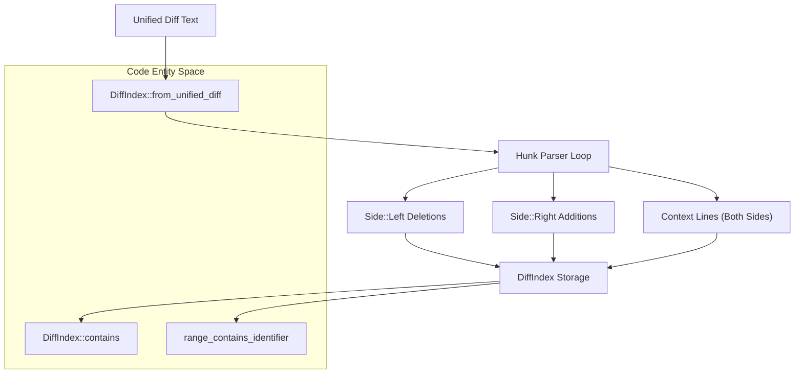

<!-- source: DeepWiki mcp.deepwiki.com · repo NVIDIA/boro · page 2.4 Context Assembly and Prefetch · fetched 2026-10-26 -->

# Context Assembly and Prefetch

Relevant source files

The following files were used as context for generating this wiki page:

- [resources/false-positive-digest.md](resources/false-positive-digest.md)
- [src/config.rs](src/config.rs)
- [src/diff_index.rs](src/diff_index.rs)
- [src/prefetch.rs](src/prefetch.rs)
- [src/prompts.rs](src/prompts.rs)
- [src/target/libvirt.rs](src/target/libvirt.rs)
- [src/target/virt_manager.rs](src/target/virt_manager.rs)

This page details the context assembly, phase-0 subsystem narrowing, source code prefetching (`prefetch.rs`), unified diff indexing (`diff_index.rs`), and false-positive filtering mechanisms used during the boro review pipeline. These mechanisms ensure that model prompts remain within strict token budgets while providing precise code definitions, core instructions, and domain-specific guardrails.

---

## 1. Context Assembly and Phase-0 Narrowing

Before sending a patch or commit chunk to a review stage, boro builds a comprehensive reference context via `build_reference_context` in `src/prompts.rs` [src/prompts.rs:61-181](). This function aggregates global instructions, core target patterns, subsystem-specific markdown documentation, and optional upstream follow-up summaries.

### Implementation Details

The context assembly proceeds in a deterministic sequence:
1. **One-Shot Instructions**: Appends the target-specific instruction block retrieved via `target::one_shot_review(target)` [src/prompts.rs:73-75]().
2. **Local References**: Appends local prompt overrides if present using `target::local_reference(target)` [src/prompts.rs:77-82]().
3. **Core Files**: Iterates over core files defined by the target specification (`target::core_files(target)`), reading each embedded prompt file up to a fractional token budget (`max_total / 4`) [src/prompts.rs:84-101]().
4. **Subsystem Narrowing (Phase 0 vs. Path Match)**:
   - If Phase 0 produced a selected list of subsystem guides (`phase0_selected`), boro treats it as authoritative and normalizes the paths using `normalize_phase0_guide` [src/prompts.rs:103-106, 130-144](). Locking documentation (`locking.md`) is excluded from duplicate Phase 0 picks because it is already loaded via core files [src/prompts.rs:135]().
   - If Phase 0 is disabled, fails, or returns an empty set, boro falls back to static path matching via `pick_subsystem_files`, scanning changed file paths against the target's subsystem map [src/prompts.rs:15-27, 107-128]().
5. **Upstream Follow-Up**: Appends optional follow-up summaries if they fit within the remaining token budget (`max_total`) [src/prompts.rs:166-178]().

*Sources: [src/prompts.rs:15-181](), [src/config.rs:40-62]()*

---

## 2. Source Code Prefetching (`prefetch.rs`)

To give specialist review stages adequate code context beyond the immediate patch hunks, boro implements a prefetch pipeline in `src/prefetch.rs` [src/prefetch.rs:30-120](). 

### Diff Parsing and Range Extraction

`parse_diff_ranges` parses incoming unified diff strings, extracting modified line ranges in the new file (0-based indices matching tree-sitter points) [src/prefetch.rs:30-34](). Adjacent or overlapping hunks within 10 lines of each other are merged so that functions split across hunks are fetched in a single pass [src/prefetch.rs:64-81]().

### Prefetch Pipeline Workflow

`prefetch_context` coordinates the retrieval of definitions and referenced symbols from the worktree:
1. **Overlapping Definitions**: Reads modified source files from the worktree and locates top-level C definitions overlapping changed hunks [src/prefetch.rs:93-114]().
2. **Symbol Extraction**: Extracts defined names and referenced types/functions using tree-sitter AST queries [src/prefetch.rs:115-119]().
3. **Repo-Wide Search**: Builds a regex matching strategy for unresolved symbols and runs a parallel walker (`ignore::WalkBuilder`) across the worktree to locate candidate definitions in caller directories and include paths [src/prefetch.rs:139-176]().

*Sources: [src/prefetch.rs:30-176]()*

---

## 3. Location Validation and Hunk Indexing (`diff_index.rs`)

Model-generated findings often reference file locations that may be misaligned or point to unrelated code. boro uses `DiffIndex` in `src/diff_index.rs` to validate all model-supplied line numbers against the actual patch text [src/diff_index.rs:3-14]().

### Hunk Indexing Semantics

`DiffIndex::from_unified_diff` processes unified diffs and indexes every hunk line [src/diff_index.rs:33-117]():
- **Additions**: Indexed under `Side::Right` using the new file line number [src/diff_index.rs:82-88]().
- **Deletions**: Indexed under `Side::Left` using the old file line number [src/diff_index.rs:89-95]().
- **Context Lines**: Indexed under **both** `Side::Right` (new line number) and `Side::Left` (old line number), matching viewer anchoring semantics [src/diff_index.rs:13-14, 96-108]().

### Validation Functions

- `contains(file, line, side)`: Returns `true` if the specified coordinate exists in the parsed diff index [src/diff_index.rs:119-121]().
- `range_contains_identifier(file, start, end, side, identifiers)`: Verifies whether at least one expected C identifier appears within the anchored line range, rejecting locations that are syntactically valid hunk coordinates but point at unrelated tokens [src/diff_index.rs:131-144]().

*Sources: [src/diff_index.rs:3-144]()*

---

## 4. False-Positive Digests and Guardrails

To suppress weak or speculative concerns before consolidation, boro injects target-specific false-positive digests (derived from `resources/false-positive-digest.md` and target variants) into specialist stage prompts [resources/false-positive-digest.md:1-129](), [src/target/virt_manager.rs:126-128](), [src/target/libvirt.rs:119-121]().

### Core Principle

> *If you cannot point to specific code in the diff that proves the issue, do not emit it.* [resources/false-positive-digest.md:12-13]()

### Key Guardrail Rules

1. **Defensive Programming Requests**: Bounds/NULL checks are dropped unless untrusted input reaches a dereference without validation [resources/false-positive-digest.md:17-25]().
2. **Locking Complaints**: Requires tracing 2–3 levels up the call chain to verify whether a documented caller (such as RCU-protected sections or `kn->active`) already holds the lock [resources/false-positive-digest.md:38-43]().
3. **Use-After-Free**: Only sequences matching `alloc → free → use` or `alloc → use → free → use` are valid findings [resources/false-positive-digest.md:45-50]().
4. **Fixed Old-Code Bugs**: Bugs present only in removed/old code that are fixed by the patch are classified as evidence of a fix, not review findings [resources/false-positive-digest.md:95-100]().
5. **Function-Like Macro Expansion**: Requires token-by-token expansion of macro bodies before reasoning about semantics or parameter matches [resources/false-positive-digest.md:111-118]().

---
*Sources: [resources/false-positive-digest.md:1-129](), [src/target/virt_manager.rs:126-128](), [src/target/libvirt.rs:119-121]()*

---

