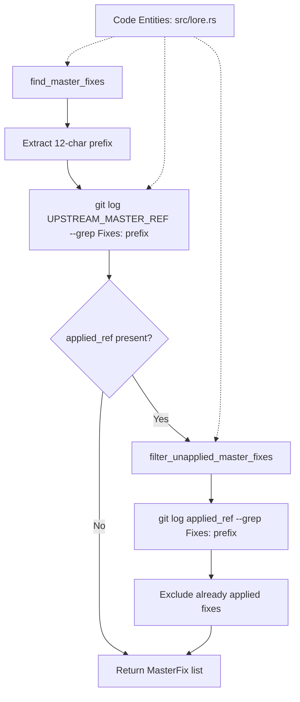
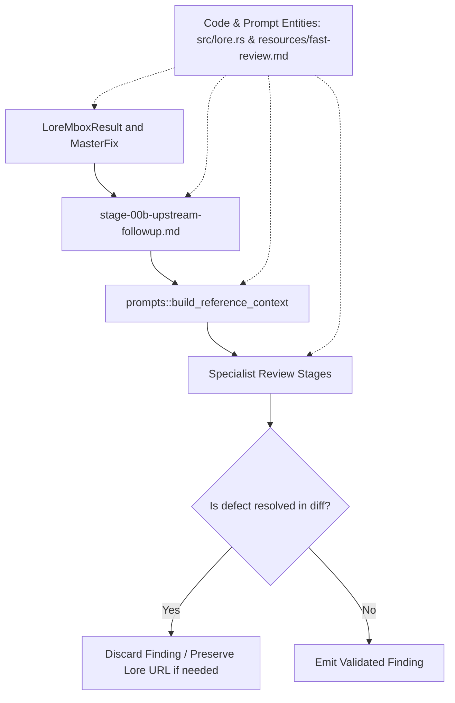

<!-- source: DeepWiki mcp.deepwiki.com · repo NVIDIA/boro · page 2.5 Upstream Follow-up (lore and Fixes:) · fetched 2026-10-26 -->

# Upstream Follow-up (lore and Fixes:)

<details>
<summary>Relevant source files</summary>

The following files were used as context for generating this wiki page:

- [resources/fast-review.md](resources/fast-review.md)
- [src/lore.rs](src/lore.rs)

</details>


The upstream follow-up subsystem in `boro` retrieves historical discussion, mailing list feedback (`lore`), and upstream repository `Fixes:` trailers related to patches under review. Implemented primarily in `src/lore.rs`, it executes stateless queries against public-inbox archives via `lei` and queries upstream Git repositories for backported or dependent fixes. This context flows into the agentic review pipeline to prevent duplicate reporting of known issues and to highlight unaddressed regressions or incomplete upstream fixes.

---

## 1. Lore Configuration and Environment Variables

The behavior of the follow-up retrieval engine is controlled by environment variables prefixed with `BORO_LORE_`, which are parsed into the `LoreConfig` configuration struct at runtime.

The `LoreConfig` struct defines four core operational parameters:
- `enabled`: Toggles whether lore queries are executed (default: `true`, overridden by `BORO_LORE_ENABLED`).
- `window`: The time window for public-inbox searches (default: `"1.year.ago.."`, overridden by `BORO_LORE_WINDOW`).
- `max_bytes`: The byte size ceiling for retrieved mboxes before truncation (default: `65536`, overridden by `BORO_LORE_MAX_BYTES`).
- `inbox_url`: The public-inbox endpoint URL (default: `"https://lore.kernel.org/all/"`, overridden by `BORO_LORE_INBOX_URL`).

```rust
pub struct LoreConfig {
    pub enabled: bool,
    pub window: String,
    pub max_bytes: usize,
    pub inbox_url: String,
}
```

These parameters are initialized via `LoreConfig::from_env()` which inspects the execution environment [src/lore.rs:60-88](). Boolean parsing handles standard negative representations (`"0"`, `"false"`, `"no"`, `""`), treating any other non-empty value as enabled.

Sources: `src/lore.rs:51-88`

---

## 2. Public-Inbox Queries via `lei`

`boro` performs a single deterministic, stateless `lei` query per commit without establishing persistent on-disk mirrors or invoking `lei add-external` [src/lore.rs:5-8](). 

The query searches for bare phrases matching the patch subject across the public-inbox index, capturing references such as `Fixes: <sha> ("<subject>")` tags in later patch bodies [src/lore.rs:6-8](). The resulting mbox output is processed into a `LoreMboxResult` container:

```rust
pub struct LoreMboxResult {
    pub mbox: String,
    pub hit_count: u32,
    pub query: String,
}
```

Retrieved mboxes undergo noisy header stripping and truncation to a maximum boundary governed by `LoreConfig::max_bytes` [src/lore.rs:42-43](). Truncation operates strictly on whole-message boundaries to prevent malformed email chunks from reaching prompt construction.

Sources: `src/lore.rs:3-13, 42-49`

---

## 3. Upstream Master `Fixes:` Traversal

Beyond mailing list discussions, `boro` queries upstream master repositories to identify whether subsequent commits have already introduced a `Fixes:` trailer targeting the commit under review [src/lore.rs:22-24]().

The default upstream repository URL is defined as `UPSTREAM_MASTER_BRANCH_URL`:
```rust
pub const UPSTREAM_MASTER_BRANCH_URL: &str =
    "git://git.kernel.org/pub/scm/linux/kernel/git/torvalds/linux.git";
```
This repository is fetched directly into transient `FETCH_HEAD` storage without modifying local remote configurations [src/lore.rs:22-28, 90-114]().

### Core Structs and Functions

- `MasterRepo`: Encapsulates the target repository path and an optional applied reference [src/lore.rs:29-33]().
- `MasterFix`: Represents an upstream commit that fixes the reviewed hash, containing its SHA, subject, and commit date [src/lore.rs:35-40]().
- `prepare_master_fetch()`: Executes `git fetch --no-tags` into `FETCH_HEAD` [src/lore.rs:92-114]().
- `find_master_fixes()`: Extracts the first 12 hex digits of the target SHA (following the kernel's canonical hash convention) and searches upstream commits using `git log --grep="Fixes: <prefix>"` [src/lore.rs:116-162]().
- `filter_unapplied_master_fixes()`: Cross-references discovered upstream fixes against the reviewed branch tip (`applied_ref`) to eliminate fixes already present in the local branch [src/lore.rs:164-193]().


*Diagram: Upstream Fixes Discovery and Filtering Flow*

Sources: `src/lore.rs:22-193`

---

## 4. Integration with Prompt Corpora and Review Rules

The structured output derived from `LoreMboxResult` and `MasterFix` entries is formatted into a textual summary. This rendered summary flows directly into `prompts::build_reference_context` to inform all downstream review stages [src/lore.rs:10-13]().

According to the fast review prompt specifications, upstream follow-up comments must be treated as historical evidence rather than mandatory findings [resources/fast-review.md:59-60]():

```markdown
Treat upstream follow-up comments as historical evidence, not as findings that
must be repeated. Independently verify every upstream concern against the
reviewed commit's new/right-side code and the complete series. If the current
code conclusively addresses the concern, including a requested revision or
test, do not emit it as a finding. Preserve the lore URL only when the defect
remains, the fix is incomplete, or the patch introduces a distinct bug.
```


*Diagram: Integration of Lore and Fixes Context into the Review Pipeline*

Sources: `src/lore.rs:10-13`, `resources/fast-review.md:59-70`

---

