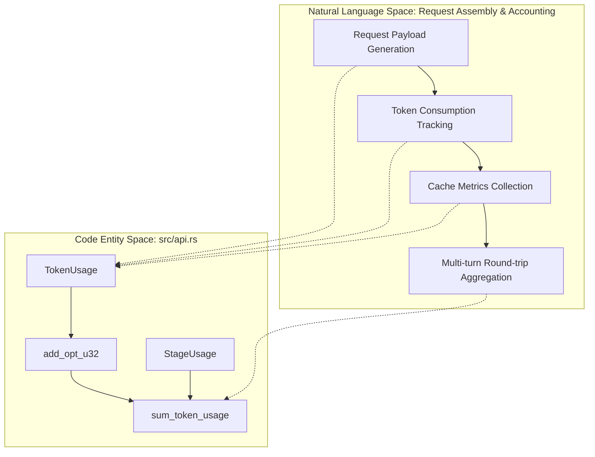
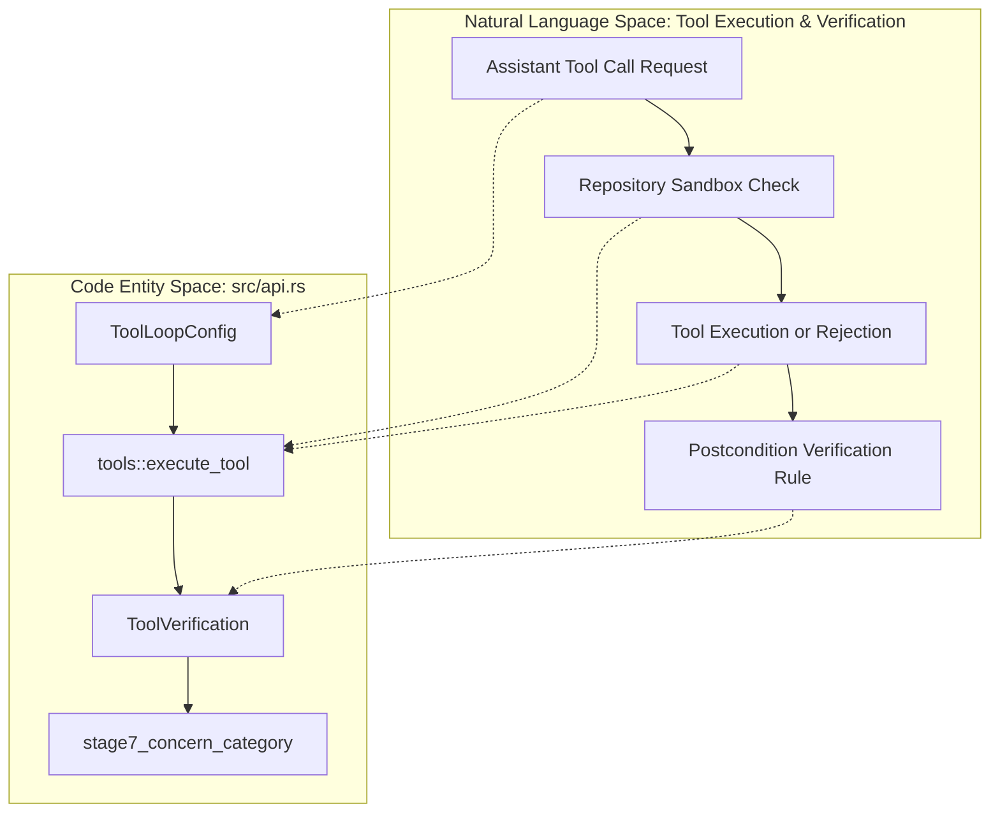

<!-- source: DeepWiki mcp.deepwiki.com · repo NVIDIA/boro · page 3.1 chat_completion, Streaming and Retries · fetched 2026-10-26 -->

# chat_completion, Streaming and Retries

<details>
<summary>Relevant source files</summary>

The following files were used as context for generating this wiki page:

- [src/api.rs](src/api.rs)

</details>


## Purpose and Scope

This page documents the inference and model interaction layer implemented in `src/api.rs`. It details request assembly, Server-Sent Events (SSE) streaming mechanics, parse-retry loops, token usage accounting, repository tool loop configurations, and HTTP error handling fallbacks utilized across review stages and command executions in `boro`.

---

## 1. Request Assembly and Token Accounting

The API layer manages the transmission of prompts and context to configured model backends (OpenAI-compatible endpoints or CLI subprocesses). Input and output token metrics are tracked through structured types that capture standard usage alongside provider-specific prompt caching statistics.

The base token usage data structure, `TokenUsage`, records prompt and completion counts along with Anthropic-style cache creation and read metrics [src/api.rs:47-60]():

```rust
#[derive(Clone, Copy, Default, Debug)]
pub struct TokenUsage {
    pub prompt: Option<u32>,
    pub completion: Option<u32>,
    pub cache_creation: Option<u32>,
    pub cache_read: Option<u32>,
}
```

Per-stage accounting aggregates these metrics alongside wall-clock duration and potential execution errors via `StageUsage` [src/api.rs:64-70]():

```rust
#[derive(Clone, Debug)]
pub struct StageUsage {
    pub step: &'static str,
    pub usage: TokenUsage,
    pub wall: Duration,
    pub error: Option<String>,
}
```

When multi-turn tool interactions or sequential round-trips occur within a single logical step, individual `TokenUsage` objects are summed using `sum_token_usage` [src/api.rs:104-121]():

```rust
pub fn sum_token_usage(usages: &[TokenUsage]) -> TokenUsage { ... }
```

### Request Assembly Architecture



Sources: `[src/api.rs:47-121]()`

---

## 2. Tool Loop Configuration and Verification

To support agentic review tasks, `chat_completion` can execute multiple POST requests involving tool calls under a unified spinner context. This behavior is governed by `ToolLoopConfig` and strict runtime verification rules [src/api.rs:130-153]():

```rust
pub struct ToolLoopConfig<'a> {
    pub repo: &'a Path,
    pub max_tool_iterations: u32,
    pub allow_edit_file: bool,
    pub verification: ToolVerification,
}

#[derive(Debug, Clone, Copy, PartialEq, Eq)]
pub enum ToolVerification {
    Optional,
    Stage7Linkage,
    SensitiveFindings,
    BaselineFalsePositiveProof,
    Stage7LinkageAndBaselineFalsePositiveProof,
    ValidationFindingsAndBaselineAdjudications,
}
```

The `ToolLoopConfig` restricts file modifications to the resolved git root of the target repository and enforces that write-capable tools like `edit_file` remain disabled unless explicitly permitted by specific workflows (such as the post-apply review stage).

### Tool Loop Integration



Sources: `[src/api.rs:130-161]()`

---

## 3. HTTP Error Fallbacks and Short Error Summarization

When backend API errors occur—such as non-2xx HTTP responses or 200 OK responses containing an OpenAI-style error body (`{"error": ...}`)—`boro` extracts and condenses the failure reason for progress reporting and human-readable stats tables.

The function `short_error_reason` inspects error causal chains to surface concise diagnostic summaries [src/api.rs:72-92]():

```rust
pub fn short_error_reason(e: &anyhow::Error) -> String {
    for cause in e.chain() {
        let s = cause.to_string();
        if s.contains("API error object:") {
            return s;
        }
        if s.contains("API error ") {
            return s.lines().next().unwrap_or(&s).to_string();
        }
    }
    e.to_string()
        .lines()
        .next()
        .unwrap_or("API error")
        .to_string()
}
```

This guarantees that downstream CLI reporting mechanisms receive clean, single-line summaries of rate limits, context overflows, or malformed payloads without multi-line stack trace pollution.

Sources: `[src/api.rs:72-92]()`

---

