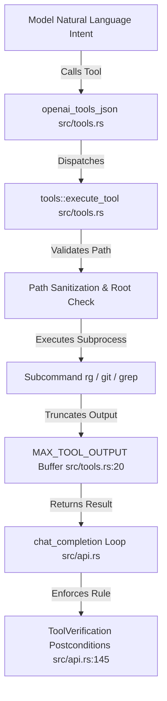
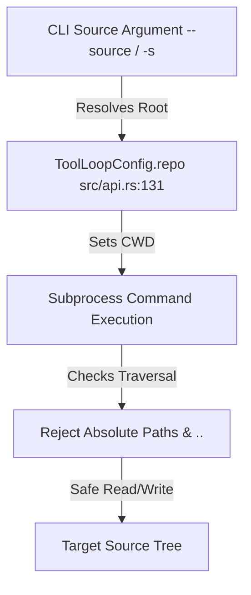

<!-- source: DeepWiki mcp.deepwiki.com · repo NVIDIA/boro · page 3.3 Repository Tool Loop · fetched 2026-10-26 -->

# Repository Tool Loop

<details>
<summary>Relevant source files</summary>

The following files were used as context for generating this wiki page:

- [src/api.rs](src/api.rs)
- [src/apply.rs](src/apply.rs)
- [src/output.rs](src/output.rs)
- [src/tools.rs](src/tools.rs)

</details>


## Purpose and Scope

The Repository Tool Loop provides the infrastructure for model-driven interactive exploration and modification of the target source tree during review and apply pipelines. It defines the available tool schemas (`grep_repo`, `read_files`, `read_symbol`, `git_*`, `rg`, `edit_file`), enforces strict workspace sandboxing relative to the repository root, bounds execution output, and implements output-dependent verification postconditions (`ToolVerification`) to guarantee that models ground their findings in actual code investigations.

Sources: `src/api.rs:130-154()`, `src/tools.rs:1-13()`

---

## Tool Definitions and OpenAI Tool Schemas

The model interacts with the codebase via structured tool calls defined by `tools::openai_tools_json` in `src/tools.rs`. The schema includes both read-only analysis tools and a conditional write-capable tool (`edit_file`).

### Available Tools
- `grep_repo`: Executes `git grep` within the repository root to locate symbols, identifiers, or patterns efficiently without reading entire files `[src/tools.rs:36-54]()`.
- `read_files`: Reads specific file segments or structural key-holes (`raw` or `smart` modes) within tight line boundaries `[src/tools.rs:55-80]()`.
- `read_symbol`: Extracts specific symbols, struct definitions, or function bodies.
- `git_blame`, `git_diff`, `git_show`, `run_git`: Subcommand wrappers that execute read-only git operations scoped to the repository root `[src/tools.rs:81-128]()`.
- `edit_file`: The sole write-capable tool, permitted only when explicitly enabled via configuration `[src/api.rs:136-138]()`, used during post-apply review and backport remediation `[src/apply.rs:60-65]()`.

Sources: `src/api.rs:130-144()`, `src/tools.rs:35-128()`

---

## Sandboxing and Workspace Security

All tools operate strictly within a single designated directory: the git checkout root resolved from the `--source` / `-s` command-line argument `[src/tools.rs:6-10]()`. 

### Sandboxing Guarantees
- **Path Resolution**: Relative paths are evaluated against the repository root. Absolute paths and parent directory traversal (`..`) are rejected.
- **Output Bunting**: Tool execution output is clipped to a maximum buffer size (`MAX_TOOL_OUTPUT`, default 24,000 bytes) to prevent prompt window exhaustion `[src/tools.rs:20]()`.
- **Process Isolation**: Git and search subprocesses (`rg`, `git`) execute with their current working directory explicitly set to the repository root, ensuring no escape outside the checkout.

Sources: `src/tools.rs:1-23()`

---

## Tool Loop Configuration and Execution

The execution orchestrator uses `ToolLoopConfig` to manage tool round-trips during a model request cycle `[src/api.rs:130-144()()`.

```
+-------------------------------------------------------+
|                    ToolLoopConfig                     |
|  - repo: &Path                                        |
|  - max_tool_iterations: u32                           |
|  - allow_edit_file: bool                              |
|  - verification: ToolVerification                     |
+-------------------------------------------------------+
                           |
                           v
+-------------------------------------------------------+
|                    chat_completion                    |
|  - Sends prompt + tools json to model                 |
|  - Captures tool_calls request                        |
+-------------------------------------------------------+
                           |
                           v
+-------------------------------------------------------+
|                   tools::execute_tool                 |
|  - Validates paths against repo root                  |
|  - Executes git/grep/read commands                    |
|  - Truncates output to MAX_TOOL_OUTPUT                |
+-------------------------------------------------------+
```

### Configuration Parameters (`ToolLoopConfig`)
- `repo`: The resolved `&Path` of the git root `[src/api.rs:131-135]()`.
- `max_tool_iterations`: The upper bound on assistant tool-calling round-trips per stage. Exceeding this limit drops tool definitions from subsequent requests `[src/api.rs:135-139]()`.
- `allow_edit_file`: A boolean gate controlling whether `edit_file` is advertised and executable. Defaults to `false`; enabled only during post-apply review steps `[src/api.rs:136-139()()`, `[src/apply.rs:60-65]()`.
- `verification`: An instance of `ToolVerification` defining mandatory postconditions `[src/api.rs:139-144]()`.

Sources: `src/api.rs:130-144()`, `src/tools.rs:1-23()`

---

## Tool Verification Postconditions

To prevent hallucinated findings or unverified claims, `ToolVerification` enforces runtime postconditions before model outputs are accepted.

```
+---------------------------------------------------------------+
|                      ToolVerification                         |
|  - Optional                                                   |
|  - Stage7Linkage                                              |
|  - SensitiveFindings                                          |
|  - BaselineFalsePositiveProof                                 |
|  - Stage7LinkageAndBaselineFalsePositiveProof                 |
|  - ValidationFindingsAndBaselineAdjudications                 |
+---------------------------------------------------------------+
                           |
                           v
+---------------------------------------------------------------+
|                    Postcondition Check                        |
|  - Verifies at least one repository tool executed             |
|  - Validates symbol linkage against target tree               |
|  - Rejects ungrounded critical findings                       |
+---------------------------------------------------------------+
```

### Verification Modes (`ToolVerification`)
- `Optional`: No tool execution required prior to returning findings `[src/api.rs:146]()`.
- `Stage7Linkage`: Requires hardware or configuration linkage checks to be backed by repository tool queries `[src/api.rs:147-150]()`.
- `SensitiveFindings`: Enforces tool verification for high-severity or sensitive reports.
- `BaselineFalsePositiveProof`: Mandates that claims regarding false positives in baselines are backed by explicit code inspections.
- `Stage7LinkageAndBaselineFalsePositiveProof`: Combines linkage and false-positive verification rules `[src/api.rs:151-152]()`.
- `ValidationFindingsAndBaselineAdjudications`: Enforces rigorous tool confirmation during validation and adjudication phases `[src/api.rs:153-154]()`.

Sources: `src/api.rs:145-154()`

---

## Code-to-Natural-Language Bridge

The following diagram maps the natural language intent of a model requesting repository exploration to the concrete internal Rust types and execution functions in `src/tools.rs` and `src/api.rs`.

Diagram: "ToolLoopExecutionMapping"

Sources: `src/api.rs:130-154()`, `src/tools.rs:20-128()`

Diagram: "WorkspaceSandboxArchitecture"

Sources: `src/api.rs:130-135()`, `src/tools.rs:1-13()`

---

