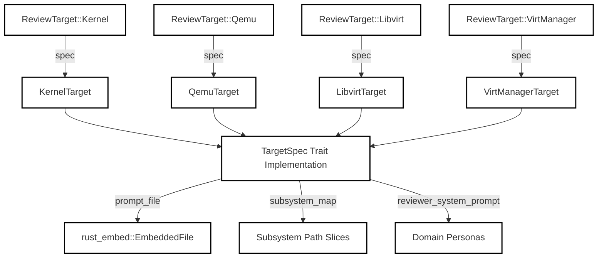
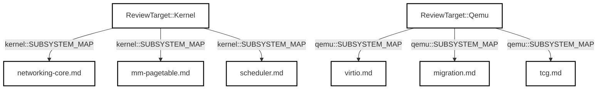
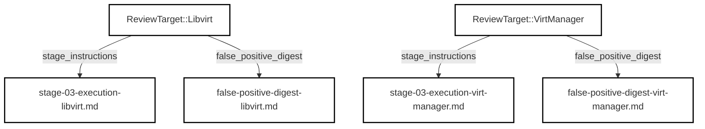

<!-- source: DeepWiki mcp.deepwiki.com · repo NVIDIA/boro · page 4 Targets and Prompt Corpora · fetched 2026-10-26 -->

# Targets and Prompt Corpora

Relevant source files

The following files were used as context for generating this wiki page:

- [src/config.rs](src/config.rs)
- [src/prompts.rs](src/prompts.rs)
- [src/target.rs](src/target.rs)
- [src/target/kernel.rs](src/target/kernel.rs)
- [src/target/libvirt.rs](src/target/libvirt.rs)
- [src/target/qemu.rs](src/target/qemu.rs)
- [src/target/virt_manager.rs](src/target/virt_manager.rs)

The purpose of this section is to provide an overview of how `boro` abstracts different review domains through the `TargetSpec` trait and embeds target-specific markdown prompt corpora. Every review target (`Kernel`, `Qemu`, `Libvirt`, and `VirtManager`) bundles its own subsystem mappings, core prompt files, system prompts, and local reference material directly into the compiled binary via `rust_embed`.

For detailed coverage of trait contracts, subsystem maps, and stage overrides, refer to the child pages linked below:
- [TargetSpec Trait and Dispatch](#4.1) — Trait contract, dispatch functions, `rust_embed` corpora, and local prompt overrides.
- [Kernel and QEMU Targets](#4.2) — Kernel/QEMU subsystem maps, core files, and subsystem guides.
- [libvirt and virt-manager Targets](#4.3) — libvirt/virt-manager subsystem maps, stage overrides, and false-positive digests.

---

## 4.1 TargetSpec Trait and Dispatch

The `TargetSpec` trait defines the contract that all review targets must implement, standardizing how `boro` retrieves prompt files, subsystem maps, core files, and specialized system prompts [src/target.rs:13-53](). The central dispatch mechanism uses the `ReviewTarget` enum to route calls from generic pipeline code to the appropriate target implementation [src/target.rs:55-62]().

*Figure 4.1: Dispatch architecture bridging CLI target selection to concrete `TargetSpec` trait implementations.*

Sources: `[src/target.rs:13-62](), [src/config.rs:40-62]()`

For deep technical details on the trait contract, dispatch functions, `rust_embed` integration, and local prompt overrides, see [TargetSpec Trait and Dispatch](#4.1).

---

## 4.2 Kernel and QEMU Targets

The Linux kernel and QEMU targets represent complex C codebases with extensive subsystem categorization. `KernelTarget` uses a comprehensive subsystem map generated from upstream metadata [src/target/kernel.rs:22-102](), while `QemuTarget` manages virtual machine emulation subsystems such as `virtio`, `block`, `pci`, `migration`, and `accel/kvm` [src/target/qemu.rs:21-45]().

*Figure 4.2: Mapping file paths to target-specific subsystem markdown corpora for kernel and QEMU review workflows.*

Sources: `[src/target/kernel.rs:22-102](), [src/target/qemu.rs:21-45]()`

For detailed subsystem maps, core files, and guide references under `resources/prompts/kernel` and `qemu`, see [Kernel and QEMU Targets](#4.2).

---

## 4.3 libvirt and virt-manager Targets

User-space virtualization management components—`libvirt` (daemon and C library) and `virt-manager` / `virtinst` (Python/GTK GUI)—require specialized review rules. Unlike the kernel target, these targets override default specialist stage instructions and false-positive digests to account for Python concurrency, GTK thread safety, libvirt RPC protocols, and domain XML generation [src/target/libvirt.rs:115-134](), [src/target/virt_manager.rs:122-140]().

*Figure 4.3: Target-specific stage instructions and false-positive digest overrides for libvirt and virt-manager.*

Sources: `[src/target/libvirt.rs:115-134](), [src/target/virt_manager.rs:122-140]()`

For full details on subsystem maps, stage overrides, and false-positive digests for libvirt and virt-manager, see [libvirt and virt-manager Targets](#4.3).

---

