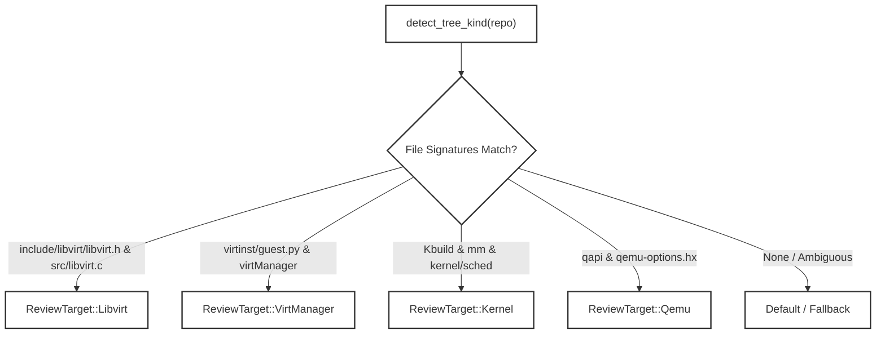
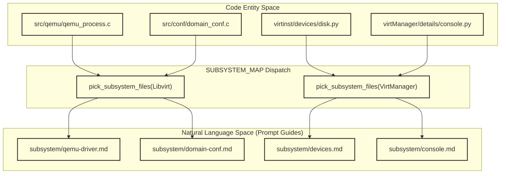

<!-- source: DeepWiki mcp.deepwiki.com · repo NVIDIA/boro · page 4.3 libvirt and virt-manager Targets · fetched 2026-10-26 -->

# libvirt and virt-manager Targets

<details>
<summary>Relevant source files</summary>

The following files were used as context for generating this wiki page:

- [resources/one-shot-review-libvirt.md](resources/one-shot-review-libvirt.md)
- [resources/one-shot-review-virt-manager.md](resources/one-shot-review-virt-manager.md)
- [resources/prompts/libvirt/subsystem/subsystem.md](resources/prompts/libvirt/subsystem/subsystem.md)
- [resources/prompts/virt-manager/subsystem/subsystem.md](resources/prompts/virt-manager/subsystem/subsystem.md)
- [src/config.rs](src/config.rs)
- [src/prompts.rs](src/prompts.rs)
- [src/target/libvirt.rs](src/target/libvirt.rs)
- [src/target/virt_manager.rs](src/target/virt_manager.rs)

</details>


This page details the implementation, subsystem mapping, stage overrides, and false-positive handling for the `libvirt` and `virt-manager` review targets within `boro`. While `boro` originally targeted the Linux kernel, its `TargetSpec` abstraction enables support for userspace virtualization targets written in C (`libvirt`) and Python (`virt-manager` / `virtinst`), tailoring system prompts, subsystem heuristics, and stage instructions accordingly.

---

## 1. Target Specification and Tree Detection

The target review domain is determined by the `ReviewTarget` enum, which identifies whether a repository is evaluated as a Linux kernel, QEMU, libvirt, or virt-manager project [src/config.rs:40-52](). 

Automatic repository classification is performed by `detect_tree_kind`, which checks for unambiguous signature files within the repository root without guessing when ambiguous [src/config.rs:69-83](). For `libvirt`, it verifies the presence of `include/libvirt/libvirt.h`, `libvirt.spec.in`, and `src/libvirt.c` [src/config.rs:73-74](). For `virt-manager`, it validates the existence of `virtinst`, `virtManager`, and `virtinst/guest.py` [src/config.rs:75]().


*Sources: [src/config.rs:40-83]()*

---

## 2. Subsystem Mappings (`SUBSYSTEM_MAP`)

Both `LibvirtTarget` [src/target/libvirt.rs:21-44]() and `VirtManagerTarget` [src/target/virt_manager.rs:21-50]() define static subsystem mapping arrays (`SUBSYSTEM_MAP`) that associate source file path prefixes with specific markdown subsystem guides stored under `resources/prompts/libvirt/` and `resources/prompts/virt-manager/`.

During context assembly, `pick_subsystem_files` iterates over changed file paths, matches them against target-specific prefixes, and selects relevant subsystem markdown guides [src/prompts.rs:15-27]().


*Sources: [src/prompts.rs:15-27](), [src/target/libvirt.rs:21-44](), [src/target/virt_manager.rs:21-50]()*

### Subsystem Mapping Summary Tables

| Target | Path Prefix | Subsystem Guide | Core Focus |
| :--- | :--- | :--- | :--- |
| **Libvirt** | `src/qemu/` | `qemu-driver.md` | QEMU driver lifecycle, process management, QMP communication |
| **Libvirt** | `src/conf/` | `domain-conf.md` | Domain, network, and storage XML configuration parsing and formatting |
| **Libvirt** | `src/rpc/`, `src/remote/` | `rpc.md` | XDR decoding, NetServer client dispatch, RPC protocol versioning |
| **Libvirt** | `src/security/` | `security.md` | SELinux, AppArmor, DAC security managers and isolation |
| **Virt-Manager** | `virtinst/devices/` | `devices.md` | Disk, interface, controller, and hostdev device model definitions |
| **Virt-Manager** | `virtinst/guest.py` | `guest.md` | Guest lifecycle, capabilities discovery, and installer logic |
| **Virt-Manager** | `virtManager/baseclass.py` | `threading.md` | `vmmGObject`, background async jobs, thread-safety, `idle_add` |
| **Virt-Manager** | `virtManager/details/` | `ui.md` | GTK widget interactions, dialog windows, connection state management |

*Sources: [src/target/libvirt.rs:21-44](), [src/target/virt_manager.rs:21-50]()*

---

## 3. Core Files and Stage Overrides

In addition to dynamic subsystem guide selection, every review target specifies a set of `CORE_FILES` that are always included in the reference context (subject to context size budgets) [src/prompts.rs:84-101](). For both `libvirt` and `virt-manager`, core files include:
* `technical-patterns.md` [src/target/libvirt.rs:47](), [src/target/virt_manager.rs:53]()
* `callstack.md` [src/target/libvirt.rs:48](), [src/target/virt_manager.rs:54]()
* `subsystem/locking.md` [src/target/libvirt.rs:49](), [src/target/virt_manager.rs:55]()
* `coding-style.md` [src/target/libvirt.rs:50](), [src/target/virt_manager.rs:56]()

### Specialist Stage Instruction Overrides

Stages 3 through 8 load specialist instruction files tailored to the target language and architecture. `LibvirtTarget` provides C-specific instructions focusing on `virObject` refcount balance, `virDomainObjBeginJob`, and `goto cleanup;` error handling [resources/one-shot-review-libvirt.md:1-69](), whereas `VirtManagerTarget` provides Python/GTK instructions targeting `None` safety, garbage collection, and main-thread UI confinement [resources/one-shot-review-virt-manager.md:1-58]().

```rust
// Example implementation pattern in TargetSpec trait for libvirt/virt-manager stage overrides
fn stage_instructions(&self, stage: u8) -> Option<&'static str> {
    Some(match stage {
        3 => include_str!("../../resources/stage-03-execution-libvirt.md"),
        4 => include_str!("../../resources/stage-04-resource-libvirt.md"),
        5 => include_str!("../../resources/stage-05-locking-libvirt.md"),
        6 => include_str!("../../resources/stage-06-security-libvirt.md"),
        7 => include_str!("../../resources/stage-07-portability-libvirt.md"),
        8 => include_str!("../../resources/stage-08-comment-accuracy-libvirt.md"),
        _ => return None,
    })
}
```
*Sources: [src/target/libvirt.rs:123-133](), [src/target/virt_manager.rs:130-140]()*

---

## 4. False-Positive Digests and Domain-Specific Verification

Both targets embed target-specific false-positive digests (`false_positive_digest`) via `TargetSpec` [src/target/libvirt.rs:119-121](), [src/target/virt_manager.rs:126-128](). These digests guide the validation and adjudication phases to prevent common spurious findings:

1. **Libvirt False-Positive Avoidance**:
   * Flagging internal GLib memory management patterns or standard `virObject` unref cascades as memory leaks.
   * Treating standard macro-based configuration guards (`WITH_QEMU`, `WITH_LIBXL`) as missing dependency inclusions when build configurations guarantee inclusion.
   * Misinterpreting XDR struct padding or bitfield alignments as buffer overflows.

2. **Virt-Manager False-Positive Avoidance**:
   * Reporting pure-Python circular references as unmanaged resource leaks (handled by CPython's garbage collector).
   * Flagging background thread workers that correctly marshal updates via `GLib.idle_add` as GTK thread-safety violations.
   * Raising `None` safety alerts on attributes guaranteed to be initialized by `XMLBuilder` base classes.

*Sources: [src/target/libvirt.rs:119-121](), [src/target/virt_manager.rs:126-128](), [src/prompts.rs:61-181]()*

---

