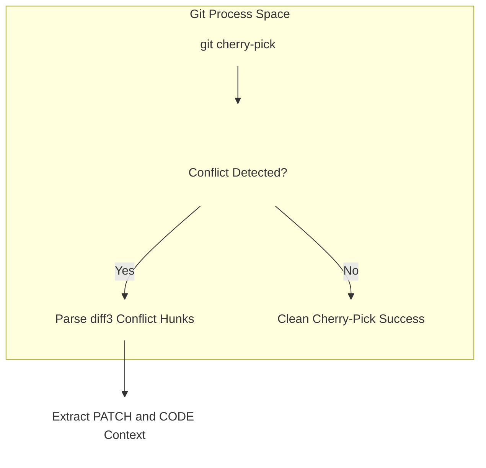
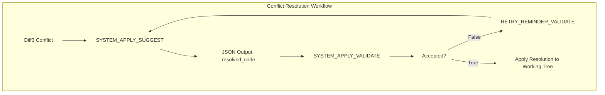
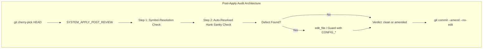

<!-- source: DeepWiki mcp.deepwiki.com · repo NVIDIA/boro · page 5.1 Patch Apply and Conflict Resolution · fetched 2026-10-26 -->

# Patch Apply and Conflict Resolution

<details>
<summary>Relevant source files</summary>

The following files were used as context for generating this wiki page:

- [src/apply.rs](src/apply.rs)
- [src/output.rs](src/output.rs)
- [src/tools.rs](src/tools.rs)

</details>


## Purpose and Scope

Section 5.1 of the `boro` wiki covers non-review apply commands, focusing on backporting code into target repositories via `git cherry-pick`, handling `diff3` merge conflicts, executing LLM-driven suggest-and-validate loops for conflict resolution, and performing rigorous post-apply audits (static checks and backport gap analysis). 

The primary implementation logic resides in `src/apply.rs` [src/apply.rs:1-95]() alongside the sandboxed tool infrastructure defined in `src/tools.rs` [src/tools.rs:1-128]().

---

## Cherry-Pick Execution and Conflict Detection

When `boro` applies an upstream commit via backport commands, it executes a standard git operation (`git cherry-pick`) inside the target tree [src/apply.rs:60-60](). If the commit applies cleanly, the tree advances. However, if code divergence causes a merge conflict, `boro` intercepts the `diff3`-style conflict hunks to parse out the common base, incoming patch changes (`PATCH`), and target tree local state (`CODE`) [src/apply.rs:20-39]().


Sources: [src/apply.rs:20-39]()

---

## Suggest and Validate Loop for Conflicts

When a `diff3` conflict arises, `boro` invokes an iterative LLM loop governed by strict prompt instructions and JSON schema constraints. The resolution process splits into two distinct agent roles: the **Suggest** pass and the **Validate** pass.

### Suggestion Phase (`SYSTEM_APPLY_SUGGEST`)
The suggestion engine uses `SYSTEM_APPLY_SUGGEST` [src/apply.rs:20-39]() to ingest the incoming `PATCH` and local `CODE`. It must preserve target-tree-only adaptations, maintain precise indentation/coding styles (such as leading tabs `\t` escaping [src/apply.rs:30-31]()), respect vertical whitespace guidelines [src/apply.rs:33-36](), and omit conflict markers [src/apply.rs:37-37](). The output must conform strictly to JSON:

```json
{"resolved_code":"string","explanation":"string"}
```

If the model response fails JSON parsing, `RETRY_REMINDER_SUGGEST` [src/apply.rs:50-53]() is fed back into the model loop.

### Validation Phase (`SYSTEM_APPLY_VALIDATE`)
The proposed resolution is immediately evaluated by a separate maintainer validation prompt (`SYSTEM_APPLY_VALIDATE`) [src/apply.rs:41-48](). The validator inspects whether the resolved code correctly applies the patch intent without dropping vendor adaptations, inventing unrelated logic, or introducing style/indentation regressions [src/apply.rs:44-46](). It responds with a strict JSON structure:

```json
{"accepted":true|false,"reason":"string","concerns":["string"]}
```

If rejected, `RETRY_REMINDER_VALIDATE` [src/apply.rs:55-58]() prompts the model to correct its output format or reasoning.


Sources: [src/apply.rs:20-58]()

---

## Post-Apply Audit and Static Checks

Once a commit is successfully cherry-picked (either cleanly or via resolved conflict hunks), `boro` runs a mandatory post-apply audit using `SYSTEM_APPLY_POST_REVIEW` [src/apply.rs:60-61](). This audit guards against **Backport Gaps**—instances where an upstream patch references a struct field, function, type, macro, or enum value that exists upstream but has not yet been backported to the target tree [src/apply.rs:64-65]().

### Step 1: Mandatory Symbol-Resolution Check
The auditor scans every `+` line in the diff to ensure symbols exist in the target tree at `HEAD` [src/apply.rs:66-67]():
- **Field Access (`expr->FIELD` / `expr.FIELD`)**: Verifies the struct type and checks that the field exists in its definition file via `read_symbol` or `grep_repo` [src/apply.rs:68-68]().
- **Function Calls (`FUNC(...)`)**: Verifies function prototypes or definitions exist using `grep_repo` with `fixed_string=true` [src/apply.rs:69-69]().
- **Types, Macros, and Enums**: Confirms declarations, macros, and enum values exist in target headers/sources [src/apply.rs:70-71]().

If a backport gap is discovered, the model must either fix it via `edit_file` (e.g., removing unneeded instrumentation, adapting fields, or guarding with `#ifdef CONFIG_*` blocks) or return `needs_human` [src/apply.rs:73-78]().

### Step 2: Auto-Resolved Hunk Sanity Check
For hunks handled by conflict resolution, the auditor inspects adjacent callers to ensure the logic remains coherent and that target-tree-specific code (such as vendor adaptations or debug hooks) was not inadvertently dropped [src/apply.rs:82-82]().

### Finalization
Once the post-review concludes with a `"clean"` or `"amended"` verdict, the host validates `git status --porcelain`, stages tracked modifications, and executes `git commit --amend --no-edit` [src/apply.rs:90-90]().


Sources: [src/apply.rs:60-94]()

---

## Sandboxed Tool Integration During Apply

During the post-apply review and conflict resolution loops, the agent utilizes a sandboxed set of read-only navigation tools alongside a single write-capable tool (`edit_file`) [src/apply.rs:60-62](). These tools are implemented in `src/tools.rs` and restricted to the repository root directory specified by `--source` / `-s` [src/tools.rs:6-13]().

| Tool Name | Role in Apply/Audit | Source Implementation |
| :--- | :--- | :--- |
| `grep_repo` | Locates symbols, identifiers, or struct definitions across the target tree. | `[src/tools.rs:41-53]()` |
| `read_files` | Fetches specific file segments or key-hole summaries (`smart` mode). | `[src/tools.rs:58-79]()` |
| `read_symbol` | Inspects exact struct or function boundaries within a file. | `[src/tools.rs:1-128]()` |
| `git_diff` / `git_show` | Inspects patch context and diff hunks. | `[src/tools.rs:100-128]()` |
| `edit_file` | Gated write tool used to fix backport gaps or syntax errors. | `[src/tools.rs:1-128]()` |

Sources: [src/apply.rs:60-62](), [src/tools.rs:35-128]()

---

