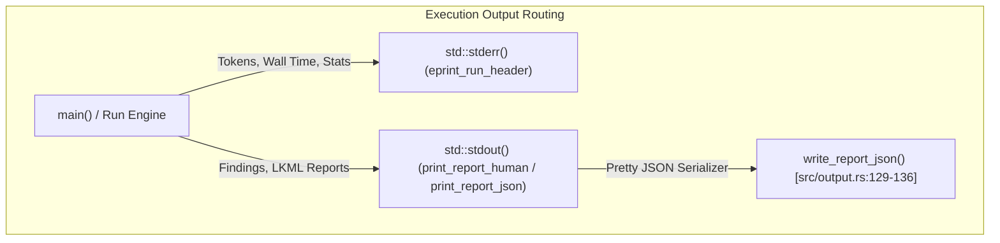
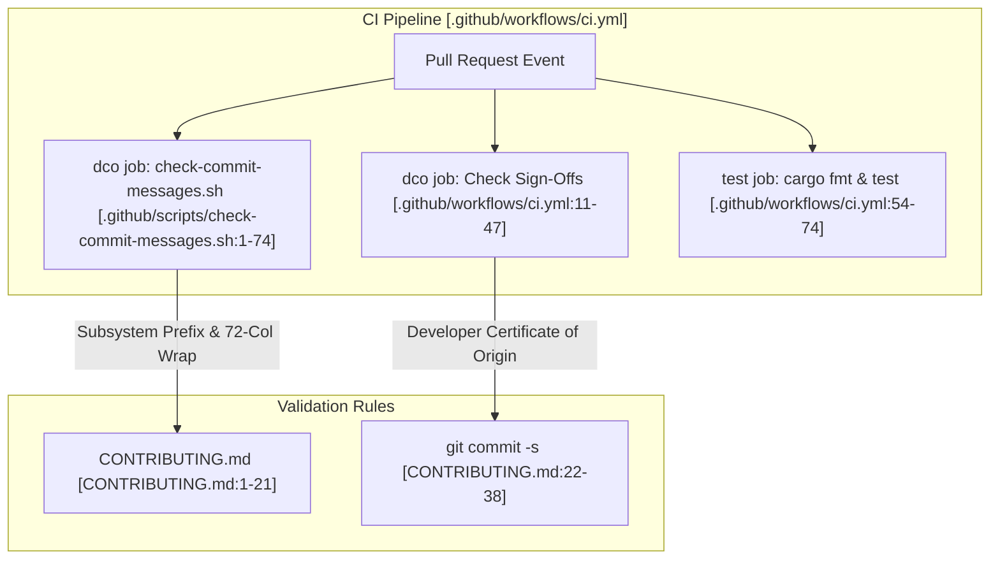

<!-- source: DeepWiki mcp.deepwiki.com · repo NVIDIA/boro · page 6 Output, Progress and Developer Tooling · fetched 2026-10-26 -->

# Output, Progress and Developer Tooling

Relevant source files

The following files were used as context for generating this wiki page:

- [.github/scripts/check-commit-messages.sh](.github/scripts/check-commit-messages.sh)
- [.github/scripts/test-check-commit-messages.sh](.github/scripts/test-check-commit-messages.sh)
- [.github/workflows/ci.yml](.github/workflows/ci.yml)
- [CONTRIBUTING.md](CONTRIBUTING.md)
- [src/apply.rs](src/apply.rs)
- [src/output.rs](src/output.rs)
- [src/tools.rs](src/tools.rs)

## Purpose and Scope

This page provides a high-level overview of reporting mechanisms, user interface output routing, and developer tooling in `boro`. The system separates model-derived findings from run-wide execution statistics, streaming diagnostic counters and timing data to `stderr` while keeping structured review output on `stdout` for downstream agent consumption [src/output.rs:3-8](). Repository-level automation, continuous integration workflows, and commit validation scripts enforce project contribution standards.

For granular technical details, see the child pages:
- [Reporting and Progress UI](#6.1)
- [CI, Contributing and Scripts](#6.2)

---

## 6.1 Reporting and Progress UI

`boro` structures its output channels to decouple human-readable progress indicators and usage telemetry from machine-parseable analysis results. The `output` module uses custom macros like `pln!` to direct execution metrics and token accounting to `stderr`, protecting `stdout` streams from noise so that findings and LKML-style reports can be cleanly piped into other agents [src/output.rs:3-33]().

*Sources: [src/output.rs:3-142]()*.

JSON reporting formats are managed via `write_report_json` and `print_report_json`, ensuring stable serialization of underlying `serde_json::Value` objects while gracefully handling broken pipe signals [src/output.rs:129-142](). For detailed coverage of human-readable rendering, snapshot states, and interactive worker status lines, refer to [Reporting and Progress UI](#6.1).

*Sources: [src/output.rs:3-142]()*.

---

## 6.2 CI, Contributing and Scripts

Development workflows, pull requests, and commit verification are governed by automated continuous integration jobs defined in GitHub Actions [.github/workflows/ci.yml:1-73]() and companion shell scripts [.github/scripts/check-commit-messages.sh:1-73](). 

*Sources: [.github/workflows/ci.yml:1-73](), [.github/scripts/check-commit-messages.sh:1-73](), [CONTRIBUTING.md:1-38]*().

The CI pipeline enforces strict commit message formatting (requiring lowercase subsystem prefixes like `subsystem: Description` and prohibiting conventional-commit style subjects) alongside 72-column prose wrapping constraints [.github/scripts/check-commit-messages.sh:17-69](). These checks are unit-tested locally via `.github/scripts/test-check-commit-messages.sh` [.github/scripts/test-check-commit-messages.sh:1-106]() and documented under `CONTRIBUTING.md` [CONTRIBUTING.md:1-70](). For a complete overview of repository scripts and contribution rules, refer to [CI, Contributing and Scripts](#6.2).

*Sources: [.github/workflows/ci.yml:1-73](), [.github/scripts/check-commit-messages.sh:1-73](), [.github/scripts/test-check-commit-messages.sh:1-106](), [CONTRIBUTING.md:1-70]().*

---

