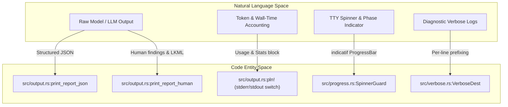
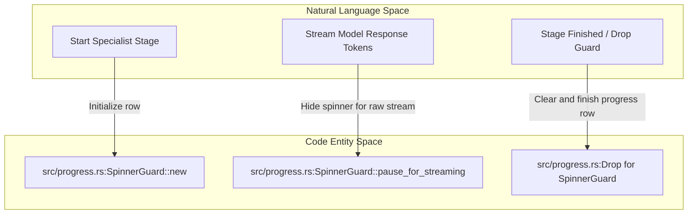

<!-- source: DeepWiki mcp.deepwiki.com · repo NVIDIA/boro · page 6.1 Reporting and Progress UI · fetched 2026-10-26 -->

# Reporting and Progress UI

<details>
<summary>Relevant source files</summary>

The following files were used as context for generating this wiki page:

- [src/apply.rs](src/apply.rs)
- [src/output.rs](src/output.rs)
- [src/progress.rs](src/progress.rs)
- [src/tools.rs](src/tools.rs)
- [src/verbose.rs](src/verbose.rs)

</details>


## Purpose and Scope
This page details the implementation of output rendering, token and wall-time accounting, interactive progress bars, and verbose diagnostics in `boro`. The reporting architecture strictly segregates data streams: `stdout` is reserved exclusively for structured model output (such as JSON reports or clean, pipeable findings/LKML blocks), while `stderr` handles usage statistics, progress spinners, live streaming tokens, and diagnostic logs [src/output.rs:3-8](). 

---

## Human and JSON Report Rendering
The output formatting logic is implemented in `src/output.rs`. `boro` supports both human-readable terminal rendering via `print_report_human` and structured serialization via `write_report_json` / `print_report_json` [src/output.rs:101-142]().

### Stream Separation via Macros
To support writing the `Usage & stats` block to `stderr` while writing findings and LKML reports to `stdout`, `src/output.rs` defines a custom `pln!` macro that conditionally targets `eprintln!` or `println!` based on an boolean error flag [src/output.rs:15-33]. 

ANSI styling is handled using the `paint!` macro, wrapping `owo_colors` styling chains to bypass Higher-Rank Trait Bound (HRTB) lifetime inference constraints on closures [src/output.rs:35-50].

```rust
macro_rules! pln {
    ($err:expr, $($arg:tt)*) => {
        if $err {
            eprintln!($($arg)*)
        } else {
            println!($($arg)*)
        }
    };
}
```

### Report Sections
1. **Run Header (`eprint_run_header`)**: Emits range, main model, and optional validation/fast models to `stderr` prior to review execution [src/output.rs:69-99].
2. **Usage & Stats Block (`print_stats_block`)**: Renders run-wide token usage (prompt, completion, cache read/write) and wall-clock duration to `stderr` [src/output.rs:152-189].
3. **Quick Summary & Findings Blocks**: Iterates over commits, pulling validated findings (`validated_findings[]`) or raw analysis outputs depending on the active validation mode (`off`, `filter`, or `findings`) [src/output.rs:101-127].
4. **LKML Reports**: Renders maintainer-ready patch review summaries unless suppressed by strict findings-only modes [src/output.rs:124-126].

Sources: `[src/output.rs:3-189]()`

---

## Progress UI and Spinners (`src/progress.rs`)
Interactive progress and TTY status rendering are managed by `src/progress.rs` utilizing the `indicatif` crate [src/progress.rs:13-16]. 

### Spinners and Stream Guards
- **`SpinnerGuard`**: Wraps a single `ProgressBar` configured with a custom spinner template (`{spinner:.cyan} {msg} {elapsed:.dim}`) [src/progress.rs:21-79]. When `stderr` is not an interactive terminal (e.g., in CI or piped scripts), spinners automatically no-op [src/progress.rs:70-71].
- **`ProgressStreamGuard`**: Pauses or hides progress bars temporarily when raw model responses stream directly to `stderr` via verbose flags, preventing rendering corruption [src/progress.rs:23-64, 100-111].
- **`MultiPatchSpinner`**: Manages multi-commit concurrent runs using `MultiProgress`, allocating one row per commit while keeping a unified totals footer [src/progress.rs:9-12].

### Phase Tagging
Worker status changes are decorated using `phase_tag`, which applies conditional ANSI coloring based on the state string (e.g., cyan for `thinking`, green for `responding`, yellow for `tool` executions, and dim for initialization) [src/progress.rs:146-159].

Sources: `[src/progress.rs:3-159]()`

---

## Verbose Output and Streaming (`src/verbose.rs`)
Runtime display preferences are encapsulated within the `VerboseDest` struct [src/verbose.rs:5-15]. 

```rust
pub struct VerboseDest {
    pub stderr: bool,
    stream_model_responses: bool,
    line_prefix: String,
}
```

- **Model Streaming**: When `stream_model_responses` is enabled, tokens arrive chunk-by-chunk and stream directly to `stderr` [src/verbose.rs:11-12].
- **Diagnostic Logging**: The `line` method emits prefixed diagnostic lines (defaulting to `[boro]`) when `stderr` logging is active [src/verbose.rs:22-56].

Sources: `[src/verbose.rs:5-57]()`

---

## Architecture and Data Flow

### Diagram: Output Stream Routing
The following diagram maps high-level reporting concepts to their corresponding code entities in `src/output.rs`, `src/progress.rs`, and `src/verbose.rs`.


Sources: `[src/output.rs:101-142](), [src/progress.rs:66-79](), [src/verbose.rs:5-57]()`

### Diagram: Progress and Stream Guard Lifecycle
This diagram illustrates the control flow between active task execution, stream pausing, and terminal restoration during interactive reviews.


Sources: `[src/progress.rs:68-118]()`

---

