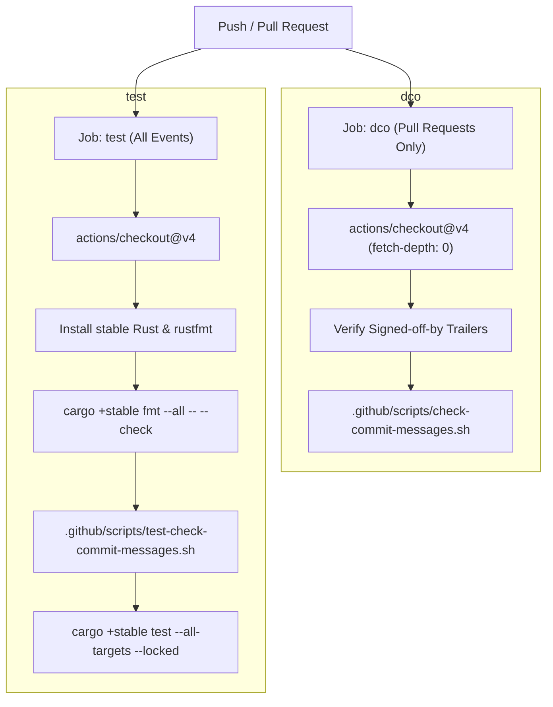
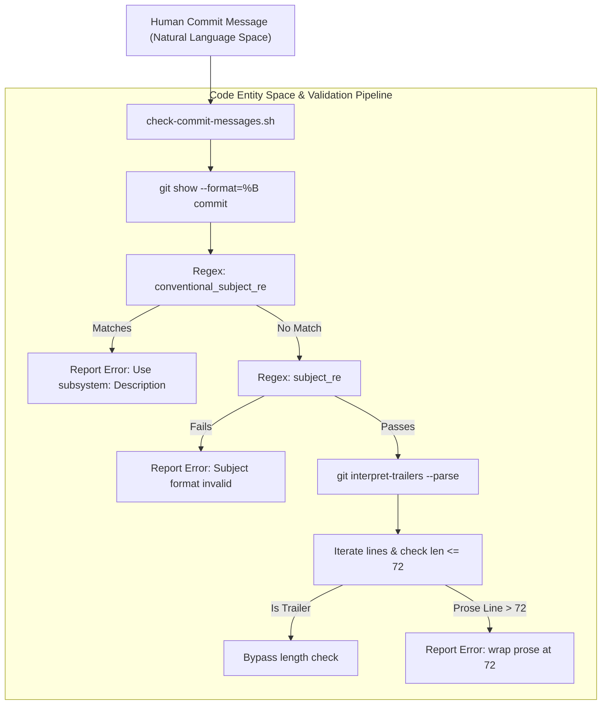

<!-- source: DeepWiki mcp.deepwiki.com · repo NVIDIA/boro · page 6.2 CI, Contributing and Scripts · fetched 2026-10-26 -->

# CI, Contributing and Scripts

<details>
<summary>Relevant source files</summary>

The following files were used as context for generating this wiki page:

- [.github/scripts/check-commit-messages.sh](.github/scripts/check-commit-messages.sh)
- [.github/scripts/test-check-commit-messages.sh](.github/scripts/test-check-commit-messages.sh)
- [.github/workflows/ci.yml](.github/workflows/ci.yml)
- [CONTRIBUTING.md](CONTRIBUTING.md)
- [resources/prompts/kernel.local/ubuntu.md](resources/prompts/kernel.local/ubuntu.md)
- [resources/prompts/qemu.local/.gitkeep](resources/prompts/qemu.local/.gitkeep)

</details>


## Purpose and Scope

This leaf page details the Continuous Integration (CI) infrastructure, commit-message validation engines, Developer Certificate of Origin (DCO) enforcement policies, contribution guidelines, and local prompt customization frameworks for the `boro` codebase. It covers how GitHub Actions automates pull request verification, how shell-based validation scripts enforce strict conventional formatting and line-length constraints, and how local prompt extensions like Ubuntu kernel policy definitions integrate into the system.

---

## 1. GitHub Actions CI Pipeline

The continuous integration pipeline for `boro` is defined in `.github/workflows/ci.yml` [.github/workflows/ci.yml:1-73](). The pipeline triggers on every push and pull request [.github/workflows/ci.yml:3-5] with read-only content permissions [.github/workflows/ci.yml:7-8]. It divides execution into two primary parallel jobs: `dco` and `test` [.github/workflows/ci.yml:10-54].

### Job Breakdown
* **`dco`**: Runs exclusively on pull requests (`if: github.event_name == 'pull_request'`) on an `ubuntu-latest` runner [.github/workflows/ci.yml:11-15]. It checks out full history (`fetch-depth: 0`) [.github/workflows/ci.yml:16-20], validates that all commits in the range contain a valid `Signed-off-by` trailer [.github/workflows/ci.yml:22-46], and invokes the custom commit-message validation script [.github/workflows/ci.yml:48-52].
* **`test`**: Runs on an `ubuntu-latest` runner to check out the code [.github/workflows/ci.yml:54-59], installs the stable Rust toolchain with `rustfmt` [.github/workflows/ci.yml:61-64], verifies code formatting via `cargo +stable fmt --all -- --check` [.github/workflows/ci.yml:66-68], runs the test suite for the commit-message checker [.github/workflows/ci.yml:69-70], and executes the complete cargo workspace test suite using `cargo +stable test --all-targets --locked` [.github/workflows/ci.yml:72-73].


Sources: [.github/workflows/ci.yml:1-73]()

---

## 2. Commit Message and DCO Validation Engine

Commit-message standards and line-wrapping conventions are programmatically enforced via `.github/scripts/check-commit-messages.sh` [.github/scripts/check-commit-messages.sh:1-74]. This script is accompanied by an extensive test harness located at `.github/scripts/test-check-commit-messages.sh` [.github/scripts/test-check-commit-messages.sh:1-107].

### Validation Rules and Regex Logic
The validation script iterates through all non-merge commits in a given range (`<base-commit>..<head-commit>`) [.github/scripts/check-commit-messages.sh:71] and performs the following checks:
1. **Conventional Commit Prohibition**: It checks if the subject matches conventional commit patterns (`fix(...)`, `feat(...)`, `feature(...)`), rejecting them in favor of the project's native subsystem prefix style [.github/scripts/check-commit-messages.sh:17,33-35].
2. **Subsystem Subject Format**: The subject must strictly conform to `^[a-z0-9][a-z0-9_./+-]*:[[:space:]][A-Z]`, ensuring a lowercase subsystem name followed by a colon, space, and a capitalized description [.github/scripts/check-commit-messages.sh:18,36-39].
3. **Line Length and Prose Wrapping**: Every line in the commit body and subject is verified to be at most 72 columns [.github/scripts/check-commit-messages.sh:46-48]. 
4. **Git Trailer Exemption**: Git trailers parsed via `git interpret-trailers --parse` are normalized and exempted from the 72-column restriction, as trailers like `Signed-off-by:` or `Fixes:` frequently exceed this limit [.github/scripts/check-commit-messages.sh:41-43,50-66].


Sources: [.github/scripts/check-commit-messages.sh:1-73](), [.github/scripts/test-check-commit-messages.sh:1-106]()

---

## 3. Contributor Guidelines and DCO 1.1

Contributions to `boro` are governed by `CONTRIBUTING.md` [CONTRIBUTING.md:1-71]. The project requires all contributors to certify compliance with the Developer Certificate of Origin (DCO) Version 1.1 [CONTRIBUTING.md:3-4,39-70].

### Key Contribution Requirements
* **No Contributor License Agreement (CLA)**: Contributions are accepted directly under the DCO 1.1 via the `Signed-off-by` git trailer [CONTRIBUTING.md:3-4,22-26].
* **Commit Subject Structure**: Must begin with a lowercase subsystem name and a capitalized description (e.g., `subsystem: Short description`) [CONTRIBUTING.md:8-13]. Conventional commit prefixes (`fix(...)`, `feat(...)`, `feature(...)`) are explicitly forbidden [CONTRIBUTING.md:15-16].
* **Prose Wrapping**: Commit subjects and body prose must be wrapped at 72 columns [CONTRIBUTING.md:18-20].
* **Sign-off Automation**: Developers must use `git commit -s` to append the mandatory DCO signature line [CONTRIBUTING.md:27-37]:
  ```text
  Signed-off-by: Your Name <your.email@example.com>
  ```

Sources: [CONTRIBUTING.md:1-70]()

---

## 4. Local Prompt Extensions and Subsystem Policies

To support customized review instructions and organizational policies, `boro` loads markdown prompt corpora from `resources/prompts/` (e.g., kernel and qemu subsystem guides). Local extensions are placed under `.local` directories, such as `resources/prompts/kernel.local/` [resources/prompts/kernel.local/ubuntu.md:1-16].

### Ubuntu Kernel Annotations Policy Example
The file `resources/prompts/kernel.local/ubuntu.md` defines specialized review behavior when patches modify Debian/Ubuntu kernel configuration annotations (`debian.*/config/annotations`) [resources/prompts/kernel.local/ubuntu.md:1-6]:
* **Tracking Bug Requirement**: Added or modified `CONFIG_*` policy entries must include a corresponding note (e.g., `note<'LP: #2059316'>`) linking the tracking bug [resources/prompts/kernel.local/ubuntu.md:6-9].
* **Exemptions**: Mechanical updates resulting from repository-wide version bumps or global configuration refreshes do not require per-symbol annotations, provided the commit message clarifies the global rationale [resources/prompts/kernel.local/ubuntu.md:12-15].

Sources: [resources/prompts/kernel.local/ubuntu.md:1-15]()

---

