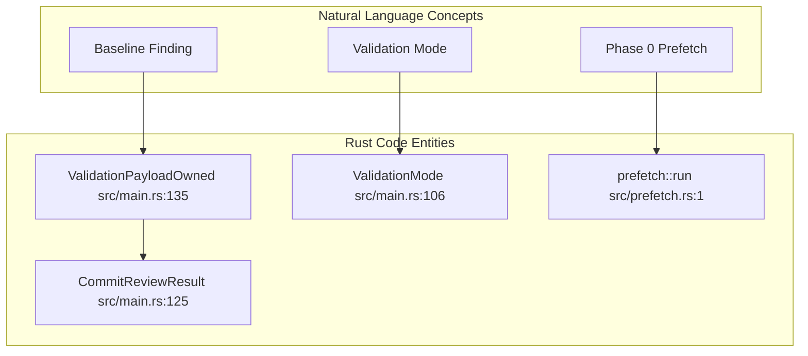
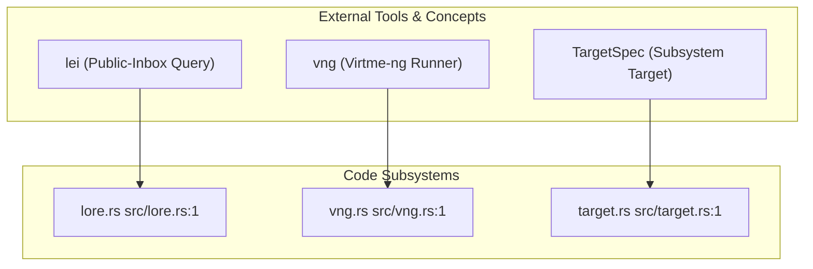

<!-- source: DeepWiki mcp.deepwiki.com · repo NVIDIA/boro · page 7 Glossary · fetched 2026-10-26 -->

# Glossary

Relevant source files

The following files were used as context for generating this wiki page:

- [README.md](README.md)
- [resources/fast-review.md](resources/fast-review.md)
- [resources/review-validation-findings-kernel.md](resources/review-validation-findings-kernel.md)
- [resources/review-validation-findings.md](resources/review-validation-findings.md)
- [src/lore.rs](src/lore.rs)
- [src/main.rs](src/main.rs)

## Purpose and Scope

This page defines domain-specific terms, architectural abstractions, external tool integrations, and configuration modes used across the `boro` codebase. Each entry details its conceptual role, implementation context, and direct code pointers within the repository.

Sources: [`README.md:1-160`](), [`src/main.rs:1-216`](), [`src/lore.rs:1-114`]()

---

## Terminology Reference

### Baseline Finding
A preliminary review finding produced during the protected one-shot fast review pass (`resources/fast-review.md`) or ingestion from upstream analysis before specialist and multi-stage refinement. Baseline findings are collected into structured payload arrays and subjected to rigorous repository-tool-verified adjudication during the validation stage.
* **Implementation:** Defined in payload structures and validation instructions [resources/review-validation-findings.md:19-25](), handled in validation logic [src/main.rs:141]().

Sources: [`resources/review-validation-findings.md:1-35`](), [`src/main.rs:135-145`]()

### Specialist Stage
One of the discrete multi-stage agentic review passes (Stages 3 through 8) focused on specific code dimensions such as execution flow, locking invariants, memory safety, and security. Specialist stages run concurrently or sequentially depending on worker pool settings, feeding candidate concerns into cluster deduplication.
* **Implementation:** Orchestrated via stage definitions and worker routines [src/cluster.rs:1-50](), [src/main.rs:23]().

Sources: [`src/main.rs:1-30`](), [`src/cluster.rs:1-60`]()

### Phase 0
The initial subsystem narrowing and prefetch phase of commit analysis. Phase 0 inspects diff indices and repository metadata to identify relevant subsystem prompt files, reference context, and false-positive digests before executing full specialist review passes.
* **Implementation:** Managed via prefetch logic and diff indexing [src/prefetch.rs:1-50](), [src/main.rs:10](), [src/main.rs:18](), resulting in selected prompts stored in evaluation structs [src/main.rs:131]().

Sources: [`src/main.rs:10-18`](), [`src/main.rs:131-133`](), [`src/prefetch.rs:1-50`]()

### TargetSpec
The core abstraction trait defining target-specific behaviors, subsystem maps, prompt corpora, and validation rules for different software projects supported by `boro` (e.g., Linux Kernel, QEMU, libvirt, virt-manager).
* **Implementation:** Trait definitions and dispatch implementations in target modules [src/target.rs:1-50](), CLI target flags [src/main.rs:78-100]().

Sources: [`src/main.rs:78-100`](), [`src/target.rs:1-50`]()

### Lei
The local email interface tool from the `public-inbox` project (`lei q -I https://lore.kernel.org/all/`), utilized by `boro` to perform deterministic, stateless queries against mailing list archives for patch follow-up context and historical discussions.
* **Implementation:** Configured and executed via wrapper functions [src/lore.rs:1-88](), requiring external binary presence on `$PATH` [README.md:157-159]().

Sources: [`README.md:150-160`](), [`src/lore.rs:1-88`]()

### Vng (Virtme-ng)
An execution runner used for kernel build testing and fast virtualized boot testing (`vng -b`, `vng --run`). `boro` invokes `vng` inside ephemeral worktrees to compile code and boot target kernels under test modes.
* **Implementation:** Subprocess orchestration routines [src/vng.rs:1-50](), integration with build and test pipelines [src/main.rs:29](), [README.md:154-156]().

Sources: [`README.md:150-160`](), [`src/main.rs:25-29`](), [`src/vng.rs:1-50`]()

### B4
A patch series management tool (`b4`) used to fetch patch series posted to lore or mailing lists via message IDs, reconstructing exact series state in temporary worktrees before local review and application.
* **Implementation:** Invoked during `apply --message-id` workflows [README.md:43-55, 150-153]().

Sources: [`README.md:40-56`](), [`README.md:150-155`]()

### Validation Mode
A global runtime configuration parameter determining how findings are filtered, adjudicated, and rendered. Supports modes to skip validation (`off`), filter and render narrative prose from survivors (`filter`), or perform validation without narrative prose (`findings`).
* **Implementation:** Enumerated by [`ValidationMode`] CLI argument struct [src/main.rs:105-123]().

Sources: [`src/main.rs:105-123`]()

### Tool Loop
An interactive model execution capability where the agent invokes sandboxed repository exploration tools (such as grep, file reading, symbol resolution, and git operations) and verifies postconditions before finalizing findings.
* **Implementation:** Configured via `ToolLoopConfig` and execution helpers [src/main.rs:48-51](), [src/api.rs:1-50](), [src/tools.rs:1-50]().

Sources: [`src/main.rs:48-51`](), [`src/api.rs:1-50`](), [`src/tools.rs:1-50`]()

### Prompt Caching
An optimization feature utilizing Anthropic-style `cache_control` markers on outgoing HTTP model requests to cache static system prompts and reference context across multiple model turns. Can be disabled via CLI flags.
* **Implementation:** Controlled by CLI global options `--no-prompt-caching` [src/main.rs:204-209]() and handled within payload builders [src/api.rs:1-50]().

Sources: [`src/main.rs:204-209`](), [`src/api.rs:1-50`]()

---

## Architectural Mapping Diagrams

### Diagram: Natural Language Space to Code Entity Space: Review and Validation Pipeline

Sources: [`src/main.rs:106-145`](), [`src/prefetch.rs:1-30`]()

### Diagram: Natural Language Space to Code Entity Space: External Tooling Integration

Sources: [`src/target.rs:1-30`](), [`src/lore.rs:1-50`](), [`src/vng.rs:1-50`]()