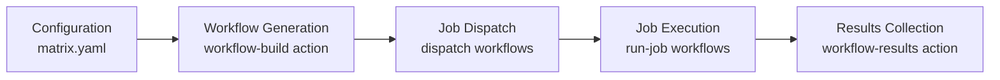
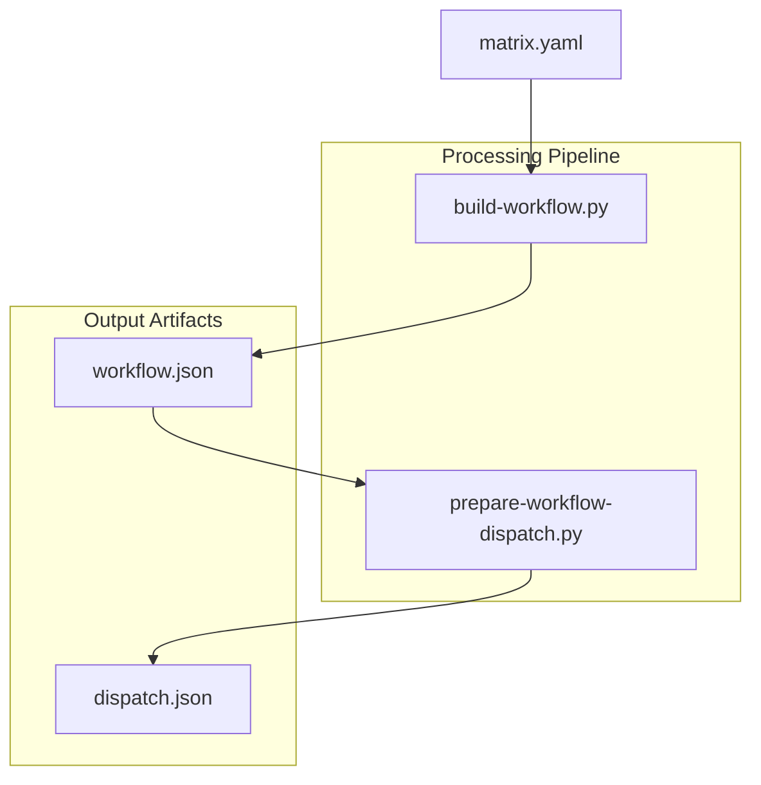
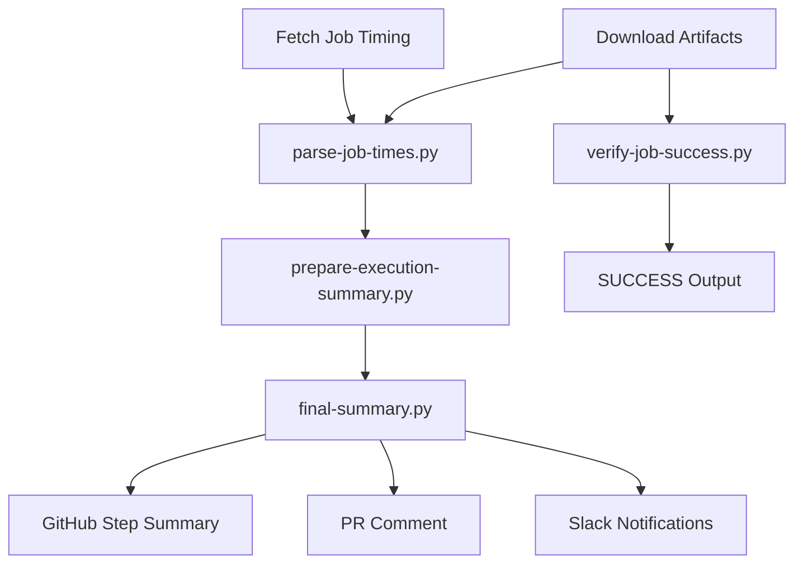
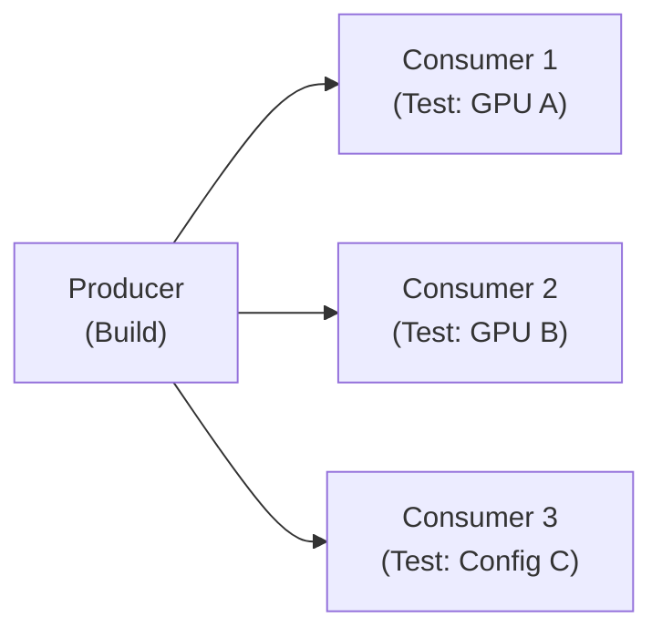
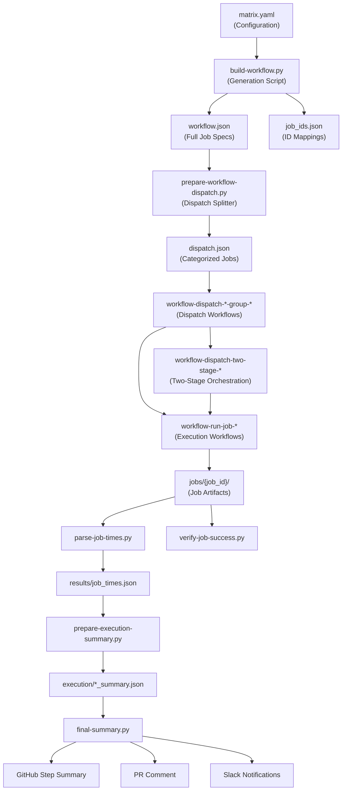

<!-- source: DeepWiki mcp.deepwiki.com · repo NVIDIA/cccl-gha · page 1 Overview · fetched 2026-10-26 -->

# Overview

<details>
<summary>Relevant source files</summary>

The following files were used as context for generating this wiki page:

- [.github/actions/workflow-build/action.yml](.github/actions/workflow-build/action.yml)
- [.github/actions/workflow-build/build-workflow.py](.github/actions/workflow-build/build-workflow.py)
- [.github/actions/workflow-results/action.yml](.github/actions/workflow-results/action.yml)

</details>


The CCCL-GHA repository provides a GitHub Actions workflow orchestration system for NVIDIA's CCCL (CUDA C++ Core Libraries) project. This system transforms a declarative matrix configuration into hundreds of parallelized CI/CD jobs that build and test multiple combinations of projects, compilers, CUDA versions, C++ standards, and hardware architectures.

This page provides a high-level introduction to the system architecture, core concepts, and data flow. For detailed configuration of `matrix.yaml`, see [Configuration Guide](#2). For workflow generation internals, see [Workflow Generation](#3). For job execution details, see [Job Execution](#5).

## System Purpose

CCCL-GHA addresses the challenge of testing a complex C++/CUDA codebase across a large matrix of configurations:
- Multiple projects (libcudacxx, CUB, Thrust)
- Multiple CUDA Toolkit versions
- Multiple host compilers (GCC, Clang, MSVC) with various versions
- Multiple C++ standards
- Multiple GPU architectures
- Both Linux and Windows operating systems

The system automates the generation, scheduling, execution, and reporting of these jobs while minimizing redundant builds through artifact sharing (producer/consumer pattern) and distributed compilation caching (sccache).

Sources: [.github/actions/workflow-build/action.yml:1-4](), [.github/actions/workflow-build/build-workflow.py:1-54]()

## High-Level Architecture

The system operates in four distinct phases:



**Diagram: Four-Phase Architecture**

### Phase 1: Configuration

The `matrix.yaml` file defines all possible job combinations using a concise tag-based syntax. Each job specifies:
- `project`: Which CCCL component to build/test
- `jobs`: What operations to perform (build, test, etc.)
- `ctk`: CUDA Toolkit version
- `cxx`: Host compiler
- `cudacxx`: Device compiler (nvcc, clang)
- `std`: C++ standard
- `gpu`: Target GPU architecture
- Additional tags as needed

Sources: [.github/actions/workflow-build/build-workflow.py:4-24]()

### Phase 2: Workflow Generation

The `workflow-build` action transforms `matrix.yaml` into executable job definitions:



**Diagram: Workflow Generation Pipeline**

The `build-workflow.py` script performs multi-stage processing:
1. Validates tags against schema
2. Sets default values
3. Explodes list values into individual jobs
4. Canonicalizes compiler names
5. Derives values (e.g., SM architecture from GPU name)
6. Applies exclusion rules
7. Groups jobs by dispatch category

Sources: [.github/actions/workflow-build/action.yml:74-109](), [.github/actions/workflow-build/build-workflow.py:811-919]()

### Phase 3: Job Dispatch

The `dispatch.json` file categorizes jobs into four groups:

| Category | OS | Pattern | Description |
|----------|----|---------| ------------|
| `linux_standalone` | Linux | Standalone | Independent jobs with no dependencies |
| `linux_two_stage` | Linux | Producer→Consumer | Build artifacts shared with test jobs |
| `windows_standalone` | Windows | Standalone | Independent jobs with no dependencies |
| `windows_two_stage` | Windows | Producer→Consumer | Build artifacts shared with test jobs |

Each category maps to a dedicated dispatch workflow that uses GitHub Actions matrix strategies to parallelize execution.

Sources: [.github/actions/workflow-build/build-workflow.py:28-35](), [.github/actions/workflow-build/build-workflow.py:507-539]()

### Phase 4: Job Execution

Jobs execute in isolated environments:
- **Linux**: Docker-outside-of-Docker (DOOD) pattern using devcontainers
- **Windows**: Native Docker containers

Each job produces artifacts including success markers, sccache statistics, and test results.

Sources: [.github/actions/workflow-build/build-workflow.py:379-445]()

### Phase 5: Results Collection

The `workflow-results` action aggregates job outcomes:



**Diagram: Results Collection Pipeline**

The system generates comprehensive reports including:
- Pass/fail status by project and configuration
- Timing breakdown with overhead analysis
- sccache hit rate statistics
- Identification of "likely culprits" for failures

Sources: [.github/actions/workflow-results/action.yml:30-128]()

## Key Concepts

### Matrix Jobs

A **matrix job** is a single entry in the `matrix.yaml` workflow definition. Example:

```json
{
  "project": "libcudacxx",
  "jobs": ["build", "test"],
  "ctk": "12.0",
  "cxx": "gcc12",
  "cudacxx": "nvcc",
  "std": 17,
  "gpu": "t4"
}
```

Matrix jobs are processed into one or more **dispatch jobs** after tag explosion, canonicalization, and exclusion filtering.

Sources: [.github/actions/workflow-build/build-workflow.py:4-24]()

### Dispatch Groups

A **dispatch group** organizes related jobs together for UI clarity. Jobs in the same group share:
- Project
- CUDA Toolkit version  
- Compiler toolchain

Example dispatch group name: `"libcudacxx CTK12.0 nvcc GCC12"`

Sources: [.github/actions/workflow-build/build-workflow.py:345-359]()

### Job Patterns

**Standalone Jobs**: Execute independently with no dependencies. Example: a build-and-test job in a single step.

**Two-Stage Jobs**: Producer/consumer pattern where a build job creates artifacts consumed by multiple test configurations:



**Diagram: Two-Stage Producer/Consumer Pattern**

Sources: [.github/actions/workflow-build/build-workflow.py:493-504](), [.github/actions/workflow-build/build-workflow.py:517-534]()

### Devcontainers

**Devcontainers** are Docker images containing specific CUDA Toolkit and compiler versions. The system uses images from the `rapidsai/devcontainers` repository with the format:

- Linux: `rapidsai/devcontainers:{version}-cpp-{compiler}-cuda{ctk}`
- Windows: `rapidsai/devcontainers:{version}-cuda{ctk}-{compiler}`

The `.devcontainer/launch.sh` script selects and launches the appropriate container based on job requirements.

Sources: [.github/actions/workflow-build/build-workflow.py:404-412]()

### Job Artifacts

Each job produces artifacts in the `jobs/{job_id}/` directory:

| Artifact | Purpose |
|----------|---------|
| `success` | Marker file indicating job completion |
| `sccache_stats.json` | Compilation cache statistics |
| `cccl_meta_bench.csv` | Benchmark results (if applicable) |

Sources: [.github/actions/workflow-results/action.yml:36-42]()

## Data Flow

The following diagram maps the complete data flow from configuration to results:



**Diagram: Complete Data Flow with File Names**

Sources: [.github/actions/workflow-build/action.yml:1-140](), [.github/actions/workflow-results/action.yml:1-213]()

## Integration Points

The system integrates with external services:

### GitHub Actions API

- **Workflow Artifacts**: Upload/download job outputs
- **Job Timing Data**: Fetch execution duration via REST API
- **PR Comments**: Post results to pull requests
- **Step Summary**: Display results inline in workflow UI

Sources: [.github/actions/workflow-results/action.yml:30-34](), [.github/actions/workflow-results/action.yml:59-90](), [.github/actions/workflow-results/action.yml:130-153]()

### AWS S3 (sccache)

The system uses `sccache` for distributed compilation caching. Jobs access the `rapids-sccache-devs` S3 bucket using AWS credentials configured at runtime.

### Slack API

Notifications are sent to two channels:
- **Log Channel**: All workflow events (start, completion)
- **Alert Channel**: Failures only

Sources: [.github/actions/workflow-build/action.yml:47-59](), [.github/actions/workflow-build/action.yml:126-139](), [.github/actions/workflow-results/action.yml:179-212]()

## System Characteristics

| Characteristic | Implementation |
|----------------|----------------|
| **Scalability** | Matrix parallelization creates hundreds of concurrent jobs |
| **Efficiency** | Producer/consumer pattern avoids redundant builds; sccache reduces compilation time |
| **Isolation** | Devcontainers ensure reproducible builds |
| **Visibility** | Multi-channel reporting (GitHub UI, PR comments, Slack) |
| **Flexibility** | Declarative configuration supports complex job matrices |
| **Change Detection** | `inspect-changes` mechanism skips irrelevant jobs on PRs |

Sources: [.github/actions/workflow-build/action.yml:12-19]()

## Workflow Entry Points

Users interact with the system through two primary GitHub Actions:

### workflow-build Action

**Location**: `.github/actions/workflow-build/action.yml`

**Inputs**:
- `workflows`: Space-separated workflow names to execute
- `matrix_file`: Path to `matrix.yaml` (default: `ci/matrix.yaml`)
- `allow_override`: Enable override workflow mechanism
- `inspect_changes_script`: Script for change detection
- Slack tokens and channel IDs for notifications

**Outputs**:
- `workflow`: JSON object containing `dispatch.json` content

Sources: [.github/actions/workflow-build/action.yml:1-42]()

### workflow-results Action

**Location**: `.github/actions/workflow-results/action.yml`

**Inputs**:
- `github_token`: For PR comments
- `pr_number`: PR to comment on
- Slack tokens and channel IDs for notifications

**Outputs**:
- `success`: Boolean indicating whether all jobs passed

Sources: [.github/actions/workflow-results/action.yml:1-24]()

## Example Workflow Lifecycle

A typical workflow execution follows this sequence:

1. **Trigger**: PR opened or commit pushed
2. **Generation**: `workflow-build` action reads `matrix.yaml`, applies change detection, generates `dispatch.json`
3. **Dispatch**: Four group dispatch workflows distribute jobs across runners
4. **Execution**: Jobs run in parallel in isolated devcontainers
5. **Artifact Upload**: Each job uploads success markers and statistics
6. **Collection**: `workflow-results` action downloads artifacts, fetches timing data
7. **Analysis**: Python scripts parse results, identify failures, calculate statistics
8. **Reporting**: Summary posted to GitHub UI, PR comments, and Slack

Sources: [.github/actions/workflow-build/action.yml:61-109](), [.github/actions/workflow-results/action.yml:30-128]()

---

This overview provides the foundation for understanding CCCL-GHA. For detailed documentation on specific subsystems, refer to the child pages in this wiki.

---

