<!-- source: DeepWiki mcp.deepwiki.com · repo NVIDIA/cccl-gha · page 1.1 System Architecture · fetched 2026-10-26 -->

# System Architecture

Relevant source files

The following files were used as context for generating this wiki page:

- [.github/actions/workflow-build/action.yml](.github/actions/workflow-build/action.yml)
- [.github/actions/workflow-build/build-workflow.py](.github/actions/workflow-build/build-workflow.py)
- [.github/actions/workflow-build/prepare-workflow-dispatch.py](.github/actions/workflow-build/prepare-workflow-dispatch.py)

## Purpose and Scope

This document describes the four-phase architecture of the CCCL GitHub Actions workflow orchestration system. It explains how the system transforms a declarative job matrix configuration into distributed, containerized CI/CD execution across Linux and Windows runners, and how data flows between the Configuration, Generation, Dispatch, and Execution phases.

For detailed information about specific configuration syntax, see [Configuration Guide](#2). For implementation details of individual execution environments, see [Job Execution](#5). For result aggregation mechanisms, see [Results and Reporting](#6).

## Architectural Overview

The system implements a pipeline architecture consisting of four sequential phases:

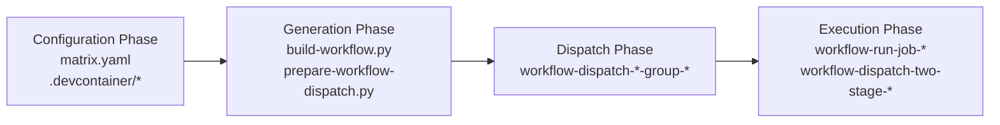

**Sources:** [.github/actions/workflow-build/action.yml:1-140](), [.github/actions/workflow-build/build-workflow.py:1-100]()

### Phase Responsibilities

| Phase | Primary Function | Key Inputs | Key Outputs |
|-------|-----------------|------------|-------------|
| Configuration | Define job matrix | `matrix.yaml`, `.devcontainer/` configs | Human-readable job specifications |
| Generation | Transform and optimize | Matrix definitions, change detection data | `workflow.json`, `dispatch.json` |
| Dispatch | Route and parallelize | `dispatch.json` by OS and pattern | Matrix-parallelized GitHub Actions jobs |
| Execution | Run commands | Job specifications, runner assignment | Build/test results, artifacts |

**Sources:** [.github/actions/workflow-build/build-workflow.py:1-60](), [.github/actions/workflow-build/prepare-workflow-dispatch.py:1-20]()

## Configuration Layer

The configuration layer provides declarative definitions of all possible job combinations through two primary sources:

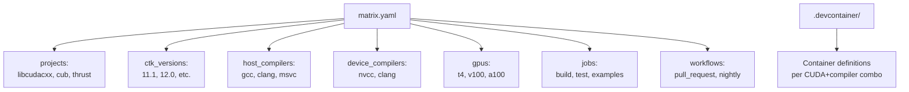

**Sources:** [.github/actions/workflow-build/build-workflow.py:113-303](), [.github/actions/workflow-build/action.yml:20-23]()

The `matrix.yaml` file defines:
- **Projects**: Individual CCCL components (`libcudacxx`, `cub`, `thrust`)
- **CTK versions**: CUDA Toolkit versions with metadata like supported standards
- **Host compilers**: GCC, Clang, MSVC with version ranges and aliases
- **Device compilers**: NVCC, Clang with capability mappings
- **GPUs**: Physical hardware identifiers with SM architecture mappings
- **Jobs**: Build, test, example tasks with dependency relationships
- **Workflows**: Named collections of matrix jobs (e.g., `pull_request`, `nightly`)

**Sources:** [.github/actions/workflow-build/build-workflow.py:113-303]()

## Workflow Generation Phase

The generation phase transforms the declarative matrix into executable job specifications through a multi-stage processing pipeline.

### Generation Pipeline Components

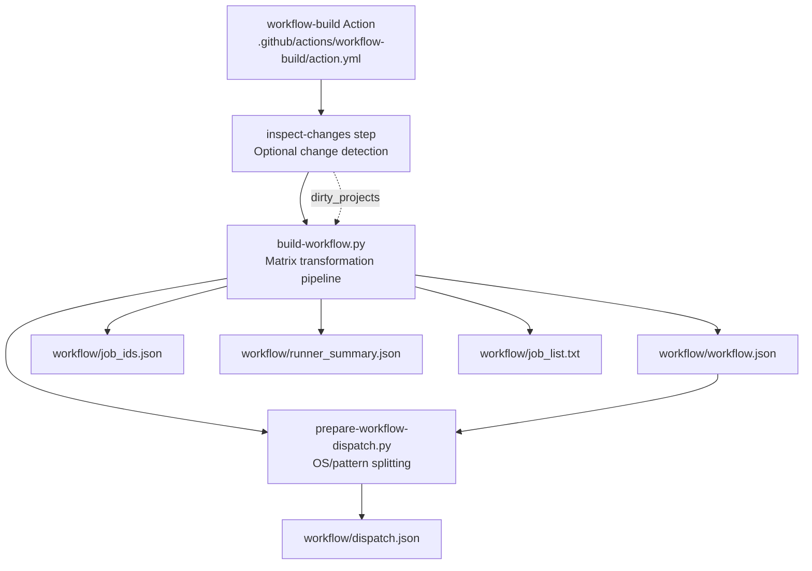

**Sources:** [.github/actions/workflow-build/action.yml:61-109](), [.github/actions/workflow-build/build-workflow.py:922-1048]()

### build-workflow.py Processing Stages

The `build-workflow.py` script implements a sophisticated ETL pipeline:

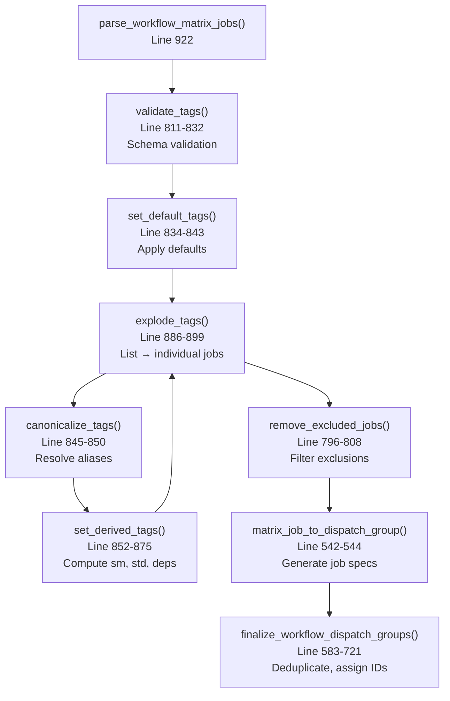

**Sources:** [.github/actions/workflow-build/build-workflow.py:811-960]()

#### Key Processing Functions

**Tag Validation** [`validate_tags()`](.github/actions/workflow-build/build-workflow.py:811-832)()
- Verifies all required tags are present
- Checks for unknown tags
- Validates GPU identifiers against defined set
- Ensures `cudacxx=clang` requires `cxx=clang`

**Tag Canonicalization** [`canonicalize_tags()`](.github/actions/workflow-build/build-workflow.py:845-850)()
- Converts CTK versions via `canonicalize_ctk_version()` [line 114-123]()
- Normalizes compiler names via `canonicalize_host_compiler_name()` [line 139-172]()
- Handles version aliases (e.g., `gcc10` → `gcc10`, `gcc` → `gcc<latest>`)

**Tag Explosion** [`explode_tags()`](.github/actions/workflow-build/build-workflow.py:886-899)()
- Recursively expands list-valued tags into individual jobs
- Example: `std: [17, 20]` generates two jobs with `std: 17` and `std: 20`
- Preserves non-exploded tags like `jobs` for scheduling optimization

**Derived Tags** [`set_derived_tags()`](.github/actions/workflow-build/build-workflow.py:852-875)()
- Computes `sm` from `gpu` when `sm: "gpu"` is specified
- Expands `std: "all"` to intersection of supported standards from CTK, compiler, and project
- Injects job dependencies from `jobs[*].needs` relationships
- Applies project-specific job mappings via `job_map`

**Sources:** [.github/actions/workflow-build/build-workflow.py:811-899]()

### Dispatch Group Generation

The `matrix_job_to_dispatch_group()` function [line 542-544]() converts matrix jobs into dispatch groups with two execution patterns:

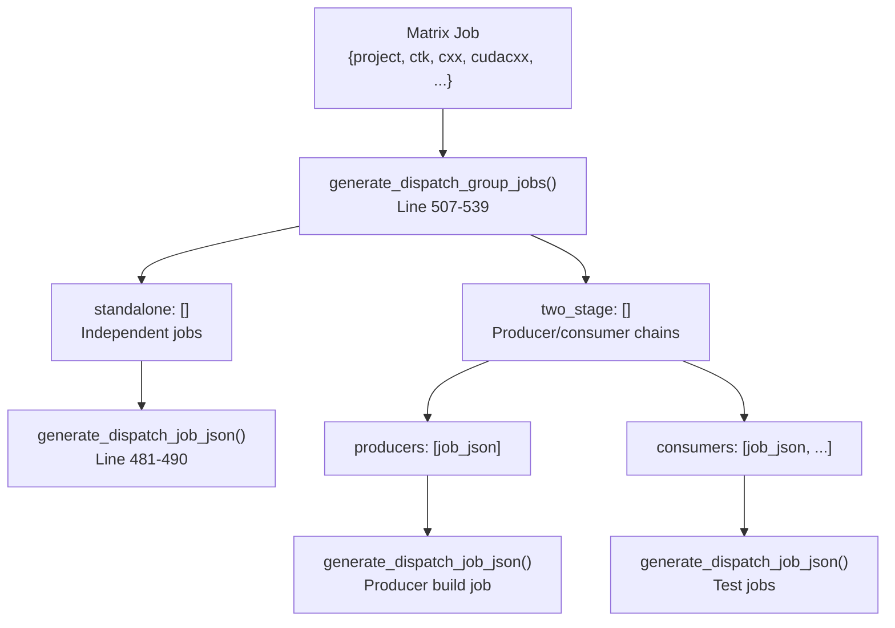

**Sources:** [.github/actions/workflow-build/build-workflow.py:481-544]()

#### Job JSON Structure

Each `job_json` object contains:

| Field | Generator Function | Purpose |
|-------|-------------------|---------|
| `id` | GUID generator [line 78-96]() | Short unique identifier for GHA |
| `name` | `generate_dispatch_job_name()` [line 362-376]() | Human-readable job display name |
| `runner` | `generate_dispatch_job_runner()` [line 379-390]() | GHA runner label (OS, CPU, GPU) |
| `image` | `generate_dispatch_job_image()` [line 404-412]() | DevContainer image reference |
| `command` | `generate_dispatch_job_command()` [line 415-445]() | Shell script invocation with args |
| `cuda` | `generate_dispatch_job_ctk_version()` [line 393-395]() | CTK version for devcontainer |
| `host` | `generate_dispatch_job_host_compiler()` [line 398-401]() | Host compiler for devcontainer |
| `origin` | `generate_dispatch_job_origin()` [line 448-478]() | Metadata for result aggregation |

**Sources:** [.github/actions/workflow-build/build-workflow.py:362-490]()

### Workflow Finalization

The `finalize_workflow_dispatch_groups()` function [line 583-721]() performs critical post-processing:

**Validation** [line 586-599]():
- Ensures no two-stage group has more than one producer
- Raises error if multiple producers detected (not supported by dispatch workflows)

**Deduplication** [line 601-667]():
- Merges consumers for duplicate producers with notice messages
- Removes duplicate standalone jobs with notice messages
- Removes standalone jobs that appear as producers/consumers
- Warns about unavoidable duplicates in two-stage dependencies

**Sorting** [line 693-706]():
- Natural sort of dispatch group names (handles embedded numbers)
- Sorts jobs within groups by name

**ID Assignment** [line 708-719]():
- Assigns compact GUIDs to standalone jobs, two-stage groups, and all individual jobs
- GUIDs range from 1-3 characters, supporting up to 65,535 unique IDs

**Sources:** [.github/actions/workflow-build/build-workflow.py:583-721]()

## Dispatch Preparation

The `prepare-workflow-dispatch.py` script splits the monolithic `workflow.json` into four categorized dispatch workflows to optimize the GitHub Actions UI.

### Dispatch Splitting Logic

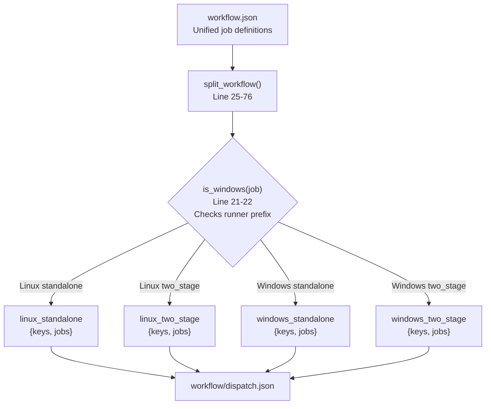

**Sources:** [.github/actions/workflow-build/prepare-workflow-dispatch.py:21-76]()

### Dispatch JSON Structure

Each category in `dispatch.json` contains:
- `keys`: Array of dispatch group names for matrix expansion
- `jobs`: Map of group names to job arrays or two-stage structures

The `strip_extra_info()` function [line 31-32]() removes the `origin` metadata before dispatch to reduce artifact size, as origin information is preserved in `workflow.json` for result processing.

**Sources:** [.github/actions/workflow-build/prepare-workflow-dispatch.py:31-76]()

## Dispatch Layer Architecture

The dispatch layer consumes `dispatch.json` and uses GitHub Actions matrix strategies to parallelize job execution. Four dispatch workflow types correspond to the four categories in `dispatch.json`:

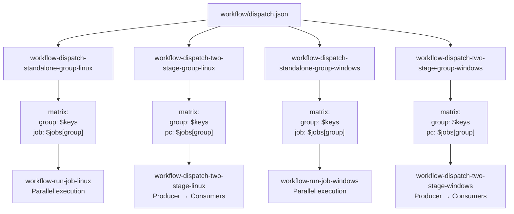

**Sources:** [.github/actions/workflow-build/prepare-workflow-dispatch.py:59-72]()

### Matrix Expansion Strategy

**Standalone workflows**: Each matrix entry corresponds to one job. The matrix iterates over both `group` (for organization) and `job` (the actual job specification).

**Two-stage workflows**: Each matrix entry corresponds to one producer/consumer chain (`pc`). The two-stage dispatch workflows handle dependency ordering internally.

This categorization ensures:
- No skipped jobs clutter the UI (each workflow only runs applicable jobs)
- Efficient parallelization via matrix strategies
- Clear separation between OS environments
- Proper handling of producer/consumer dependencies

**Sources:** [.github/actions/workflow-build/prepare-workflow-dispatch.py:25-76]()

## Execution Layer

The execution layer receives individual job specifications from the dispatch layer and runs commands in isolated containerized environments. Linux and Windows follow different execution patterns due to platform constraints.

### Linux Execution: Docker-outside-of-Docker (DOOD)

Linux jobs use an intermediate container strategy to avoid nested Docker performance issues:

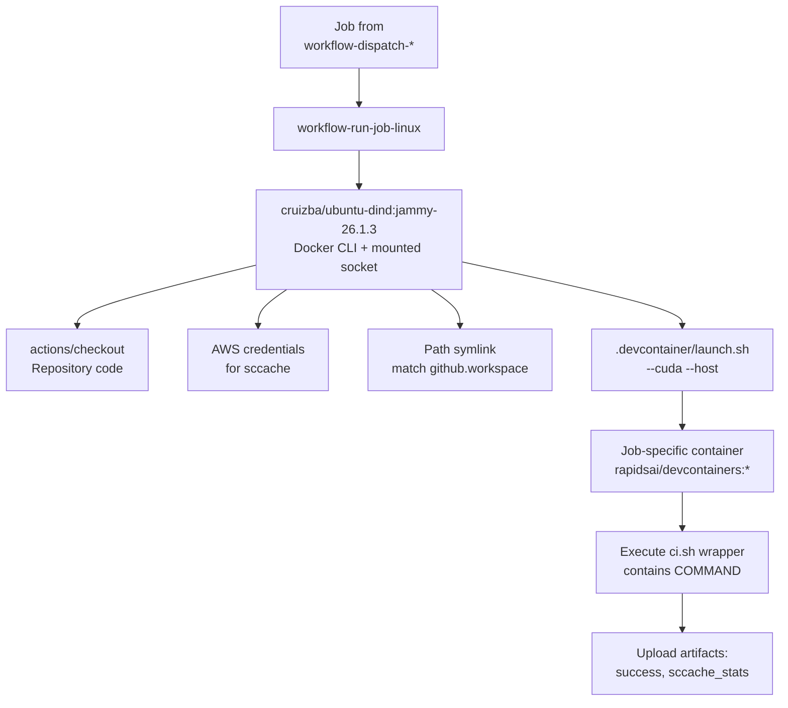

The intermediate container has access to the host Docker daemon via a mounted socket, allowing it to launch devcontainers directly on the host without nesting. Path symlinks ensure the container's view of `github.workspace` matches the host path structure, which is necessary for volume mounts.

**Sources:** Based on system overview diagrams

### Windows Execution: Native Docker

Windows jobs run directly in Docker containers without an intermediate layer:

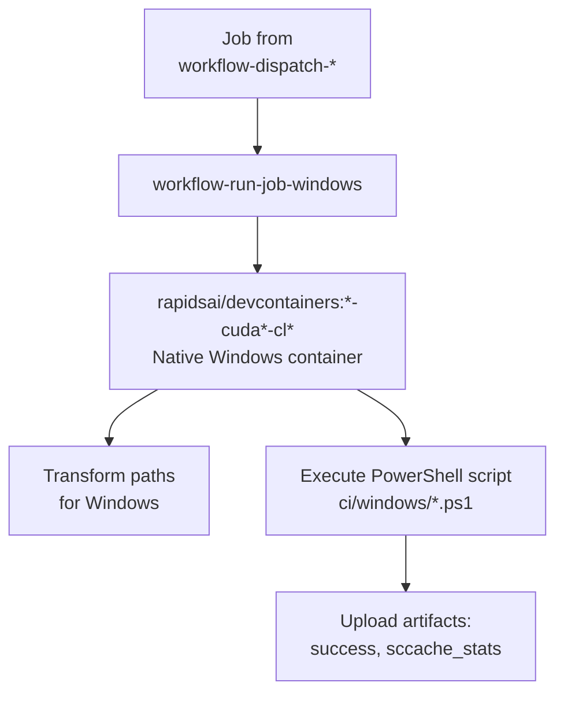

**Sources:** Based on system overview diagrams

### DevContainer Selection

The `generate_dispatch_job_image()` function [.github/actions/workflow-build/build-workflow.py:404-412]() constructs image references:

**Linux format**: `rapidsai/devcontainers:{devcontainer_version}-cpp-{host_compiler}-cuda{ctk}`

**Windows format**: `rapidsai/devcontainers:{devcontainer_version}-cuda{ctk}-{host_compiler}`

Where:
- `devcontainer_version`: Global version identifier from `matrix.yaml`
- `host_compiler`: Compiler container tag + version (e.g., `gcc12`, `cl14.38`)
- `ctk`: CUDA Toolkit version (e.g., `11.1`, `12.0`)

**Sources:** [.github/actions/workflow-build/build-workflow.py:404-412]()

## Data Flow Summary

The complete data flow through the system:

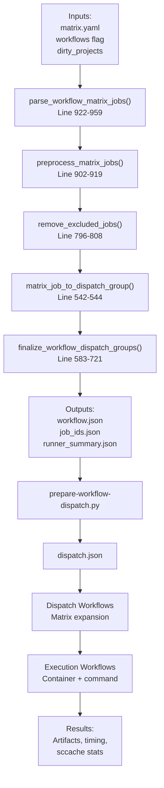

**Sources:** [.github/actions/workflow-build/build-workflow.py:922-1048](), [.github/actions/workflow-build/prepare-workflow-dispatch.py:78-95](), [.github/actions/workflow-build/action.yml:74-124]()

### Key Artifacts

| Artifact | Producer | Consumer | Purpose |
|----------|----------|----------|---------|
| `matrix.yaml` | Human author | `build-workflow.py` | Job matrix definition |
| `workflow.json` | `build-workflow.py` | `prepare-workflow-dispatch.py`, results processing | Complete job specifications with origin metadata |
| `job_ids.json` | `build-workflow.py` | Results processing | Maps short IDs to full job names |
| `runner_summary.json` | `build-workflow.py` | GitHub Step Summary | Runner allocation statistics |
| `dispatch.json` | `prepare-workflow-dispatch.py` | Dispatch workflows | Categorized jobs for matrix expansion |
| Job artifacts | Execution workflows | `workflow-results` action | Success markers, sccache stats, benchmark data |

**Sources:** [.github/actions/workflow-build/build-workflow.py:979-1023](), [.github/actions/workflow-build/prepare-workflow-dispatch.py:74-75](), [.github/actions/workflow-build/action.yml:119-124]()

## Component Interaction Patterns

### Composite Action Orchestration

The `workflow-build` composite action [.github/actions/workflow-build/action.yml:1-140]() orchestrates the generation phase:

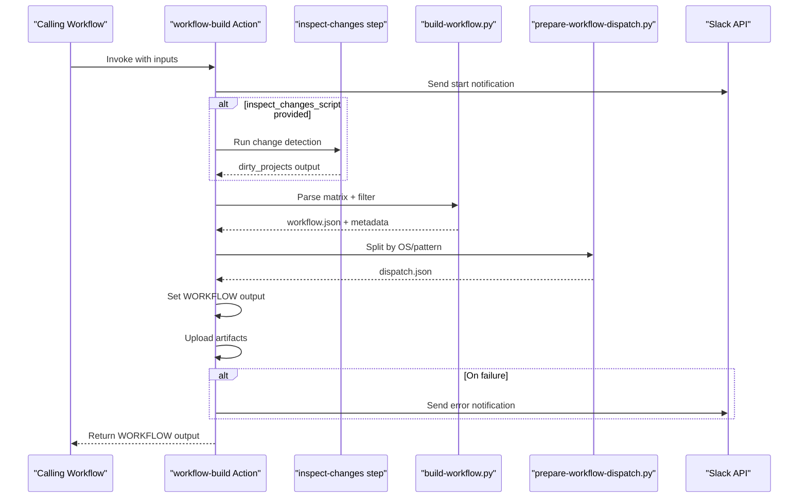

**Sources:** [.github/actions/workflow-build/action.yml:44-140]()

### Error Handling and Notifications

The system implements resilient error handling:

- **Validation errors**: `build-workflow.py` raises exceptions with file location context using `error_message_with_matrix_job()` [line 109-110]()
- **GitHub annotations**: Errors/warnings/notices printed to stderr with `::error file=ci/matrix.yaml::` format
- **Slack notifications**: Two-channel strategy:
  - `slack_log`: Verbose notifications for all runs [line 47-59]()
  - `slack_alert`: Critical failures only [line 126-139]()
- **Artifact preservation**: `continue-on-error` used in results processing to ensure partial data is reported

**Sources:** [.github/actions/workflow-build/action.yml:47-139](), [.github/actions/workflow-build/build-workflow.py:109-110]()

---

