<!-- source: DeepWiki mcp.deepwiki.com · repo NVIDIA/cccl-gha · page 1.2 Key Concepts · fetched 2026-10-26 -->

# Key Concepts

<details>
<summary>Relevant source files</summary>

The following files were used as context for generating this wiki page:

- [.github/actions/workflow-build/build-workflow.py](.github/actions/workflow-build/build-workflow.py)
- [.github/workflows/workflow-dispatch-two-stage-linux.yml](.github/workflows/workflow-dispatch-two-stage-linux.yml)

</details>


This page defines the core terminology and data structures used throughout the cccl-gha workflow orchestration system. Understanding these concepts is essential for navigating the codebase and comprehending how jobs flow from configuration to execution.

For details on how these concepts are generated from configuration files, see [Workflow Generation](#3). For information on how they execute in specific environments, see [Job Execution](#5).

---

## Matrix Jobs

A **matrix job** is a single configuration entry in `matrix.yaml` that defines a build or test job. Matrix jobs specify combinations of tags (parameters) such as project, compiler, CUDA version, and GPU architecture. The workflow generation pipeline transforms matrix jobs into executable dispatch jobs.

**Structure in YAML:**
```yaml
- project: libcudacxx
  ctk: 11.1
  cudacxx: nvcc
  cxx: gcc10
  std: [17, 20]
  sm: 75-real
  jobs: [build, test]
```

**Structure after parsing (JSON):**
```json
{
  "project": "libcudacxx",
  "ctk": "11.1",
  "cudacxx": "nvcc",
  "cxx": "gcc10",
  "std": 17,
  "sm": "75-real",
  "cpu": "amd64",
  "gpu": "t4",
  "jobs": ["build", "test"],
  "origin": {
    "filename": "ci/matrix.yaml",
    "workflow_name": "pull_request",
    "workflow_location": "ci/matrix.yaml:42 (job 3)"
  }
}
```

Matrix jobs undergo several transformations:
1. **Validation** - verify all required tags are present
2. **Default-setting** - fill in optional tags with defaults
3. **Explosion** - expand list values into individual jobs
4. **Canonicalization** - resolve aliases (e.g., `gcc10` → `gcc10`)
5. **Derived tags** - compute values (e.g., `sm` from `gpu`, `std: all`)
6. **Exclusion** - filter out invalid combinations

```mermaid
graph LR
    A["matrix.yaml entry"]
    B["parse_workflow_matrix_jobs()"]
    C["validate_tags()"]
    D["set_default_tags()"]
    E["explode_tags()"]
    F["canonicalize_tags()"]
    G["set_derived_tags()"]
    H["remove_excluded_jobs()"]
    I["matrix_job JSON"]
    
    A --> B
    B --> C
    C --> D
    D --> E
    E --> F
    F --> G
    G --> H
    H --> I
```

**Sources:** [.github/actions/workflow-build/build-workflow.py:4-24](), [.github/actions/workflow-build/build-workflow.py:811-843](), [.github/actions/workflow-build/build-workflow.py:845-861](), [.github/actions/workflow-build/build-workflow.py:876-900](), [.github/actions/workflow-build/build-workflow.py:902-919]()

---

## Tags

**Tags** are named parameters that describe job configurations. Each tag has metadata defining whether it is required, its default value, and validation rules.

### Tag Categories

| Category | Tags | Description |
|----------|------|-------------|
| **Required** | `project`, `cudacxx`, `cxx`, `ctk` | Must be specified for every job |
| **Optional** | `std`, `sm`, `gpu`, `cpu`, `cmake_options` | Have default values or can be derived |
| **Computed** | `origin` | Added automatically by the system |
| **Special** | `jobs` | Left unexploded for scheduling optimization |

### Tag Processing Functions

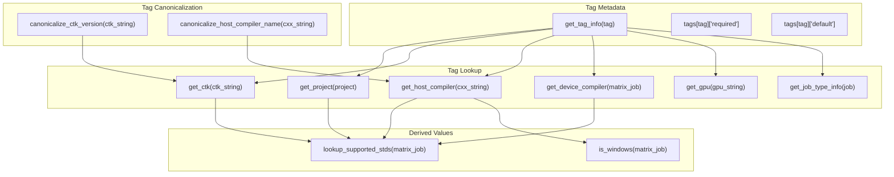

**Key Tag Functions:**
- `get_tag_info(tag)` - retrieves tag metadata from `matrix_yaml['tags']`
- `canonicalize_host_compiler_name(cxx_string)` - standardizes compiler names (e.g., `gcc` → `gcc12`, `gcc-10` → `gcc10`)
- `set_derived_tags(matrix_job)` - computes `sm` from `gpu`, expands `std: all`, applies project job maps

**Sources:** [.github/actions/workflow-build/build-workflow.py:284-303](), [.github/actions/workflow-build/build-workflow.py:132-173](), [.github/actions/workflow-build/build-workflow.py:852-875]()

---

## Dispatch Groups

A **dispatch group** is a named collection of jobs that share common configuration (project, CTK version, compilers). Dispatch groups organize jobs for parallel execution and are displayed as collapsible sections in GitHub Actions UI.

**Structure:**
```json
{
  "<group name>": {
    "standalone": [
      { "id": "ABC", "name": "...", "runner": "...", "image": "...", "command": "..." }
    ],
    "two_stage": [
      {
        "id": "DEF",
        "producers": [ { "id": "GHI", "name": "...", ... } ],
        "consumers": [ { "id": "JKL", "name": "...", ... } ]
      }
    ]
  }
}
```

**Group Name Format:**
```
{project_name} CTK{version} {compiler_info}
```

Examples:
- `libcudacxx CTK11.1 nvcc GCC`
- `Thrust CTK12.0 Clang`

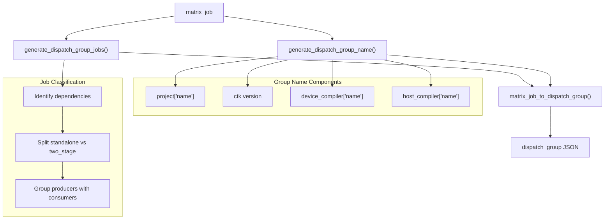

**Sources:** [.github/actions/workflow-build/build-workflow.py:28-35](), [.github/actions/workflow-build/build-workflow.py:345-359](), [.github/actions/workflow-build/build-workflow.py:507-544](), [.github/actions/workflow-build/build-workflow.py:547-554]()

---

## Job Types: Standalone vs Two-Stage

The system supports two execution patterns based on job dependencies.

### Standalone Jobs

**Standalone jobs** execute independently without dependencies. Each job runs a complete workflow (build and test) in a single execution.

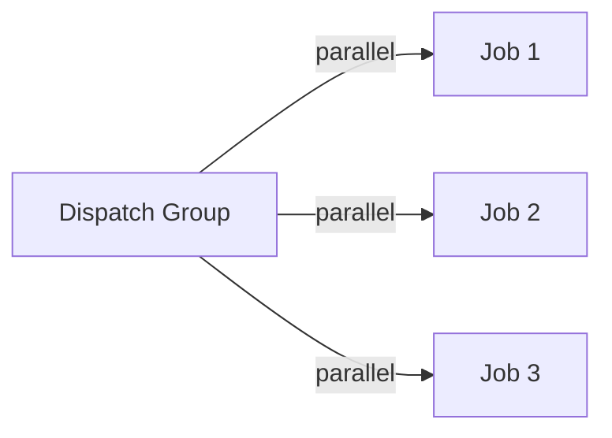

**Characteristics:**
- No inter-job dependencies
- Execute in parallel
- Self-contained execution
- Typically used for simple test jobs

**Sources:** [.github/actions/workflow-build/build-workflow.py:536-537]()

### Two-Stage Jobs

**Two-stage jobs** implement a producer-consumer pattern where one job builds artifacts and multiple jobs consume them. This optimizes scenarios where compilation is expensive but testing across multiple configurations is needed.

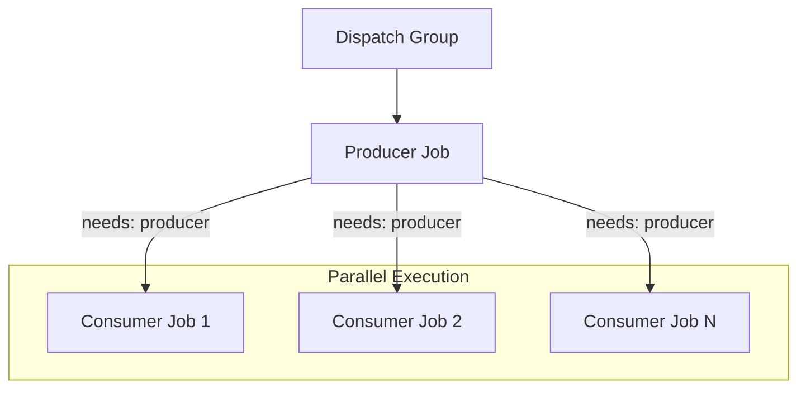

**Two-Stage Structure:**
```json
{
  "id": "uniqueId",
  "producers": [
    {
      "id": "prodId",
      "name": "[C++17 GCC12] Build(amd64): sm{75}",
      "command": "\"./ci/build_libcudacxx.sh\" -std \"17\" -arch \"75-real\""
    }
  ],
  "consumers": [
    {
      "id": "cons1",
      "name": "[C++17 GCC12] Test(amd64, T4)",
      "command": "\"./ci/test_libcudacxx.sh\" -std \"17\""
    },
    {
      "id": "cons2",
      "name": "[C++20 GCC12] Test(amd64, V100)",
      "command": "\"./ci/test_libcudacxx.sh\" -std \"20\""
    }
  ]
}
```

**Dependency Declaration:**
```yaml
# In matrix.yaml jobs section:
jobs:
  test:
    needs: build  # test jobs depend on build jobs
```

**Workflow Implementation:**
The two-stage pattern is enforced by `workflow-dispatch-two-stage-linux.yml` and `workflow-dispatch-two-stage-windows.yml`:
- Producer runs first as a single job
- Consumers wait for producer completion (`needs: producer`)
- Consumers execute in parallel using matrix strategy (`fail-fast: false`)
- Artifacts are exchanged via GitHub Actions artifact storage

**Sources:** [.github/actions/workflow-build/build-workflow.py:37-43](), [.github/actions/workflow-build/build-workflow.py:493-504](), [.github/actions/workflow-build/build-workflow.py:517-534](), [.github/workflows/workflow-dispatch-two-stage-linux.yml:19-76]()

---

## Job JSON

A **job JSON** object represents a single executable job with all information needed to run it on a GitHub Actions runner.

**Complete Structure:**
```json
{
  "id": "ABC",
  "name": "[C++17 GCC12] Test(amd64, T4): sm{75}",
  "runner": "linux-amd64-gpu-t4-latest-1",
  "image": "rapidsai/devcontainers:24.10.00-cpp-gcc12-cuda11.1",
  "command": "\"./ci/test_libcudacxx.sh\" -std \"17\" -arch \"75-real\"",
  "cuda": "11.1",
  "host": "gcc12",
  "origin": {
    "filename": "ci/matrix.yaml",
    "workflow_name": "pull_request",
    "workflow_location": "ci/matrix.yaml:42 (job 3)",
    "original_matrix_job": "{project: libcudacxx, ...}",
    "matrix_job": {
      "project": "libcudacxx",
      "jobs": "Test",
      "cxx": "GCC12",
      "cxx_family": "GCC",
      "cudacxx": "nvcc11.1",
      "cudacxx_family": "nvcc",
      "std": 17,
      "sm": "75-real"
    }
  }
}
```

### Job JSON Fields

| Field | Purpose | Generated By |
|-------|---------|--------------|
| `id` | Compact unique identifier (1-3 chars) | GUID generator |
| `name` | Human-readable job description | `generate_dispatch_job_name()` |
| `runner` | GitHub Actions runner label | `generate_dispatch_job_runner()` |
| `image` | Docker container image | `generate_dispatch_job_image()` |
| `command` | Shell command to execute | `generate_dispatch_job_command()` |
| `cuda` | CUDA toolkit version for devcontainer | `generate_dispatch_job_ctk_version()` |
| `host` | Host compiler for devcontainer | `generate_dispatch_job_host_compiler()` |
| `origin` | Traceability metadata | `generate_dispatch_job_origin()` |

### GUID Generation

Unique job IDs are generated using a compact base64 encoding scheme that produces 1-3 character identifiers:

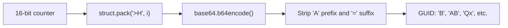

The generator produces up to 65,535 unique IDs before exhaustion.

**Sources:** [.github/actions/workflow-build/build-workflow.py:45-53](), [.github/actions/workflow-build/build-workflow.py:78-96](), [.github/actions/workflow-build/build-workflow.py:481-490](), [.github/actions/workflow-build/build-workflow.py:708-720]()

---

## Devcontainers

**Devcontainers** are Docker images containing specific combinations of CUDA toolkit and host compiler. Each job executes inside a devcontainer to ensure reproducible build environments.

### Devcontainer Image Naming

```
rapidsai/devcontainers:{version}-cpp-{host}-cuda{ctk}
rapidsai/devcontainers:{version}-cuda{ctk}-{host}  # Windows
```

**Examples:**
- `rapidsai/devcontainers:24.10.00-cpp-gcc12-cuda11.1` (Linux)
- `rapidsai/devcontainers:24.10.00-cuda12.0-cl14.39` (Windows)

### Devcontainer Components

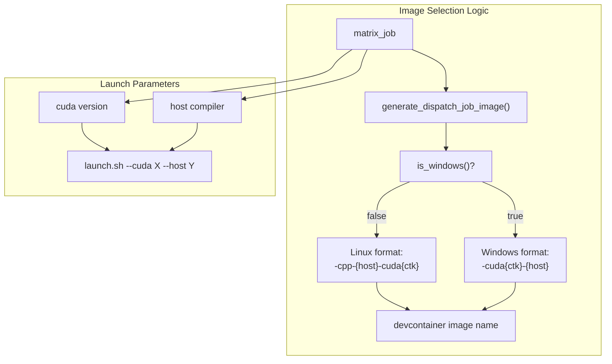

**Key Configuration Values:**
- `devcontainer_version` - global version string from `matrix_yaml['devcontainer_version']`
- `host` - compiler tag (e.g., `gcc12`, `cl14.39`)
- `cuda` - CUDA toolkit version (e.g., `11.1`, `12.0`)

**Verification:**
The `verify-devcontainers` workflow ensures devcontainer configurations remain synchronized with generation scripts by running `make_devcontainers.sh --clean` and checking for modifications.

**Sources:** [.github/actions/workflow-build/build-workflow.py:393-413]()

---

## Workflows

A **workflow** is a named collection of matrix jobs defined in `matrix.yaml`. Workflows represent different CI/CD scenarios (pull requests, nightly builds, weekly tests).

**Common Workflows:**
- `pull_request` - jobs that run on every PR
- `nightly` - comprehensive testing run daily
- `weekly` - extended testing including expensive configurations
- `exclude` - special workflow defining job combinations to filter out
- `override` - emergency override that supersedes all other workflows

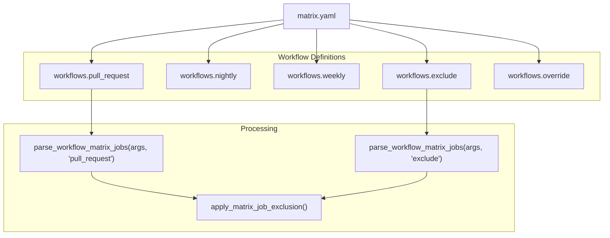

### Workflow Selection

Workflows are selected via command-line arguments:
```bash
build-workflow.py matrix.yaml --workflows pull_request nightly
```

With override support:
```bash
build-workflow.py matrix.yaml --workflows pull_request --allow-override
```

If `override` workflow exists and is non-empty, it supersedes the specified workflows.

**Sources:** [.github/actions/workflow-build/build-workflow.py:922-959](), [.github/actions/workflow-build/build-workflow.py:1031-1048]()

---

## Exclusions

**Exclusions** define invalid or unsupported job combinations that should be filtered out. They are specified in the special `exclude` workflow in `matrix.yaml`.

### Exclusion Logic

An exclusion is a partial matrix job. A job is excluded if it matches **all** specified tags in any exclusion entry.

**Example Exclusion:**
```yaml
exclude:
  - cudacxx: clang
    sm: 90a  # Clang doesn't support sm_90a
  - project: thrust
    cxx: msvc
    std: 20  # Thrust + MSVC + C++20 is broken
```

### Partial Matching

Exclusions support partial list matching. If an exclusion matches some but not all values in a tag's list, only the matched values are removed:

```yaml
# Matrix job:
std: [17, 20]
cxx: gcc10

# Exclusion:
std: [20]
cxx: gcc10

# Result: std becomes [17] (20 is removed, 17 remains)
```

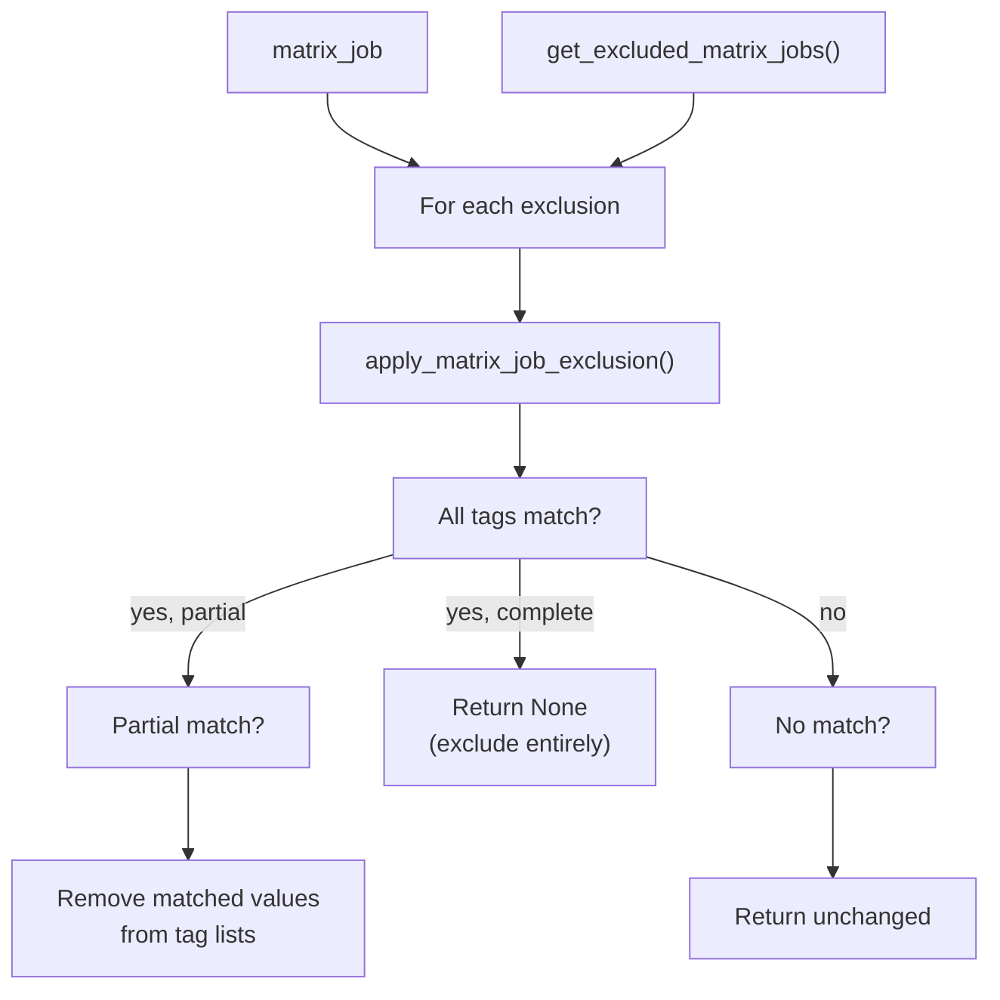

**Sources:** [.github/actions/workflow-build/build-workflow.py:749-808]()

---

## Job Artifacts

**Job artifacts** are files produced during job execution and uploaded to GitHub Actions artifact storage for later retrieval or inter-job exchange.

### Artifact Types

| Artifact | Purpose | Producer | Consumer |
|----------|---------|----------|----------|
| `success` marker | Indicates job completion | All jobs | `workflow-results` |
| `sccache_stats.json` | Compilation cache statistics | Jobs using sccache | `workflow-results` |
| `cccl_meta_bench.csv` | Benchmark results | Benchmark jobs | `workflow-results` |
| Build artifacts | Compiled binaries, libraries | Producer jobs | Consumer jobs |

### Artifact Paths

Artifacts are organized by job ID:
```
jobs/
  {job_id}/
    success
    sccache_stats.json
    cccl_meta_bench.csv
```

### Two-Stage Artifact Flow

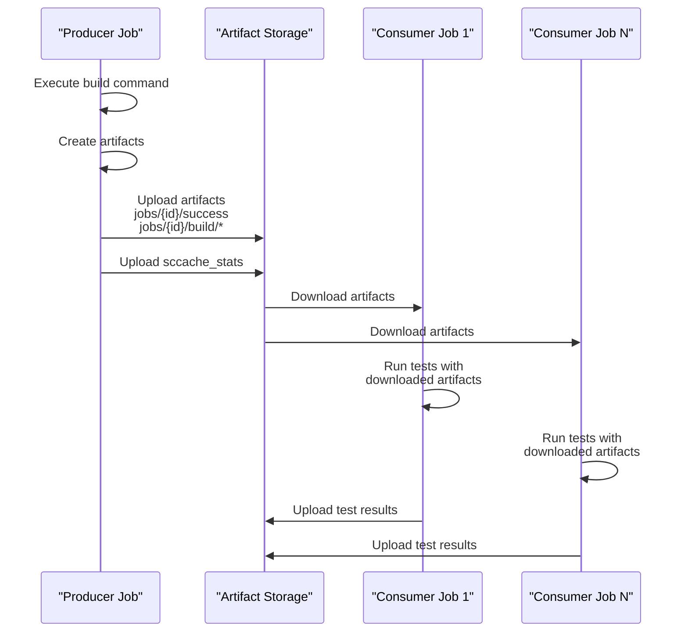

**Sources:** Inferred from system architecture diagrams and two-stage workflow structure

---

## Origin Metadata

**Origin metadata** provides traceability from executed jobs back to their source configuration. This information is used for error reporting and execution summaries.

### Origin Structure

```json
{
  "origin": {
    "filename": "ci/matrix.yaml",
    "workflow_name": "pull_request",
    "workflow_location": "ci/matrix.yaml:42 (job 3)",
    "original_matrix_job": "{project: libcudacxx, ctk: 11.1, ...}",
    "matrix_job": {
      "project": "libcudacxx",
      "jobs": "Test",
      "cxx": "GCC12",
      "cxx_family": "GCC",
      "cudacxx": "nvcc11.1",
      "cudacxx_family": "nvcc",
      "std": 17,
      "sm": "75-real",
      "cpu": "amd64",
      "gpu": "t4",
      "ctk": "11.1"
    }
  }
}
```

### Origin Transformations

Origin metadata is transformed to be summary-friendly:
- `jobs` value becomes human-readable (e.g., `"build"` → `"Build"`)
- `cxx` becomes formatted (e.g., `"gcc12"` → `"GCC12"`)
- `cxx_family` is added for grouping (e.g., `"GCC"`)
- `cudacxx` becomes formatted (e.g., `"nvcc"` → `"nvcc11.1"`)
- `cudacxx_family` is added for grouping (e.g., `"nvcc"`)

These transformations enable hierarchical aggregation in execution summaries by project, job type, compiler family, etc.

**Sources:** [.github/actions/workflow-build/build-workflow.py:448-478]()

---

## Dispatch JSON Structure

The **dispatch JSON** is the final output of the workflow generation pipeline, organized for optimal GitHub Actions execution.

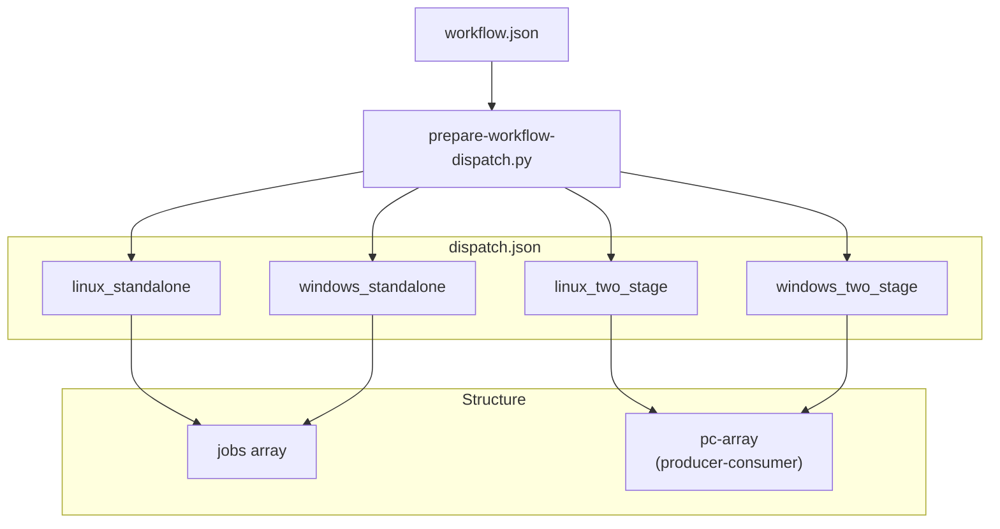

### Split Categories

The dispatch JSON splits jobs into four categories:

1. **`linux_standalone`** - Linux jobs without dependencies
2. **`linux_two_stage`** - Linux producer-consumer chains
3. **`windows_standalone`** - Windows jobs without dependencies
4. **`windows_two_stage`** - Windows producer-consumer chains

This organization allows the dispatch layer to:
- Target appropriate runner OS (Linux vs Windows)
- Use correct execution pattern (standalone vs two-stage)
- Avoid showing hundreds of skipped jobs in GitHub UI
- Parallelize execution efficiently

**Sources:** System architecture diagrams, inferred from dispatch workflow structure

---

