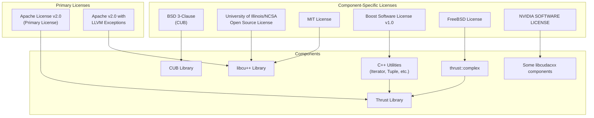
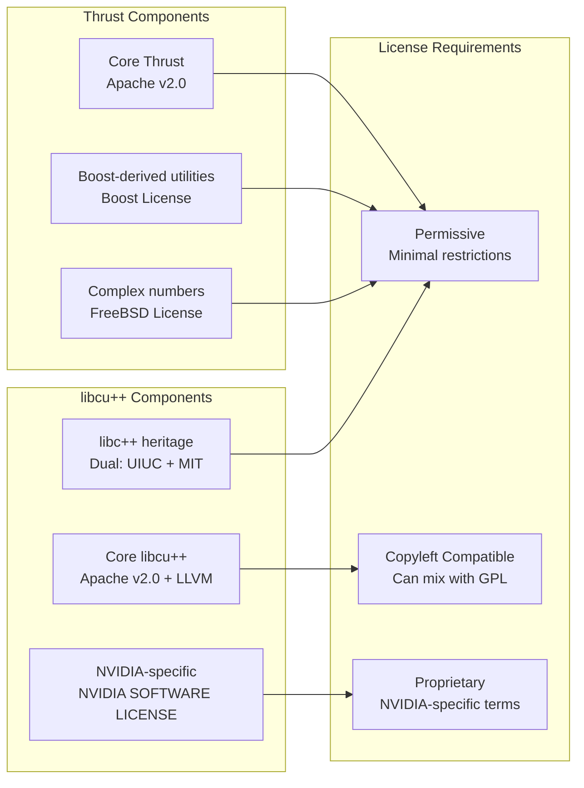
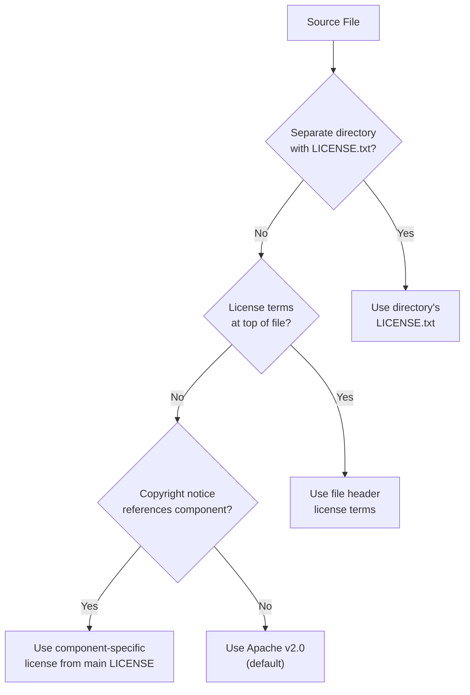
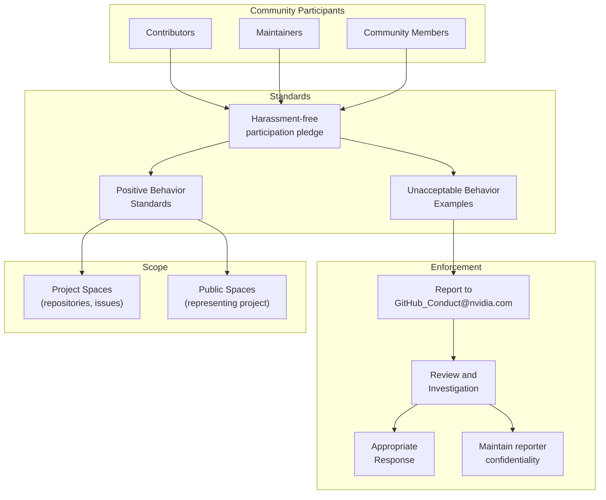
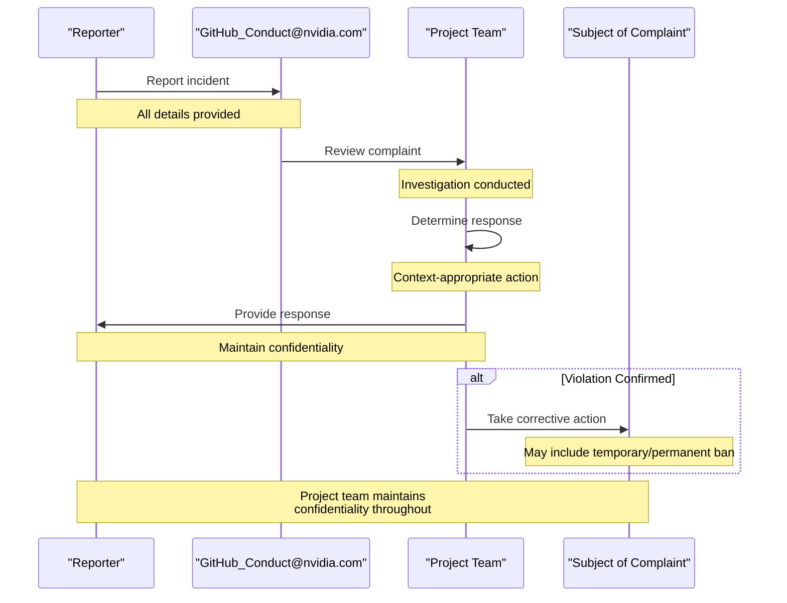
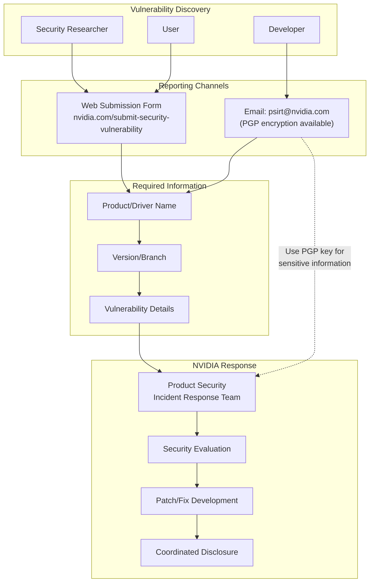
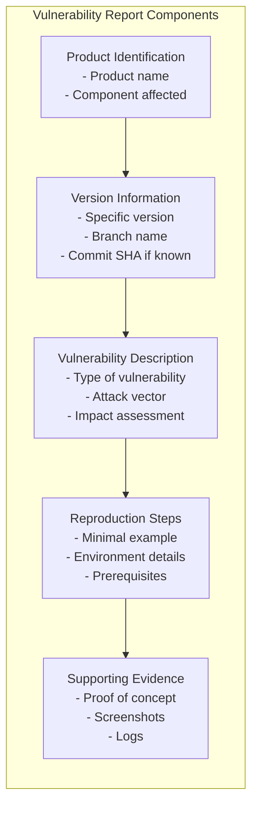

<!-- source: DeepWiki mcp.deepwiki.com · repo NVIDIA/cccl-gha · page 1.3 Legal and Policies · fetched 2026-10-26 -->

# Legal and Policies

Relevant source files

The following files were used as context for generating this wiki page:

- [CODE_OF_CONDUCT.md](CODE_OF_CONDUCT.md)
- [LICENSE](LICENSE)
- [SECURITY.md](SECURITY.md)

## Purpose and Scope

This document describes the legal framework, community standards, and security policies that govern the cccl-gha repository. It covers licensing terms, code of conduct requirements, and security vulnerability reporting procedures. All contributors and users must comply with these policies.

For information about contributing code changes and development practices, see [Development and Contributing](#9). For system requirements and setup, see [System Requirements](#9.1).

---

## License Structure

The cccl-gha repository inherits licensing from its parent CCCL project, which employs a multi-license structure to accommodate different components with distinct heritage and requirements.

### License Hierarchy

**License Component Mapping**

Sources: [LICENSE:1-467]()

### Apache License v2.0

The primary license governing Thrust and most of the codebase is Apache License v2.0 (January 2004). This license grants users the following permissions:

| Permission | Scope | Requirements |
|------------|-------|--------------|
| **Reproduce** | Unlimited copies in Source or Object form | Must include copy of License |
| **Prepare Derivative Works** | Create modified versions | Must mark modified files prominently |
| **Publicly Display/Perform** | Public use of the software | Retain copyright/patent/trademark notices |
| **Distribute** | Redistribute to third parties | Include NOTICE file if present |
| **Sublicense** | Grant sublicenses | Terms must be consistent with Apache License |

**Key Provisions:**

- **Copyright License**: Perpetual, worldwide, non-exclusive, no-charge, royalty-free, irrevocable [LICENSE:70-75]()
- **Patent License**: Includes patent rights for contributions [LICENSE:77-91]()
- **Patent Litigation Termination**: Patent licenses terminate if licensee initiates patent litigation [LICENSE:86-91]()
- **No Warranty**: Software provided "AS IS" without warranties [LICENSE:147-155]()
- **Limitation of Liability**: No liability for damages except as required by law [LICENSE:157-167]()

Sources: [LICENSE:1-205]()

### Apache v2.0 with LLVM Exceptions

The libcu++ library uses Apache License v2.0 with LLVM Exceptions, which provides additional flexibility:

**LLVM Exception 1 - Object Code Embedding:**
Portions of the software embedded into object code during compilation may be redistributed in object form without complying with Sections 4(a), 4(b), and 4(d) of the standard Apache License. This exception enables easier integration into proprietary software. [LICENSE:211-216]()

**LLVM Exception 2 - GPLv2 Compatibility:**
If combined with GPLv2-licensed software and a court determines conflicts exist, specific sections of the Apache License may be waived for the Combined Software only. [LICENSE:218-225]()

Sources: [LICENSE:209-225]()

### BSD 3-Clause License (CUB)

CUB's source code is released under the BSD 3-Clause license, which is more permissive than Apache but requires attribution:

| Requirement | Description |
|-------------|-------------|
| **Copyright Notice** | Must retain copyright notice in source redistributions |
| **Binary Notice** | Must reproduce notice in documentation for binary distributions |
| **Endorsement Restriction** | Cannot use NVIDIA name without permission |

The license explicitly disclaims warranties and limits liability. [LICENSE:441-466]()

Sources: [LICENSE:441-466]()

### Component-Specific Licensing

**Boost Software License v1.0:**
Thrust's iterator, tuple, system, and random number utilities are based on Boost libraries. The Boost license requires that copyright notices and disclaimers be included in all copies but permits derivative works in machine-executable object code form without these restrictions. [LICENSE:379-405]()

**FreeBSD License:**
The `thrust::complex` implementation is derived from FreeBSD with a permissive 2-clause BSD license requiring only copyright notice retention and disclaimer reproduction. [LICENSE:409-438]()

**NVIDIA SOFTWARE LICENSE:**
Some libcudacxx components are covered by NVIDIA's proprietary license with specific restrictions:

- Software licensed only for systems with NVIDIA GPUs [LICENSE:338]()
- Cannot reverse engineer, decompile, or disassemble [LICENSE:339]()
- Cannot modify or create derivative works [LICENSE:340]()
- Cannot use in safety-critical applications without agreement [LICENSE:343]()
- Subject to U.S. export control laws [LICENSE:363-364]()

Sources: [LICENSE:318-370](), [LICENSE:379-405](), [LICENSE:409-438]()

### License Identification System

The LICENSE file documents how to identify which license applies to specific code:

The LICENSE file establishes a two-mechanism identification system:
1. Separate directory tree with its own LICENSE file [LICENSE:233-235]()
2. Specific license terms at the top of individual files [LICENSE:236-237]()

Sources: [LICENSE:228-237]()

---

## Code of Conduct

The repository follows the Contributor Covenant Code of Conduct version 1.4 to ensure a harassment-free environment for all participants.

### Governance Structure

### Standards of Behavior

**Positive Environment Contributions:**

| Behavior | Description |
|----------|-------------|
| **Inclusive Language** | Using welcoming and inclusive terminology |
| **Respectful Discourse** | Being respectful of differing viewpoints and experiences |
| **Constructive Criticism** | Gracefully accepting constructive feedback |
| **Community Focus** | Focusing on what is best for the community |
| **Empathy** | Showing empathy towards other community members |

[CODE_OF_CONDUCT.md:22-29]()

**Unacceptable Behaviors:**

| Behavior | Impact |
|----------|--------|
| **Sexualized Language/Imagery** | Creates hostile environment |
| **Trolling/Derogatory Comments** | Disrupts constructive dialogue |
| **Public/Private Harassment** | Violates personal safety |
| **Publishing Private Information** | Violates privacy (doxxing) |
| **Professionally Inappropriate Conduct** | Damages professional atmosphere |

[CODE_OF_CONDUCT.md:31-40]()

Sources: [CODE_OF_CONDUCT.md:20-40]()

### Maintainer Responsibilities

Project maintainers have explicit responsibilities and authority:

**Responsibilities:**
- Clarify standards of acceptable behavior [CODE_OF_CONDUCT.md:44-45]()
- Take appropriate and fair corrective action [CODE_OF_CONDUCT.md:45-46]()

**Authority:**
- Remove, edit, or reject contributions not aligned with Code of Conduct [CODE_OF_CONDUCT.md:48-50]()
- Ban contributors temporarily or permanently for inappropriate behavior [CODE_OF_CONDUCT.md:50-52]()

**Scope of Application:**
- Within project spaces (repositories, issues, documentation) [CODE_OF_CONDUCT.md:56-57]()
- In public spaces when representing the project [CODE_OF_CONDUCT.md:56-57]()
- Using official project email addresses [CODE_OF_CONDUCT.md:58-59]()
- Posting via official social media [CODE_OF_CONDUCT.md:59]()
- Acting as appointed representative at events [CODE_OF_CONDUCT.md:59-60]()

Sources: [CODE_OF_CONDUCT.md:42-62]()

### Enforcement Process

**Enforcement Contact:** `GitHub_Conduct@nvidia.com` [CODE_OF_CONDUCT.md:66]()

**Process Guarantees:**
- All complaints reviewed and investigated [CODE_OF_CONDUCT.md:66-67]()
- Response deemed necessary and appropriate to circumstances [CODE_OF_CONDUCT.md:67-68]()
- Confidentiality maintained regarding reporter [CODE_OF_CONDUCT.md:68-69]()

**Maintainer Accountability:**
Maintainers who do not follow or enforce the Code of Conduct in good faith may face temporary or permanent repercussions as determined by project leadership. [CODE_OF_CONDUCT.md:72-74]()

Sources: [CODE_OF_CONDUCT.md:64-74]()

### Attribution

The Code of Conduct is adapted from the Contributor Covenant, version 1.4, available at https://www.contributor-covenant.org/version/1/4/code-of-conduct.html [CODE_OF_CONDUCT.md:78-79]()

Sources: [CODE_OF_CONDUCT.md:76-84]()

---

## Security Policies

NVIDIA is dedicated to the security and trust of software products and services, including all source code repositories. The repository follows specific procedures for reporting security vulnerabilities.

### Security Reporting Channels

**Critical Policy: Do not report security vulnerabilities through GitHub issues, pull requests, or discussions.** [SECURITY.md:5]()

### Reporting Methods

**Primary Reporting Channels:**

| Method | Details | Use Case |
|--------|---------|----------|
| **Web Form** | [Security Vulnerability Submission Form](https://www.nvidia.com/object/submit-security-vulnerability.html) | Preferred for most reports |
| **Email** | `psirt@nvidia.com` | Encrypted communication option |

[SECURITY.md:10-11]()

**Email Reporting Guidelines:**

When reporting via email, the following practices are recommended:

1. **PGP Encryption:** Use NVIDIA's public PGP key for secure communication [SECURITY.md:12]()
   - Key available at: https://www.nvidia.com/en-us/security/pgp-key

2. **Required Information:** [SECURITY.md:13-14]()
   - Product/Driver name
   - Version/branch containing the vulnerability

Sources: [SECURITY.md:1-15]()

### Information Security Classification

When reporting vulnerabilities, include the following information structure:

For the cccl-gha repository specifically, reports should identify:
- Whether the vulnerability affects workflow generation, execution, or results collection
- Which scripts or actions are impacted
- Potential for privilege escalation or information disclosure
- Impact on CI/CD integrity

Sources: [SECURITY.md:13-14]()

### Responsible Disclosure

NVIDIA follows responsible disclosure practices:

1. **Acknowledgment:** NVIDIA's Product Security Incident Response Team (PSIRT) acknowledges receipt
2. **Evaluation:** Security team evaluates severity and scope
3. **Remediation:** Patches developed and tested
4. **Coordinated Disclosure:** Public disclosure coordinated with reporter
5. **Credit:** Security researchers appropriately credited (if desired)

The timeline and process follow industry-standard responsible disclosure practices, balancing the need for user protection with thorough remediation.

Sources: [SECURITY.md:1-15]()

---

## Compliance Summary

### License Compliance Checklist

When using or distributing code from this repository, ensure compliance with:

| Requirement | Components | Action Required |
|-------------|------------|-----------------|
| **Apache License Notice** | Thrust, most components | Include LICENSE file and NOTICE (if present) |
| **LLVM Exception Notice** | libcu++ | Include license with LLVM exceptions text |
| **BSD 3-Clause Notice** | CUB | Retain copyright notice in source/binary distributions |
| **Boost License Notice** | Iterator/Tuple utilities | Include copyright and disclaimer in copies |
| **Modified File Marking** | Any modified files | Mark files prominently with change notice |
| **NVIDIA GPU Restriction** | NVIDIA-licensed components | Use only with NVIDIA GPU systems |

### Export Control Compliance

The software is subject to United States export control laws and regulations:

- Cannot ship to embargoed countries [LICENSE:363-364]()
- Reporter must confirm not resident/citizen of embargoed country [LICENSE:365]()
- Subject to Bureau of Industry and Security regulations [LICENSE:363]()
- Subject to OFAC economic sanctions [LICENSE:363]()

Sources: [LICENSE:363-365]()

### Community Participation Requirements

All participants must:

1. **Follow Code of Conduct** in all project spaces [CODE_OF_CONDUCT.md:56-62]()
2. **Report violations** to `GitHub_Conduct@nvidia.com` [CODE_OF_CONDUCT.md:66]()
3. **Report security issues** via proper channels (not GitHub) [SECURITY.md:5]()
4. **Respect license terms** for all components used [LICENSE:1-467]()

Sources: [CODE_OF_CONDUCT.md:56-74](), [SECURITY.md:5](), [LICENSE:1-467]()

---

