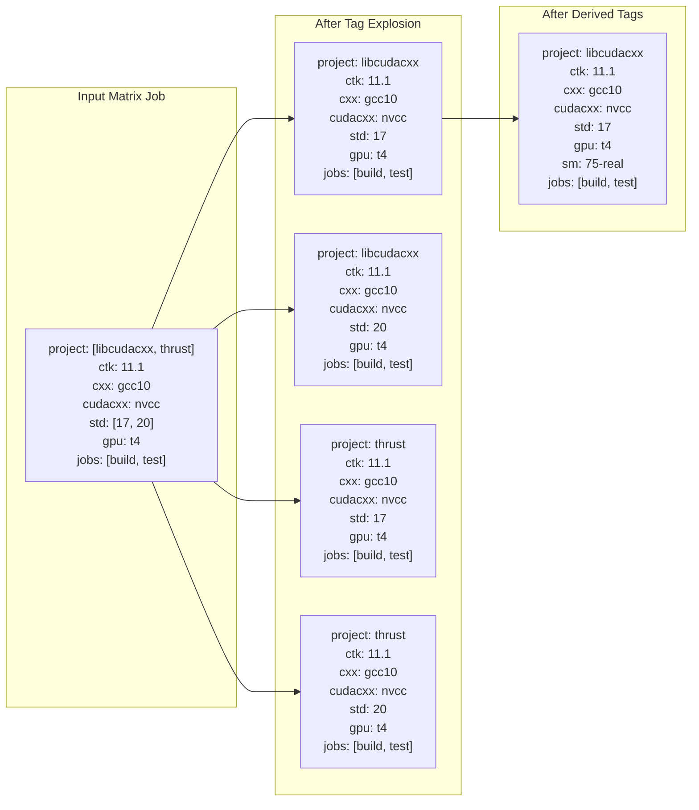
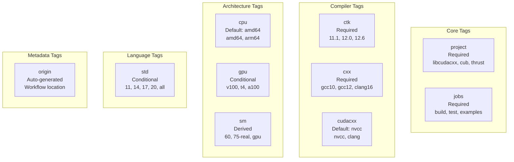
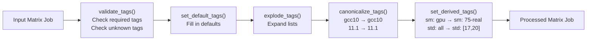
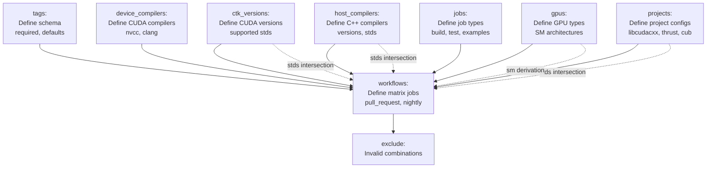
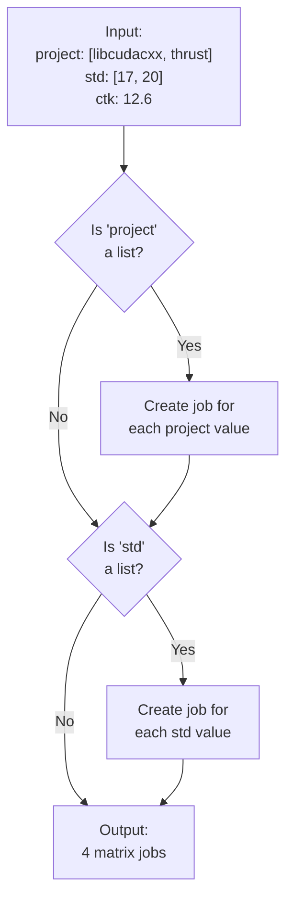
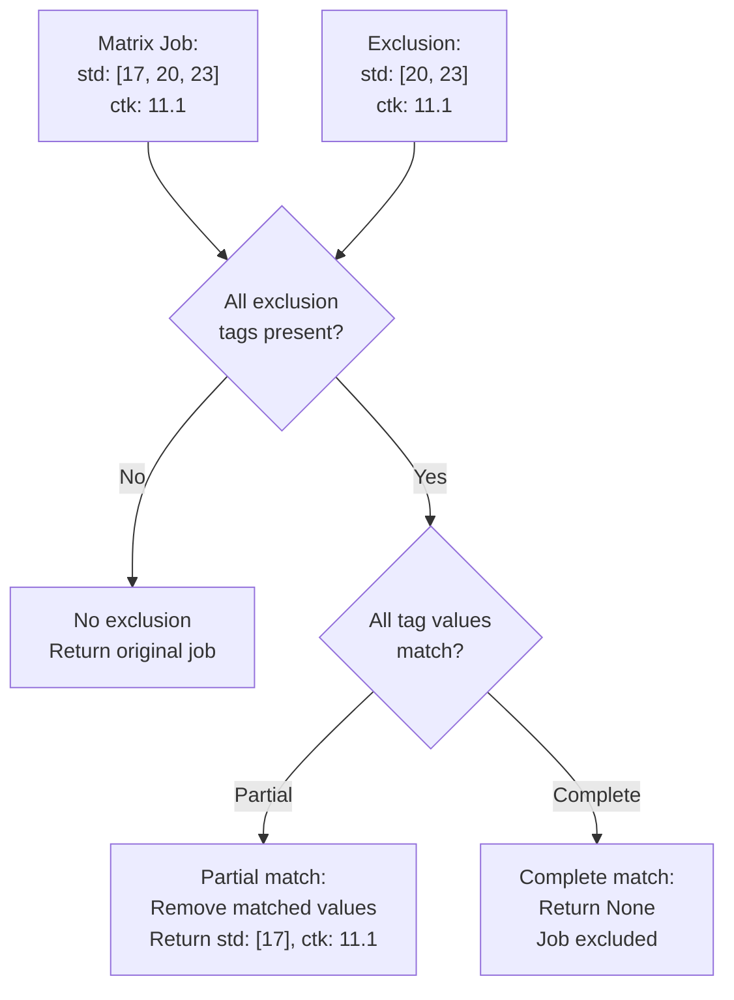
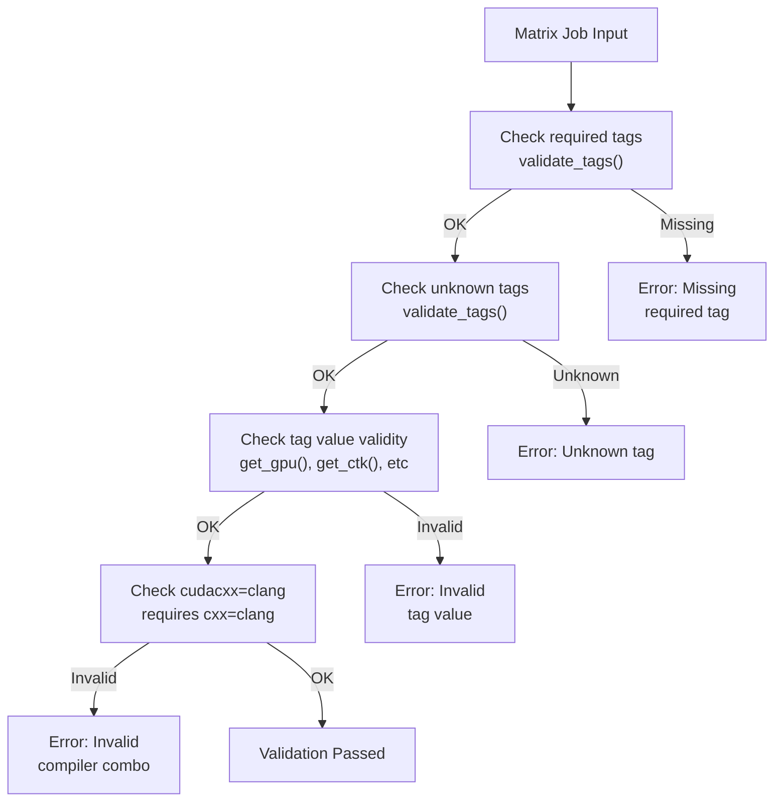

<!-- source: DeepWiki mcp.deepwiki.com · repo NVIDIA/cccl-gha · page 2 Configuration Guide · fetched 2026-10-26 -->

# Configuration Guide

<details>
<summary>Relevant source files</summary>

The following files were used as context for generating this wiki page:

- [.github/actions/workflow-build/build-workflow.py](.github/actions/workflow-build/build-workflow.py)

</details>


## Purpose and Scope

This guide covers the configuration system for the cccl-gha workflow orchestration. The primary configuration artifact is the `matrix.yaml` file, which defines all possible job combinations (projects, CUDA versions, compilers, GPU architectures, etc.) that can be executed in CI workflows. This page provides an overview of the configuration structure, the tag system, and the processing pipeline that transforms human-readable configuration into executable jobs.

For detailed information on specific topics:
- Matrix YAML schema specification: see [Matrix YAML Structure](#2.1)
- Tag validation, defaults, and derived values: see [Tags and Parameters](#2.2)
- Job filtering and exclusion rules: see [Exclusions and Filtering](#2.3)
- The workflow generation pipeline: see [Workflow Generation](#3)
- Generated output formats: see [Generated Artifacts](#3.3)

---

## Configuration Architecture

The configuration system follows a declarative model where users specify **matrix jobs** in YAML format. Each matrix job describes a build/test configuration using a set of **tags** (key-value pairs). The `build-workflow.py` script processes these matrix jobs through multiple transformation stages to produce concrete job specifications that can be executed by GitHub Actions.

### Configuration to Execution Flow

```mermaid
graph TB
    subgraph "Configuration Layer"
        MatrixYAML["matrix.yaml<br/>Human-readable job definitions"]
        Workflows["workflows:<br/>pull_request, nightly, weekly"]
        TagDefs["tags:<br/>project, ctk, cxx, gpu, etc"]
        Exclusions["exclude:<br/>Invalid combinations"]
    end
    
    subgraph "Processing Pipeline (build-workflow.py)"
        Validate["validate_tags()<br/>Schema validation"]
        SetDefaults["set_default_tags()<br/>Fill optional values"]
        Explode["explode_tags()<br/>Expand list values"]
        Canonicalize["canonicalize_tags()<br/>Resolve aliases"]
        Derive["set_derived_tags()<br/>Compute sm, std:all"]
        Exclude["remove_excluded_jobs()<br/>Apply exclusions"]
    end
    
    subgraph "Output Artifacts"
        WorkflowJSON["workflow.json<br/>Fully specified jobs"]
        DispatchJSON["dispatch.json<br/>Grouped by OS/pattern"]
    end
    
    MatrixYAML --> Validate
    Workflows --> Validate
    TagDefs --> Validate
    Validate --> SetDefaults
    SetDefaults --> Explode
    Explode --> Canonicalize
    Canonicalize --> Derive
    Derive --> Exclude
    Exclusions --> Exclude
    Exclude --> WorkflowJSON
    WorkflowJSON --> DispatchJSON
    
    style MatrixYAML fill:#f9f9f9
    style WorkflowJSON fill:#f9f9f9
```



**Configuration Processing Pipeline**

Sources: [.github/actions/workflow-build/build-workflow.py:811-919](), [.github/actions/workflow-build/build-workflow.py:902-920]()

---

## Matrix Job Definition

A **matrix job** is a JSON/YAML object that describes a single build/test configuration. Matrix jobs are defined in the `matrix.yaml` file under named workflows (e.g., `pull_request`, `nightly`).

### Matrix Job Structure



**Tag Explosion and Derivation Example**

Sources: [.github/actions/workflow-build/build-workflow.py:4-54](), [.github/actions/workflow-build/build-workflow.py:877-900]()

### Matrix Job Conceptual Model

The configuration system operates on these core concepts:

| Concept | Description | Example |
|---------|-------------|---------|
| **Matrix Job** | A set of tags describing a build/test configuration | `{project: thrust, ctk: 11.1, cxx: gcc10}` |
| **Tag** | A key-value pair in a matrix job | `ctk: 11.1` |
| **Tag Explosion** | Expanding list-valued tags into multiple jobs | `std: [17, 20]` → two jobs |
| **Tag Canonicalization** | Resolving aliases to standard forms | `gcc10` → `gcc10` (with version lookup) |
| **Derived Tag** | Tag computed from other tags | `sm: gpu` → `sm: 75-real` (from `gpu: t4`) |
| **Dispatch Group** | Collection of related jobs for UI organization | "Thrust CTK11.1 nvcc GCC" |

Sources: [.github/actions/workflow-build/build-workflow.py:4-54]()

---

## Tag System Overview

Tags are the fundamental building blocks of matrix jobs. Each tag represents a dimension of the configuration space (e.g., compiler version, CUDA toolkit, C++ standard).

### Tag Categories



**Tag Organization by Category**

Sources: [.github/actions/workflow-build/build-workflow.py:284-302](), [.github/actions/workflow-build/build-workflow.py:305-321]()

### Tag Properties

Each tag definition in `matrix.yaml` specifies:

| Property | Description | Effect |
|----------|-------------|--------|
| `required` | Must be present in every matrix job | Validation fails if missing |
| `default` | Value used if tag not specified | Makes tag optional |
| `validation` | Schema constraints | Type checking, allowed values |
| `derivation` | Computed from other tags | Not specified by user |

Sources: [.github/actions/workflow-build/build-workflow.py:284-302]()

### Tag Processing Stages



**Tag Processing Pipeline**

Sources: [.github/actions/workflow-build/build-workflow.py:811-860](), [.github/actions/workflow-build/build-workflow.py:902-920]()

---

## Configuration File Structure

The `matrix.yaml` file is organized into top-level sections that define the vocabulary and rules for matrix jobs.

### Top-Level Sections

```yaml
# Version identifier for devcontainer images
devcontainer_version: "24.10"

# All supported C++ standards
all_stds: [11, 14, 17, 20, 23]

# Tag definitions and properties
tags:
  project:
    required: true
  ctk:
    required: true
  cxx:
    required: true
  std:
    default: null
  # ... more tags

# CUDA Toolkit versions and properties
ctk_versions:
  "11.1":
    stds: [11, 14, 17]
  "12.6":
    aka: "curr"
    stds: [11, 14, 17, 20, 23]

# Host compiler definitions
host_compilers:
  gcc:
    name: "GCC"
    exe: "g++"
    container_tag: "gcc"
    versions:
      "10":
        stds: [11, 14, 17, 20]
      "12":
        aka: "12.3"
        stds: [11, 14, 17, 20, 23]

# Device compiler definitions
device_compilers:
  nvcc:
    name: "nvcc"
    exe: "nvcc"
  clang:
    name: "clang++"
    exe: "clang++"

# GPU definitions
gpus:
  t4:
    sm: "75-real"
    testing: false
  a100:
    sm: "80"
    testing: true

# Project definitions
projects:
  libcudacxx:
    name: "libcu++"
    stds: [11, 14, 17, 20]
  thrust:
    name: "Thrust"
    stds: [14, 17, 20]

# Job type definitions
jobs:
  build:
    name: "Build"
    gpu: false
  test:
    name: "Test"
    gpu: true
    needs: "build"

# Workflow definitions
workflows:
  pull_request:
    - project: [libcudacxx, thrust]
      ctk: "12.6"
      cxx: gcc12
      std: [17, 20]
      gpu: t4
      jobs: [build, test]
  
  # Invalid combinations to exclude
  exclude:
    - ctk: "11.1"
      std: 20
```

**Matrix YAML Structure Overview**

Sources: [.github/actions/workflow-build/build-workflow.py:114-130](), [.github/actions/workflow-build/build-workflow.py:133-173](), [.github/actions/workflow-build/build-workflow.py:204-224]()

### Section Relationships



**Configuration Section Dependencies**

Sources: [.github/actions/workflow-build/build-workflow.py:323-338](), [.github/actions/workflow-build/build-workflow.py:852-876]()

---

## Workflow Definitions

Workflows are named collections of matrix jobs that define when and what to execute. Common workflows include `pull_request`, `nightly`, and `weekly`.

### Workflow Syntax

Each workflow entry in the `workflows` section is a list of matrix job objects:

```yaml
workflows:
  pull_request:
    # Example 1: Basic matrix job
    - project: libcudacxx
      ctk: "12.6"
      cxx: gcc12
      std: 17
      gpu: t4
      jobs: [build, test]
    
    # Example 2: Multi-value tags (will explode)
    - project: [libcudacxx, thrust, cub]
      ctk: "12.6"
      cxx: [gcc12, clang16]
      std: [17, 20]
      gpu: v100
      jobs: [build, test]
    
    # Example 3: Using derived tags
    - project: thrust
      ctk: "11.1"
      cxx: gcc10
      std: all          # Derives intersection of supported stds
      gpu: t4
      sm: gpu           # Derives from gpu definition
      jobs: test
```

Sources: [.github/actions/workflow-build/build-workflow.py:922-960]()

### Workflow Selection

The `build-workflow.py` script accepts a `--workflows` argument to select which workflows to process:

```bash
# Single workflow
build-workflow.py matrix.yaml --workflows pull_request

# Multiple workflows (will be merged)
build-workflow.py matrix.yaml --workflows pull_request nightly

# Workflow with filtering
build-workflow.py matrix.yaml --workflows pull_request --dirty-projects thrust
```

Sources: [.github/actions/workflow-build/build-workflow.py:1104-1136]()

---

## Tag Explosion Process

Tag explosion is the process of expanding list-valued tags into multiple matrix jobs, creating the Cartesian product of all possible combinations.

### Explosion Algorithm



**Tag Explosion Decision Flow**

### Explosion Example

| Input | After First Explosion | After Second Explosion |
|-------|----------------------|------------------------|
| `project: [a, b]`<br/>`std: [17, 20]`<br/>`ctk: 12.6` | `project: a, std: [17, 20], ctk: 12.6`<br/>`project: b, std: [17, 20], ctk: 12.6` | `project: a, std: 17, ctk: 12.6`<br/>`project: a, std: 20, ctk: 12.6`<br/>`project: b, std: 17, ctk: 12.6`<br/>`project: b, std: 20, ctk: 12.6` |

Sources: [.github/actions/workflow-build/build-workflow.py:877-900]()

### Non-Exploded Tags

The `jobs` tag is intentionally left as a list to optimize scheduling. Multiple job types in a single matrix entry allow the system to create producer/consumer dependencies efficiently:

```yaml
# This creates a two-stage job: build (producer) → test (consumer)
- project: thrust
  ctk: "12.6"
  cxx: gcc12
  jobs: [build, test]  # NOT exploded
```

Sources: [.github/actions/workflow-build/build-workflow.py:877-883](), [.github/actions/workflow-build/build-workflow.py:507-540]()

---

## Tag Canonicalization

Canonicalization resolves aliases and incomplete specifications to their standard forms, ensuring consistent processing downstream.

### Compiler Name Canonicalization

The `canonicalize_host_compiler_name()` function handles various input formats:

| Input Format | Canonical Output | Notes |
|--------------|------------------|-------|
| `gcc` | `gcc12` | Uses latest version |
| `gcc10` | `gcc10` | Already canonical |
| `gcc-12` | `gcc12` | Removes hyphen |
| `gcc-12.3` | `gcc12` | Uses major version |

The function first parses the input to extract compiler ID and version using regex `^([a-z]+)-?([\d\.]+)?$`, then looks up the compiler definition and resolves aliases.

Sources: [.github/actions/workflow-build/build-workflow.py:132-173]()

### CTK Version Canonicalization

CTK versions support aliases for convenience:

```yaml
ctk_versions:
  "12.6":
    aka: "curr"
    stds: [11, 14, 17, 20, 23]
```

Both `ctk: "12.6"` and `ctk: curr` resolve to the canonical version `"12.6"`.

Sources: [.github/actions/workflow-build/build-workflow.py:113-124]()

---

## Derived Tags

Derived tags are computed from other tags rather than specified by the user. This provides convenience and ensures consistency.

### SM Architecture Derivation

The special value `sm: gpu` automatically derives the SM architecture from the `gpu` tag:

```yaml
# Input
- project: thrust
  gpu: t4
  sm: gpu

# After derivation
- project: thrust
  gpu: t4
  sm: "75-real"  # Derived from gpu definition
```

Sources: [.github/actions/workflow-build/build-workflow.py:852-858]()

### Standard Version Derivation

The special value `std: all` computes the intersection of all supported C++ standards based on the CTK version, host compiler, device compiler, and project:

```yaml
# Input
- project: libcudacxx  # supports [11, 14, 17, 20]
  ctk: "12.6"          # supports [11, 14, 17, 20, 23]
  cxx: gcc12           # supports [11, 14, 17, 20, 23]
  std: all

# After derivation
- project: libcudacxx
  ctk: "12.6"
  cxx: gcc12
  std: [11, 14, 17, 20]  # Intersection of all constraints
```

The intersection logic is implemented in `lookup_supported_stds()`:

Sources: [.github/actions/workflow-build/build-workflow.py:323-338](), [.github/actions/workflow-build/build-workflow.py:859-861]()

### Job Dependency Derivation

Job types can specify dependencies using the `needs` property. The system automatically adds dependencies to the `jobs` list:

```yaml
# Job type definition
jobs:
  test:
    needs: build

# Input matrix job
- project: thrust
  jobs: [test]

# After derivation
- project: thrust
  jobs: [build, test]  # build added as dependency
```

Sources: [.github/actions/workflow-build/build-workflow.py:260-282](), [.github/actions/workflow-build/build-workflow.py:863-868]()

---

## Exclusions

The `exclude` workflow defines invalid tag combinations that should be filtered out. Exclusions are applied after all other processing stages.

### Exclusion Syntax

Exclusions use the same matrix job syntax but are interpreted as filter patterns:

```yaml
workflows:
  exclude:
    # Exclude all jobs with CTK 11.1 and C++20
    - ctk: "11.1"
      std: 20
    
    # Exclude specific compiler/GPU combinations
    - cxx: gcc10
      gpu: a100
    
    # Exclude multiple values
    - project: [libcudacxx, thrust]
      ctk: "11.1"
      std: [20, 23]
```

Sources: [.github/actions/workflow-build/build-workflow.py:748-751]()

### Exclusion Matching Logic

The `apply_matrix_job_exclusion()` function performs partial or complete exclusions:



**Exclusion Matching Decision Tree**

Sources: [.github/actions/workflow-build/build-workflow.py:753-794]()

### Exclusion Examples

| Original Matrix Job | Exclusion Pattern | Result | Reason |
|---------------------|-------------------|--------|--------|
| `ctk: 11.1, std: 20` | `ctk: 11.1, std: 20` | **Excluded** | Complete match |
| `ctk: 11.1, std: [17, 20]` | `ctk: 11.1, std: 20` | `ctk: 11.1, std: [17]` | Partial match |
| `ctk: 11.1, std: 20, cxx: gcc12` | `ctk: 11.1, std: 20` | **Excluded** | All exclusion tags match |
| `ctk: 12.6, std: 20` | `ctk: 11.1, std: 20` | **Not excluded** | ctk doesn't match |

Sources: [.github/actions/workflow-build/build-workflow.py:796-809]()

---

## Configuration Validation

The system performs comprehensive validation to catch errors early and provide helpful error messages.

### Validation Stages



**Validation Flow**

Sources: [.github/actions/workflow-build/build-workflow.py:811-833]()

### Error Message Format

Validation errors include rich context to help locate and fix issues:

```
ci/matrix.yaml:42 (job 3): Missing required tag 'ctk'
  Input: {project: thrust, cxx: gcc12, std: 17, gpu: t4, jobs: [build, test]}
```

The error message includes:
- File path and line number
- Job index in the workflow
- Specific error description
- Original matrix job specification

Sources: [.github/actions/workflow-build/build-workflow.py:109-111](), [.github/actions/workflow-build/build-workflow.py:736-746]()

---

## Configuration Processing Reference

### Key Functions in build-workflow.py

| Function | Purpose | Line Range |
|----------|---------|------------|
| `parse_workflow_matrix_jobs()` | Parse and preprocess workflow matrix jobs | [922-960]() |
| `preprocess_matrix_jobs()` | Orchestrate validation, defaults, explosion, canonicalization | [902-920]() |
| `validate_tags()` | Validate required tags and tag names | [811-833]() |
| `set_default_tags()` | Fill in default values for optional tags | [834-843]() |
| `explode_tags()` | Recursively expand list-valued tags | [886-900]() |
| `canonicalize_tags()` | Resolve aliases to canonical forms | [845-850]() |
| `set_derived_tags()` | Compute derived tag values | [852-876]() |
| `remove_excluded_jobs()` | Apply exclusion filters | [796-809]() |
| `canonicalize_host_compiler_name()` | Canonicalize compiler names | [138-173]() |
| `canonicalize_ctk_version()` | Canonicalize CTK versions | [113-124]() |
| `lookup_supported_stds()` | Compute std intersection | [323-338]() |

Sources: [.github/actions/workflow-build/build-workflow.py:1-1140]()

### Configuration File Location

The primary configuration file is located at:
- **Repository path**: `ci/matrix.yaml` (expected location)
- **Command-line argument**: First positional argument to `build-workflow.py`
- **Environment context**: Specified in workflow-build action

The file path is stored in the global `matrix_yaml['filename']` variable after loading.

Sources: [.github/actions/workflow-build/build-workflow.py:1104-1128]()

---

## Common Configuration Patterns

### Pattern 1: Compiler Matrix

Test multiple compilers with the same configuration:

```yaml
- project: thrust
  ctk: "12.6"
  cxx: [gcc12, clang16, clang17]  # Expands to 3 jobs
  std: 17
  gpu: t4
  jobs: [build, test]
```

### Pattern 2: Standard Matrix

Test all supported C++ standards:

```yaml
- project: libcudacxx
  ctk: "12.6"
  cxx: gcc12
  std: all  # Derives [11, 14, 17, 20]
  gpu: v100
  jobs: test
```

### Pattern 3: Multi-Project Job

Run the same configuration across multiple projects:

```yaml
- project: [libcudacxx, thrust, cub]  # Expands to 3 jobs
  ctk: "12.6"
  cxx: gcc12
  std: 17
  gpu: t4
  jobs: [build, test]
```

### Pattern 4: Build-Once, Test-Many

Leverage two-stage jobs to build once and test on multiple GPUs:

```yaml
# Single build job will be created
# Multiple test jobs will be created (one per GPU)
- project: thrust
  ctk: "12.6"
  cxx: gcc12
  std: 17
  gpu: [v100, t4, a100]  # Expands test jobs only
  jobs: [build, test]
```

Sources: [.github/actions/workflow-build/build-workflow.py:493-540]()

### Pattern 5: Exclusion with Partial Match

Exclude specific standards from older CTK versions:

```yaml
workflows:
  pull_request:
    - project: thrust
      ctk: ["11.1", "12.6"]
      std: [17, 20, 23]
      # ... other tags

  exclude:
    - ctk: "11.1"
      std: [20, 23]  # Only std 17 will run for CTK 11.1
```

Sources: [.github/actions/workflow-build/build-workflow.py:753-794]()

---

## Next Steps

For detailed information on specific aspects of configuration:

- **Matrix YAML Schema**: See [Matrix YAML Structure](#2.1) for complete schema documentation
- **Tag System Details**: See [Tags and Parameters](#2.2) for tag properties, validation rules, and derived tag logic
- **Exclusion Rules**: See [Exclusions and Filtering](#2.3) for advanced exclusion patterns and dirty project filtering
- **Workflow Generation**: See [Workflow Generation](#3) for how configuration transforms into executable jobs
- **Testing Configuration**: See [Troubleshooting Guide](#8.4) for validating and debugging configuration changes

Sources: [.github/actions/workflow-build/build-workflow.py:1-1140]()

---

