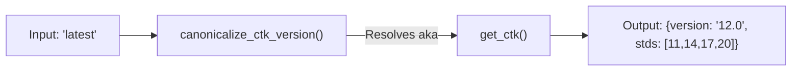
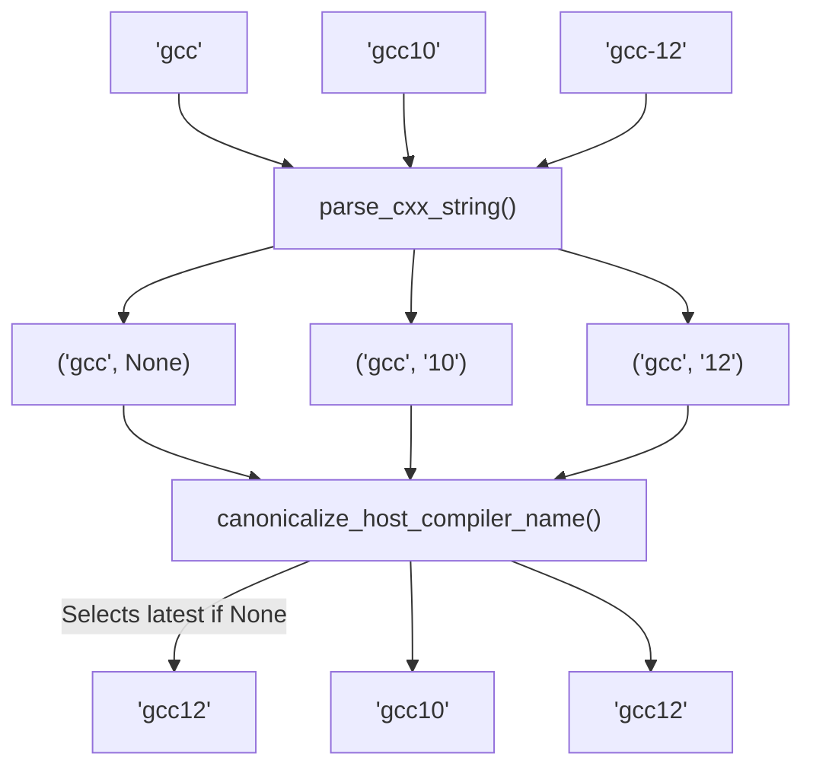
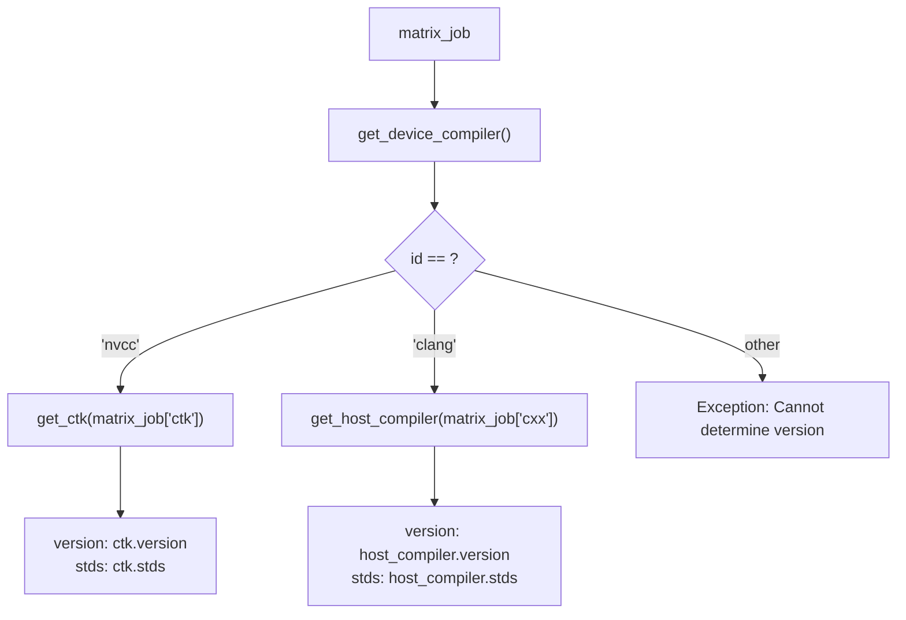
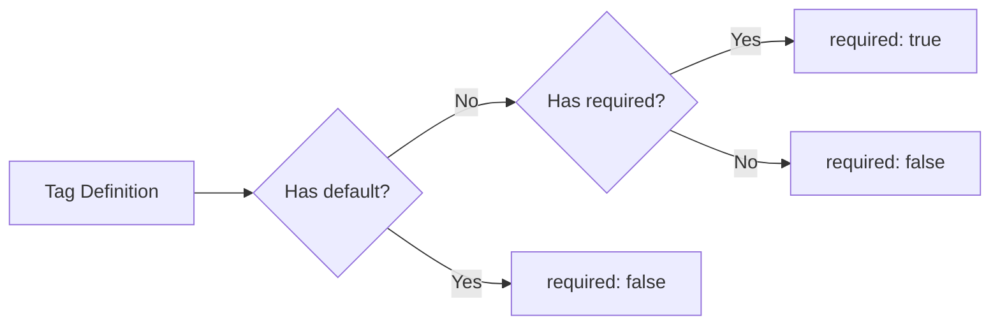
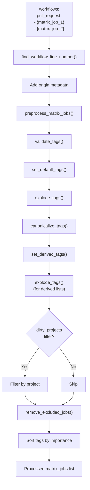
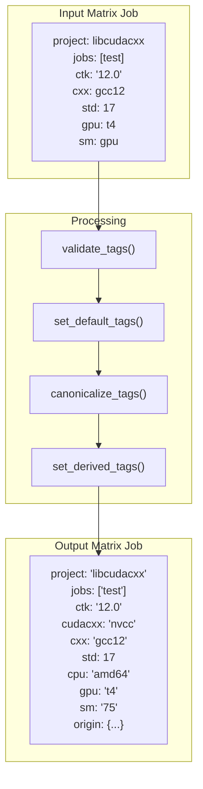

<!-- source: DeepWiki mcp.deepwiki.com · repo NVIDIA/cccl-gha · page 2.1 Matrix YAML Structure · fetched 2026-10-26 -->

# Matrix YAML Structure

<details>
<summary>Relevant source files</summary>

The following files were used as context for generating this wiki page:

- [.github/actions/workflow-build/build-workflow.py](.github/actions/workflow-build/build-workflow.py)

</details>


This document provides detailed documentation of the `matrix.yaml` schema, which serves as the declarative configuration file for defining all possible job combinations in the CCCL CI system. The matrix defines projects, CUDA Toolkit versions, compilers, GPUs, job types, and workflows.

For information about how tags are validated, canonicalized, and processed during workflow generation, see [Tags and Parameters](#2.2). For information about exclusions and filtering mechanisms, see [Exclusions and Filtering](#2.3). For the complete workflow generation pipeline that processes this file, see [Workflow Generation](#3).

## Overview

The `matrix.yaml` file is located at `ci/matrix.yaml` and serves as the single source of truth for all CI job configurations. The file is parsed by `build-workflow.py` which loads it using YAML safe loading and preprocesses version numbers into strings.

**Purpose**: Define the complete configuration space for CCCL CI jobs, including:
- Available CUDA Toolkit (CTK) versions and their supported C++ standards
- Host compilers (gcc, clang, MSVC) with version-specific attributes
- Device compilers (nvcc, clang) for CUDA code compilation
- GPU architectures for testing
- Projects (libcudacxx, CUB, Thrust) with their requirements
- Job types (build, test, etc.) with execution characteristics
- Tags that parameterize job configurations
- Workflow definitions that combine these elements

Sources: [.github/actions/workflow-build/build-workflow.py:1123-1127]()

## Top-Level Schema Structure

```mermaid
graph TB
    MatrixYAML["matrix.yaml"]
    
    MatrixYAML --> CTKVersions["ctk_versions:<br/>CUDA Toolkit definitions"]
    MatrixYAML --> HostCompilers["host_compilers:<br/>C++ compiler definitions"]
    MatrixYAML --> DeviceCompilers["device_compilers:<br/>CUDA compiler definitions"]
    MatrixYAML --> GPUs["gpus:<br/>GPU architecture definitions"]
    MatrixYAML --> Projects["projects:<br/>Project configurations"]
    MatrixYAML --> Jobs["jobs:<br/>Job type definitions"]
    MatrixYAML --> Tags["tags:<br/>Parameter schema"]
    MatrixYAML --> Workflows["workflows:<br/>Job combinations"]
    MatrixYAML --> DevcontainerVersion["devcontainer_version:<br/>Container image version"]
    MatrixYAML --> AllStds["all_stds:<br/>Supported C++ standards"]
    
    CTKVersions --> GetCTK["get_ctk()"]
    HostCompilers --> GetHostCompiler["get_host_compiler()"]
    DeviceCompilers --> GetDeviceCompiler["get_device_compiler()"]
    GPUs --> GetGPU["get_gpu()"]
    Projects --> GetProject["get_project()"]
    Jobs --> GetJobTypeInfo["get_job_type_info()"]
    Tags --> GetTagInfo["get_tag_info()"]
    Workflows --> ParseWorkflowMatrixJobs["parse_workflow_matrix_jobs()"]
```



**Diagram: Matrix YAML Top-Level Structure**

The matrix file is preprocessed by `preprocess_matrix_yaml()` which normalizes all version keys to strings. Each top-level section has a corresponding getter function that validates and retrieves configuration data with appropriate defaults.

Sources: [.github/actions/workflow-build/build-workflow.py:1087-1101](), [.github/actions/workflow-build/build-workflow.py:126-302]()

## CTK Versions Section

The `ctk_versions` section defines available CUDA Toolkit versions and their properties.

### Schema

| Field | Type | Required | Description |
|-------|------|----------|-------------|
| `<version>` | object | Yes | Version string (e.g., "11.1", "12.0") as key |
| `<version>.stds` | list[int] | Yes | Supported C++ standards for this CTK version |
| `<version>.aka` | string | No | Alternative name/alias for this version |

### Example

```yaml
ctk_versions:
  "11.1":
    stds: [11, 14, 17]
  "12.0":
    stds: [11, 14, 17, 20]
    aka: "latest"
```

### Processing

The `canonicalize_ctk_version()` function resolves CTK version strings, including aliases defined in the `aka` field. The `get_ctk()` function retrieves the full CTK definition and adds the version string to the result.



**Diagram: CTK Version Resolution Process**

Sources: [.github/actions/workflow-build/build-workflow.py:113-129]()

## Host Compilers Section

The `host_compilers` section defines C++ compilers used for host code compilation.

### Schema

| Field | Type | Required | Description |
|-------|------|----------|-------------|
| `<id>` | object | Yes | Compiler family identifier (e.g., "gcc", "clang", "msvc") |
| `<id>.name` | string | Yes | Human-readable compiler name |
| `<id>.container_tag` | string | Yes | Tag used in devcontainer image names |
| `<id>.exe` | string | Yes | Compiler executable name |
| `<id>.versions` | object | Yes | Version-specific configurations |
| `<id>.versions.<version>` | object | Yes | Configuration for specific version |
| `<id>.versions.<version>.stds` | list[int] | Yes | Supported C++ standards |
| `<id>.versions.<version>.aka` | string | No | Alternative name for this version |

### Example

```yaml
host_compilers:
  gcc:
    name: "GCC"
    container_tag: "gcc"
    exe: "g++"
    versions:
      "10":
        stds: [11, 14, 17, 20]
      "12":
        stds: [11, 14, 17, 20, 23]
        aka: "latest"
  msvc:
    name: "MSVC"
    container_tag: "cl"
    exe: "cl.exe"
    versions:
      "14.29":
        stds: [14, 17, 20]
```

### Canonicalization

The `parse_cxx_string()` function parses compiler strings like "gcc", "gcc10", or "gcc-12" into `(id, version)` tuples. The `canonicalize_host_compiler_name()` function normalizes these to the format `"gcc10"` (no separator, explicit version). If no version is specified, the latest version is selected by sorting version strings numerically.



**Diagram: Host Compiler Name Canonicalization**

The `is_windows()` function determines if a job targets Windows by checking if `container_tag == "cl"`.

Sources: [.github/actions/workflow-build/build-workflow.py:133-172](), [.github/actions/workflow-build/build-workflow.py:176-201](), [.github/actions/workflow-build/build-workflow.py:340-342]()

## Device Compilers Section

The `device_compilers` section defines compilers for CUDA device code.

### Schema

| Field | Type | Required | Description |
|-------|------|----------|-------------|
| `<id>` | object | Yes | Compiler identifier (e.g., "nvcc", "clang") |
| `<id>.name` | string | Yes | Human-readable compiler name |
| `<id>.exe` | string | Yes | Compiler executable name |

### Example

```yaml
device_compilers:
  nvcc:
    name: "NVCC"
    exe: "nvcc"
  clang:
    name: "Clang CUDA"
    exe: "clang++"
```

### Version Resolution

Unlike host compilers, device compiler versions are not defined in the matrix file. Instead, they are derived:
- For `nvcc`: version and supported standards come from the CTK version
- For `clang`: version and supported standards come from the host compiler

The `get_device_compiler()` function implements this logic and raises an exception for unknown device compilers.



**Diagram: Device Compiler Version Derivation**

Sources: [.github/actions/workflow-build/build-workflow.py:204-223]()

## GPUs Section

The `gpus` section defines GPU architectures available for testing.

### Schema

| Field | Type | Required | Description |
|-------|------|----------|-------------|
| `<id>` | object | Yes | GPU identifier (e.g., "t4", "v100") |
| `<id>.sm` | string | Yes | CUDA compute capability (e.g., "75", "70") |
| `<id>.testing` | bool | No | Whether to use testing runner pool (default: false) |

### Example

```yaml
gpus:
  t4:
    sm: "75"
  v100:
    sm: "70"
    testing: true
  a100:
    sm: "80"
```

### Usage

The `get_gpu()` function retrieves GPU definitions and adds the `id` field to the result. If `testing` is not specified, it defaults to `false`. The GPU's `sm` value is used to derive the `sm` tag when `sm: "gpu"` is specified in a matrix job (see `set_derived_tags()`).

Sources: [.github/actions/workflow-build/build-workflow.py:227-238](), [.github/actions/workflow-build/build-workflow.py:852-857]()

## Projects Section

The `projects` section defines the CCCL projects (libraries) being tested.

### Schema

| Field | Type | Required | Description |
|-------|------|----------|-------------|
| `<id>` | object | Yes | Project identifier (e.g., "libcudacxx", "cub", "thrust") |
| `<id>.name` | string | No | Human-readable name (defaults to id) |
| `<id>.stds` | list[int] | Yes | C++ standards supported by this project |
| `<id>.job_map` | object | No | Maps generic job names to project-specific jobs |

### Example

```yaml
projects:
  libcudacxx:
    name: "libcu++"
    stds: [11, 14, 17, 20]
    job_map:
      test: [test_cpu, test_gpu]
  cub:
    name: "CUB"
    stds: [14, 17, 20]
  thrust:
    name: "Thrust"
    stds: [14, 17, 20]
```

### Job Mapping

The `job_map` field allows a single job name to expand into multiple project-specific jobs. This mapping is applied by `set_derived_tags()` after dependency resolution. For example, specifying `jobs: [test]` for the libcudacxx project expands to `jobs: [test_cpu, test_gpu]`.

Sources: [.github/actions/workflow-build/build-workflow.py:242-256](), [.github/actions/workflow-build/build-workflow.py:869-874]()

## Jobs Section

The `jobs` section defines job types and their execution characteristics.

### Schema

| Field | Type | Required | Description |
|-------|------|----------|-------------|
| `<id>` | object | Yes | Job type identifier (e.g., "build", "test") |
| `<id>.name` | string | No | Human-readable name (defaults to capitalized id) |
| `<id>.gpu` | bool | No | Whether job requires GPU access (default: false) |
| `<id>.needs` | string | No | Job dependency (for producer/consumer pattern) |
| `<id>.invoke` | object | No | Script invocation configuration |
| `<id>.invoke.prefix` | string | No | Script name prefix (defaults to id) |
| `<id>.invoke.args` | string | No | Additional script arguments (default: "") |

### Example

```yaml
jobs:
  build:
    name: "Build"
    gpu: false
    invoke:
      prefix: "build"
  test:
    name: "Test"
    gpu: true
    needs: "build"
    invoke:
      prefix: "test"
      args: "--verbose"
```

### Dependency Resolution

The `needs` field creates producer/consumer relationships. When a job declares a dependency, the system:
1. Adds the dependency to the `jobs` list if not present (via `set_derived_tags()`)
2. Separates producers and consumers during dispatch group generation
3. Creates two-stage dispatch groups (see `generate_dispatch_group_jobs()`)

The `get_job_type_info()` function fills in default values for optional fields.

Sources: [.github/actions/workflow-build/build-workflow.py:260-281](), [.github/actions/workflow-build/build-workflow.py:862-874](), [.github/actions/workflow-build/build-workflow.py:507-539]()

## Tags Section

The `tags` section defines the schema for all configuration parameters (tags) that can appear in matrix jobs.

### Schema

| Field | Type | Required | Description |
|-------|------|----------|-------------|
| `<id>` | object | Yes | Tag identifier (e.g., "std", "sm", "cpu") |
| `<id>.required` | bool | No | Whether tag must be specified (default: false) |
| `<id>.default` | any | No | Default value if not specified |

### Example

```yaml
tags:
  project:
    required: true
  ctk:
    required: true
  cxx:
    required: true
  cudacxx:
    default: "nvcc"
  std:
    # No default, not required
  sm:
    # No default, not required
  cpu:
    default: "amd64"
  gpu:
    # No default, not required
  cmake_options:
    # No default, not required
```

### Tag Processing

Tags are processed in a specific order during workflow generation:
1. **Validation**: `validate_tags()` checks for required tags and unknown tags
2. **Defaults**: `set_default_tags()` applies default values
3. **Explosion**: `explode_tags()` expands list-valued tags into separate jobs
4. **Canonicalization**: `canonicalize_tags()` normalizes compiler/CTK names
5. **Derived Tags**: `set_derived_tags()` computes `sm` from `gpu`, `std: all`, and job dependencies

The `get_tag_info()` function retrieves tag definitions and computes `required` status: a tag with a `default` is never required.



**Diagram: Tag Required Status Computation**

### Important Tag List

The system maintains a sorted list of tags for consistent ordering in `get_all_matrix_job_tags_sorted()`:
- **Important tags** (always first): `project`, `jobs`, `cudacxx`, `cxx`, `ctk`, `gpu`, `std`, `sm`, `cpu`
- **Other tags** (middle, alphabetically sorted)
- **Noise tags** (always last): `origin`

Sources: [.github/actions/workflow-build/build-workflow.py:284-302](), [.github/actions/workflow-build/build-workflow.py:305-320]()

## Workflows Section

The `workflows` section defines named collections of matrix jobs that represent different CI scenarios.

### Schema

| Field | Type | Required | Description |
|-------|------|----------|-------------|
| `<workflow_name>` | list[object] | No | List of matrix job definitions |
| `exclude` | list[object] | No | Special workflow for exclusion rules |
| `override` | list[object] | No | Special workflow that supersedes all others |

### Matrix Job Format

Each matrix job in a workflow is an object with tag-value pairs:

```yaml
workflows:
  pull_request:
    - project: libcudacxx
      jobs: [build, test]
      ctk: "12.0"
      cxx: gcc12
      std: [17, 20]
      cpu: amd64
      gpu: t4
      sm: gpu
    
    - project: [cub, thrust]
      jobs: test
      ctk: "11.1"
      cxx: clang14
      cudacxx: clang
      std: all
```

### Matrix Job Explosion

List-valued tags (except `jobs`) are exploded into separate jobs by `explode_tags()`. The example above produces:
- 1st entry → 2 jobs (std=17, std=20)
- 2nd entry → 2 × N jobs (2 projects × N standards from `std: all`)

### Workflow Processing Flow



**Diagram: Workflow Matrix Job Processing Pipeline**

Sources: [.github/actions/workflow-build/build-workflow.py:922-959](), [.github/actions/workflow-build/build-workflow.py:902-919]()

## Special Workflows

### Exclude Workflow

The `exclude` workflow defines patterns that should be removed from all other workflows. It uses the same matrix job format but:
- Does not require all required tags to be present
- Only explodes and canonicalizes (no validation, defaults, or derived tags)
- Is processed by `get_excluded_matrix_jobs()` and applied by `remove_excluded_jobs()`

```yaml
workflows:
  exclude:
    # Exclude gcc10 + CTK 12.0 combinations
    - cxx: gcc10
      ctk: "12.0"
```

### Override Workflow

The `override` workflow supersedes all other workflows when:
1. The `--allow-override` flag is passed to `build-workflow.py`
2. The `override` workflow exists and is non-empty

When activated, the system prints a notice and processes only the override workflow, ignoring the `--workflows` argument. This is useful for debugging specific configurations.

Sources: [.github/actions/workflow-build/build-workflow.py:748-808](), [.github/actions/workflow-build/build-workflow.py:1031-1038]()

## Additional Top-Level Fields

### devcontainer_version

String field specifying the version tag for devcontainer images. Used when generating image names in `generate_dispatch_job_image()`.

Example:
```yaml
devcontainer_version: "24.10"
```

This produces image names like `rapidsai/devcontainers:24.10-cpp-gcc12-cuda12.0`.

### all_stds

List of all C++ standards supported across the system. Used by `lookup_supported_stds()` to compute the intersection of standards supported by the CTK, host compiler, device compiler, and project.

Example:
```yaml
all_stds: [11, 14, 17, 20, 23]
```

Sources: [.github/actions/workflow-build/build-workflow.py:323-337](), [.github/actions/workflow-build/build-workflow.py:404-412]()

## Complete Matrix Job Structure

After preprocessing, a fully specified matrix job contains all resolved tags and derived metadata:



**Diagram: Matrix Job Transformation Example**

| Tag | Input Value | Processing | Output Value |
|-----|-------------|------------|--------------|
| `project` | `libcudacxx` | Validated | `"libcudacxx"` |
| `jobs` | `[test]` | Validated | `["test"]` |
| `ctk` | `12.0` | Canonicalized | `"12.0"` |
| `cudacxx` | (not specified) | Default applied | `"nvcc"` |
| `cxx` | `gcc12` | Canonicalized | `"gcc12"` |
| `std` | `17` | Validated | `17` |
| `cpu` | (not specified) | Default applied | `"amd64"` |
| `gpu` | `t4` | Validated | `"t4"` |
| `sm` | `gpu` | Derived from gpu | `"75"` |
| `origin` | (not specified) | Added by system | `{filename, workflow_name, workflow_location, original_matrix_job}` |

The `origin` field contains metadata for error reporting and result aggregation:
- `filename`: Path to matrix.yaml
- `workflow_name`: Name of the workflow this job came from
- `workflow_location`: File path and line number
- `original_matrix_job`: JSON representation of the original input

Sources: [.github/actions/workflow-build/build-workflow.py:736-745](), [.github/actions/workflow-build/build-workflow.py:811-861]()

## Related Code Entities Reference

| Function | Purpose | File Location |
|----------|---------|---------------|
| `preprocess_matrix_yaml()` | Normalize version keys to strings | [.github/actions/workflow-build/build-workflow.py:1087-1101]() |
| `canonicalize_ctk_version()` | Resolve CTK version aliases | [.github/actions/workflow-build/build-workflow.py:113-123]() |
| `get_ctk()` | Retrieve CTK definition | [.github/actions/workflow-build/build-workflow.py:126-129]() |
| `parse_cxx_string()` | Parse compiler string into (id, version) | [.github/actions/workflow-build/build-workflow.py:133-135]() |
| `canonicalize_host_compiler_name()` | Normalize host compiler names | [.github/actions/workflow-build/build-workflow.py:139-172]() |
| `get_host_compiler()` | Retrieve host compiler definition | [.github/actions/workflow-build/build-workflow.py:176-201]() |
| `get_device_compiler()` | Retrieve device compiler definition | [.github/actions/workflow-build/build-workflow.py:204-223]() |
| `get_gpu()` | Retrieve GPU definition | [.github/actions/workflow-build/build-workflow.py:227-238]() |
| `get_project()` | Retrieve project definition | [.github/actions/workflow-build/build-workflow.py:242-256]() |
| `get_job_type_info()` | Retrieve job type definition | [.github/actions/workflow-build/build-workflow.py:260-281]() |
| `get_tag_info()` | Retrieve tag schema definition | [.github/actions/workflow-build/build-workflow.py:284-302]() |
| `get_all_matrix_job_tags_sorted()` | Get ordered list of all tags | [.github/actions/workflow-build/build-workflow.py:305-320]() |
| `lookup_supported_stds()` | Compute supported C++ standards | [.github/actions/workflow-build/build-workflow.py:323-337]() |
| `is_windows()` | Check if job targets Windows | [.github/actions/workflow-build/build-workflow.py:340-342]() |
| `validate_tags()` | Validate matrix job tags | [.github/actions/workflow-build/build-workflow.py:811-832]() |
| `set_default_tags()` | Apply default tag values | [.github/actions/workflow-build/build-workflow.py:834-842]() |
| `canonicalize_tags()` | Normalize tag values | [.github/actions/workflow-build/build-workflow.py:845-849]() |
| `set_derived_tags()` | Compute derived tag values | [.github/actions/workflow-build/build-workflow.py:852-875]() |
| `explode_tags()` | Expand list-valued tags | [.github/actions/workflow-build/build-workflow.py:886-899]() |
| `preprocess_matrix_jobs()` | Full preprocessing pipeline | [.github/actions/workflow-build/build-workflow.py:902-919]() |
| `parse_workflow_matrix_jobs()` | Parse and process workflow definition | [.github/actions/workflow-build/build-workflow.py:922-959]() |
| `get_excluded_matrix_jobs()` | Parse exclude workflow | [.github/actions/workflow-build/build-workflow.py:748-750]() |
| `remove_excluded_jobs()` | Apply exclusion rules | [.github/actions/workflow-build/build-workflow.py:796-808]() |

Sources: [.github/actions/workflow-build/build-workflow.py:1-1140]()

---

