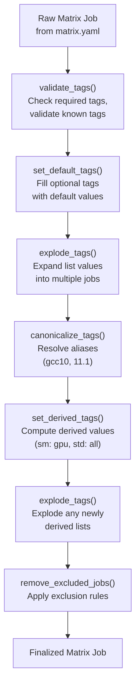
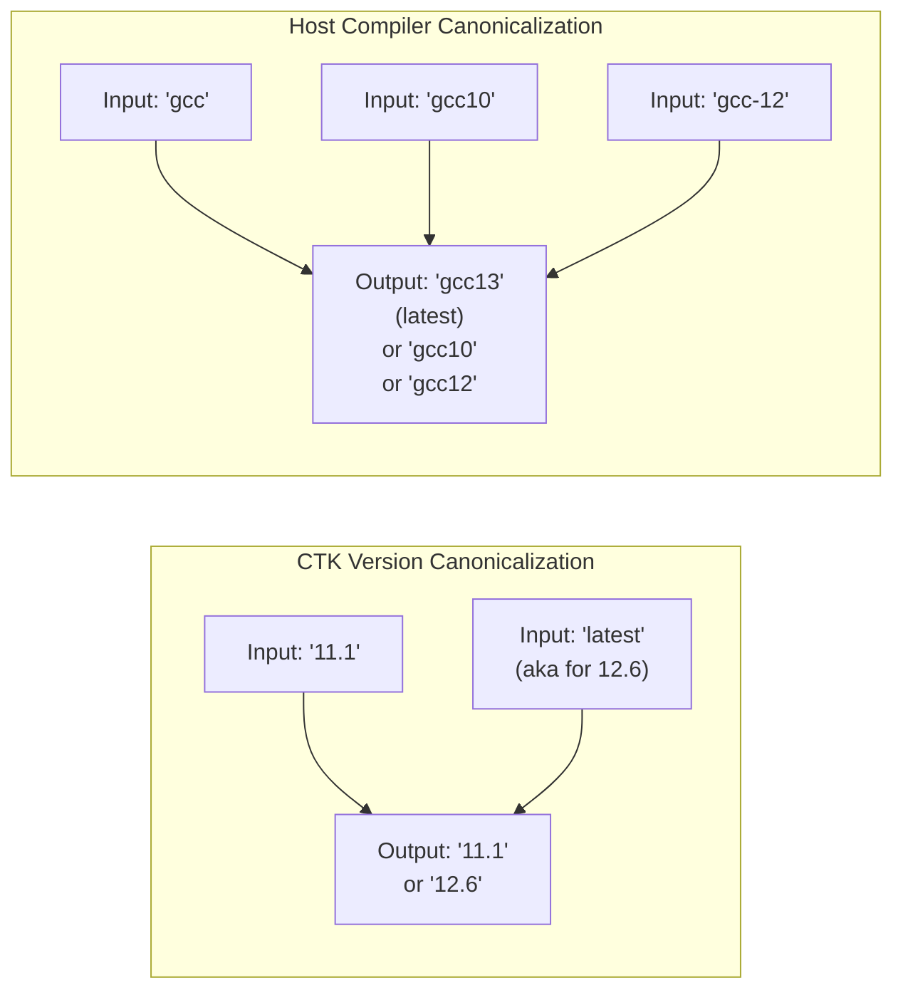
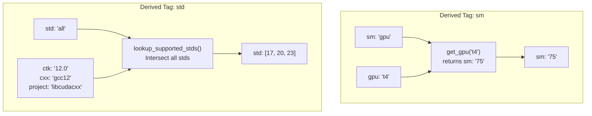
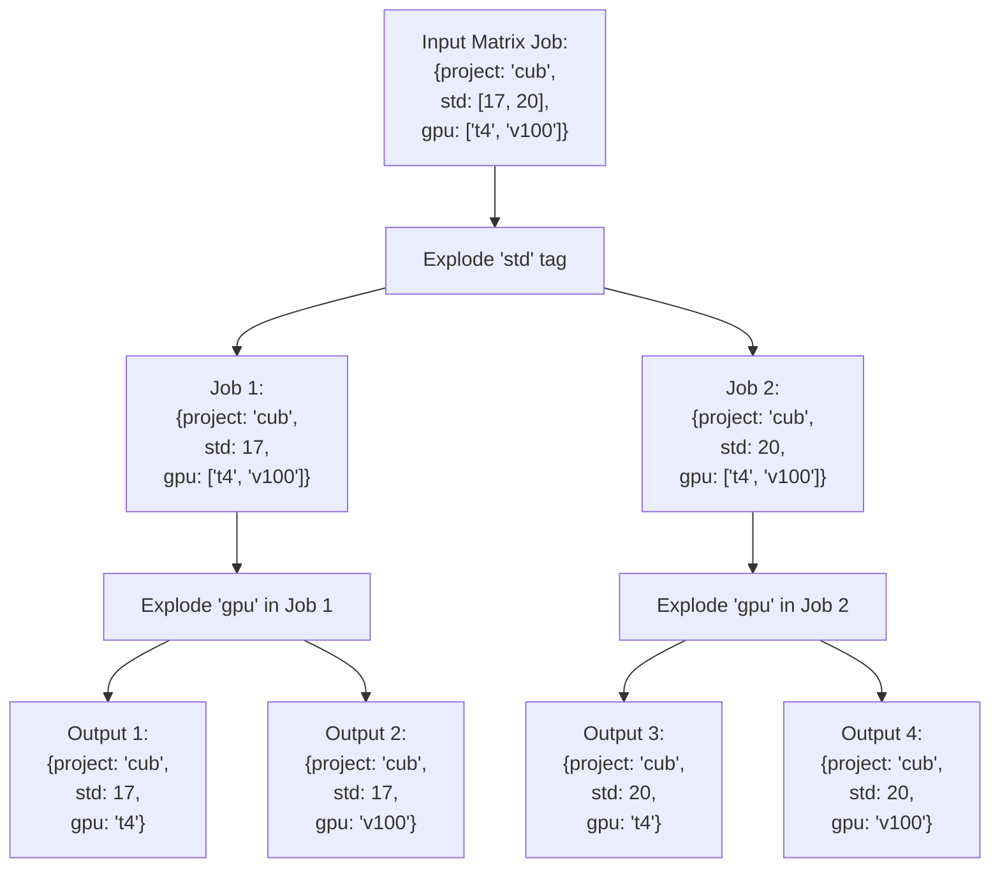

<!-- source: DeepWiki mcp.deepwiki.com · repo NVIDIA/cccl-gha · page 2.2 Tags and Parameters · fetched 2026-10-26 -->

# Tags and Parameters

<details>
<summary>Relevant source files</summary>

The following files were used as context for generating this wiki page:

- [.github/actions/workflow-build/build-workflow.py](.github/actions/workflow-build/build-workflow.py)

</details>


This page documents the tag system used to define job configurations in `matrix.yaml`. Tags are key-value parameters that specify build configurations such as projects, compilers, CUDA versions, and GPU architectures. The workflow generation system processes these tags through multiple stages of validation, canonicalization, and derivation to produce fully-specified job definitions.

For information about the overall structure of `matrix.yaml`, see [Matrix YAML Structure](#2.1). For information about excluding specific tag combinations, see [Exclusions and Filtering](#2.3).

## Tag Concepts

A **tag** is a configuration parameter that appears in a matrix job definition. Each tag has:
- An **ID**: the key name used in `matrix.yaml` (e.g., `ctk`, `cxx`, `std`)
- A **required** status: whether the tag must be present in every job
- A **default** value: optional value used when tag is omitted
- Validation rules and canonicalization logic

Tags are defined in the `tags` section of `matrix.yaml` and referenced in workflow job definitions.

**Sources:** [.github/actions/workflow-build/build-workflow.py:285-302]()

## Tag Definitions

The following table lists all standard tags recognized by the system:

| Tag ID | Description | Required | Default | Example Values |
|--------|-------------|----------|---------|----------------|
| `project` | Target project to build/test | Yes | - | `libcudacxx`, `cub`, `thrust` |
| `jobs` | Job types to execute | Yes | - | `build`, `test`, `[build, test]` |
| `ctk` | CUDA Toolkit version | Yes | - | `11.1`, `12.0`, `12.6` |
| `cudacxx` | Device compiler | No | `nvcc` | `nvcc`, `clang` |
| `cxx` | Host compiler | Yes | - | `gcc10`, `gcc-12`, `clang16` |
| `cpu` | CPU architecture | No | `amd64` | `amd64`, `arm64` |
| `gpu` | GPU architecture for testing | Conditional | - | `t4`, `v100`, `a100` |
| `std` | C++ standard(s) | No | - | `17`, `20`, `all` |
| `sm` | CUDA compute capability | No | - | `75`, `80-real`, `gpu` |
| `cmake_options` | Additional CMake flags | No | - | `-DCMAKE_BUILD_TYPE=Debug` |

**Sources:** [.github/actions/workflow-build/build-workflow.py:285-302]()

## Tag Processing Pipeline

Tags undergo a multi-stage transformation pipeline before becoming job specifications. The following diagram illustrates this pipeline:



**Diagram: Tag Processing Pipeline in preprocess_matrix_jobs()**

**Sources:** [.github/actions/workflow-build/build-workflow.py:902-919](), [.github/actions/workflow-build/build-workflow.py:922-959]()

## Required vs Optional Tags

### Required Tags

Required tags must be present in every matrix job definition (unless excluded by context). Missing required tags cause validation errors.

```python
# From get_tag_info()
if 'required' not in result:
    result['required'] = False

if 'default' in result:
    result['required'] = False  # Tags with defaults are never required
```

Validation occurs in `validate_tags()`:

```python
for tag in all_tags:
    tag_info = get_tag_info(tag)
    if tag not in matrix_job:
        if tag_info['required']:
            raise Exception(f"Missing required tag '{tag}'")
```

**Special validation rules:**
- If `cudacxx: clang` is specified, `cxx` must also be `clang` (validated at [build-workflow.py:820-822]())
- The `gpu` tag is conditionally required when job types require GPU execution

**Sources:** [.github/actions/workflow-build/build-workflow.py:293-299](), [.github/actions/workflow-build/build-workflow.py:811-832]()

### Optional Tags

Optional tags may be omitted. The system handles them in two ways:

1. **Tags with defaults**: Automatically filled by `set_default_tags()`
2. **Tags without defaults**: Left undefined, job specification adapts accordingly

Example from `set_default_tags()`:

```python
for tag in all_tags:
    if tag in matrix_job:
        continue
    
    tag_info = get_tag_info(tag)
    if tag_info['default']:
        matrix_job[tag] = tag_info['default']
```

**Sources:** [.github/actions/workflow-build/build-workflow.py:834-843]()

## Tag Canonicalization

Canonicalization resolves aliases and normalizes tag values to standard formats. This allows flexible input syntax while maintaining consistent internal representation.



**Diagram: Tag Canonicalization Examples**

### CTK Version Canonicalization

The `canonicalize_ctk_version()` function handles CTK versions and their aliases:

```python
@memoize_result
def canonicalize_ctk_version(ctk_string):
    if ctk_string in matrix_yaml['ctk_versions']:
        return ctk_string
    
    # Check for aka's:
    for ctk_key, ctk_value in matrix_yaml['ctk_versions'].items():
        if 'aka' in ctk_value and ctk_string == ctk_value['aka']:
            return ctk_key
    
    raise Exception(f"Unknown CTK version '{ctk_string}'")
```

**Example:** If `matrix.yaml` defines `12.6: {aka: "latest"}`, then specifying `ctk: latest` resolves to `ctk: 12.6`.

**Sources:** [.github/actions/workflow-build/build-workflow.py:113-123]()

### Host Compiler Canonicalization

The `canonicalize_host_compiler_name()` function normalizes compiler specifications:

**Input formats supported:**
- `gcc` → uses latest version defined in `matrix.yaml`
- `gcc10` → uses version 10
- `gcc-12` → normalizes to `gcc12`

**Output format:** Always `{compiler_id}{version}` (e.g., `gcc12`, `clang16`)

```python
@memoize_result
def canonicalize_host_compiler_name(cxx_string):
    id, version = parse_cxx_string(cxx_string)
    
    if not version:
        # Use latest version
        version = max(hc_def['versions'].keys(), 
                     key=lambda x: tuple(map(int, x.split('.'))))
    
    # Check for version aliases
    if not version in hc_def['versions']:
        for version_key, version_data in hc_def['versions'].items():
            if 'aka' in version_data and version == version_data['aka']:
                version = version_key
    
    return f"{id}{version}"
```

**Sources:** [.github/actions/workflow-build/build-workflow.py:132-172]()

### Canonicalization Entry Point

The main `canonicalize_tags()` function applies canonicalization to relevant tags:

```python
def canonicalize_tags(matrix_job):
    if 'ctk' in matrix_job:
        matrix_job['ctk'] = canonicalize_ctk_version(matrix_job['ctk'])
    if 'cxx' in matrix_job:
        matrix_job['cxx'] = canonicalize_host_compiler_name(matrix_job['cxx'])
```

**Sources:** [.github/actions/workflow-build/build-workflow.py:845-850]()

## Derived Tags

Derived tags are computed values based on other tags. The system supports two primary derived tags: `sm` and `std`.



**Diagram: Derived Tag Resolution**

### Derived SM (Compute Capability)

When `sm: gpu` is specified, the SM architecture is derived from the `gpu` tag:

```python
def set_derived_tags(matrix_job):
    if 'sm' in matrix_job and matrix_job['sm'] == 'gpu':
        if not 'gpu' in matrix_job:
            raise Exception("\"sm: 'gpu'\" requires tag 'gpu'.")
        gpu = get_gpu(matrix_job['gpu'])
        matrix_job['sm'] = gpu['sm']  # e.g., '75' for T4
```

**Example transformation:**
```yaml
# Input
gpu: t4
sm: gpu

# Output (after derivation)
gpu: t4
sm: 75
```

**Sources:** [.github/actions/workflow-build/build-workflow.py:853-857]()

### Derived std (C++ Standard)

When `std: all` is specified, the system computes the intersection of supported standards across all relevant components:

```python
def lookup_supported_stds(matrix_job):
    stds = set(matrix_yaml['all_stds'])
    if 'ctk' in matrix_job:
        ctk = get_ctk(matrix_job['ctk'])
        stds = stds & set(ctk['stds'])
    if 'cxx' in matrix_job:
        host_compiler = get_host_compiler(matrix_job['cxx'])
        stds = stds & set(host_compiler['stds'])
    if 'cudacxx' in matrix_job:
        device_compiler = get_device_compiler(matrix_job)
        stds = stds & set(device_compiler['stds'])
    if 'project' in matrix_job:
        project = get_project(matrix_job['project'])
        stds = stds & set(project['stds'])
    return sorted(list(stds))
```

**Intersection logic:**
1. Start with all possible C++ standards
2. Intersect with CTK supported standards
3. Intersect with host compiler supported standards
4. Intersect with device compiler supported standards
5. Intersect with project-specific standards

**Example:**
```yaml
# Input
project: libcudacxx
ctk: 11.8
cxx: gcc10
std: all

# Output (after derivation)
project: libcudacxx
ctk: 11.8
cxx: gcc10
std: [17, 20]  # Intersection result
```

**Sources:** [.github/actions/workflow-build/build-workflow.py:323-337](), [.github/actions/workflow-build/build-workflow.py:859-860]()

### Job Dependency Resolution

Derived tags also handle job dependencies. When a job type declares dependencies via the `needs` field, those dependencies are automatically added to the `jobs` list:

```python
# Add all deps before applying project job maps:
for job in matrix_job['jobs']:
    job_info = get_job_type_info(job)
    dep = job_info['needs']
    if dep and dep not in matrix_job['jobs']:
        matrix_job['jobs'].append(dep)
```

**Example:**
```yaml
# Input
jobs: [test]

# If test job needs build (from job definitions)
# Output (after derivation)
jobs: [test, build]
```

**Sources:** [.github/actions/workflow-build/build-workflow.py:863-867]()

### Project Job Mapping

Projects can define job expansions via the `job_map` configuration. This allows project-specific job types to expand into multiple concrete jobs:

```python
# Apply project job map:
project = get_project(matrix_job['project'])
for original_job, expanded_jobs in project['job_map'].items():
    if original_job in matrix_job['jobs']:
        matrix_job['jobs'].remove(original_job)
        matrix_job['jobs'] += expanded_jobs
```

**Sources:** [.github/actions/workflow-build/build-workflow.py:869-874]()

## Tag Explosion

Tag explosion converts list-valued tags into multiple distinct jobs. This enables concise matrix definitions that generate many configurations.



**Diagram: Tag Explosion Creating Cartesian Product**

### Explosion Algorithm

The `explode_tags()` function recursively expands list-valued tags:

```python
def explode_tags(matrix_job, explode_tag=None):
    if not explode_tag:
        explode_tag = next_explode_tag(matrix_job)
    
    if not explode_tag:
        return [matrix_job]  # No more lists to explode
    
    result = []
    for value in matrix_job[explode_tag]:
        new_job = copy.deepcopy(matrix_job)
        new_job[explode_tag] = value
        result.extend(explode_tags(new_job))  # Recursive
    
    return result
```

**Key characteristics:**
- Recursive: Explodes one tag, then recursively explodes remaining lists
- Cartesian product: Generates all combinations of list values
- Deep copy: Each output job is independent

**Sources:** [.github/actions/workflow-build/build-workflow.py:886-899]()

### Non-Exploded Tags

Certain tags are intentionally kept as lists to optimize GitHub Actions scheduling:

```python
def next_explode_tag(matrix_job):
    non_exploded_tags = ['jobs']
    
    for tag in matrix_job:
        if not tag in non_exploded_tags and isinstance(matrix_job[tag], list):
            return tag
    return None
```

The `jobs` tag remains as a list because it's processed differently during dispatch group generation, where producer/consumer relationships are analyzed.

**Sources:** [.github/actions/workflow-build/build-workflow.py:877-883]()

### Multiple Explosion Passes

The pipeline performs explosion twice:

1. **First pass**: After setting defaults, before canonicalization ([build-workflow.py:914]())
2. **Second pass**: After setting derived tags ([build-workflow.py:918]())

This two-pass approach is necessary because derived tags like `std: all` may produce lists that need explosion:

```yaml
# Input
std: all

# After derivation (becomes a list)
std: [17, 20, 23]

# After second explosion (three jobs)
Job 1: std: 17
Job 2: std: 20
Job 3: std: 23
```

**Sources:** [.github/actions/workflow-build/build-workflow.py:902-919]()

## Tag Sorting

After all transformations, tags are sorted by "importance" for consistent output formatting:

```python
@static_result
def get_all_matrix_job_tags_sorted():
    all_tags = set(matrix_yaml['tags'].keys())
    
    # Always first, information dense:
    sorted_important_tags = ['project', 'jobs', 'cudacxx', 'cxx', 
                             'ctk', 'gpu', 'std', 'sm', 'cpu']
    
    # Always last, derived:
    sorted_noise_tags = ['origin']
    
    # In between: alphabetical
    sorted_tags = set(sorted_important_tags + sorted_noise_tags)
    sorted_meh_tags = sorted(list(all_tags - sorted_tags))
    
    return sorted_important_tags + sorted_meh_tags + sorted_noise_tags
```

This ensures that critical identifying information appears first when inspecting job definitions.

**Sources:** [.github/actions/workflow-build/build-workflow.py:305-320](), [.github/actions/workflow-build/build-workflow.py:956-957]()

## Complete Tag Processing Example

The following table shows a concrete example of a matrix job progressing through the entire tag pipeline:

| Stage | Input/Output |
|-------|--------------|
| **Raw Input** | `{project: "cub", ctk: "latest", cxx: "gcc", std: "all", gpu: "t4", sm: "gpu"}` |
| **After Validation** | ✓ All required tags present |
| **After Set Defaults** | `{project: "cub", ctk: "latest", cxx: "gcc", std: "all", gpu: "t4", sm: "gpu", cudacxx: "nvcc", cpu: "amd64"}` |
| **After First Explosion** | (No lists yet) |
| **After Canonicalization** | `{project: "cub", ctk: "12.6", cxx: "gcc13", std: "all", gpu: "t4", sm: "gpu", cudacxx: "nvcc", cpu: "amd64"}` |
| **After Derived Tags** | `{project: "cub", ctk: "12.6", cxx: "gcc13", std: [17, 20, 23], gpu: "t4", sm: "75", cudacxx: "nvcc", cpu: "amd64"}` |
| **After Second Explosion** | Three jobs: same as above with `std: 17`, `std: 20`, `std: 23` |
| **After Exclusions** | (Assume no exclusions match) |
| **Final Output** | Three complete, finalized matrix jobs ready for dispatch group generation |

**Sources:** [.github/actions/workflow-build/build-workflow.py:902-959]()

## Tag Origin Tracking

Each matrix job carries an `origin` tag that tracks provenance for error reporting and result aggregation:

```python
def get_matrix_job_origin(matrix_job, workflow_name, workflow_location):
    filename = matrix_yaml['filename']
    original_matrix_job = json.dumps(matrix_job, indent=None, separators=(', ', ': '))
    original_matrix_job = original_matrix_job.replace('"', '')
    return {
        'filename': filename,
        'workflow_name': workflow_name,
        'workflow_location': workflow_location,
        'original_matrix_job': original_matrix_job
    }
```

The `origin` tag includes:
- **filename**: Path to `matrix.yaml`
- **workflow_name**: Source workflow (e.g., `pull_request`, `nightly`)
- **workflow_location**: File path and line number
- **original_matrix_job**: The unexpanded job definition as written

This information is preserved through all transformations and included in job dispatch specifications for debugging and results reporting.

**Sources:** [.github/actions/workflow-build/build-workflow.py:736-745](), [.github/actions/workflow-build/build-workflow.py:938-942]()

---

