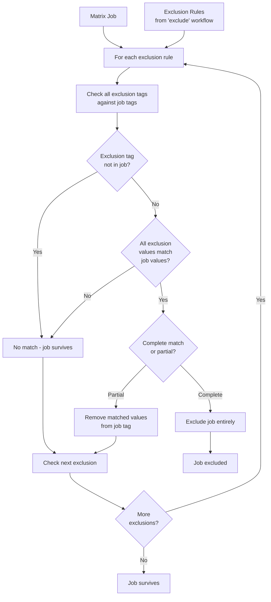
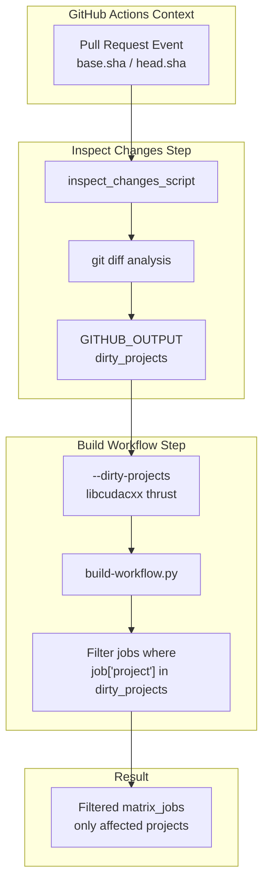
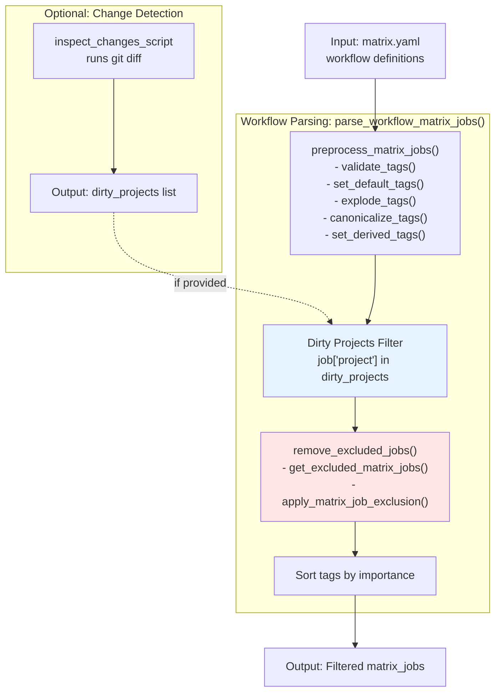

<!-- source: DeepWiki mcp.deepwiki.com · repo NVIDIA/cccl-gha · page 2.3 Exclusions and Filtering · fetched 2026-10-26 -->

# Exclusions and Filtering

<details>
<summary>Relevant source files</summary>

The following files were used as context for generating this wiki page:

- [.github/actions/workflow-build/action.yml](.github/actions/workflow-build/action.yml)
- [.github/actions/workflow-build/build-workflow.py](.github/actions/workflow-build/build-workflow.py)

</details>


This document describes how to exclude specific job combinations from workflows and filter jobs based on changed files. These mechanisms reduce CI compute costs by preventing invalid configurations from executing and skipping unaffected projects.

For information about the overall matrix configuration structure, see [Matrix YAML Structure](#2.1). For details on the workflow generation pipeline where these filters are applied, see [build-workflow.py Pipeline](#3.1).

## Overview

The cccl-gha system provides two filtering mechanisms:

1. **Exclusions**: Declarative rules in `matrix.yaml` that remove invalid or unsupported job combinations (e.g., incompatible compiler versions with specific CUDA toolkits)
2. **Dirty Projects Filtering**: Dynamic filtering based on git diff analysis that runs only jobs for projects affected by code changes

Both filters are applied during the workflow generation phase, before jobs are dispatched to runners.

## Exclusion System

### Defining Exclusions

Exclusions are defined in a special `exclude` workflow within `matrix.yaml`. This workflow uses the same syntax as regular workflows but is never executed directly—it serves solely as a filter definition.

**Sources:** [.github/actions/workflow-build/build-workflow.py:748-750](), [.github/actions/workflow-build/build-workflow.py:922-929]()

**Example Exclusion Matrix:**

```yaml
workflows:
  exclude:
    - {ctk: '11.1', cxx: gcc13}  # GCC 13 not supported with CTK 11.1
    - {cudacxx: clang, gpu: v100}  # Clang CUDA incompatible with V100
    - {project: thrust, std: 11}  # Thrust requires C++14 minimum
```

### Exclusion Matching Logic

The exclusion matching algorithm evaluates each matrix job against all exclusion rules. A job is excluded if **all tags** specified in an exclusion rule match the job's corresponding tag values.

**Title: Exclusion Matching Decision Flow**



**Sources:** [.github/actions/workflow-build/build-workflow.py:753-793](), [.github/actions/workflow-build/build-workflow.py:796-808]()

### Matching Rules

| Condition | Behavior | Example |
|-----------|----------|---------|
| Exclusion tag not present in job | No match—job not affected | Exclusion `{ctk: 11.1}` does not affect jobs without `ctk` tag |
| No exclusion values match job values | No match—job not affected | Exclusion `{cxx: gcc10}` does not affect `{cxx: gcc11}` |
| Partial match (some values match) | Remove matched values from list | Job `{std: [11, 14, 17]}` with exclusion `{std: 11}` becomes `{std: [14, 17]}` |
| Complete match (all values match) | Exclude job entirely | Job `{ctk: 11.1, cxx: gcc10}` fully matches exclusion `{ctk: 11.1, cxx: gcc10}` |

**Sources:** [.github/actions/workflow-build/build-workflow.py:753-793]()

### Partial Exclusions

The exclusion system supports **partial matches** for tags with list values. This is particularly useful for the `jobs` tag, which often contains multiple job types. If only some values in a list match the exclusion, those values are removed while preserving the rest.

**Example:**

```yaml
# Matrix job definition
- project: libcudacxx
  jobs: [build, test, benchmark]
  ctk: 11.1
  cxx: gcc10

# Exclusion rule
- project: libcudacxx
  jobs: benchmark
  ctk: 11.1
```

**Result:** The job survives with `jobs: [build, test]`—only `benchmark` is removed.

**Sources:** [.github/actions/workflow-build/build-workflow.py:777-791]()

### Processing Pipeline Integration

Exclusions are applied after tag explosion and canonicalization but before dispatch group generation:

**Title: Exclusion Application in Processing Pipeline**

```mermaid
graph LR
    Input["matrix.yaml<br/>workflow definitions"]
    
    Parse["parse_workflow_matrix_jobs()"]
    Validate["validate_tags()"]
    Defaults["set_default_tags()"]
    Explode1["explode_tags()"]
    Canon["canonicalize_tags()"]
    Derived["set_derived_tags()"]
    Explode2["explode_tags()<br/>(derived tags)"]
    
    Exclude["remove_excluded_jobs()"]
    GetExcluded["get_excluded_matrix_jobs()"]
    ApplyExclusion["apply_matrix_job_exclusion()"]
    
    Dispatch["matrix_job_to_dispatch_group()"]
    
    Input --> Parse
    Parse --> Validate
    Validate --> Defaults
    Defaults --> Explode1
    Explode1 --> Canon
    Canon --> Derived
    Derived --> Explode2
    
    Explode2 --> Exclude
    GetExcluded --> Exclude
    Exclude --> ApplyExclusion
    ApplyExclusion --> Dispatch
    
    style Exclude fill:#ffe6e6
    style GetExcluded fill:#ffe6e6
    style ApplyExclusion fill:#ffe6e6
```



**Sources:** [.github/actions/workflow-build/build-workflow.py:902-919](), [.github/actions/workflow-build/build-workflow.py:922-959]()

## Change-Based Filtering (Dirty Projects)

### Overview

Change-based filtering reduces CI costs on pull requests by running only jobs for projects affected by code changes. This is implemented through an optional `inspect_changes_script` that performs git diff analysis.

**Sources:** [.github/actions/workflow-build/action.yml:12-19](), [.github/actions/workflow-build/action.yml:61-72]()

### Configuration

The `workflow-build` action accepts the following inputs for change detection:

| Input | Description | Required |
|-------|-------------|----------|
| `inspect_changes_script` | Path to script that outputs `dirty_projects` | No |
| `inspect_changes_base_sha` | Base git ref for diff comparison (e.g., `origin/main`) | No |

**Example Action Usage:**

```yaml
- uses: ./.github/actions/workflow-build
  with:
    workflows: pull_request
    inspect_changes_script: ./ci/inspect_changes.sh
    inspect_changes_base_sha: ${{ github.event.pull_request.base.sha }}
```

**Sources:** [.github/actions/workflow-build/action.yml:12-19]()

### Inspect Changes Script Requirements

The script must:
1. Accept two arguments: `base_sha` and `head_sha`
2. Perform git diff analysis between these refs
3. Output a `dirty_projects` variable to `GITHUB_OUTPUT`

**Example Output Format:**

```bash
# Script writes to GITHUB_OUTPUT:
dirty_projects=libcudacxx thrust
```

This indicates that only jobs with `project: libcudacxx` or `project: thrust` should execute.

**Sources:** [.github/actions/workflow-build/action.yml:61-72]()

### Integration with Workflow Generation

**Title: Dirty Projects Filtering Data Flow**



**Sources:** [.github/actions/workflow-build/action.yml:61-72](), [.github/actions/workflow-build/action.yml:74-88]()

### Filtering Implementation

The dirty projects filter is applied in `parse_workflow_matrix_jobs()` after tag preprocessing but before exclusion removal:

```python
# build-workflow.py:947-949
if args.dirty_projects != None:  # Explicitly check for None
    matrix_jobs = [job for job in matrix_jobs if job['project'] in args.dirty_projects]
```

**Key Points:**
- Checks explicitly for `None` to distinguish between "no filtering" and "empty list" (no projects changed)
- Simple list comprehension filter on the `project` tag
- Applied after tag explosion/canonicalization, so all jobs have a single `project` value
- Occurs **before** exclusion removal to avoid wasted computation

**Sources:** [.github/actions/workflow-build/build-workflow.py:947-949]()

### Empty Dirty Projects Behavior

If `dirty_projects` is an empty list (no relevant files changed), all jobs are filtered out:

```yaml
# No jobs generated → workflows skip entirely
workflow.json: {}
```

This results in no dispatch jobs and zero runner allocation, maximizing cost savings.

**Sources:** [.github/actions/workflow-build/build-workflow.py:947-949]()

## Combined Filtering Pipeline

**Title: Complete Filtering Pipeline**



**Sources:** [.github/actions/workflow-build/build-workflow.py:922-959]()

## Processing Order Rationale

The filtering pipeline applies filters in this specific order:

1. **Tag preprocessing** (validation, defaults, explosion, canonicalization)
2. **Dirty projects filter** (if enabled)
3. **Exclusion removal**
4. **Tag sorting**

**Rationale:**

| Step | Reason for Placement |
|------|---------------------|
| Preprocessing first | Ensures all tags are standardized before filtering logic runs |
| Dirty projects before exclusions | Avoids computing exclusions for jobs that will be filtered anyway—performance optimization |
| Exclusions before sorting | Sorting is cosmetic and should operate on final job set |

**Sources:** [.github/actions/workflow-build/build-workflow.py:902-959]()

## Exclusion Tag Validation

The exclusion workflow supports **partial tag validation**—exclusion rules do not need to specify all required tags. This is implemented via the `ignore_required` parameter:

```python
# build-workflow.py:811-829
def validate_tags(matrix_job, ignore_required=False):
    if not ignore_required:
        for tag in all_tags:
            tag_info = get_tag_info(tag)
            if tag not in matrix_job:
                if tag_info['required']:
                    raise Exception(f"Missing required tag '{tag}'")
```

When processing the `exclude` workflow:

```python
# build-workflow.py:902-909
if is_exclusion_matrix:
    for matrix_job in matrix_jobs:
        validate_tags(matrix_job, ignore_required=True)  # Skip required check
        for job in explode_tags(matrix_job):
            canonicalize_tags(job)
```

This allows exclusions like `{ctk: 11.1}` without specifying `project`, `cxx`, etc.

**Sources:** [.github/actions/workflow-build/build-workflow.py:811-829](), [.github/actions/workflow-build/build-workflow.py:902-919]()

## Error Reporting

Exclusion matching failures are reported with context through the `error_message_with_matrix_job()` function:

```python
# build-workflow.py:109-110
def error_message_with_matrix_job(matrix_job, message):
    return f"{matrix_job['origin']['workflow_location']}: {message}\n  Input: {matrix_job['origin']['original_matrix_job']}"
```

This provides:
- File name and line number where the job was defined
- Original job specification before preprocessing
- Specific error message

**Example Error:**

```
ci/matrix.yaml:42 (job 3): "sm: 'gpu'" requires tag 'gpu'.
  Input: {project: thrust, ctk: 11.1, cxx: gcc10, sm: gpu}
```

**Sources:** [.github/actions/workflow-build/build-workflow.py:109-110]()

## Summary

| Feature | Purpose | Implementation |
|---------|---------|----------------|
| **Exclusions** | Remove invalid job combinations | `exclude` workflow in `matrix.yaml` + `remove_excluded_jobs()` |
| **Partial Exclusions** | Remove specific values from list tags | `apply_matrix_job_exclusion()` with update_dict logic |
| **Dirty Projects** | Run only affected projects on PRs | `inspect_changes_script` + `--dirty-projects` flag |
| **Processing Order** | Optimize performance | Dirty filter before exclusions to reduce computation |

Both filtering mechanisms reduce CI costs: exclusions prevent invalid configurations from ever being generated, while dirty projects filtering adapts to code changes dynamically. Together, they ensure only necessary, valid jobs execute.

**Sources:** [.github/actions/workflow-build/build-workflow.py:753-808](), [.github/actions/workflow-build/build-workflow.py:922-959](), [.github/actions/workflow-build/action.yml:12-19](), [.github/actions/workflow-build/action.yml:61-88]()

---

