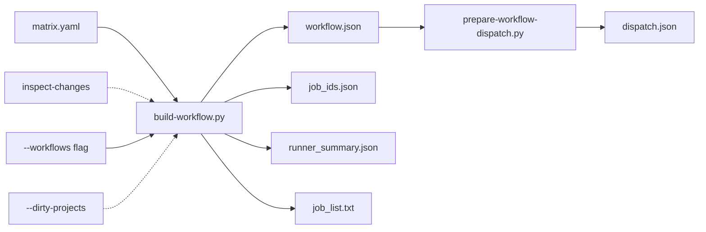
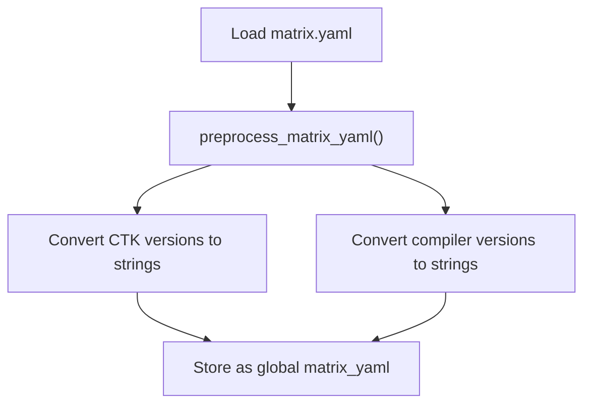
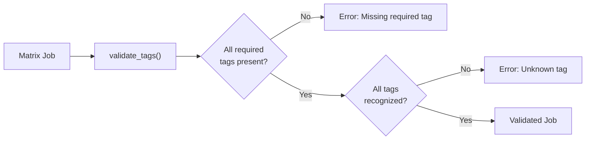
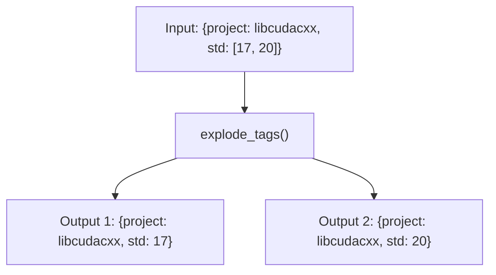
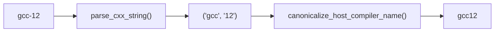
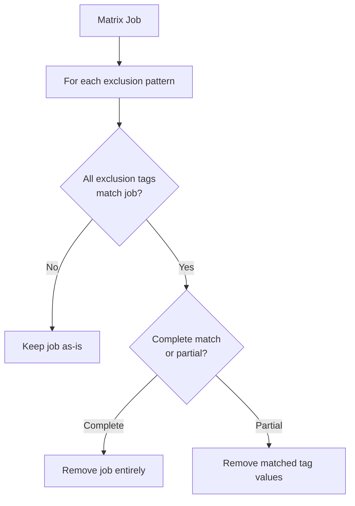
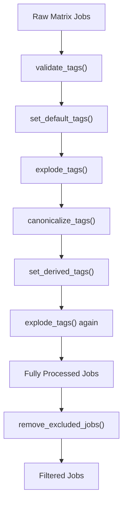
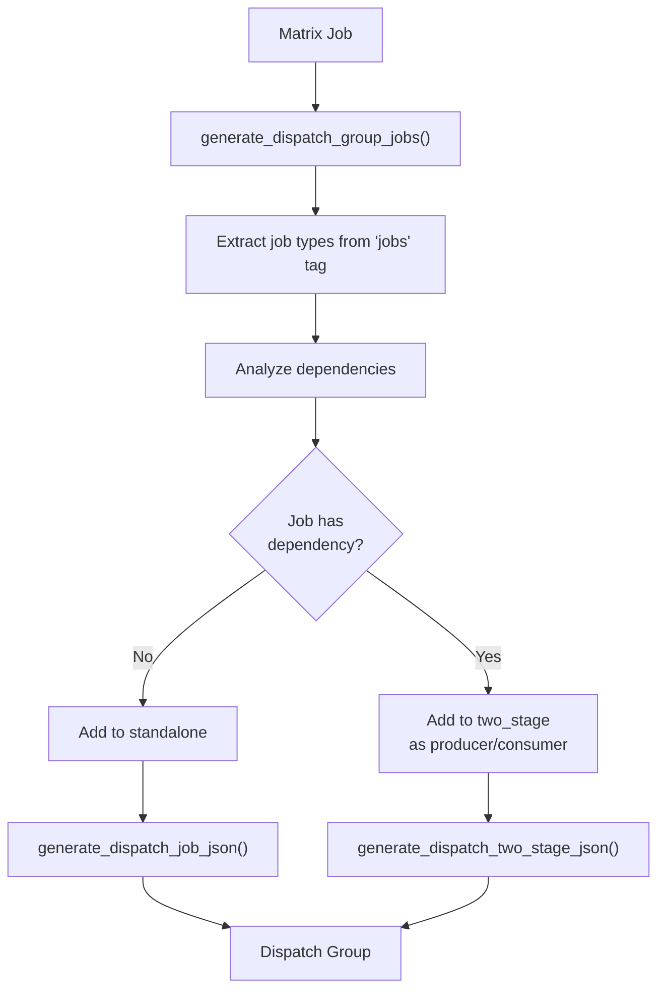
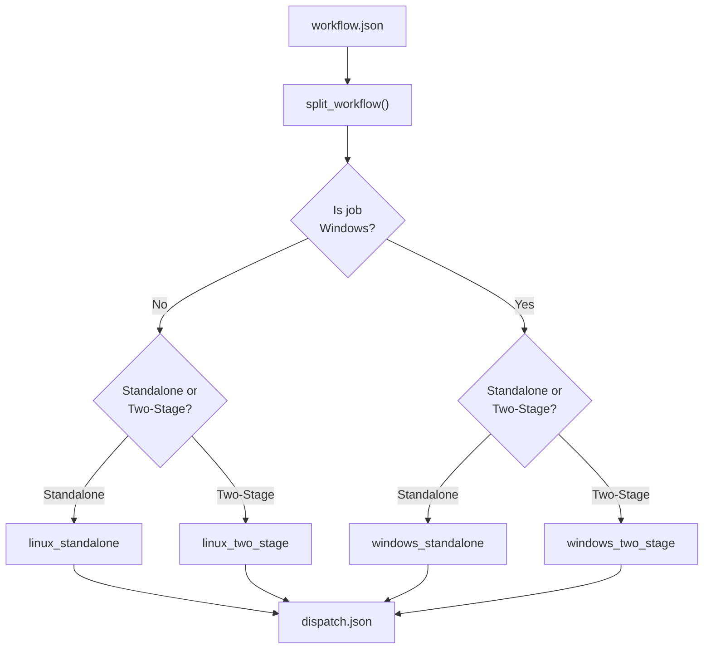
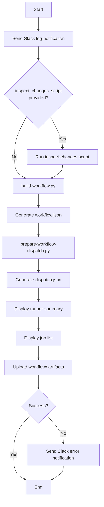

<!-- source: DeepWiki mcp.deepwiki.com · repo NVIDIA/cccl-gha · page 3 Workflow Generation · fetched 2026-10-26 -->

# Workflow Generation

<details>
<summary>Relevant source files</summary>

The following files were used as context for generating this wiki page:

- [.github/actions/workflow-build/action.yml](.github/actions/workflow-build/action.yml)
- [.github/actions/workflow-build/build-workflow.py](.github/actions/workflow-build/build-workflow.py)
- [.github/actions/workflow-build/prepare-workflow-dispatch.py](.github/actions/workflow-build/prepare-workflow-dispatch.py)

</details>


## Purpose and Scope

This document describes the workflow generation pipeline, which transforms a declarative configuration file (`matrix.yaml`) into dispatchable job definitions that can be executed by GitHub Actions workflows. The generation system parses, validates, expands, and organizes job definitions, producing structured JSON outputs optimized for parallel execution.

For information about configuring `matrix.yaml`, see [Configuration Guide](#2). For information about how generated jobs are dispatched and executed, see [Job Dispatch](#4) and [Job Execution](#5).

---

## Generation Pipeline Overview

The workflow generation system operates in two main phases: **job processing** (`build-workflow.py`) and **dispatch preparation** (`prepare-workflow-dispatch.py`), orchestrated by the `workflow-build` composite action.

**Pipeline Flow Diagram**



The pipeline accepts a `matrix.yaml` configuration and optional filtering parameters, producing multiple output artifacts that describe the complete set of jobs to execute.

**Sources:** [.github/actions/workflow-build/action.yml:1-140](), [.github/actions/workflow-build/build-workflow.py:1-1140](), [.github/actions/workflow-build/prepare-workflow-dispatch.py:1-96]()

---

## Input Processing

### Matrix YAML Loading

The `build-workflow.py` script loads and preprocesses the matrix configuration file:



The preprocessing ensures all version numbers are consistently represented as strings, regardless of whether they were specified as numbers or strings in YAML.

**Key Functions:**
- `preprocess_matrix_yaml()` [.github/actions/workflow-build/build-workflow.py:1087-1101](): Normalizes version numbers to strings
- `main()` [.github/actions/workflow-build/build-workflow.py:1104-1139](): Entry point that loads the YAML file

**Sources:** [.github/actions/workflow-build/build-workflow.py:1087-1139]()

### Command-Line Arguments

The `workflow-build` action accepts several inputs that control generation:

| Input | Purpose | Passed to build-workflow.py as |
|-------|---------|-------------------------------|
| `workflows` | Space-separated list of workflow names (e.g., `pull_request nightly`) | `--workflows` |
| `allow_override` | If true, use `override` workflow when present | `--allow-override` |
| `inspect_changes_script` | Script to determine changed projects | Results in `--dirty-projects` |
| `matrix_file` | Path to matrix.yaml | Positional argument |

**Sources:** [.github/actions/workflow-build/action.yml:4-36](), [.github/actions/workflow-build/build-workflow.py:1105-1116]()

---

## Processing Stages

The `build-workflow.py` script transforms matrix jobs through multiple stages. Each stage operates on a list of matrix job objects.

### Stage 1: Validation



The `validate_tags()` function ensures each matrix job contains all required tags and no unrecognized tags:

- Checks for required tags: tags with `required: true` in the tags schema
- Validates tag names against known tags from `matrix_yaml['tags']`
- Special validation: if `cudacxx: clang`, requires `cxx` to contain `clang`

**Key Functions:**
- `validate_tags()` [.github/actions/workflow-build/build-workflow.py:811-832]()
- `get_tag_info()` [.github/actions/workflow-build/build-workflow.py:284-302]()

**Sources:** [.github/actions/workflow-build/build-workflow.py:811-832](), [.github/actions/workflow-build/build-workflow.py:284-302]()

### Stage 2: Default Assignment

Tags with default values are populated if not specified:

```python
# Example: If 'cpu' tag has default: 'amd64', and job doesn't specify cpu:
# Input:  {'project': 'libcudacxx', 'ctk': '11.1'}
# Output: {'project': 'libcudacxx', 'ctk': '11.1', 'cpu': 'amd64'}
```

**Key Functions:**
- `set_default_tags()` [.github/actions/workflow-build/build-workflow.py:834-843]()

**Sources:** [.github/actions/workflow-build/build-workflow.py:834-843]()

### Stage 3: Tag Explosion

Tags specified as lists are "exploded" into multiple jobs, one per value:



The explosion process is recursive and handles multiple list-valued tags:

**Key Functions:**
- `explode_tags()` [.github/actions/workflow-build/build-workflow.py:886-899](): Recursively explodes list-valued tags
- `next_explode_tag()` [.github/actions/workflow-build/build-workflow.py:877-883](): Identifies next tag to explode (skips `jobs` tag)

**Exception:** The `jobs` tag is intentionally left unexploded to optimize dispatch scheduling [.github/actions/workflow-build/build-workflow.py:878]().

**Sources:** [.github/actions/workflow-build/build-workflow.py:877-899]()

### Stage 4: Canonicalization

Host compiler and CUDA toolkit version strings are normalized to canonical forms:

| Input Format | Canonical Output | Example |
|--------------|------------------|---------|
| `gcc` | `gccX` (latest version) | `gcc13` |
| `gcc-12` | `gccX` | `gcc12` |
| `gcc12` | `gccX` | `gcc12` |
| CTK aka | Version string | `current` → `12.5` |



**Key Functions:**
- `canonicalize_tags()` [.github/actions/workflow-build/build-workflow.py:845-850]()
- `canonicalize_ctk_version()` [.github/actions/workflow-build/build-workflow.py:113-123]()
- `canonicalize_host_compiler_name()` [.github/actions/workflow-build/build-workflow.py:138-172]()

**Sources:** [.github/actions/workflow-build/build-workflow.py:113-172](), [.github/actions/workflow-build/build-workflow.py:845-850]()

### Stage 5: Derived Tags

Certain tag values are computed from other tags:

**SM Architecture Derivation:**
```python
# If sm: 'gpu', derive from gpu tag
# Input:  {'gpu': 't4', 'sm': 'gpu'}
# Output: {'gpu': 't4', 'sm': '75'}  # T4's SM architecture
```

**Standard Expansion:**
```python
# If std: 'all', compute supported standards from project/compiler/CTK
# Input:  {'std': 'all', 'ctk': '11.1', 'cxx': 'gcc12'}
# Output: {'std': [11, 14, 17, 20]}  # intersection of supported stds
```

**Dependency Resolution:**
```python
# If job type has 'needs' dependency, add producer to jobs list
# Input:  {'jobs': ['test']}  # test job needs 'build'
# Output: {'jobs': ['test', 'build']}
```

**Project Job Mapping:**
```python
# Apply project-specific job expansions
# If project has job_map: {'verify': ['verify_headers', 'verify_codegen']}
# Input:  {'jobs': ['verify']}
# Output: {'jobs': ['verify_headers', 'verify_codegen']}
```

**Key Functions:**
- `set_derived_tags()` [.github/actions/workflow-build/build-workflow.py:852-875]()
- `lookup_supported_stds()` [.github/actions/workflow-build/build-workflow.py:323-337]()
- `get_gpu()` [.github/actions/workflow-build/build-workflow.py:226-238]()

**Note:** After derived tags are set, the job may need to be exploded again if derived tags introduced new list values.

**Sources:** [.github/actions/workflow-build/build-workflow.py:852-875](), [.github/actions/workflow-build/build-workflow.py:323-337]()

### Stage 6: Exclusion Application

Jobs matching exclusion patterns are filtered out or have specific tag values removed:



**Exclusion Matching Logic:**

An exclusion is a matrix job that specifies tag values to exclude. A job is excluded if **all** tags in the exclusion pattern match values in the job:

```python
# Exclusion: {'ctk': '11.1', 'cxx': 'gcc13'}
# Job 1: {'ctk': '11.1', 'cxx': 'gcc13', 'std': 17}  → EXCLUDED (all tags match)
# Job 2: {'ctk': '11.1', 'cxx': 'gcc12', 'std': 17}  → KEPT (cxx doesn't match)
```

**Partial Exclusions:**

If a job tag is a list and only some values match the exclusion, those values are removed:

```python
# Exclusion: {'ctk': '11.1', 'std': [17, 20]}
# Input:  {'ctk': '11.1', 'std': [17, 20, 23]}
# Output: {'ctk': '11.1', 'std': [23]}  # 17 and 20 removed
```

**Key Functions:**
- `remove_excluded_jobs()` [.github/actions/workflow-build/build-workflow.py:796-808]()
- `apply_matrix_job_exclusion()` [.github/actions/workflow-build/build-workflow.py:753-793]()
- `get_excluded_matrix_jobs()` [.github/actions/workflow-build/build-workflow.py:748-750]()

**Sources:** [.github/actions/workflow-build/build-workflow.py:748-808]()

### Complete Processing Pipeline

The `preprocess_matrix_jobs()` function orchestrates these stages:



**Key Functions:**
- `preprocess_matrix_jobs()` [.github/actions/workflow-build/build-workflow.py:902-919]()
- `parse_workflow_matrix_jobs()` [.github/actions/workflow-build/build-workflow.py:922-959]()

**Sources:** [.github/actions/workflow-build/build-workflow.py:902-959]()

---

## Dispatch Group Generation

After processing, matrix jobs are converted into dispatch groups. Each group represents a logical collection of related jobs (e.g., "libcudacxx CTK11.1 nvcc gcc12").

### Matrix Job to Dispatch Jobs



**Dispatch Job Structure:**

Each dispatch job contains the information needed to execute it:

```json
{
  "id": "Aa",
  "name": "[C++17 gcc12] Test(amd64, T4): sm{75}",
  "runner": "linux-amd64-gpu-t4-latest-1",
  "image": "rapidsai/devcontainers:24.10.00-cpp-gcc12-cuda11.1",
  "cuda": "11.1",
  "host": "gcc12",
  "command": "\"./ci/test_libcudacxx.sh\" -std \"17\" -arch \"75\"",
  "origin": { ... }
}
```

**Key Generation Functions:**
- `generate_dispatch_job_json()` [.github/actions/workflow-build/build-workflow.py:481-490]()
- `generate_dispatch_job_name()` [.github/actions/workflow-build/build-workflow.py:362-376]()
- `generate_dispatch_job_runner()` [.github/actions/workflow-build/build-workflow.py:379-390]()
- `generate_dispatch_job_image()` [.github/actions/workflow-build/build-workflow.py:404-412]()
- `generate_dispatch_job_command()` [.github/actions/workflow-build/build-workflow.py:415-445]()

**Sources:** [.github/actions/workflow-build/build-workflow.py:362-490]()

### Two-Stage Job Structure

Jobs with dependencies are organized as producer/consumer pairs:

```json
{
  "id": "Ab",
  "producers": [
    {
      "id": "Ac",
      "name": "[C++17 gcc12] Build(amd64)",
      ...
    }
  ],
  "consumers": [
    {
      "id": "Ad",
      "name": "[C++17 gcc12] Test(amd64, T4): sm{75}",
      ...
    },
    {
      "id": "Ae",
      "name": "[C++17 gcc12] Test(amd64, V100): sm{70}",
      ...
    }
  ]
}
```

**Key Functions:**
- `generate_dispatch_two_stage_json()` [.github/actions/workflow-build/build-workflow.py:494-504]()
- `generate_dispatch_group_jobs()` [.github/actions/workflow-build/build-workflow.py:507-539]()

**Limitation:** Only one producer per two-stage group is supported [.github/actions/workflow-build/build-workflow.py:586-599]().

**Sources:** [.github/actions/workflow-build/build-workflow.py:494-539]()

### Finalization and Deduplication

The `finalize_workflow_dispatch_groups()` function performs cleanup and optimization:

**Deduplication Steps:**

1. **Merge duplicate producers**: If multiple two-stage entries have identical producers, merge their consumers [.github/actions/workflow-build/build-workflow.py:602-640]()

2. **Remove duplicate standalone jobs**: Warn and remove duplicates [.github/actions/workflow-build/build-workflow.py:643-651]()

3. **Remove standalone jobs that appear in two-stage**: If a job appears both as standalone and in a two-stage group, remove the standalone version [.github/actions/workflow-build/build-workflow.py:654-667]()

4. **Sort dispatch groups and jobs**: Natural sort by name [.github/actions/workflow-build/build-workflow.py:694-706]()

5. **Assign unique IDs**: Generate short, unique IDs for all jobs and two-stage groups [.github/actions/workflow-build/build-workflow.py:708-719]()

**GUID Generation:**

The system generates compact unique IDs (1-3 characters) using base64 encoding:

```python
# Examples: "A", "AA", "AB", "Aa", "Ab", "Ac", ...
```

**Key Functions:**
- `finalize_workflow_dispatch_groups()` [.github/actions/workflow-build/build-workflow.py:583-721]()
- `generate_guids()` [.github/actions/workflow-build/build-workflow.py:78-93]()
- `compare_dispatch_jobs()` [.github/actions/workflow-build/build-workflow.py:557-563]()

**Sources:** [.github/actions/workflow-build/build-workflow.py:78-93](), [.github/actions/workflow-build/build-workflow.py:583-721]()

---

## Dispatch Preparation

The `prepare-workflow-dispatch.py` script reorganizes the complete workflow into four categories to optimize GitHub Actions UI presentation.

### Splitting Strategy



**OS Detection:**

Windows jobs are identified by checking if the runner string starts with `'windows'` [.github/actions/workflow-build/prepare-workflow-dispatch.py:21-22]().

**Output Structure:**

```json
{
  "linux_standalone": {
    "keys": ["libcudacxx CTK11.1 nvcc gcc12", ...],
    "jobs": {
      "libcudacxx CTK11.1 nvcc gcc12": [
        {"id": "Aa", "name": "...", ...}
      ]
    }
  },
  "linux_two_stage": {
    "keys": ["Thrust CTK12.0 nvcc gcc13", ...],
    "jobs": {
      "Thrust CTK12.0 nvcc gcc13": [
        {"id": "Ab", "producers": [...], "consumers": [...]}
      ]
    }
  },
  "windows_standalone": { ... },
  "windows_two_stage": { ... }
}
```

**Cleanup:**

The `origin` field is removed from each job during splitting to reduce output size [.github/actions/workflow-build/prepare-workflow-dispatch.py:31-32]().

**Key Functions:**
- `split_workflow()` [.github/actions/workflow-build/prepare-workflow-dispatch.py:25-75]()
- `is_windows()` [.github/actions/workflow-build/prepare-workflow-dispatch.py:21-22]()

**Sources:** [.github/actions/workflow-build/prepare-workflow-dispatch.py:1-96]()

---

## Generated Artifacts

The generation pipeline produces several files in the `workflow/` directory:

### workflow.json

Complete workflow specification with all dispatch groups and jobs. This is the primary output from `build-workflow.py`.

**Structure:**
```json
{
  "Group Name 1": {
    "standalone": [
      {"id": "...", "name": "...", "runner": "...", "image": "...", "command": "...", "origin": {...}}
    ],
    "two_stage": [
      {
        "id": "...",
        "producers": [{...}],
        "consumers": [{...}]
      }
    ]
  },
  "Group Name 2": { ... }
}
```

**Generated by:** `write_outputs()` [.github/actions/workflow-build/build-workflow.py:979-1023]()

**Sources:** [.github/actions/workflow-build/build-workflow.py:979-1023]()

### dispatch.json

Workflow split by OS and execution pattern, optimized for GitHub Actions dispatch workflows.

**Structure:** See "Dispatch Preparation" section above.

**Purpose:** Enables four separate dispatch workflows to run only relevant jobs, avoiding cluttered UI with hundreds of skipped jobs.

**Generated by:** `split_workflow()` [.github/actions/workflow-build/prepare-workflow-dispatch.py:25-75]()

**Sources:** [.github/actions/workflow-build/prepare-workflow-dispatch.py:25-75]()

### job_ids.json

Mapping from short job IDs to full job names for human-readable reporting:

```json
{
  "Aa": "libcudacxx CTK11.1 nvcc gcc12 [C++17 gcc12] Test(amd64, T4): sm{75}",
  "Ab": "Thrust CTK12.0 nvcc gcc13 [C++20 gcc13] Build(amd64)"
}
```

**Generated by:** `write_outputs()` [.github/actions/workflow-build/build-workflow.py:982-1005]()

**Sources:** [.github/actions/workflow-build/build-workflow.py:982-1005]()

### runner_summary.json

Summary of runner allocation for the GitHub Step Summary:

```json
{
  "heading": "🏃‍ Runner counts (total jobs: 42)",
  "body": "| #    | Runner\n|------|------\n|   20 | `linux-amd64-gpu-t4-latest-1`\n|   15 | `linux-amd64-cpu16`\n|    7 | `windows-amd64-cpu16`\n"
}
```

**Generated by:** `write_outputs()` [.github/actions/workflow-build/build-workflow.py:1007-1017]()

**Sources:** [.github/actions/workflow-build/build-workflow.py:1007-1017]()

### job_list.txt

Human-readable list of all jobs for debugging:

```
   1 id: Aa     standalone     [C++17 gcc12] Test(amd64, T4): sm{75}
   2 id: Ab     producers      [C++17 gcc12] Build(amd64)
   3 id: Ac     consumers      [C++17 gcc12] Test(amd64, V100): sm{70}
```

**Generated by:** `write_outputs()` [.github/actions/workflow-build/build-workflow.py:981-1022]()

**Sources:** [.github/actions/workflow-build/build-workflow.py:981-1022]()

---

## workflow-build Action

The `workflow-build` composite action orchestrates the entire generation pipeline.

### Execution Sequence



### Step Details

**Step 1: Slack Notification** [.github/actions/workflow-build/action.yml:47-59]()
- Sends initial notification to log channel if credentials provided
- Includes workflow type and run URL

**Step 2: Inspect Changes** [.github/actions/workflow-build/action.yml:61-72]()
- Conditionally runs change detection script
- Exports `dirty_projects` output for filtering

**Step 3: Parse Matrix** [.github/actions/workflow-build/action.yml:74-100]()
- Invokes `build-workflow.py` with appropriate flags
- Outputs workflow.json, job_ids.json, runner_summary.json, job_list.txt
- Displays runner summary and job list in GitHub Step Summary

**Step 4: Create Dispatch Workflows** [.github/actions/workflow-build/action.yml:102-109]()
- Invokes `prepare-workflow-dispatch.py`
- Generates dispatch.json

**Step 5: Set Outputs** [.github/actions/workflow-build/action.yml:111-117]()
- Sets `WORKFLOW` output to contents of dispatch.json (compact JSON)

**Step 6: Upload Artifacts** [.github/actions/workflow-build/action.yml:119-124]()
- Uploads entire `workflow/` directory as GitHub Actions artifact
- Used by downstream workflow-results action

**Step 7: Error Notification** [.github/actions/workflow-build/action.yml:126-139]()
- Sends Slack notification to alert and/or log channels on failure

### Action Inputs Reference

| Input | Type | Required | Default | Description |
|-------|------|----------|---------|-------------|
| `workflows` | string | Yes | - | Space-separated workflow names |
| `allow_override` | boolean | No | `false` | Use override workflow if present |
| `inspect_changes_script` | string | No | `""` | Path to change detection script |
| `inspect_changes_base_sha` | string | No | `""` | Base SHA for change detection |
| `matrix_file` | string | No | `ci/matrix.yaml` | Path to matrix configuration |
| `matrix_parser` | string | No | `""` | Custom parser script path |
| `slack_token` | string | No | - | Slack bot token |
| `slack_log` | string | No | - | Slack log channel ID |
| `slack_alert` | string | No | - | Slack alert channel ID |

### Action Outputs Reference

| Output | Description |
|--------|-------------|
| `workflow` | Complete dispatch.json as compact JSON string |

**Sources:** [.github/actions/workflow-build/action.yml:1-140]()

---

## Error Handling

The generation system includes comprehensive error reporting:

### Error Message Format

Errors include file location and context:

```
ci/matrix.yaml:42 (job 3): Missing required tag 'ctk'
  Input: {project: libcudacxx, cxx: gcc12, std: 17}
```

**Generated by:** `error_message_with_matrix_job()` [.github/actions/workflow-build/build-workflow.py:109-110]()

### Validation Errors

- Missing required tags [.github/actions/workflow-build/build-workflow.py:818-819]()
- Unknown tags [.github/actions/workflow-build/build-workflow.py:827-828]()
- Unknown CTK versions [.github/actions/workflow-build/build-workflow.py:123]()
- Unknown host compilers [.github/actions/workflow-build/build-workflow.py:151-152]()
- Unknown GPUs [.github/actions/workflow-build/build-workflow.py:831]()
- Clang device compiler without clang host compiler [.github/actions/workflow-build/build-workflow.py:821-822]()

### Warnings

Warnings are emitted as GitHub annotations:

```
::notice file=ci/matrix.yaml::Merging consumers for duplicate producer 'Build' in 'libcudacxx CTK11.1'
```

**Warning Types:**
- Duplicate producers being merged [.github/actions/workflow-build/build-workflow.py:621-632]()
- Duplicate standalone jobs being removed [.github/actions/workflow-build/build-workflow.py:648-649]()
- Standalone jobs removed due to two-stage presence [.github/actions/workflow-build/build-workflow.py:658-664]()
- Jobs appearing multiple times in two-stage groups [.github/actions/workflow-build/build-workflow.py:679-682]()

### Fatal Errors

Certain conditions cause immediate failure:

- Multiple producers in a single two-stage group [.github/actions/workflow-build/build-workflow.py:592-599]()
- GUID generator exhaustion (>65535 jobs) [.github/actions/workflow-build/build-workflow.py:92-93]()
- Missing matrix file [.github/actions/workflow-build/build-workflow.py:1119-1121]()
- Workflow not found in matrix file [.github/actions/workflow-build/build-workflow.py:929]()

**Sources:** [.github/actions/workflow-build/build-workflow.py:109-110](), [.github/actions/workflow-build/build-workflow.py:592-599](), [.github/actions/workflow-build/build-workflow.py:818-831]()

---

