<!-- source: DeepWiki mcp.deepwiki.com · repo NVIDIA/cccl-gha · page 3.1 build-workflow.py Pipeline · fetched 2026-10-26 -->

# build-workflow.py Pipeline

<details>
<summary>Relevant source files</summary>

The following files were used as context for generating this wiki page:

- [.github/actions/workflow-build/build-workflow.py](.github/actions/workflow-build/build-workflow.py)

</details>


## Purpose and Scope

This document describes the `build-workflow.py` processing pipeline, which transforms a human-readable `matrix.yaml` configuration into fully-specified job definitions ready for GitHub Actions dispatch. The pipeline performs multi-stage processing including validation, default-setting, tag explosion, canonicalization, derived tag computation, and exclusion filtering.

For information about the dispatch.json structure produced downstream from this pipeline, see [Dispatch Preparation](#3.2). For the overall workflow generation architecture, see [Workflow Generation](#3). For details on the matrix.yaml schema itself, see [Matrix YAML Structure](#2.1).

**Sources:** [.github/actions/workflow-build/build-workflow.py:1-1140]()

---

## Pipeline Overview

The `build-workflow.py` pipeline processes matrix job definitions through a series of transformations, converting compact YAML entries into complete job specifications.

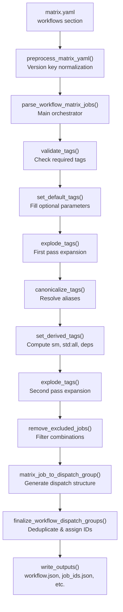

**Diagram: End-to-End Processing Pipeline**

The pipeline operates on **matrix jobs**, which are JSON objects representing individual job configurations. Each stage modifies these objects, progressively transforming them from terse YAML entries into complete job specifications.

**Sources:** [.github/actions/workflow-build/build-workflow.py:902-920](), [.github/actions/workflow-build/build-workflow.py:922-960](), [.github/actions/workflow-build/build-workflow.py:962-977]()

---

## Core Data Structures

The pipeline works with three primary data types, defined in the file header comments:

| Data Structure | Description | Key Fields |
|----------------|-------------|------------|
| **matrix_job** | Input configuration from matrix.yaml | `project`, `jobs`, `ctk`, `cxx`, `cudacxx`, `std`, `gpu`, `sm`, `cpu` |
| **dispatch_group_json** | Grouped jobs by configuration | `<group_name>: { standalone: [...], two_stage: [...] }` |
| **job_json** | Fully-specified executable job | `id`, `name`, `runner`, `image`, `command`, `origin` |

**Sources:** [.github/actions/workflow-build/build-workflow.py:4-54]()

### Matrix Job Structure

A matrix job evolves through the pipeline. Here's an example transformation:

**Input (matrix.yaml):**
```yaml
- project: [libcudacxx, cub, thrust]
  ctk: "11.1"
  cxx: gcc10
  std: all
  gpu: t4
  sm: gpu
```

**After Processing:**
```json
{
  "project": "libcudacxx",
  "jobs": ["build", "test"],
  "ctk": "11.1",
  "cudacxx": "nvcc",
  "cxx": "gcc10",
  "cpu": "amd64",
  "gpu": "t4",
  "sm": "75-real",
  "std": 17,
  "origin": { "filename": "ci/matrix.yaml", ... }
}
```

**Sources:** [.github/actions/workflow-build/build-workflow.py:6-23]()

---

## Input Processing and Preprocessing

### Matrix YAML Loading

The pipeline begins by loading and normalizing the matrix YAML file:

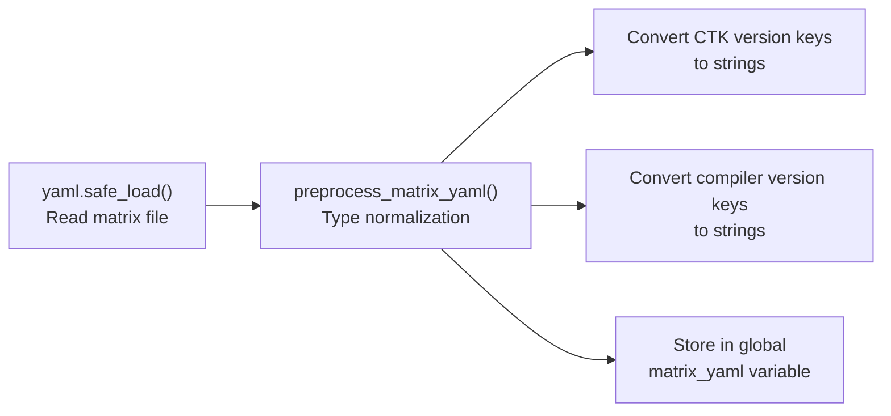

**Diagram: Matrix YAML Preprocessing**

The `preprocess_matrix_yaml()` function ensures all version numbers are strings, preventing type mismatches during later lookups. This handles cases where YAML parsers interpret numeric values like `11.1` or `10` differently.

**Sources:** [.github/actions/workflow-build/build-workflow.py:1087-1101](), [.github/actions/workflow-build/build-workflow.py:1123-1127]()

### Workflow Selection and Filtering

The `parse_workflow_matrix_jobs()` function orchestrates the main processing:

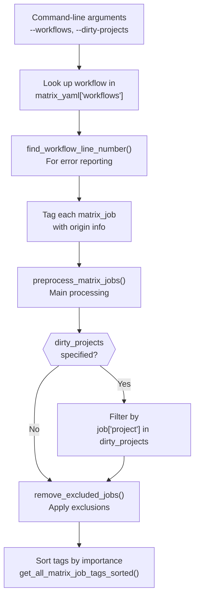

**Diagram: parse_workflow_matrix_jobs() Flow**

**Sources:** [.github/actions/workflow-build/build-workflow.py:922-960]()

---

## Tag Processing Stages

The `preprocess_matrix_jobs()` function applies a series of transformations to each matrix job:

### Stage 1: Validation

The `validate_tags()` function ensures matrix jobs conform to the schema:

| Validation Check | Error Condition |
|------------------|----------------|
| **Required tags** | Missing `project`, `jobs`, or other required tags |
| **Known tags** | Tag not in `matrix_yaml['tags']` |
| **Valid GPUs** | GPU string not in `matrix_yaml['gpus']` |
| **clang consistency** | `cudacxx: clang` requires `cxx: clang` |

The validation can be run in two modes:
- **Normal mode** (`ignore_required=False`): Enforces all required tags
- **Exclusion mode** (`ignore_required=True`): Only checks tag names, not requirements

**Sources:** [.github/actions/workflow-build/build-workflow.py:811-832]()

### Stage 2: Default Setting

The `set_default_tags()` function fills in missing optional tags using defaults from `matrix_yaml['tags']`:

```python
# Example tag definitions with defaults:
tags:
  cpu:
    default: "amd64"
  cudacxx:
    default: "nvcc"
  jobs:
    default: ["build"]
```

For each tag in the schema, if it has a `default` value and isn't present in the matrix job, the default is applied.

**Sources:** [.github/actions/workflow-build/build-workflow.py:834-843]()

### Stage 3: Tag Explosion (First Pass)

The `explode_tags()` function recursively expands list values into separate matrix jobs:

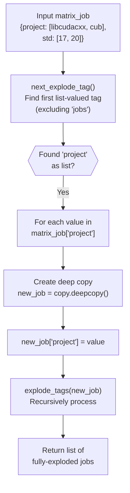

**Diagram: Tag Explosion Algorithm**

The `jobs` tag is intentionally **not exploded** to optimize scheduling. Multiple job types (e.g., `["build", "test"]`) remain together in a single matrix job for dependency analysis.

**Sources:** [.github/actions/workflow-build/build-workflow.py:877-900]()

### Stage 4: Canonicalization

The `canonicalize_tags()` function resolves aliases and standardizes naming:

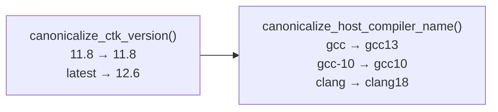

**Diagram: Canonicalization Functions**

**CTK Canonicalization** ([.github/actions/workflow-build/build-workflow.py:113-124]()):
- Checks if the version string exists directly in `matrix_yaml['ctk_versions']`
- If not, searches for an `aka` field match (e.g., `latest`)
- Returns the canonical key

**Host Compiler Canonicalization** ([.github/actions/workflow-build/build-workflow.py:138-173]()):
- Parses the compiler string using regex: `([a-z]+)-?([\d\.]+)?`
- If no version specified, selects the highest version number
- Checks for version `aka` aliases
- Returns format: `{compiler_id}{version}` (e.g., `gcc10`)

**Sources:** [.github/actions/workflow-build/build-workflow.py:845-850]()

### Stage 5: Derived Tags

The `set_derived_tags()` function computes values from other tags:

| Derived Tag | Computation Logic |
|-------------|-------------------|
| **sm** | If `sm: "gpu"`, look up `matrix_yaml['gpus'][gpu]['sm']` |
| **std** | If `std: "all"`, call `lookup_supported_stds()` to find common standards |
| **jobs** | Add dependencies from `matrix_yaml['jobs'][job]['needs']` |
| **jobs** | Apply project-specific `job_map` expansions |

#### SM Architecture Derivation

```python
if matrix_job['sm'] == 'gpu':
    gpu = get_gpu(matrix_job['gpu'])
    matrix_job['sm'] = gpu['sm']  # e.g., "75-real" for T4
```

**Sources:** [.github/actions/workflow-build/build-workflow.py:852-858]()

#### C++ Standard Derivation

The `lookup_supported_stds()` function computes the intersection of standards supported by all components:

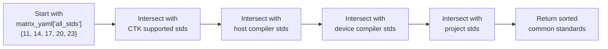

**Diagram: C++ Standard Intersection Logic**

**Sources:** [.github/actions/workflow-build/build-workflow.py:323-338](), [.github/actions/workflow-build/build-workflow.py:859-861]()

#### Job Dependency Resolution

The pipeline automatically adds producer jobs when consumers are requested:

```python
for job in matrix_job['jobs']:
    job_info = get_job_type_info(job)
    dep = job_info['needs']  # e.g., 'test' needs 'build'
    if dep and dep not in matrix_job['jobs']:
        matrix_job['jobs'].append(dep)
```

Then project-specific job mappings are applied:

```python
project = get_project(matrix_job['project'])
for original_job, expanded_jobs in project['job_map'].items():
    if original_job in matrix_job['jobs']:
        matrix_job['jobs'].remove(original_job)
        matrix_job['jobs'] += expanded_jobs
```

**Sources:** [.github/actions/workflow-build/build-workflow.py:863-875]()

### Stage 6: Tag Explosion (Second Pass)

After derived tags are set, `explode_tags()` runs again to expand any list values introduced by derivation (e.g., `std: "all"` became `[17, 20, 23]`).

**Sources:** [.github/actions/workflow-build/build-workflow.py:914-918]()

---

## Exclusion Filtering

The `remove_excluded_jobs()` function applies exclusion rules from the `exclude` workflow:

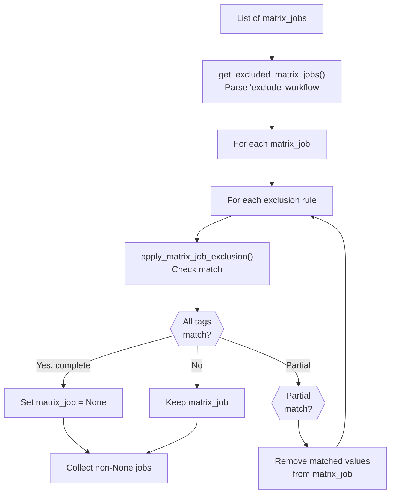

**Diagram: Exclusion Application Logic**

### Exclusion Matching Algorithm

The `apply_matrix_job_exclusion()` function implements sophisticated partial matching:

1. **Tag presence check**: If an exclusion specifies a tag not in the matrix job, the exclusion doesn't apply
2. **Value matching**: For each exclusion tag, check if any specified values match the matrix job
3. **Complete vs. partial match**:
   - **Complete**: All tag values match → return `None` (discard job)
   - **Partial**: Some values match → remove matched values from matrix job
   - **No match**: No values match for any tag → return matrix job unchanged

**Example:**
```yaml
# Exclusion:
- project: libcudacxx
  std: [11, 14]

# Matrix job:
project: libcudacxx
std: [11, 14, 17]

# Result: std becomes [17] (partial removal)
```

**Sources:** [.github/actions/workflow-build/build-workflow.py:753-808]()

---

## Dispatch Group Generation

After all matrix jobs are processed, they're converted to dispatch groups by `matrix_job_to_dispatch_group()`:

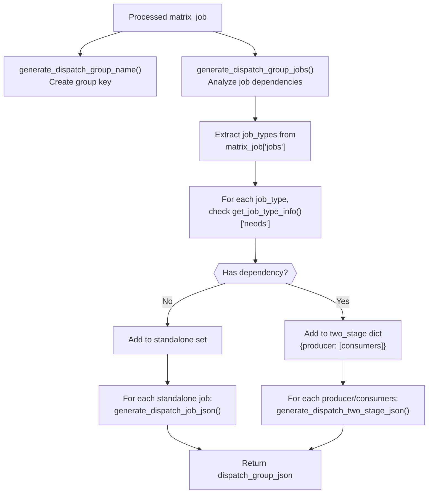

**Diagram: Dispatch Group Generation**

### Group Naming

The `generate_dispatch_group_name()` function creates human-readable group names:

```python
# Example output:
"libcudacxx CTK11.1 nvcc GCC"
"Thrust CTK12.6 Clang"
```

Format: `{project_name} CTK{version} {device_compiler} {host_compiler}`

**Sources:** [.github/actions/workflow-build/build-workflow.py:345-360]()

### Job JSON Generation

The `generate_dispatch_job_json()` function creates complete job specifications:

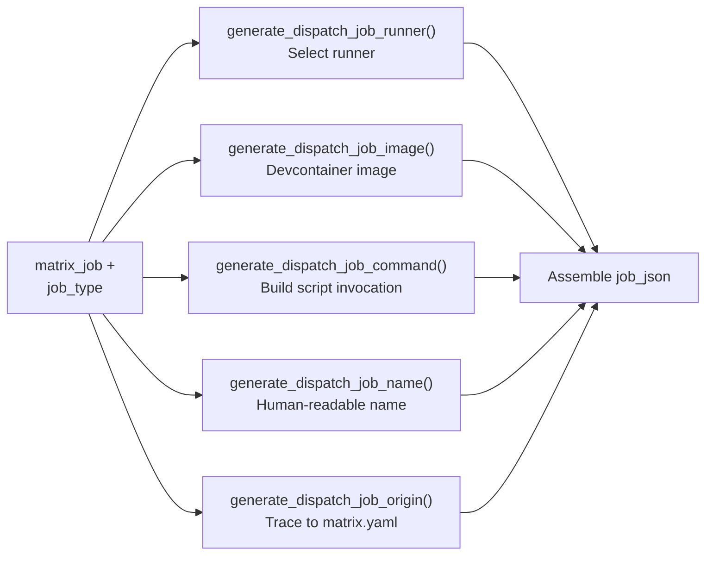

**Diagram: Job JSON Assembly**

**Sources:** [.github/actions/workflow-build/build-workflow.py:481-491]()

#### Runner Selection Logic

The `generate_dispatch_job_runner()` function determines the appropriate GitHub Actions runner:

| Job Type | Runner Format |
|----------|---------------|
| CPU-only | `{os}-{cpu}-cpu16` |
| GPU (non-testing) | `{os}-{cpu}-gpu-{gpu_id}-latest-1` |
| GPU (testing) | `{os}-{cpu}-gpu-{gpu_id}-latest-1-testing` |

**Sources:** [.github/actions/workflow-build/build-workflow.py:379-391]()

#### Image Selection

Devcontainer images follow this format:

```
# Linux:
rapidsai/devcontainers:{version}-cpp-{host}-cuda{ctk}

# Windows:
rapidsai/devcontainers:{version}-cuda{ctk}-{host}
```

**Sources:** [.github/actions/workflow-build/build-workflow.py:404-413]()

#### Command Generation

The `generate_dispatch_job_command()` function builds the script invocation string:

```bash
# Example Linux command:
"./ci/build_libcudacxx.sh -std \"17\" -arch \"75-real\""

# Example Windows command:
"./ci/windows/test_thrust.ps1 -std \"20\" -cuda \"clang++\""
```

**Sources:** [.github/actions/workflow-build/build-workflow.py:415-446]()

---

## Finalization and Deduplication

The `finalize_workflow_dispatch_groups()` function performs cleanup and assigns unique IDs:

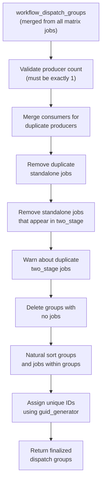

**Diagram: Finalization Pipeline**

### Producer Count Validation

The system enforces a single-producer constraint:

```python
for two_stage_json in group_json['two_stage']:
    num_producers = len(two_stage_json['producers'])
    if num_producers > 1:
        raise Exception("ci-dispatch-two-stage.yml currently only supports a single producer.")
```

**Sources:** [.github/actions/workflow-build/build-workflow.py:586-600]()

### Consumer Merging

When duplicate producers are detected, their consumers are merged:

```python
if dispatch_job_in_container(producer, merged_producers):
    # Find matching consumers
    matching_consumers = merged_consumers[producer_index]
    # Merge unique consumers
    for consumer in consumers:
        if not dispatch_job_in_container(consumer, matching_consumers):
            matching_consumers.append(consumer)
```

**Sources:** [.github/actions/workflow-build/build-workflow.py:601-640]()

### Job Comparison

The `compare_dispatch_jobs()` function checks equality by comparing:
- `name`
- `runner`
- `image`
- `command`

The `origin` field is intentionally **ignored** because different matrix entries can produce identical job specifications.

**Sources:** [.github/actions/workflow-build/build-workflow.py:557-572]()

### GUID Assignment

The `generate_guids()` generator produces compact unique IDs:

```python
# Generates base64-encoded 16-bit integers
# Strips leading 'A' characters and trailing '='
# Examples: "B", "AA", "AAD", "QA", "gA"
# Maximum: 65535 unique IDs
```

IDs are assigned to:
- Each standalone job
- Each two_stage group
- Each producer and consumer within two_stage groups

**Sources:** [.github/actions/workflow-build/build-workflow.py:78-96](), [.github/actions/workflow-build/build-workflow.py:708-720]()

---

## Output Generation

The `write_outputs()` function produces four output files:

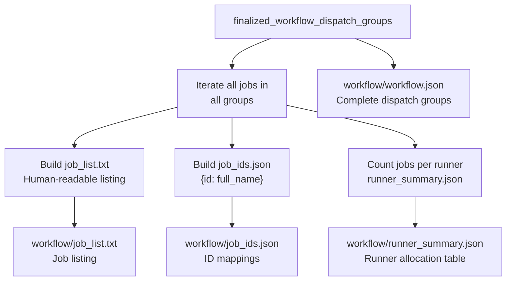

**Diagram: Output File Generation**

### Output File Formats

| File | Purpose | Format |
|------|---------|--------|
| **workflow.json** | Complete dispatch group definitions | JSON object keyed by group name |
| **job_ids.json** | Maps short IDs to full job names | `{ "id": "Group Name Job Name", ... }` |
| **job_list.txt** | Human-readable job listing | Text with numbering and indentation |
| **runner_summary.json** | Runner allocation summary | `{ "heading": "...", "body": "markdown table" }` |

**Sources:** [.github/actions/workflow-build/build-workflow.py:979-1024]()

### Runner Summary Format

The runner summary JSON contains:

```json
{
  "heading": "🏃‍ Runner counts (total jobs: 247)",
  "body": "| #    | Runner\n|------|------\n|  120 | `linux-amd64-cpu16`\n..."
}
```

This is used by downstream reporting to show resource allocation.

**Sources:** [.github/actions/workflow-build/build-workflow.py:1010-1017]()

---

## Support Functions and Utilities

### Lookup Functions

The pipeline uses memoized lookup functions to fetch metadata:

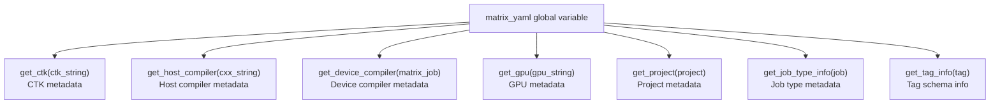

**Diagram: Metadata Lookup Functions**

All lookup functions use the `@memoize_result` decorator for performance:

```python
@memoize_result
def get_ctk(ctk_string):
    result = matrix_yaml['ctk_versions'][ctk_string]
    result["version"] = ctk_string
    return result
```

**Sources:** [.github/actions/workflow-build/build-workflow.py:126-303]()

### Host Compiler Parsing

The `parse_cxx_string()` function uses regex to extract compiler ID and version:

```python
# Input: "gcc10", "gcc-12", "clang", "clang-18"
# Regex: r'^([a-z]+)-?([\d\.]+)?$'
# Output: (id, version) tuple
# Examples:
#   "gcc10" → ("gcc", "10")
#   "gcc" → ("gcc", None)
#   "clang-18" → ("clang", "18")
```

**Sources:** [.github/actions/workflow-build/build-workflow.py:132-136]()

### Origin Tracking

The `get_matrix_job_origin()` function creates traceback information:

```python
{
  "filename": "ci/matrix.yaml",
  "workflow_name": "pull_request",
  "workflow_location": "ci/matrix.yaml:42 (job 1)",
  "original_matrix_job": "{project: libcudacxx, ctk: 11.1, ...}"
}
```

This enables error messages like:

```
ci/matrix.yaml:42 (job 1): Missing required tag 'cxx'
  Input: {project: libcudacxx, ctk: 11.1, jobs: [test]}
```

**Sources:** [.github/actions/workflow-build/build-workflow.py:736-746](), [.github/actions/workflow-build/build-workflow.py:109-111]()

### Error Reporting

The pipeline uses GitHub Actions annotations for errors and warnings:

```python
print(f"::error file=ci/matrix.yaml::{error_message}", file=sys.stderr)
print(f"::warning file=ci/matrix.yaml::Job '{job_name}' appears {count} times...", 
      file=sys.stderr)
print(f"::notice file=ci/matrix.yaml::Merging consumers...", file=sys.stderr)
```

**Sources:** [.github/actions/workflow-build/build-workflow.py:598-599](), [.github/actions/workflow-build/build-workflow.py:621-632](), [.github/actions/workflow-build/build-workflow.py:679-682]()

---

## Command-Line Interface

The script supports two primary modes:

### Workflow Generation Mode

```bash
python build-workflow.py matrix.yaml \
  --workflows pull_request nightly \
  --dirty-projects libcudacxx thrust \
  --allow-override
```

**Arguments:**

| Argument | Purpose |
|----------|---------|
| `matrix_file` | Path to matrix.yaml |
| `--workflows` | List of workflow names to process |
| `--dirty-projects` | Filter jobs to specified projects only |
| `--allow-override` | Check for `override` workflow and use if present |

**Sources:** [.github/actions/workflow-build/build-workflow.py:1104-1116](), [.github/actions/workflow-build/build-workflow.py:1129-1136]()

### Devcontainer Info Mode

```bash
python build-workflow.py matrix.yaml --devcontainer-info
```

This mode extracts unique CTK/compiler combinations for devcontainer generation, outputting JSON to stdout.

**Sources:** [.github/actions/workflow-build/build-workflow.py:1050-1085](), [.github/actions/workflow-build/build-workflow.py:1131-1136]()

### Override Workflow Handling

When `--allow-override` is specified and a non-empty `override` workflow exists:

```python
if args.allow_override and 'override' in matrix_yaml['workflows']:
    override_matrix = matrix_yaml['workflows']['override']
    if override_matrix and len(override_matrix) > 0:
        print(f"::notice::Using 'override' workflow instead of '{workflow_names}'")
        workflow_names = ['override']
        write_override_matrix(override_matrix)
```

This creates `workflow/override.json` and processes only the override workflow.

**Sources:** [.github/actions/workflow-build/build-workflow.py:1031-1038]()

---

## Integration Points

### Upstream Inputs

- **matrix.yaml**: Configuration file defining all job combinations (see [Matrix YAML Structure](#2.1))
- **Command-line arguments**: Workflow selection and filtering options

### Downstream Consumers

- **prepare-workflow-dispatch.py**: Consumes `workflow.json` to create `dispatch.json` (see [Dispatch Preparation](#3.2))
- **workflow-results**: Uses `job_ids.json` and `runner_summary.json` for reporting (see [Results and Reporting](#6))
- **GitHub Actions workflows**: Consume dispatch groups for execution

**Sources:** [.github/actions/workflow-build/build-workflow.py:1019-1024]()

---

