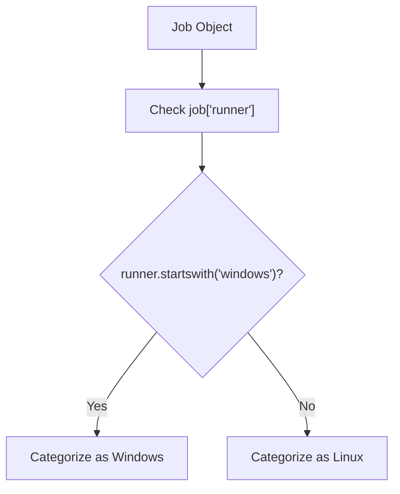
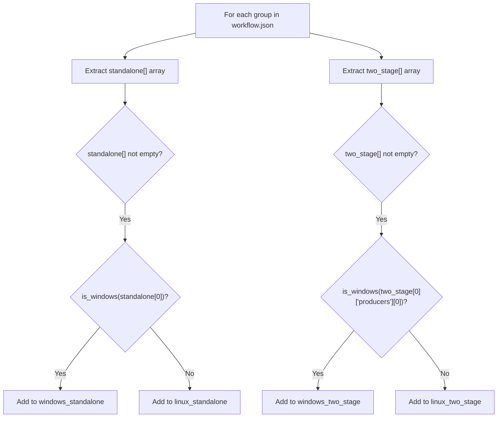
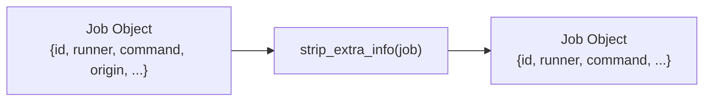
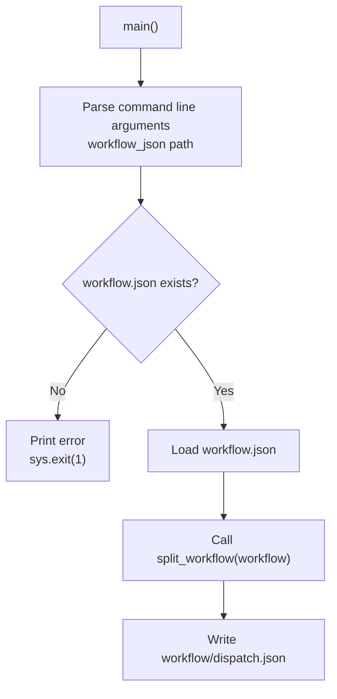
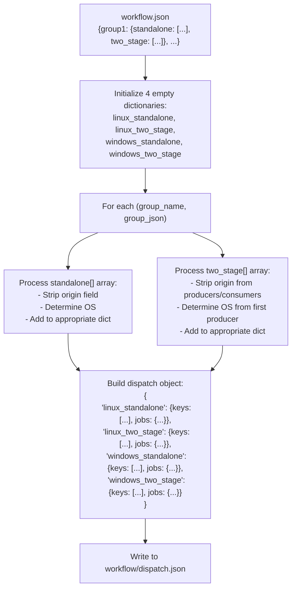
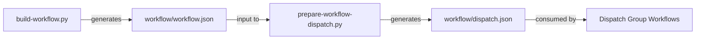

<!-- source: DeepWiki mcp.deepwiki.com · repo NVIDIA/cccl-gha · page 3.2 Dispatch Preparation · fetched 2026-10-26 -->

# Dispatch Preparation

<details>
<summary>Relevant source files</summary>

The following files were used as context for generating this wiki page:

- [.github/actions/workflow-build/prepare-workflow-dispatch.py](.github/actions/workflow-build/prepare-workflow-dispatch.py)

</details>


This document explains how `prepare-workflow-dispatch.py` transforms the comprehensive `workflow.json` into `dispatch.json`, organizing jobs by operating system and execution pattern to optimize the GitHub Actions UI experience. This script is the final step in the workflow generation pipeline before jobs are dispatched for execution.

For information about the generation of `workflow.json`, see [build-workflow.py Pipeline](#3.1). For the structure of the output artifacts, see [Generated Artifacts](#3.3).

---

## Purpose and Problem Statement

The `prepare-workflow-dispatch.py` script addresses a specific GitHub Actions UI limitation: when workflows contain many jobs with conditional execution (using `if:` expressions), the UI displays all skipped jobs, creating visual clutter that obscures the jobs that actually ran. This is problematic for the CCCL workflow system, which may define hundreds of job configurations but only execute a subset based on the runner OS and execution pattern.

The solution is to split the monolithic `workflow.json` into four separate job collections, each targeting a specific combination of OS and execution pattern. This allows GitHub Actions workflows to dispatch only relevant jobs, eliminating skipped job entries from the UI.

**Core Problem:**
```
workflow.json → 400 jobs defined
├─ Linux jobs executed on Linux runners → 200 jobs relevant, 200 skipped
└─ Windows jobs executed on Windows runners → 200 jobs relevant, 200 skipped
```

**Solution:**
```
workflow.json → dispatch.json
├─ linux_standalone → only Linux standalone jobs
├─ linux_two_stage → only Linux two-stage chains
├─ windows_standalone → only Windows standalone jobs
└─ windows_two_stage → only Windows two-stage chains
```

Sources: [.github/actions/workflow-build/prepare-workflow-dispatch.py:1-8]()

---

## Input Structure: workflow.json

The script consumes `workflow.json` produced by `build-workflow.py`. This file is organized as a nested dictionary where:

- **Top level:** Group names (strings like `"thrust"`, `"cub"`, `"libcudacxx"`)
- **Group level:** Contains `standalone` and/or `two_stage` keys
- **Job level:** Individual job objects with complete configuration

### Expected Schema

```
{
  "group_name": {
    "standalone": [
      { "id": "...", "runner": "...", "origin": {...}, ... },
      ...
    ],
    "two_stage": [
      {
        "producers": [{ "id": "...", "runner": "...", "origin": {...}, ... }],
        "consumers": [{ "id": "...", "runner": "...", "origin": {...}, ... }, ...]
      },
      ...
    ]
  },
  ...
}
```

Each job object contains:
- `runner`: String identifying the GitHub Actions runner (e.g., `"linux-amd64-cpu16"`, `"windows-cpu8"`)
- `origin`: Metadata about the job's source configuration (removed during dispatch preparation)
- Additional job-specific fields (command, environment, etc.)

Sources: [.github/actions/workflow-build/prepare-workflow-dispatch.py:88-91]()

---

## Processing Logic

### OS Detection Algorithm

The script categorizes jobs by operating system using a simple heuristic: inspect the `runner` field of each job. The `is_windows()` function determines if a job targets Windows runners.

**OS Detection Flow:**



**Implementation:**
- **Function:** `is_windows(job)` at [.github/actions/workflow-build/prepare-workflow-dispatch.py:21-22]()
- **Logic:** Returns `True` if `job['runner']` starts with `"windows"`, else `False`
- **Assumption:** All runners follow consistent naming conventions (e.g., `windows-cpu8`, `linux-amd64-gpu-v100-latest-1`)

Sources: [.github/actions/workflow-build/prepare-workflow-dispatch.py:21-22](), [.github/actions/workflow-build/prepare-workflow-dispatch.py:42-57]()

---

### Job Categorization

The `split_workflow()` function performs a four-way categorization of all jobs:

| Category | Criteria | Target Workflow |
|----------|----------|-----------------|
| `linux_standalone` | Linux runner + standalone execution | `workflow-dispatch-standalone-group-linux` |
| `linux_two_stage` | Linux runner + producer/consumer pattern | `workflow-dispatch-two-stage-group-linux` |
| `windows_standalone` | Windows runner + standalone execution | `workflow-dispatch-standalone-group-windows` |
| `windows_two_stage` | Windows runner + producer/consumer pattern | `workflow-dispatch-two-stage-group-windows` |

**Categorization Process:**



**Key Implementation Details:**
- Groups may contain only `standalone`, only `two_stage`, or both
- OS determination uses the first job in each array as representative (assumes all jobs in a group use the same OS)
- Two-stage OS detection examines the first producer job at [.github/actions/workflow-build/prepare-workflow-dispatch.py:54]()

Sources: [.github/actions/workflow-build/prepare-workflow-dispatch.py:25-72]()

---

### Stripping Extra Information

Before adding jobs to the dispatch structure, the script removes the `origin` field from each job object using the `strip_extra_info()` function. This field contains metadata about the job's source in `matrix.yaml` (useful during workflow generation for debugging and validation) but is not needed during dispatch and execution.

**Stripping Process:**



**Applied to:**
- All standalone jobs at [.github/actions/workflow-build/prepare-workflow-dispatch.py:40]()
- All producer jobs at [.github/actions/workflow-build/prepare-workflow-dispatch.py:50]()
- All consumer jobs at [.github/actions/workflow-build/prepare-workflow-dispatch.py:52]()

This reduces the size of `dispatch.json` and ensures execution workflows receive only the data they need.

Sources: [.github/actions/workflow-build/prepare-workflow-dispatch.py:31-52]()

---

## Output Structure: dispatch.json

The script writes a single JSON file at `workflow/dispatch.json` with a consistent structure containing four top-level keys.

### Schema

```json
{
  "linux_standalone": {
    "keys": ["group1", "group2", ...],
    "jobs": {
      "group1": [/* standalone job objects */],
      "group2": [/* standalone job objects */],
      ...
    }
  },
  "linux_two_stage": {
    "keys": ["group1", "group2", ...],
    "jobs": {
      "group1": [
        {
          "producers": [/* producer job objects */],
          "consumers": [/* consumer job objects */]
        },
        ...
      ],
      ...
    }
  },
  "windows_standalone": {
    "keys": [...],
    "jobs": {...}
  },
  "windows_two_stage": {
    "keys": [...],
    "jobs": {...}
  }
}
```

### Field Descriptions

| Field | Type | Purpose |
|-------|------|---------|
| `keys` | `string[]` | List of group names in this category, used for GitHub Actions matrix expansion |
| `jobs` | `object` | Dictionary mapping group names to job arrays (standalone) or two-stage chain arrays |

**Keys Array Usage:**
The `keys` array enables efficient matrix iteration in dispatch workflows:

```yaml
strategy:
  matrix:
    group: ${{ fromJSON(needs.build.outputs.linux_standalone_keys) }}
steps:
  - name: Get jobs for group
    run: |
      jobs=$(echo '${{ needs.build.outputs.linux_standalone_jobs }}' | jq -r '.["${{ matrix.group }}"]')
```

Sources: [.github/actions/workflow-build/prepare-workflow-dispatch.py:59-75]()

---

## Implementation Walkthrough

### Main Function

The entry point orchestrates the transformation process:



**Key Steps:**
1. **Argument Parsing** [.github/actions/workflow-build/prepare-workflow-dispatch.py:78-81](): Accepts `workflow_json` path
2. **File Validation** [.github/actions/workflow-build/prepare-workflow-dispatch.py:84-86](): Exits with error if file not found
3. **JSON Loading** [.github/actions/workflow-build/prepare-workflow-dispatch.py:88-89](): Parses workflow.json
4. **Splitting** [.github/actions/workflow-build/prepare-workflow-dispatch.py:91](): Calls `split_workflow()`
5. **Output** [.github/actions/workflow-build/prepare-workflow-dispatch.py:74-75](): Creates `workflow/` directory and writes `dispatch.json`

Sources: [.github/actions/workflow-build/prepare-workflow-dispatch.py:78-95]()

---

### Data Flow Diagram

The following diagram illustrates how data structures transform through the script:

**Data Transformation Pipeline:**



Sources: [.github/actions/workflow-build/prepare-workflow-dispatch.py:25-75]()

---

## Code Entity Reference

### Functions

| Function | Location | Purpose |
|----------|----------|---------|
| `write_json_file(filename, json_object)` | [.github/actions/workflow-build/prepare-workflow-dispatch.py:16-18]() | Writes formatted JSON to file with 2-space indentation |
| `is_windows(job)` | [.github/actions/workflow-build/prepare-workflow-dispatch.py:21-22]() | Returns `True` if job targets Windows runner |
| `split_workflow(workflow)` | [.github/actions/workflow-build/prepare-workflow-dispatch.py:25-75]() | Core processing logic; categorizes and writes dispatch.json |
| `strip_extra_info(job)` (nested) | [.github/actions/workflow-build/prepare-workflow-dispatch.py:31-32]() | Deletes `origin` field from job object (mutates in-place) |
| `main()` | [.github/actions/workflow-build/prepare-workflow-dispatch.py:78-91]() | Entry point; handles CLI and orchestrates execution |

### Data Structures

**Input: `workflow` (dict)**
- Keys: Group names (strings)
- Values: Objects with optional `standalone` and `two_stage` keys

**Output: `dispatch` (dict)**
- Keys: `'linux_standalone'`, `'linux_two_stage'`, `'windows_standalone'`, `'windows_two_stage'`
- Values: Objects with `'keys'` (list) and `'jobs'` (dict) fields

Sources: [.github/actions/workflow-build/prepare-workflow-dispatch.py:1-95]()

---

## Integration with Workflow Generation

The `prepare-workflow-dispatch.py` script is invoked by the `workflow-build` composite action as the final step of the generation pipeline:

**Execution Context:**



**Invocation:** The `workflow-build` action calls this script after `build-workflow.py` completes, passing the path to `workflow/workflow.json` as the command-line argument.

For details on how the workflow-build action orchestrates this, see [workflow-build Action](#3.4). For how dispatch workflows consume the output, see [Job Dispatch](#4).

Sources: [.github/actions/workflow-build/prepare-workflow-dispatch.py:1-8]()

---

## Example Transformation

Consider a simplified `workflow.json` with mixed OS and execution patterns:

**Input (workflow.json):**
```json
{
  "thrust": {
    "standalone": [
      {"id": "thrust-gcc10-cpu", "runner": "linux-amd64-cpu16", "origin": {...}},
      {"id": "thrust-msvc-cpu", "runner": "windows-cpu8", "origin": {...}}
    ]
  },
  "cub": {
    "two_stage": [
      {
        "producers": [{"id": "cub-build", "runner": "linux-amd64-gpu-v100-latest-1", "origin": {...}}],
        "consumers": [
          {"id": "cub-test-sm70", "runner": "linux-amd64-gpu-v100-latest-1", "origin": {...}},
          {"id": "cub-test-sm80", "runner": "linux-amd64-gpu-a100-latest-1", "origin": {...}}
        ]
      }
    ]
  }
}
```

**Output (dispatch.json):**
```json
{
  "linux_standalone": {
    "keys": ["thrust"],
    "jobs": {
      "thrust": [
        {"id": "thrust-gcc10-cpu", "runner": "linux-amd64-cpu16"}
      ]
    }
  },
  "linux_two_stage": {
    "keys": ["cub"],
    "jobs": {
      "cub": [
        {
          "producers": [{"id": "cub-build", "runner": "linux-amd64-gpu-v100-latest-1"}],
          "consumers": [
            {"id": "cub-test-sm70", "runner": "linux-amd64-gpu-v100-latest-1"},
            {"id": "cub-test-sm80", "runner": "linux-amd64-gpu-a100-latest-1"}
          ]
        }
      ]
    }
  },
  "windows_standalone": {
    "keys": ["thrust"],
    "jobs": {
      "thrust": [
        {"id": "thrust-msvc-cpu", "runner": "windows-cpu8"}
      ]
    }
  },
  "windows_two_stage": {
    "keys": [],
    "jobs": {}
  }
}
```

Notice:
- `origin` fields removed from all jobs
- Linux and Windows standalone jobs separated into different categories
- Two-stage structure preserved but categorized by producer OS
- Empty categories still present in output (with empty `keys` and `jobs`)

Sources: [.github/actions/workflow-build/prepare-workflow-dispatch.py:25-75]()

---

