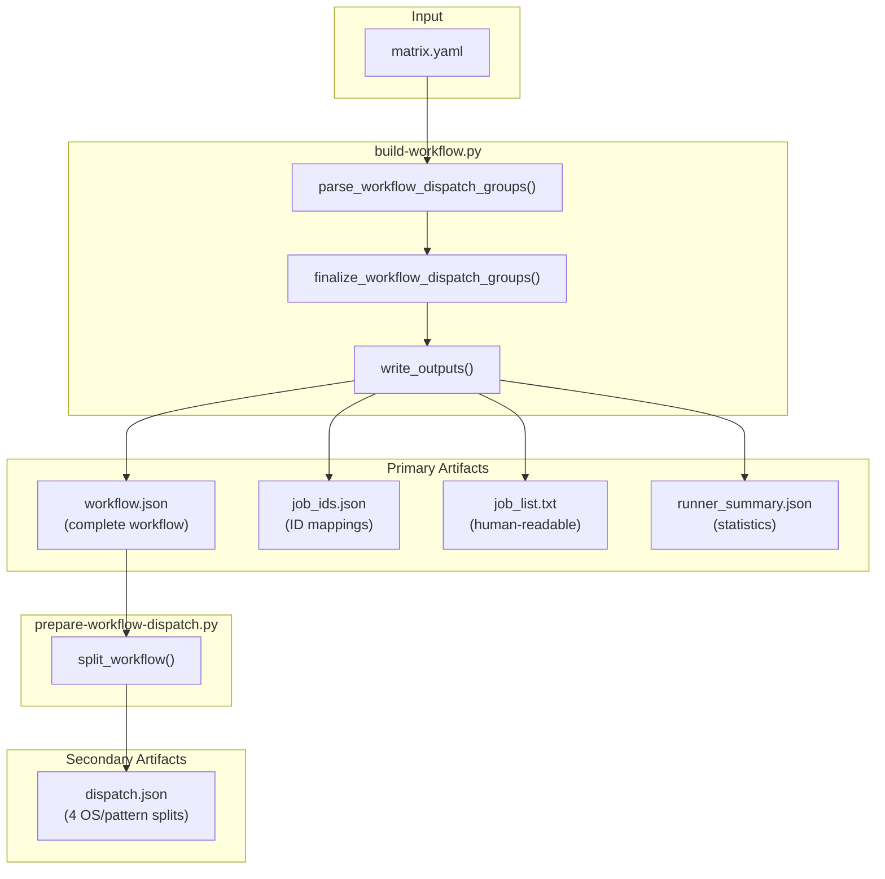
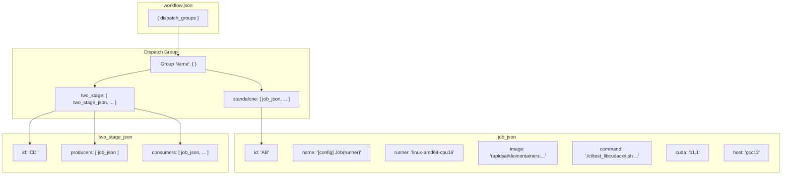
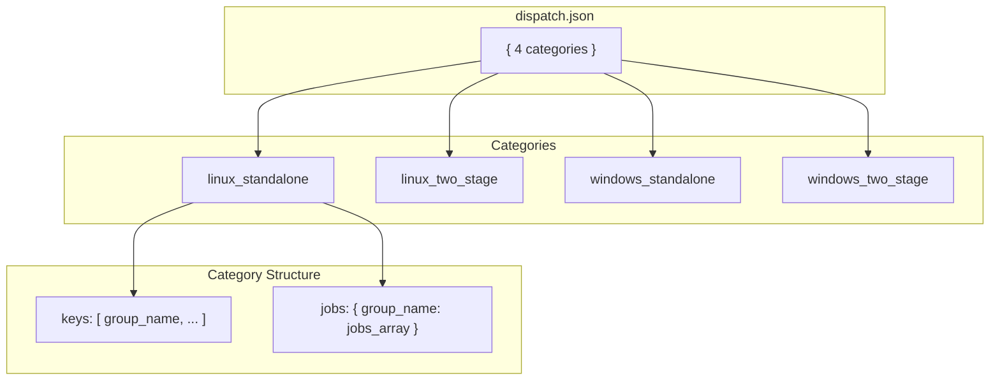
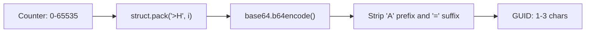
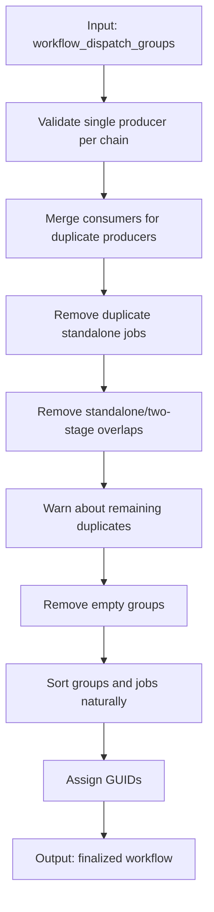

<!-- source: DeepWiki mcp.deepwiki.com · repo NVIDIA/cccl-gha · page 3.3 Generated Artifacts · fetched 2026-10-26 -->

# Generated Artifacts

<details>
<summary>Relevant source files</summary>

The following files were used as context for generating this wiki page:

- [.github/actions/workflow-build/build-workflow.py](.github/actions/workflow-build/build-workflow.py)
- [.github/actions/workflow-build/prepare-workflow-dispatch.py](.github/actions/workflow-build/prepare-workflow-dispatch.py)

</details>


## Purpose and Scope

This page documents the structure and content of the JSON artifacts produced by the workflow generation pipeline. These artifacts are intermediate outputs that bridge the gap between the human-readable `matrix.yaml` configuration and the GitHub Actions workflows that execute jobs.

For information about how these artifacts are created, see [build-workflow.py Pipeline](#3.1) and [Dispatch Preparation](#3.2). For information about how these artifacts are consumed, see [Job Dispatch](#4).

## Overview

The workflow generation pipeline produces five primary artifacts in the `workflow/` directory:

| Artifact | Purpose | Producer |
|----------|---------|----------|
| `workflow.json` | Complete workflow with all dispatch groups and job specifications | `build-workflow.py` |
| `job_ids.json` | Maps compact job IDs to human-readable full names | `build-workflow.py` |
| `job_list.txt` | Human-readable enumeration of all jobs | `build-workflow.py` |
| `runner_summary.json` | Runner allocation statistics and counts | `build-workflow.py` |
| `dispatch.json` | Workflow reorganized by OS and execution pattern | `prepare-workflow-dispatch.py` |

**Sources:** [.github/actions/workflow-build/build-workflow.py:979-1024](), [.github/actions/workflow-build/prepare-workflow-dispatch.py:25-76]()

## Artifact Generation Flow



**Sources:** [.github/actions/workflow-build/build-workflow.py:979-1024](), [.github/actions/workflow-build/prepare-workflow-dispatch.py:78-95]()

## workflow.json Structure

The `workflow.json` file contains the complete workflow specification organized into dispatch groups. Each dispatch group represents a logical collection of jobs with shared characteristics (project, CTK version, compiler).

### Schema



**Sources:** [.github/actions/workflow-build/build-workflow.py:28-53](), [.github/actions/workflow-build/build-workflow.py:507-544]()

### Dispatch Group Names

Dispatch group names are generated by `generate_dispatch_group_name()` and follow the pattern:

```
<Project Name> CTK<version> <Compiler Info>
```

Examples:
- `libcudacxx CTK11.1 nvcc GCC`
- `Thrust CTK12.0 clang`

**Sources:** [.github/actions/workflow-build/build-workflow.py:345-359]()

### Job JSON Fields

Each `job_json` object contains the following fields:

| Field | Type | Description | Generator Function |
|-------|------|-------------|-------------------|
| `id` | string | Compact unique ID (1-3 chars) | `next(guid_generator)` |
| `name` | string | Human-readable job name | `generate_dispatch_job_name()` |
| `runner` | string | GitHub Actions runner label | `generate_dispatch_job_runner()` |
| `image` | string | Docker image reference | `generate_dispatch_job_image()` |
| `command` | string | Shell command to execute | `generate_dispatch_job_command()` |
| `cuda` | string | CTK version for devcontainer | `generate_dispatch_job_ctk_version()` |
| `host` | string | Host compiler for devcontainer | `generate_dispatch_job_host_compiler()` |

The `origin` field present during generation is stripped before final output by `prepare-workflow-dispatch.py`.

**Sources:** [.github/actions/workflow-build/build-workflow.py:481-490](), [.github/actions/workflow-build/build-workflow.py:362-445]()

### Job Name Format

Job names generated by `generate_dispatch_job_name()` follow this format:

```
[<C++std> <compiler><version>] <JobType>(<cpu>, <gpu>):<sm{arch}><cmake_options>
```

Example: `[C++17 gcc12] Test(amd64, T4): sm{75}`

**Sources:** [.github/actions/workflow-build/build-workflow.py:362-376]()

### Two-Stage JSON Structure

Two-stage jobs contain exactly one producer and one or more consumers:

```json
{
  "id": "AB",
  "producers": [
    { "id": "CD", "name": "...", "runner": "...", ... }
  ],
  "consumers": [
    { "id": "EF", "name": "...", "runner": "...", ... },
    { "id": "GH", "name": "...", "runner": "...", ... }
  ]
}
```

The single-producer constraint is validated by `finalize_workflow_dispatch_groups()`.

**Sources:** [.github/actions/workflow-build/build-workflow.py:493-504](), [.github/actions/workflow-build/build-workflow.py:586-599]()

## job_ids.json Structure

The `job_ids.json` file maps compact job IDs to full human-readable names for debugging and reporting purposes.

### Schema

```json
{
  "AB": "libcudacxx CTK11.1 nvcc GCC [C++17 gcc12] Test(amd64, T4)",
  "CD": "Thrust CTK12.0 clang [C++20 clang16] Build(amd64)",
  ...
}
```

The mapping is constructed during `write_outputs()` and combines the dispatch group name with the job name.

**Sources:** [.github/actions/workflow-build/build-workflow.py:979-1024]()

## job_list.txt Structure

The `job_list.txt` file provides a human-readable enumeration of all jobs, organized hierarchically by dispatch group. This is primarily used for debugging and manual inspection.

### Format

```
     <Dispatch Group Name>:
   1 id: AB     standalone     [config] Job(runner)
   2 id: CD     producers      [config] Job(runner)
   3 id: EF     consumers      [config] Job(runner)
   4 id: GH     consumers      [config] Job(runner)
     <Next Dispatch Group>:
   5 id: IJ     standalone     [config] Job(runner)
   ...
```

The enumeration includes sequential job numbers, job IDs, job type (standalone/producers/consumers), and full job names.

**Sources:** [.github/actions/workflow-build/build-workflow.py:986-1005]()

## runner_summary.json Structure

The `runner_summary.json` file contains aggregate statistics about runner allocation across all jobs.

### Schema

```json
{
  "heading": "🏃‍ Runner counts (total jobs: 142)",
  "body": "| #    | Runner\n|------|------\n|  45  | `linux-amd64-cpu16`\n|  32  | `linux-amd64-gpu-t4-latest-1`\n..."
}
```

### Fields

| Field | Type | Description |
|-------|------|-------------|
| `heading` | string | Summary heading with total job count |
| `body` | string | Markdown table of runner counts (sorted descending) |

The runner counts are accumulated in `process_job_array()` and formatted as a markdown table.

**Sources:** [.github/actions/workflow-build/build-workflow.py:986-1023]()

## dispatch.json Structure

The `dispatch.json` file reorganizes the complete workflow into four categories based on operating system and execution pattern. This split optimizes GitHub Actions UI by avoiding large numbers of skipped jobs.

### High-Level Structure



**Sources:** [.github/actions/workflow-build/prepare-workflow-dispatch.py:25-76]()

### Category Schema

Each of the four categories has identical structure:

```json
{
  "linux_standalone": {
    "keys": ["Group A", "Group B", ...],
    "jobs": {
      "Group A": [ job_json, ... ],
      "Group B": [ job_json, ... ],
      ...
    }
  },
  "linux_two_stage": {
    "keys": ["Group C", ...],
    "jobs": {
      "Group C": [ two_stage_json, ... ],
      ...
    }
  },
  ...
}
```

The `keys` array provides group names in a format suitable for GitHub Actions matrix strategies, while `jobs` contains the actual job specifications.

**Sources:** [.github/actions/workflow-build/prepare-workflow-dispatch.py:59-75]()

### OS Detection

Jobs are categorized as Windows or Linux based on the runner field. The `is_windows()` function checks if the runner string starts with `"windows"`:

```python
def is_windows(job):
    return job['runner'].startswith('windows')
```

**Sources:** [.github/actions/workflow-build/prepare-workflow-dispatch.py:21-23]()

### Origin Field Stripping

The `split_workflow()` function removes the `origin` field from all jobs via `strip_extra_info()`. This field contains metadata used during generation (file locations, original matrix job specifications) but is not needed for execution.

**Sources:** [.github/actions/workflow-build/prepare-workflow-dispatch.py:31-52]()

## GUID Generation

All job IDs and two-stage IDs are assigned using a compact GUID generator that produces 1-3 character base64-encoded strings.

### GUID Algorithm



The generator produces up to 65,535 unique IDs before exhaustion. Examples: `"B"`, `"AB"`, `"QQ"`, `"ZYX"`.

**Sources:** [.github/actions/workflow-build/build-workflow.py:78-96]()

### GUID Assignment

GUIDs are assigned to jobs during `finalize_workflow_dispatch_groups()` after all merging and deduplication is complete:

- Standalone jobs receive individual IDs
- Two-stage job chains receive one ID for the chain itself
- Each producer and consumer within a two-stage chain receives individual IDs

**Sources:** [.github/actions/workflow-build/build-workflow.py:708-720]()

## Finalization Process

The `finalize_workflow_dispatch_groups()` function performs several critical transformations before artifacts are written:

### Deduplication and Merging



**Sources:** [.github/actions/workflow-build/build-workflow.py:583-721]()

### Job Comparison

Jobs are compared using `compare_dispatch_jobs()`, which considers only:
- `name`
- `runner`
- `image`
- `command`

The `origin` field is explicitly ignored to allow jobs from different matrix specifications to be identified as duplicates.

**Sources:** [.github/actions/workflow-build/build-workflow.py:557-571]()

### Natural Sorting

Groups and jobs are sorted using natural sort keys that handle embedded numbers correctly (e.g., "CTK11" before "CTK12" rather than lexicographic "CTK12" before "CTK11").

**Sources:** [.github/actions/workflow-build/build-workflow.py:693-707]()

## File Output Locations

All artifacts are written to the `workflow/` directory relative to the execution location:

```
workflow/
├── workflow.json          # Complete workflow specification
├── job_ids.json          # ID to name mappings
├── job_list.txt          # Human-readable enumeration
├── runner_summary.json   # Runner allocation statistics
└── dispatch.json         # OS/pattern categorized workflow
```

The directory is created by `write_outputs()` if it does not exist.

**Sources:** [.github/actions/workflow-build/build-workflow.py:1019-1023](), [.github/actions/workflow-build/prepare-workflow-dispatch.py:74-75]()

---

