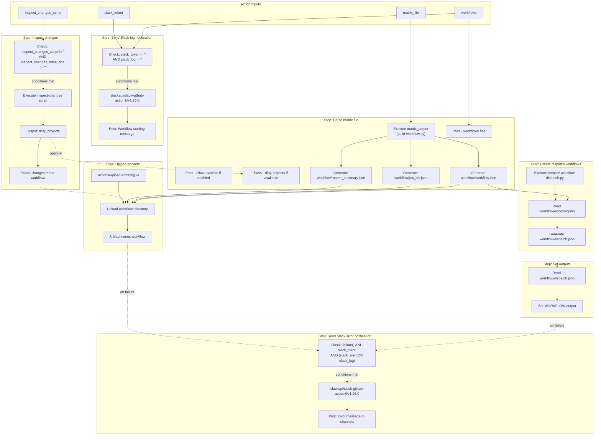
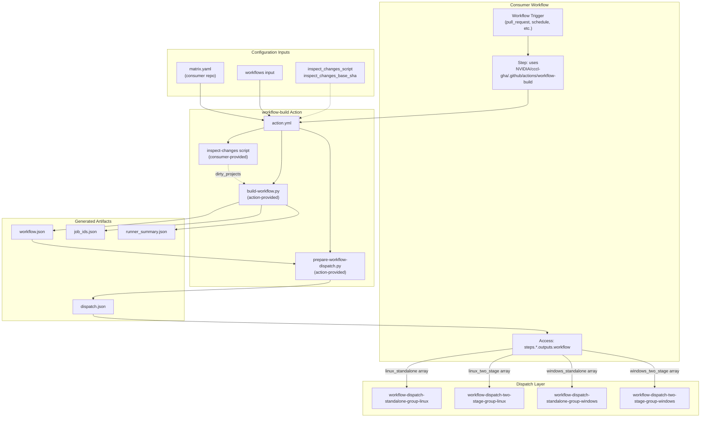

<!-- source: DeepWiki mcp.deepwiki.com · repo NVIDIA/cccl-gha · page 3.4 workflow-build Action · fetched 2026-10-26 -->

# workflow-build Action

<details>
<summary>Relevant source files</summary>

The following files were used as context for generating this wiki page:

- [.github/actions/workflow-build/action.yml](.github/actions/workflow-build/action.yml)

</details>


## Purpose and Scope

The `workflow-build` action is a composite GitHub Action that orchestrates the workflow generation pipeline, transforming a human-readable `matrix.yaml` configuration into executable job definitions organized for optimal GitHub Actions execution. This action coordinates the execution of Python scripts, handles change detection, manages artifact uploads, and sends Slack notifications throughout the generation process.

For information about the underlying matrix configuration format, see [Configuration Guide](#2). For details on the Python scripts orchestrated by this action, see [build-workflow.py Pipeline](#3.1) and [Dispatch Preparation](#3.2).

**Sources:** [.github/actions/workflow-build/action.yml:1-3]()

---

## Action Location and Type

The workflow-build action is implemented as a composite action located at `.github/actions/workflow-build/action.yml`. Composite actions execute multiple steps within a single action definition, allowing the orchestration of shell scripts, Python executables, and external actions without requiring a separate Docker container or JavaScript runtime.

**Sources:** [.github/actions/workflow-build/action.yml:43-44]()

---

## Inputs

The action accepts multiple inputs that control workflow generation behavior, change detection, and notification settings.

| Input | Required | Default | Description |
|-------|----------|---------|-------------|
| `workflows` | Yes | - | Space-separated list of workflow names from matrix file to run (e.g., `"pull_request nightly"`) |
| `allow_override` | No | `"false"` | If `"true"`, honors the `override` workflow in matrix file, ignoring requested workflows |
| `inspect_changes_script` | No | `""` | Path to script that determines which projects need testing based on file changes |
| `inspect_changes_base_sha` | No | `""` | Base commit SHA for change detection comparison |
| `matrix_file` | No | `"ci/matrix.yaml"` | Path to matrix configuration file in consumer repository |
| `matrix_parser` | No | `""` | Path to custom matrix parser script; defaults to `build-workflow.py` from action directory |
| `slack_token` | No | - | Slack bot token for sending notifications; notifications disabled if not provided |
| `slack_log` | No | - | Slack channel ID for verbose log notifications |
| `slack_alert` | No | - | Slack channel ID for error/alert notifications |

**Sources:** [.github/actions/workflow-build/action.yml:4-36]()

---

## Outputs

The action produces a single output containing all dispatchable job definitions.

| Output | Description |
|--------|-------------|
| `workflow` | JSON string containing the `dispatch.json` structure with jobs organized by OS and execution pattern |

The output value is read from `workflow/dispatch.json` and exposed as a GitHub Actions output for downstream workflow consumption.

**Sources:** [.github/actions/workflow-build/action.yml:38-41](), [.github/actions/workflow-build/action.yml:111-117]()

---

## Execution Flow

The following diagram illustrates the sequential execution of steps within the workflow-build action, showing how data flows from inputs through processing stages to outputs.



**Sources:** [.github/actions/workflow-build/action.yml:45-140]()

---

## Step 1: Send Slack Log Notification

The first step sends an initial notification to the Slack log channel indicating that workflow generation has started. This step is conditional and only executes when both `slack_token` and `slack_log` inputs are provided.

### Conditional Execution

```yaml
if: ${{inputs.slack_token != '' && inputs.slack_log != '' }}
```

The condition checks for non-empty string values. If either input is missing or empty, the step is skipped.

### Message Content

The Slack message includes:
- The workflow type (derived from `github.workflow` context variable, e.g., `pull_request`, `nightly`)
- A direct link to the GitHub Actions run summary page

### Environment Variables

- `SLACK_BOT_TOKEN`: Authentication token for Slack API
- `WORKFLOW_TYPE`: Name of the triggering workflow
- `SUMMARY_URL`: Constructed GitHub Actions run URL

**Sources:** [.github/actions/workflow-build/action.yml:47-59]()

---

## Step 2: Inspect Changes

The inspect changes step executes a user-provided script to determine which projects or dependencies have been modified, enabling selective job execution for efficiency.

### Conditional Execution

```yaml
if: ${{ inputs.inspect_changes_script != '' && inputs.inspect_changes_base_sha != '' }}
```

Both the script path and base SHA must be provided for this step to execute. This is typically used in pull request contexts where comparing the PR branch against the base branch is meaningful.

### Script Execution

The inspect-changes script is invoked with two arguments:
1. Base commit SHA (from `inputs.inspect_changes_base_sha`)
2. Current HEAD commit SHA (from `GITHUB_SHA` environment variable)

The script is expected to:
- Analyze git diff between the two commits
- Identify modified files relevant to the build system
- Determine which projects are "dirty" (need rebuilding)
- Output `dirty_projects` as a step output
- Write a summary to `GITHUB_STEP_SUMMARY`

### Output Capture

The step captures the `dirty_projects` output (typically a space-separated list of project names) using the step ID `inspect-changes`. This output is consumed by the matrix parser in Step 3.

### Artifact Preparation

The step copies the GitHub Step Summary to `workflow/changes.md` for inclusion in the final artifact upload, preserving the change detection report.

**Sources:** [.github/actions/workflow-build/action.yml:61-72]()

---

## Step 3: Parse Matrix File

This is the core workflow generation step that transforms the matrix configuration into a complete job definition set.

### Matrix Parser Selection

The action uses the `matrix_parser` input to determine which script to execute. If not provided, it defaults to `build-workflow.py` located in the action's own directory:

```bash
matrix_parser: ${{ inputs.matrix_parser && inputs.matrix_parser || '${GITHUB_ACTION_PATH}/build-workflow.py' }}
```

The `GITHUB_ACTION_PATH` environment variable is automatically set by GitHub Actions to point to the action's directory.

### Command Construction

The parser is invoked with the following arguments:

```bash
${{ env.matrix_parser }} ${{ inputs.matrix_file }}
    --workflows ${{ inputs.workflows }}
    ${{ env.allow_override }}
    ${{ env.dirty_projects_flag }} ${{ env.dirty_projects }}
```

#### Flag Processing

The action uses bash parameter expansion and conditional logic to construct optional flags:

- `allow_override`: Set to `--allow-override` if `inputs.allow_override == 'true'`, otherwise empty
- `dirty_projects_flag`: Set to `--dirty-projects` if `inspect_changes_script` input is provided, otherwise empty
- `dirty_projects`: Set to the output from Step 2 if available, otherwise empty

### Generated Outputs

The script generates multiple files in the `workflow/` directory:

| File | Description |
|------|-------------|
| `workflow.json` | Complete job definitions with all tags and parameters |
| `job_ids.json` | Mapping between job names and internal IDs |
| `runner_summary.json` | Runner allocation statistics and summary |
| `job_list.txt` | Human-readable list of all jobs |

### Console Output

The step uses GitHub Actions log groups to organize output:

- **Workflow**: Contents of `workflow.json`
- **Runners**: Formatted runner summary (also appended to `GITHUB_STEP_SUMMARY`)
- **Job List**: Contents of `job_list.txt`

**Sources:** [.github/actions/workflow-build/action.yml:74-101]()

---

## Step 4: Create Dispatch Workflows

This step transforms the complete `workflow.json` into optimized dispatch groups organized by operating system and execution pattern.

### Script Execution

The `prepare-workflow-dispatch.py` script is invoked directly from the action's directory:

```bash
"${GITHUB_ACTION_PATH}/prepare-workflow-dispatch.py" workflow/workflow.json
```

### Output Structure

The script generates `workflow/dispatch.json` with the following structure:

```json
{
  "linux_standalone": [...],
  "linux_two_stage": [...],
  "windows_standalone": [...],
  "windows_two_stage": [...]
}
```

Each array contains job definitions or producer/consumer chain definitions suitable for GitHub Actions matrix strategies.

### Console Output

The dispatch JSON is displayed in a log group for verification before proceeding to output generation.

**Sources:** [.github/actions/workflow-build/action.yml:102-109]()

---

## Step 5: Set Outputs

This step reads the generated `dispatch.json` and exposes it as a GitHub Actions output variable for consumption by downstream workflows.

### Output Format

The entire dispatch JSON is compacted (using `jq -c`) and set as the `WORKFLOW` output:

```bash
printf "WORKFLOW=%s\n" "$(cat workflow/dispatch.json | jq -c '.')" | tee -a "${GITHUB_OUTPUT}"
```

The `-c` flag ensures JSON is on a single line without whitespace, which is required for GitHub Actions output variables.

### Output Reference

Downstream workflows access this output using:

```yaml
${{ steps.workflow-build.outputs.workflow }}
```

The output is referenced by the step ID `outputs` and the output name `WORKFLOW`, which is mapped to the action-level output name `workflow` through the output definition.

**Sources:** [.github/actions/workflow-build/action.yml:111-117]()

---

## Step 6: Upload Artifacts

All generated files in the `workflow/` directory are uploaded as a GitHub Actions artifact for later retrieval and debugging.

### Artifact Configuration

| Parameter | Value | Description |
|-----------|-------|-------------|
| `name` | `workflow` | Artifact identifier used for download |
| `path` | `workflow/` | Directory containing all generated files |
| `compression-level` | `0` | No compression for faster upload/download |

### Artifact Contents

The uploaded artifact includes:

- `workflow.json`: Full job definitions
- `dispatch.json`: Dispatch-optimized job groups
- `job_ids.json`: Job ID mappings
- `runner_summary.json`: Runner statistics
- `job_list.txt`: Human-readable job list
- `changes.md`: Change detection summary (if Step 2 executed)

### Access from Other Jobs

Other jobs in the workflow can download these artifacts using:

```yaml
- uses: actions/download-artifact@v4
  with:
    name: workflow
```

**Sources:** [.github/actions/workflow-build/action.yml:119-124]()

---

## Step 7: Send Slack Error Notification

This conditional step sends an error notification to Slack channels if any previous step fails.

### Conditional Execution

```yaml
if: ${{ failure() && inputs.slack_token != '' && (inputs.slack_alert != '' || inputs.slack_log != '') }}
```

The step executes only when:
1. Any previous step has failed (`failure()` context check)
2. `slack_token` is provided
3. At least one of `slack_alert` or `slack_log` is provided

### Channel Selection Logic

The action constructs a channel list dynamically:

```yaml
channel-id: '${{ inputs.slack_log }}${{env.CHANNEL_SEP}}${{ inputs.slack_alert }}'
```

Where `CHANNEL_SEP` is a comma if both channels are provided, otherwise empty:

```yaml
CHANNEL_SEP: ${{ (inputs.slack_log != '' && inputs.slack_alert != '') && ',' || ''}}
```

This allows sending to:
- Only `slack_log` if `slack_alert` is not provided
- Only `slack_alert` if `slack_log` is not provided
- Both channels (comma-separated) if both are provided

### Error Message

The notification includes:
- Workflow type that encountered the error
- Direct link to the GitHub Actions run for investigation

**Sources:** [.github/actions/workflow-build/action.yml:126-139]()

---

## Integration with Workflow Generation Pipeline

The workflow-build action serves as the orchestration entry point for the workflow generation phase, as illustrated in the system architecture diagrams. The following diagram shows its relationship to other components:



**Sources:** [.github/actions/workflow-build/action.yml:1-140]()

---

## Shell Configuration

All shell steps in the action use a consistent shell configuration for bash:

```yaml
shell: bash --noprofile --norc -euo pipefail {0}
```

This configuration ensures:
- `--noprofile --norc`: Skip profile/rc files for reproducible environment
- `-e`: Exit immediately if any command fails
- `-u`: Treat unset variables as errors
- `-o pipefail`: Return failure if any command in a pipeline fails

The `{0}` placeholder is replaced by GitHub Actions with the script content.

**Sources:** [.github/actions/workflow-build/action.yml:64](), [.github/actions/workflow-build/action.yml:76](), [.github/actions/workflow-build/action.yml:103](), [.github/actions/workflow-build/action.yml:113]()

---

## Error Handling Strategy

The workflow-build action employs a fail-fast strategy where any step failure causes immediate workflow termination (except for the Slack notification steps, which are conditional on failure). This ensures:

1. Downstream dispatch workflows do not execute with incomplete or corrupted job definitions
2. Slack notifications alert developers to generation failures before any jobs attempt to execute
3. Artifact uploads still occur even if notifications fail

The action does not use `continue-on-error: true` on generation steps, as invalid workflow definitions would cause cryptic errors in later stages. Fast failure with clear error messages at the generation stage improves debuggability.

**Sources:** [.github/actions/workflow-build/action.yml:126-139]()

---

## Usage Example

The following example demonstrates typical usage of the workflow-build action in a consumer repository:

```yaml
name: Pull Request CI

on:
  pull_request:
    branches: [main]

jobs:
  generate-workflow:
    runs-on: ubuntu-latest
    outputs:
      WORKFLOW: ${{ steps.build.outputs.workflow }}
    steps:
      - uses: actions/checkout@v4
        with:
          fetch-depth: 0  # Required for change detection
      
      - uses: NVIDIA/cccl-gha/.github/actions/workflow-build@main
        id: build
        with:
          workflows: "pull_request"
          allow_override: "true"
          inspect_changes_script: "./ci/inspect-changes.sh"
          inspect_changes_base_sha: ${{ github.event.pull_request.base.sha }}
          matrix_file: "ci/matrix.yaml"
          slack_token: ${{ secrets.SLACK_BOT_TOKEN }}
          slack_log: ${{ secrets.SLACK_LOG_CHANNEL }}
          slack_alert: ${{ secrets.SLACK_ALERT_CHANNEL }}
```

This configuration:
- Runs on pull request events
- Checks out the full git history for change detection
- Enables override workflow support
- Provides a custom inspect-changes script
- Uses PR base commit for change comparison
- Sends Slack notifications on start and error

**Sources:** [.github/actions/workflow-build/action.yml:4-36]()

---

