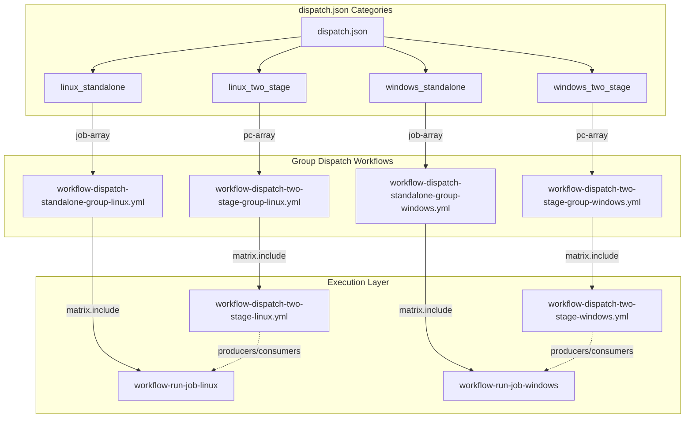
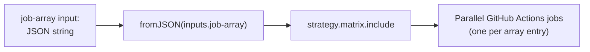
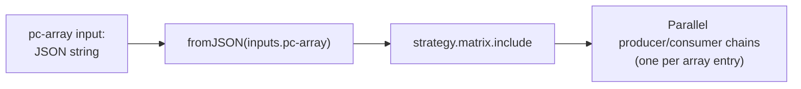
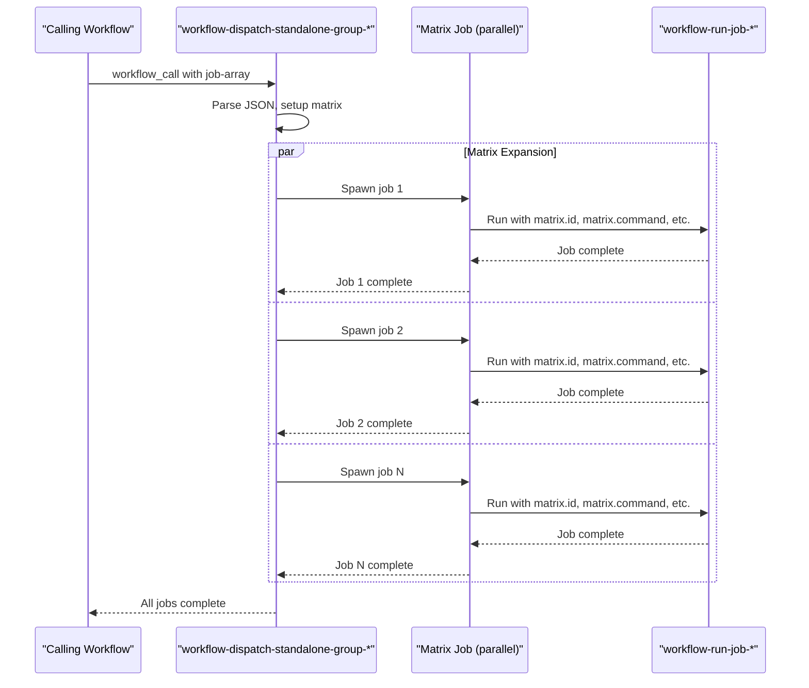
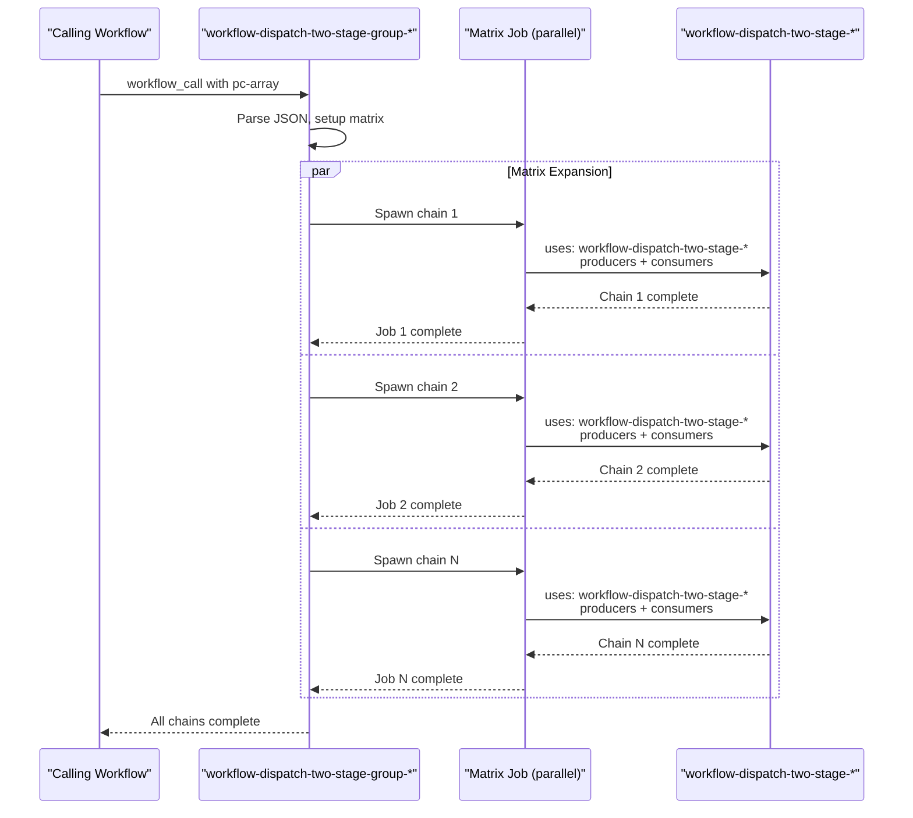

<!-- source: DeepWiki mcp.deepwiki.com · repo NVIDIA/cccl-gha · page 4 Job Dispatch · fetched 2026-10-26 -->

# Job Dispatch

<details>
<summary>Relevant source files</summary>

The following files were used as context for generating this wiki page:

- [.github/workflows/workflow-dispatch-standalone-group-linux.yml](.github/workflows/workflow-dispatch-standalone-group-linux.yml)
- [.github/workflows/workflow-dispatch-standalone-group-windows.yml](.github/workflows/workflow-dispatch-standalone-group-windows.yml)
- [.github/workflows/workflow-dispatch-two-stage-group-linux.yml](.github/workflows/workflow-dispatch-two-stage-group-linux.yml)
- [.github/workflows/workflow-dispatch-two-stage-group-windows.yml](.github/workflows/workflow-dispatch-two-stage-group-windows.yml)

</details>


## Purpose and Scope

The Job Dispatch layer is responsible for distributing jobs from `dispatch.json` to appropriate execution environments using GitHub Actions matrix strategies. This layer acts as an intermediary between workflow generation (see [Workflow Generation](#3)) and actual job execution (see [Job Execution](#5)).

The dispatch system reads categorized job definitions from `dispatch.json` and spawns parallel GitHub Actions jobs based on operating system (Linux/Windows) and execution pattern (standalone/two-stage). Each dispatch workflow uses GitHub Actions' matrix feature to parallelize job execution while maintaining the correct dependency ordering for two-stage producer/consumer chains.

For details on specific execution patterns, see [Standalone Job Dispatch](#4.1), [Two-Stage Job Dispatch](#4.2), and [Producer-Consumer Pattern](#4.3).

---

## Dispatch Architecture Overview

The dispatch layer consists of four group dispatch workflows that consume `dispatch.json` and route jobs to execution workflows:



**Sources:** [.github/workflows/workflow-dispatch-standalone-group-linux.yml](), [.github/workflows/workflow-dispatch-standalone-group-windows.yml](), [.github/workflows/workflow-dispatch-two-stage-group-linux.yml](), [.github/workflows/workflow-dispatch-two-stage-group-windows.yml]()

---

## Dispatch.json Structure

The `dispatch.json` file is generated by `prepare-workflow-dispatch.py` and contains four top-level keys corresponding to the four dispatch workflows. Each category contains jobs organized by group name:

| Category | Structure | Content |
|----------|-----------|---------|
| `linux_standalone` | `jobs.<group-name>[array]` | Standalone Linux jobs |
| `linux_two_stage` | `jobs.<group-name>[array]` | Producer/consumer chains for Linux |
| `windows_standalone` | `jobs.<group-name>[array]` | Standalone Windows jobs |
| `windows_two_stage` | `jobs.<group-name>[array]` | Producer/consumer chains for Windows |

### Job Array Format (Standalone)

Each standalone job in the array contains the following fields:

```
{
  "id": "unique-job-identifier",
  "name": "Human-readable job name",
  "runner": "github-runner-label",
  "image": "docker-image-name",
  "command": "bash command to execute",
  "cuda": "CUDA version (Linux only)",
  "host": "host type (Linux only)"
}
```

**Sources:** [.github/workflows/workflow-dispatch-standalone-group-linux.yml:10-13](), [.github/workflows/workflow-dispatch-standalone-group-windows.yml:10-13]()

### PC Array Format (Two-Stage)

Each two-stage entry in the array contains producer/consumer chain information:

```
{
  "id": "producer-job-id",
  "producers": [array of producer job definitions],
  "consumers": [array of consumer job definitions]
}
```

The `producers` and `consumers` arrays use the same structure as standalone job arrays but are processed differently to enforce dependency ordering.

**Sources:** [.github/workflows/workflow-dispatch-two-stage-group-linux.yml:10-13](), [.github/workflows/workflow-dispatch-two-stage-group-windows.yml:10-13]()

---

## Matrix Strategy Mechanics

All four group dispatch workflows use GitHub Actions' matrix strategy with the `include` feature to parallelize job execution. The matrix is populated by parsing the JSON input directly from `dispatch.json`.

### Standalone Matrix Expansion



The workflow definition uses:
```yaml
strategy:
  fail-fast: false
  matrix:
    include: ${{ fromJSON(inputs.job-array) }}
```

Each field in the job definition becomes accessible as `matrix.<field>`. For example, `matrix.id`, `matrix.name`, `matrix.command`, etc.

**Sources:** [.github/workflows/workflow-dispatch-standalone-group-linux.yml:18-21](), [.github/workflows/workflow-dispatch-standalone-group-windows.yml:22-25]()

### Two-Stage Matrix Expansion

Two-stage workflows use the same matrix mechanism but expand producer/consumer chains instead of individual jobs:



Each matrix entry invokes a two-stage execution workflow with:
- `producers: ${{ toJSON(matrix.producers) }}`
- `consumers: ${{ toJSON(matrix.consumers) }}`

**Sources:** [.github/workflows/workflow-dispatch-two-stage-group-linux.yml:16-28](), [.github/workflows/workflow-dispatch-two-stage-group-windows.yml:16-28]()

---

## Workflow Invocation Patterns

### Standalone Workflow Invocation

Standalone group workflows directly invoke execution actions within their matrix jobs:



**Linux Implementation:**
- Container: `cruizba/ubuntu-dind:jammy-26.1.3`
- Action: `./.github/actions/workflow-run-job-linux`
- Inputs: `id`, `command`, `image`, `runner`, `cuda`, `host`

**Windows Implementation:**
- Runner: Direct on `matrix.runner`
- Action: `./.github/actions/workflow-run-job-windows`
- Inputs: `id`, `command`, `image`

**Sources:** [.github/workflows/workflow-dispatch-standalone-group-linux.yml:26-43](), [.github/workflows/workflow-dispatch-standalone-group-windows.yml:26-37]()

### Two-Stage Workflow Invocation

Two-stage group workflows invoke intermediate two-stage execution workflows, which handle producer/consumer dependency ordering:



The two-stage execution workflows are invoked with `uses:` rather than direct action calls, allowing them to define complex multi-job dependencies (see [Two-Stage Job Dispatch](#4.2) for details).

**Sources:** [.github/workflows/workflow-dispatch-two-stage-group-linux.yml:25-28](), [.github/workflows/workflow-dispatch-two-stage-group-windows.yml:25-28]()

---

## Parallel Execution and Failure Handling

All four dispatch workflows configure their matrix strategies with `fail-fast: false`, which ensures that a failure in one job does not cancel other parallel jobs. This is critical for comprehensive CI coverage—failures in specific configurations (e.g., one compiler or CUDA version) should not prevent testing other configurations.

### Job Naming

Matrix jobs are named using the `name` field from the job definition:

| Workflow Type | Naming Pattern |
|---------------|----------------|
| Linux Standalone | `"${{ matrix.name }}"` |
| Windows Standalone | `${{ matrix.name }}` |
| Linux Two-Stage | `${{ matrix.id }}` |
| Windows Two-Stage | `${{ matrix.id }}` |

The two-stage workflows use `id` instead of `name` because they represent producer/consumer chains rather than individual jobs.

**Sources:** [.github/workflows/workflow-dispatch-standalone-group-linux.yml:17](), [.github/workflows/workflow-dispatch-standalone-group-windows.yml:17](), [.github/workflows/workflow-dispatch-two-stage-group-linux.yml:17](), [.github/workflows/workflow-dispatch-two-stage-group-windows.yml:17]()

---

## Permissions and Security

All dispatch workflows request minimal necessary permissions:

```yaml
permissions:
  id-token: write    # For AWS OIDC authentication
  contents: read     # For repository checkout
```

The `id-token: write` permission enables AWS credential federation via GitHub's OIDC provider, allowing jobs to access S3 for sccache without storing long-lived credentials (see [Distributed Compilation Caching](#7.2)).

**Sources:** [.github/workflows/workflow-dispatch-standalone-group-linux.yml:22-24](), [.github/workflows/workflow-dispatch-standalone-group-windows.yml:19-21](), [.github/workflows/workflow-dispatch-two-stage-group-linux.yml:18-20](), [.github/workflows/workflow-dispatch-two-stage-group-windows.yml:18-20]()

---

## Linux-Specific Container Configuration

Linux standalone jobs run within an intermediate `cruizba/ubuntu-dind:jammy-26.1.3` container that provides Docker-in-Docker capabilities:

```yaml
container:
  image: cruizba/ubuntu-dind:jammy-26.1.3
  env:
    NVIDIA_VISIBLE_DEVICES: ${{env.NVIDIA_VISIBLE_DEVICES}}
```

This container configuration:
- Provides the Docker CLI for launching devcontainers
- Preserves GPU visibility via `NVIDIA_VISIBLE_DEVICES` environment variable
- Uses the host's Docker daemon through socket mounting (configured in the execution action)

Windows workflows do not use container configuration at this level; they execute directly on the runner with Docker available.

**Sources:** [.github/workflows/workflow-dispatch-standalone-group-linux.yml:26-29]()

---

## Workflow Call Interface

The group dispatch workflows are designed to be invoked via `workflow_call` from parent orchestration workflows. They do not trigger on standard GitHub events (push, pull_request, etc.).

### Input Specification

| Workflow | Input Name | Type | Description |
|----------|-----------|------|-------------|
| `workflow-dispatch-standalone-group-linux.yml` | `job-array` | string | JSON array from `dispatch.json`'s `linux_standalone.jobs.<name>` |
| `workflow-dispatch-standalone-group-windows.yml` | `job-array` | string | JSON array from `dispatch.json`'s `windows_standalone.jobs.<name>` |
| `workflow-dispatch-two-stage-group-linux.yml` | `pc-array` | string | JSON array from `dispatch.json`'s `linux_two_stage.jobs.<name>` |
| `workflow-dispatch-two-stage-group-windows.yml` | `pc-array` | string | JSON array from `dispatch.json`'s `windows_two_stage.jobs.<name>` |

All inputs are marked as `required: true`, ensuring the calling workflow must provide valid job definitions.

**Sources:** [.github/workflows/workflow-dispatch-standalone-group-linux.yml:7-13](), [.github/workflows/workflow-dispatch-standalone-group-windows.yml:7-13](), [.github/workflows/workflow-dispatch-two-stage-group-linux.yml:7-13](), [.github/workflows/workflow-dispatch-two-stage-group-windows.yml:7-13]()

---

## Dispatch Workflow Mapping

The following table summarizes how `dispatch.json` categories map to dispatch workflows:

| dispatch.json Key | Dispatch Workflow | Target OS | Execution Pattern | Output Workflow/Action |
|-------------------|-------------------|-----------|-------------------|------------------------|
| `linux_standalone` | `workflow-dispatch-standalone-group-linux.yml` | Linux | Standalone | `workflow-run-job-linux` |
| `linux_two_stage` | `workflow-dispatch-two-stage-group-linux.yml` | Linux | Two-Stage | `workflow-dispatch-two-stage-linux.yml` |
| `windows_standalone` | `workflow-dispatch-standalone-group-windows.yml` | Windows | Standalone | `workflow-run-job-windows` |
| `windows_two_stage` | `workflow-dispatch-two-stage-group-windows.yml` | Windows | Two-Stage | `workflow-dispatch-two-stage-windows.yml` |

This separation enables:
1. **GitHub Actions UI Optimization**: Only relevant jobs appear in the workflow UI, rather than hundreds of skipped jobs
2. **OS-Specific Configuration**: Linux and Windows runners require different container and execution strategies
3. **Pattern-Specific Handling**: Standalone jobs can execute immediately, while two-stage jobs require dependency orchestration

**Sources:** [.github/workflows/workflow-dispatch-standalone-group-linux.yml](), [.github/workflows/workflow-dispatch-standalone-group-windows.yml](), [.github/workflows/workflow-dispatch-two-stage-group-linux.yml](), [.github/workflows/workflow-dispatch-two-stage-group-windows.yml]()

---

