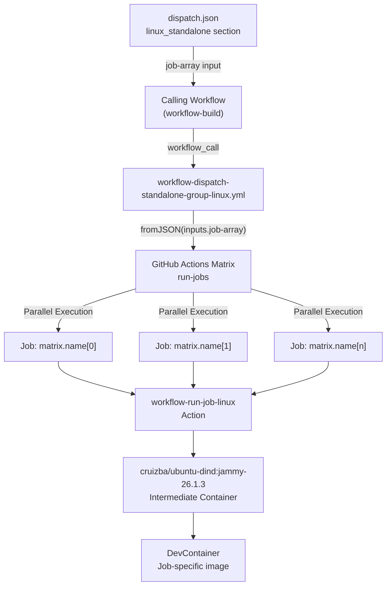
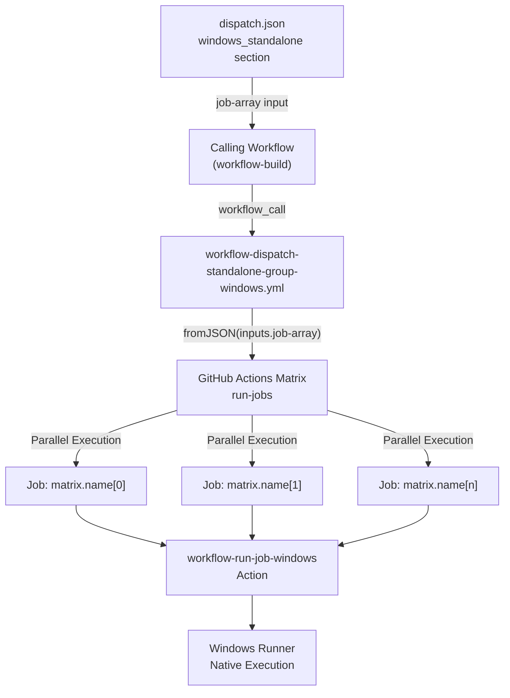
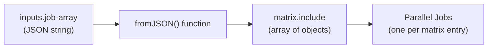
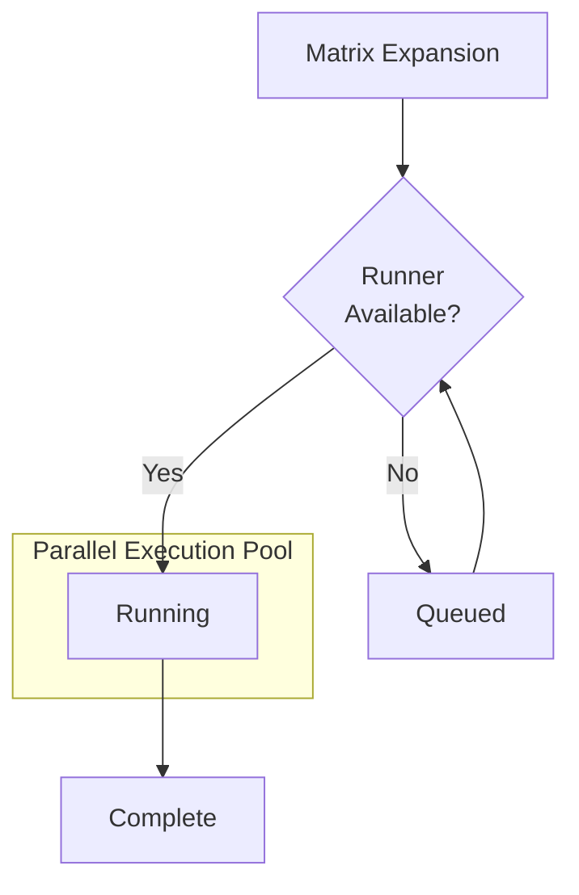
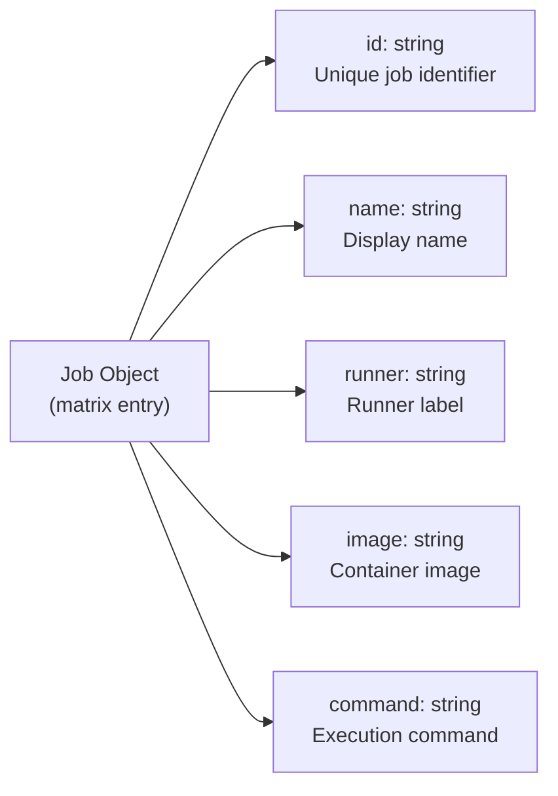
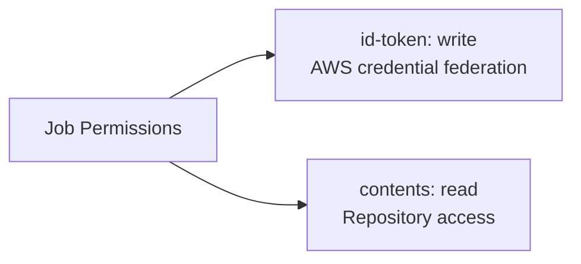
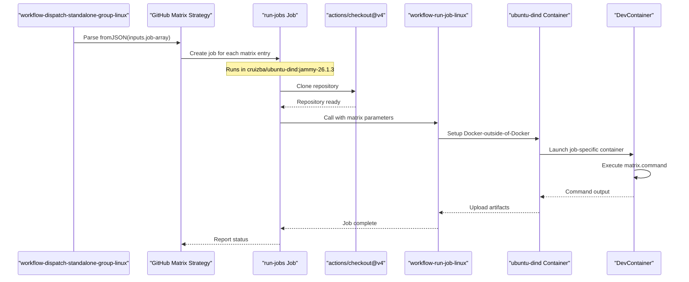
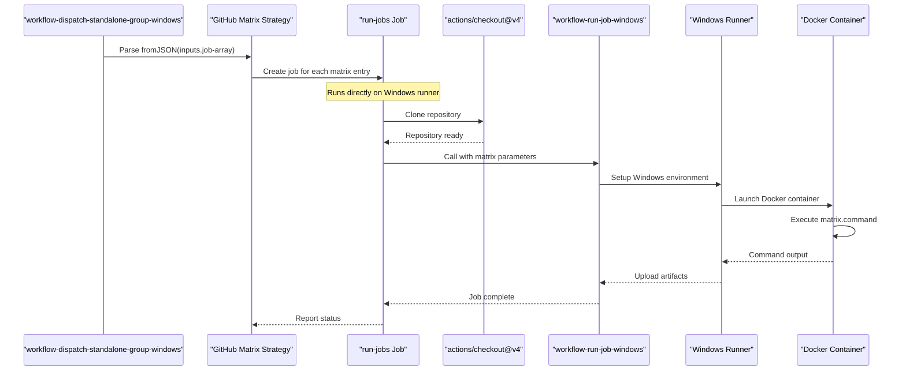
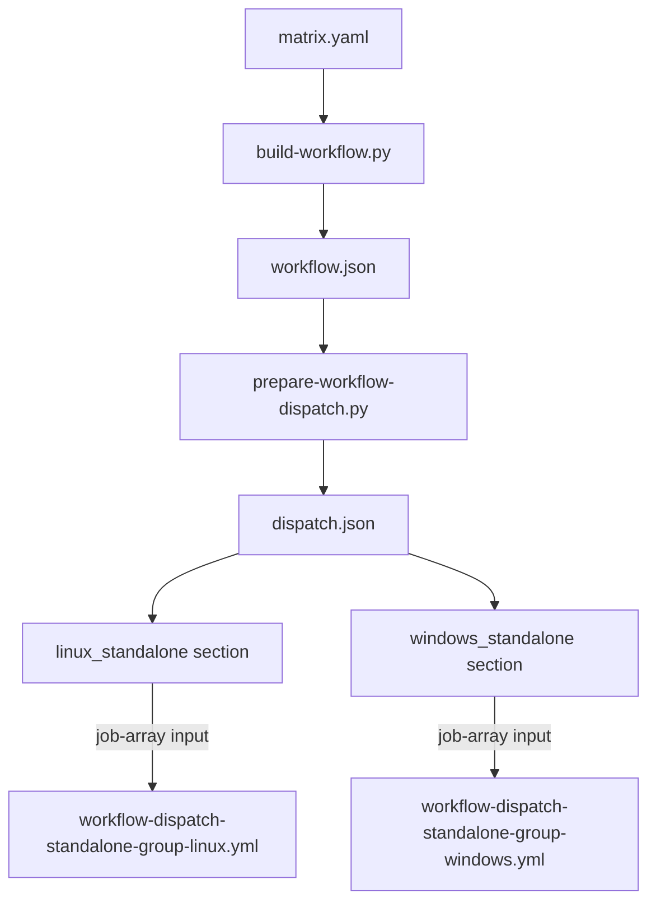

<!-- source: DeepWiki mcp.deepwiki.com · repo NVIDIA/cccl-gha · page 4.1 Standalone Job Dispatch · fetched 2026-10-26 -->

# Standalone Job Dispatch

<details>
<summary>Relevant source files</summary>

The following files were used as context for generating this wiki page:

- [.github/workflows/workflow-dispatch-standalone-group-linux.yml](.github/workflows/workflow-dispatch-standalone-group-linux.yml)
- [.github/workflows/workflow-dispatch-standalone-group-windows.yml](.github/workflows/workflow-dispatch-standalone-group-windows.yml)

</details>


## Purpose and Scope

This document describes the standalone job dispatch subsystem, which routes independent jobs to appropriate execution environments using GitHub Actions matrix strategies. Standalone jobs execute in parallel without dependencies on other jobs, in contrast to the two-stage producer/consumer pattern documented in [Producer-Consumer Pattern](#4.3).

The dispatch mechanism consists of two workflow files that handle Linux and Windows jobs separately, consuming job definitions from `dispatch.json` and expanding them into parallel matrix executions. Each workflow delegates actual command execution to platform-specific execution actions documented in [Linux Execution Environment](#5.1) and [Windows Execution Environment](#5.2).

## Standalone Job Characteristics

Standalone jobs are independent execution units with the following properties:

- **No Dependencies**: Each job runs independently without waiting for other jobs to complete
- **Parallel Execution**: All jobs in the dispatch group run simultaneously (subject to runner availability)
- **Self-Contained**: Jobs do not produce artifacts for consumption by other jobs
- **Matrix-Based**: Jobs are dispatched using GitHub Actions matrix strategy for efficient parallelization
- **Isolated Failure**: Job failures do not block other jobs due to `fail-fast: false` configuration

Standalone jobs are suitable for:
- Compilation and testing tasks that do not share build artifacts
- Independent test suites across different configurations
- Validation jobs that run against different combinations of compilers, CUDA versions, and GPU architectures

**Sources:** Context from provided diagrams

## Dispatch Workflow Architecture

### Linux Standalone Dispatch

The `workflow-dispatch-standalone-group-linux.yml` workflow handles dispatch for Linux-based standalone jobs.

**Workflow Structure:**



**Key Components:**

| Component | Description | Reference |
|-----------|-------------|-----------|
| Workflow Name | `Workflow/Dispatch/StandaloneGroup/Linux` | [.github/workflows/workflow-dispatch-standalone-group-linux.yml:1]() |
| Trigger | `workflow_call` with `job-array` input | [.github/workflows/workflow-dispatch-standalone-group-linux.yml:8-13]() |
| Matrix Source | `fromJSON(inputs.job-array)` | [.github/workflows/workflow-dispatch-standalone-group-linux.yml:21]() |
| Job Name | `${{ matrix.name }}` | [.github/workflows/workflow-dispatch-standalone-group-linux.yml:17]() |
| Container Image | `cruizba/ubuntu-dind:jammy-26.1.3` | [.github/workflows/workflow-dispatch-standalone-group-linux.yml:27]() |
| Execution Action | `workflow-run-job-linux` | [.github/workflows/workflow-dispatch-standalone-group-linux.yml:36]() |

**Sources:** [.github/workflows/workflow-dispatch-standalone-group-linux.yml:1-44]()

### Windows Standalone Dispatch

The `workflow-dispatch-standalone-group-windows.yml` workflow handles dispatch for Windows-based standalone jobs.

**Workflow Structure:**



**Key Differences from Linux:**

| Aspect | Linux | Windows |
|--------|-------|---------|
| Container Strategy | Intermediate `ubuntu-dind` container | No intermediate container |
| GPU Environment | `NVIDIA_VISIBLE_DEVICES` env var in container | Passed directly to execution action |
| Runner | Specified in `matrix.runner` | Specified in `matrix.runner` |
| Execution Action | `workflow-run-job-linux` | `workflow-run-job-windows` |

**Sources:** [.github/workflows/workflow-dispatch-standalone-group-windows.yml:1-37]()

## Matrix Strategy and Job Expansion

### Matrix Configuration

Both workflows use identical matrix strategy configuration:



**Matrix Properties:**

- **Source**: `inputs.job-array` parameter containing JSON-encoded array from `dispatch.json`
- **Strategy**: `fail-fast: false` allows all jobs to complete even if some fail
- **Expansion**: `include: ${{ fromJSON(inputs.job-array) }}` creates one job per array element
- **Naming**: Each job uses `${{ matrix.name }}` for human-readable identification

**Example Matrix Structure:**

```json
[
  {
    "id": "cub-build-cpp20-gcc10-cuda11.1",
    "name": "cub build cpp20 gcc10 cuda11.1",
    "runner": "linux-amd64-cpu16",
    "image": "rapidsai/devcontainers:...",
    "command": "mkdir build && cmake ...",
    "cuda": "11.1",
    "host": "cpp20"
  },
  {
    "id": "thrust-test-cpp17-gcc11-cuda12.0",
    "name": "thrust test cpp17 gcc11 cuda12.0",
    "runner": "linux-amd64-gpu-v100-latest-1",
    "image": "rapidsai/devcontainers:...",
    "command": "ctest --output-on-failure",
    "cuda": "12.0",
    "host": "cpp17"
  }
]
```

**Sources:** [.github/workflows/workflow-dispatch-standalone-group-linux.yml:18-21](), [.github/workflows/workflow-dispatch-standalone-group-windows.yml:22-25]()

### Parallelization Behavior



**Parallelization Characteristics:**

| Property | Behavior |
|----------|----------|
| **Maximum Concurrency** | Limited by available runners matching `matrix.runner` specification |
| **Job Independence** | Jobs do not communicate or share state during execution |
| **Failure Handling** | `fail-fast: false` prevents cascading failures |
| **Resource Allocation** | Each job allocates its specified runner type independently |
| **Execution Order** | Non-deterministic; depends on runner availability |

**Sources:** [.github/workflows/workflow-dispatch-standalone-group-linux.yml:18-21](), [.github/workflows/workflow-dispatch-standalone-group-windows.yml:22-25]()

## Job Input Structure

### Required Matrix Fields

Each job in the matrix array must contain the following fields:



| Field | Type | Purpose | Example |
|-------|------|---------|---------|
| `id` | string | Unique identifier for artifact paths | `"cub-build-cpp20-gcc10-cuda11.1"` |
| `name` | string | Human-readable job name displayed in UI | `"cub build cpp20 gcc10 cuda11.1"` |
| `runner` | string | GitHub runner label | `"linux-amd64-gpu-v100-latest-1"` |
| `image` | string | Container image for devcontainer | `"rapidsai/devcontainers:24.08-..."` |
| `command` | string | Shell command to execute | `"mkdir build && cmake ..."` |

**Linux-Specific Fields:**

| Field | Type | Purpose | Example |
|-------|------|---------|---------|
| `cuda` | string | CUDA version for environment setup | `"12.0"` |
| `host` | string | Host configuration identifier | `"cpp20"` |

**Sources:** [.github/workflows/workflow-dispatch-standalone-group-linux.yml:38-43](), [.github/workflows/workflow-dispatch-standalone-group-windows.yml:34-36]()

### Permissions Configuration

Both workflows require specific GitHub permissions:



| Permission | Level | Purpose |
|------------|-------|---------|
| `id-token` | `write` | Required for AWS OIDC federation to access sccache S3 bucket |
| `contents` | `read` | Required for repository checkout |

**Sources:** [.github/workflows/workflow-dispatch-standalone-group-linux.yml:22-24](), [.github/workflows/workflow-dispatch-standalone-group-windows.yml:19-21]()

## Execution Flow

### Linux Execution Sequence



**Execution Steps:**

1. **Matrix Expansion**: GitHub Actions parses `job-array` JSON and creates parallel jobs
2. **Container Initialization**: Each job starts in `cruizba/ubuntu-dind:jammy-26.1.3` intermediate container
3. **Repository Checkout**: `actions/checkout@v4` clones the repository with `persist-credentials: false`
4. **Action Invocation**: `workflow-run-job-linux` action receives matrix parameters
5. **DevContainer Launch**: Action launches job-specific container using Docker-outside-of-Docker
6. **Command Execution**: The `matrix.command` executes inside the devcontainer
7. **Artifact Collection**: Success markers, logs, and sccache statistics are uploaded

**Sources:** [.github/workflows/workflow-dispatch-standalone-group-linux.yml:26-43]()

### Windows Execution Sequence



**Key Differences:**

- No intermediate container; jobs run directly on Windows runner
- Docker container launched directly from runner (not Docker-outside-of-Docker)
- Fewer matrix parameters passed to execution action (no `cuda` or `host` fields)

**Sources:** [.github/workflows/workflow-dispatch-standalone-group-windows.yml:26-37]()

## Integration with Dispatch Pipeline

### Data Flow from Generation to Execution



**Pipeline Stages:**

1. **Configuration**: `matrix.yaml` defines all possible job combinations
2. **Generation**: `build-workflow.py` expands, validates, and processes jobs into `workflow.json`
3. **Dispatch Preparation**: `prepare-workflow-dispatch.py` splits jobs by OS and execution pattern
4. **Standalone Extraction**: Jobs with `job_type: standalone` are placed in `linux_standalone` or `windows_standalone`
5. **Workflow Invocation**: Parent workflow calls standalone dispatch workflows with `job-array` input
6. **Matrix Execution**: Dispatch workflows expand matrix and execute jobs in parallel

**Sources:** Context from provided diagrams and workflow files

## Configuration Reference

### Linux Workflow Inputs

| Input | Required | Type | Description |
|-------|----------|------|-------------|
| `job-array` | Yes | string | JSON-encoded array from `dispatch.json`'s `linux_standalone.jobs.<name>` |

**Sources:** [.github/workflows/workflow-dispatch-standalone-group-linux.yml:10-13]()

### Windows Workflow Inputs

| Input | Required | Type | Description |
|-------|----------|------|-------------|
| `job-array` | Yes | string | JSON-encoded array from `dispatch.json`'s `windows_standalone.jobs.<name>` |

**Sources:** [.github/workflows/workflow-dispatch-standalone-group-windows.yml:10-13]()

### Shell Configuration

Both workflows use identical shell configuration:

```bash
bash --noprofile --norc -euo pipefail {0}
```

| Flag | Purpose |
|------|---------|
| `--noprofile` | Skip profile initialization for faster startup |
| `--norc` | Skip `.bashrc` for cleaner environment |
| `-e` | Exit immediately on error |
| `-u` | Treat unset variables as errors |
| `-o pipefail` | Pipeline fails if any command fails |

**Sources:** [.github/workflows/workflow-dispatch-standalone-group-linux.yml:3-5](), [.github/workflows/workflow-dispatch-standalone-group-windows.yml:3-5]()

## Comparison: Standalone vs Two-Stage Dispatch

| Aspect | Standalone Dispatch | Two-Stage Dispatch |
|--------|---------------------|-------------------|
| **Job Dependencies** | None; all jobs independent | Producer must complete before consumers |
| **Parallelization** | All jobs run simultaneously | Consumers wait for producer |
| **Use Case** | Independent builds/tests | Build artifacts shared across tests |
| **Artifact Flow** | Each job produces own artifacts | Producer artifacts consumed by consumers |
| **Matrix Structure** | Flat array of jobs | Array of producer/consumer chains |
| **Failure Impact** | Isolated; other jobs continue | Producer failure blocks all consumers |
| **Workflow Files** | `workflow-dispatch-standalone-group-*` | `workflow-dispatch-two-stage-group-*` |
| **Execution Pattern** | Single-stage | Producer → Multiple Consumers |

For detailed information about two-stage dispatch, see [Two-Stage Job Dispatch](#4.2) and [Producer-Consumer Pattern](#4.3).

**Sources:** Context from provided diagrams and workflow files

---

