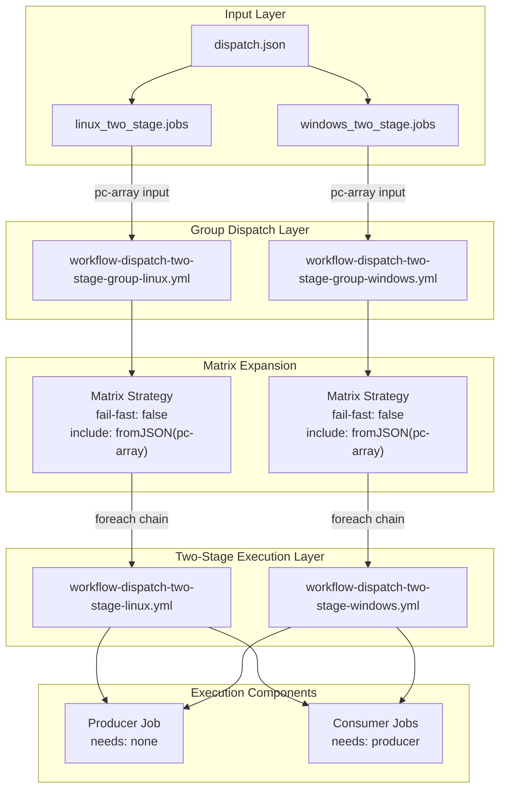
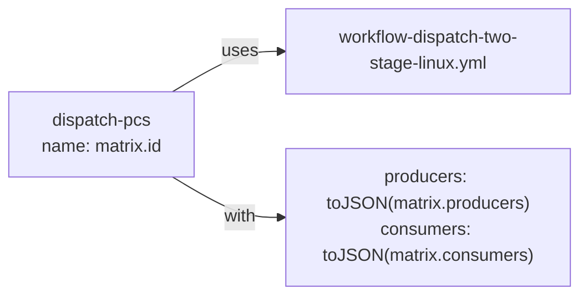
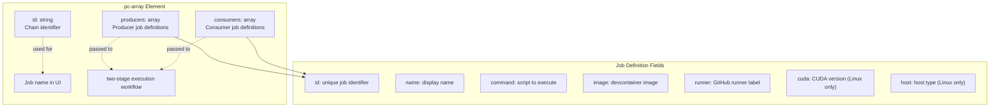
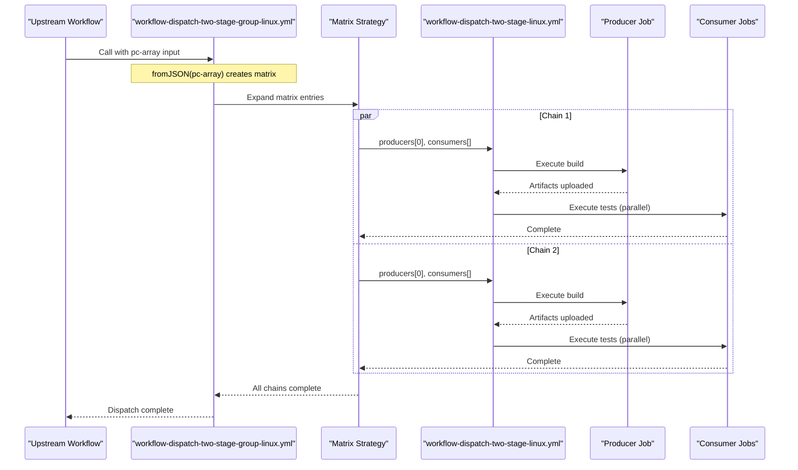
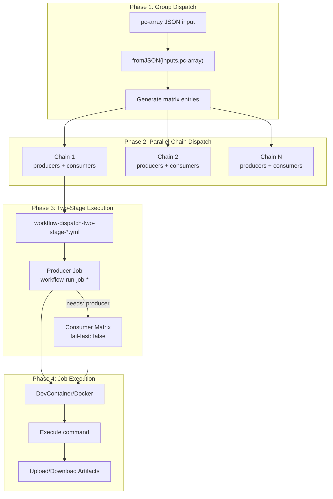

<!-- source: DeepWiki mcp.deepwiki.com · repo NVIDIA/cccl-gha · page 4.2 Two-Stage Job Dispatch · fetched 2026-10-26 -->

# Two-Stage Job Dispatch

<details>
<summary>Relevant source files</summary>

The following files were used as context for generating this wiki page:

- [.github/workflows/workflow-dispatch-two-stage-group-linux.yml](.github/workflows/workflow-dispatch-two-stage-group-linux.yml)
- [.github/workflows/workflow-dispatch-two-stage-group-windows.yml](.github/workflows/workflow-dispatch-two-stage-group-windows.yml)
- [.github/workflows/workflow-dispatch-two-stage-linux.yml](.github/workflows/workflow-dispatch-two-stage-linux.yml)
- [.github/workflows/workflow-dispatch-two-stage-windows.yml](.github/workflows/workflow-dispatch-two-stage-windows.yml)

</details>


## Purpose and Scope

This document describes the **two-stage group dispatch workflows** that handle producer/consumer job chains with dependency ordering. These workflows form the dispatch layer for two-stage jobs, using GitHub Actions matrix strategies to parallelize multiple independent producer/consumer chains.

This page focuses on the group-level dispatch mechanism. For details on the actual producer/consumer execution pattern and artifact exchange, see [Producer-Consumer Pattern](#4.3). For standalone job dispatch, see [Standalone Job Dispatch](#4.1). For information about how jobs are categorized and prepared for dispatch, see [Dispatch Preparation](#3.2).

## Architecture Overview

The two-stage job dispatch system consists of two workflow layers that work together to execute producer/consumer chains:



**Sources:** [.github/workflows/workflow-dispatch-two-stage-group-linux.yml](), [.github/workflows/workflow-dispatch-two-stage-group-windows.yml](), [.github/workflows/workflow-dispatch-two-stage-linux.yml](), [.github/workflows/workflow-dispatch-two-stage-windows.yml]()

The dispatch architecture has two levels:

1. **Group Dispatch Layer**: Receives an array of producer/consumer chains and uses GitHub Actions matrix strategies to parallelize their execution
2. **Two-Stage Execution Layer**: Enforces producer-before-consumer ordering and handles artifact exchange for each chain

This separation enables efficient parallelization while maintaining the dependency ordering required by the producer/consumer pattern.

## Linux Group Dispatch Workflow

The Linux group dispatch workflow is defined in `workflow-dispatch-two-stage-group-linux.yml` and serves as the entry point for dispatching Linux two-stage jobs.

### Workflow Interface

| Input | Type | Required | Description |
|-------|------|----------|-------------|
| `pc-array` | string | Yes | JSON string containing the `dispatch.json`'s `linux_two_stage.jobs.<name>` array of producer/consumer chains |

**Sources:** [.github/workflows/workflow-dispatch-two-stage-group-linux.yml:10-13]()

### Matrix Strategy

The workflow uses GitHub Actions matrix strategy to parallelize multiple producer/consumer chains:

```yaml
strategy:
  fail-fast: false
  matrix:
    include: ${{ fromJSON(inputs.pc-array) }}
```

Key characteristics:
- **`fail-fast: false`**: Allows all chains to execute even if one fails, ensuring comprehensive test coverage
- **`include: fromJSON(inputs.pc-array)`**: Dynamically constructs matrix from input JSON array
- **Matrix variable `${{ matrix.id }}`**: Used for job naming to identify each chain in the GitHub Actions UI

**Sources:** [.github/workflows/workflow-dispatch-two-stage-group-linux.yml:21-24]()

### Chain Dispatch

Each matrix iteration dispatches a single producer/consumer chain to the two-stage execution workflow:



The group workflow extracts `producers` and `consumers` arrays from each matrix entry and passes them as JSON strings to the two-stage execution workflow.

**Sources:** [.github/workflows/workflow-dispatch-two-stage-group-linux.yml:25-28]()

### Permissions

Each dispatched chain job requires specific GitHub permissions:

| Permission | Access Level | Purpose |
|------------|--------------|---------|
| `id-token` | write | AWS credential federation via OIDC for sccache access |
| `contents` | read | Repository checkout |

**Sources:** [.github/workflows/workflow-dispatch-two-stage-group-linux.yml:18-20]()

## Windows Group Dispatch Workflow

The Windows group dispatch workflow (`workflow-dispatch-two-stage-group-windows.yml`) has an identical structure to the Linux version but dispatches to the Windows two-stage execution workflow.

### Key Differences from Linux

The Windows group dispatch workflow is architecturally identical to the Linux version with only these differences:

| Aspect | Linux | Windows |
|--------|-------|---------|
| Workflow file | `workflow-dispatch-two-stage-group-linux.yml` | `workflow-dispatch-two-stage-group-windows.yml` |
| Input parameter | `pc-array` from `linux_two_stage.jobs` | `pc-array` from `windows_two_stage.jobs` |
| Target execution workflow | `workflow-dispatch-two-stage-linux.yml` | `workflow-dispatch-two-stage-windows.yml` |
| Container runtime | Linux containers with DOOD | Windows Docker containers |

The matrix strategy, permissions, and dispatch logic remain identical across both platforms.

**Sources:** [.github/workflows/workflow-dispatch-two-stage-group-windows.yml:1-29]()

## Input Data Structure

The `pc-array` input contains a JSON array where each element represents a producer/consumer chain with the following structure:



### Producer Definition

Each element in the `producers` array is a complete job definition passed to the two-stage execution workflow. The two-stage execution workflows currently only support **single producer per chain**.

**Sources:** [.github/workflows/workflow-dispatch-two-stage-linux.yml:20-21]()

### Consumer Definition

The `consumers` array contains multiple job definitions that will be executed in parallel after the producer completes. Each consumer receives the producer's artifacts.

**Sources:** [.github/workflows/workflow-dispatch-two-stage-linux.yml:47-61]()

## Integration with Two-Stage Execution Workflows

The group dispatch workflows act as orchestrators that invoke the two-stage execution workflows:



### Workflow Calling Pattern

The group workflows use GitHub Actions' `uses:` syntax to invoke the execution workflows:

**Linux:**
```yaml
uses: ./.github/workflows/workflow-dispatch-two-stage-linux.yml
with:
  producers: ${{ toJSON(matrix.producers) }}
  consumers: ${{ toJSON(matrix.consumers) }}
```

**Windows:**
```yaml
uses: ./.github/workflows/workflow-dispatch-two-stage-windows.yml
with:
  producers: ${{ toJSON(matrix.producers) }}
  consumers: ${{ toJSON(matrix.consumers) }}
```

The `toJSON()` function serializes the matrix variables back to JSON strings, as the two-stage execution workflows expect string inputs that are later parsed with `fromJSON()`.

**Sources:** [.github/workflows/workflow-dispatch-two-stage-group-linux.yml:25-28](), [.github/workflows/workflow-dispatch-two-stage-group-windows.yml:25-28]()

## Execution Flow

The complete execution flow from group dispatch to job completion:



**Sources:** [.github/workflows/workflow-dispatch-two-stage-group-linux.yml](), [.github/workflows/workflow-dispatch-two-stage-linux.yml]()

### Matrix Job Naming

Each matrix job is named using the `id` field from the chain definition:

```yaml
name: ${{ matrix.id }}
```

This ensures that each producer/consumer chain appears as a distinct job in the GitHub Actions UI, making it easy to identify and debug specific chains.

**Sources:** [.github/workflows/workflow-dispatch-two-stage-group-linux.yml:17](), [.github/workflows/workflow-dispatch-two-stage-group-windows.yml:17]()

## Limitations and Constraints

### Single Producer Restriction

Both Linux and Windows two-stage execution workflows currently support only **one producer per chain**:

```yaml
# Accumulating results from multiple producers is not easily implemented. 
# For now, only a single producer is supported.
# The build-workflow.py script will emit an error if more than one producer is specified.
producer:
  name: ${{ fromJSON(inputs.producers)[0].name }}
```

The workflows access the producer using `fromJSON(inputs.producers)[0]`, extracting only the first element. The workflow generation system (specifically `build-workflow.py`) validates this constraint and emits an error if multiple producers are specified for a single chain.

**Sources:** [.github/workflows/workflow-dispatch-two-stage-linux.yml:20-23](), [.github/workflows/workflow-dispatch-two-stage-windows.yml:20-23]()

### Artifact Accumulation

The single producer limitation exists because accumulating results from multiple producers into a single artifact set for consumers is complex to implement. Each consumer would need to:
- Download artifacts from multiple producers
- Handle naming conflicts
- Merge or reconcile overlapping outputs
- Determine success criteria when producers have different outcomes

### No Cross-Chain Dependencies

Producer/consumer chains are independent and cannot depend on each other. Each chain is a self-contained execution unit with its own producer and consumers. If cross-chain dependencies are required, they must be expressed through separate workflow structures or manual coordination.

**Sources:** [.github/workflows/workflow-dispatch-two-stage-group-linux.yml:21-24]()

## Configuration Example

A typical `pc-array` input structure for a group dispatch workflow:

```json
[
  {
    "id": "thrust-build-test-chain",
    "producers": [
      {
        "id": "thrust-cpp17-gcc10-cuda12.0-build",
        "name": "thrust cpp17 gcc10 cuda12.0 [build]",
        "command": "cd thrust && cmake --build build",
        "image": "rapidsai/devcontainers:cuda12.0-gcc10",
        "runner": "linux-amd64-cpu16",
        "cuda": "12.0",
        "host": "cpp"
      }
    ],
    "consumers": [
      {
        "id": "thrust-cpp17-gcc10-cuda12.0-test-v100",
        "name": "thrust cpp17 gcc10 cuda12.0 [test v100]",
        "command": "cd thrust && ctest --test-dir build",
        "image": "rapidsai/devcontainers:cuda12.0-gcc10",
        "runner": "linux-amd64-gpu-v100-latest-1",
        "cuda": "12.0",
        "host": "cpp"
      },
      {
        "id": "thrust-cpp17-gcc10-cuda12.0-test-t4",
        "name": "thrust cpp17 gcc10 cuda12.0 [test t4]",
        "command": "cd thrust && ctest --test-dir build",
        "image": "rapidsai/devcontainers:cuda12.0-gcc10",
        "runner": "linux-amd64-gpu-t4-latest-1",
        "cuda": "12.0",
        "host": "cpp"
      }
    ]
  }
]
```

This structure allows a single build job to produce artifacts consumed by multiple test jobs running on different GPU architectures.

## Summary

The two-stage group dispatch workflows provide a scalable dispatch layer for producer/consumer job chains:

| Component | File | Purpose |
|-----------|------|---------|
| Linux Group Dispatch | `workflow-dispatch-two-stage-group-linux.yml` | Parallelize Linux producer/consumer chains using matrix strategy |
| Windows Group Dispatch | `workflow-dispatch-two-stage-group-windows.yml` | Parallelize Windows producer/consumer chains using matrix strategy |
| Linux Two-Stage Execution | `workflow-dispatch-two-stage-linux.yml` | Execute single Linux producer/consumer chain with dependency ordering |
| Windows Two-Stage Execution | `workflow-dispatch-two-stage-windows.yml` | Execute single Windows producer/consumer chain with dependency ordering |

The group workflows transform a flat array of chain definitions into parallel execution streams, while the two-stage execution workflows handle the producer-before-consumer ordering and artifact exchange within each chain. This architecture enables efficient parallelization while maintaining the dependencies required by build-once, test-many workflows.

**Sources:** [.github/workflows/workflow-dispatch-two-stage-group-linux.yml](), [.github/workflows/workflow-dispatch-two-stage-group-windows.yml](), [.github/workflows/workflow-dispatch-two-stage-linux.yml](), [.github/workflows/workflow-dispatch-two-stage-windows.yml]()

---

