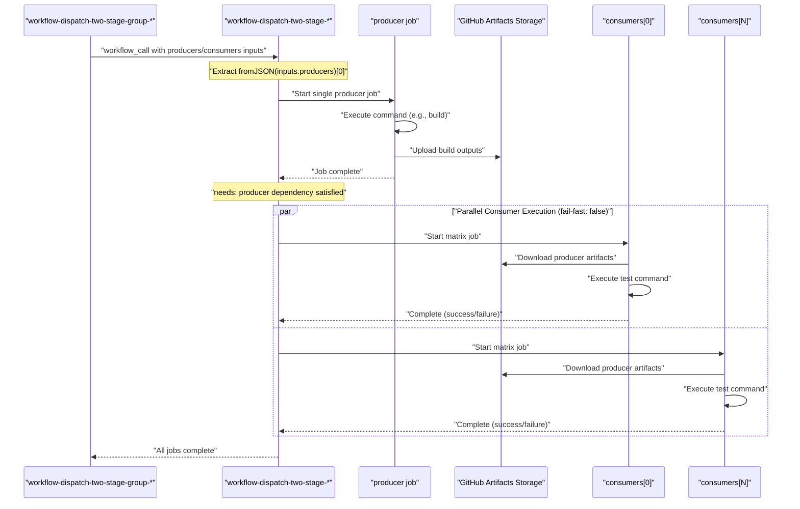
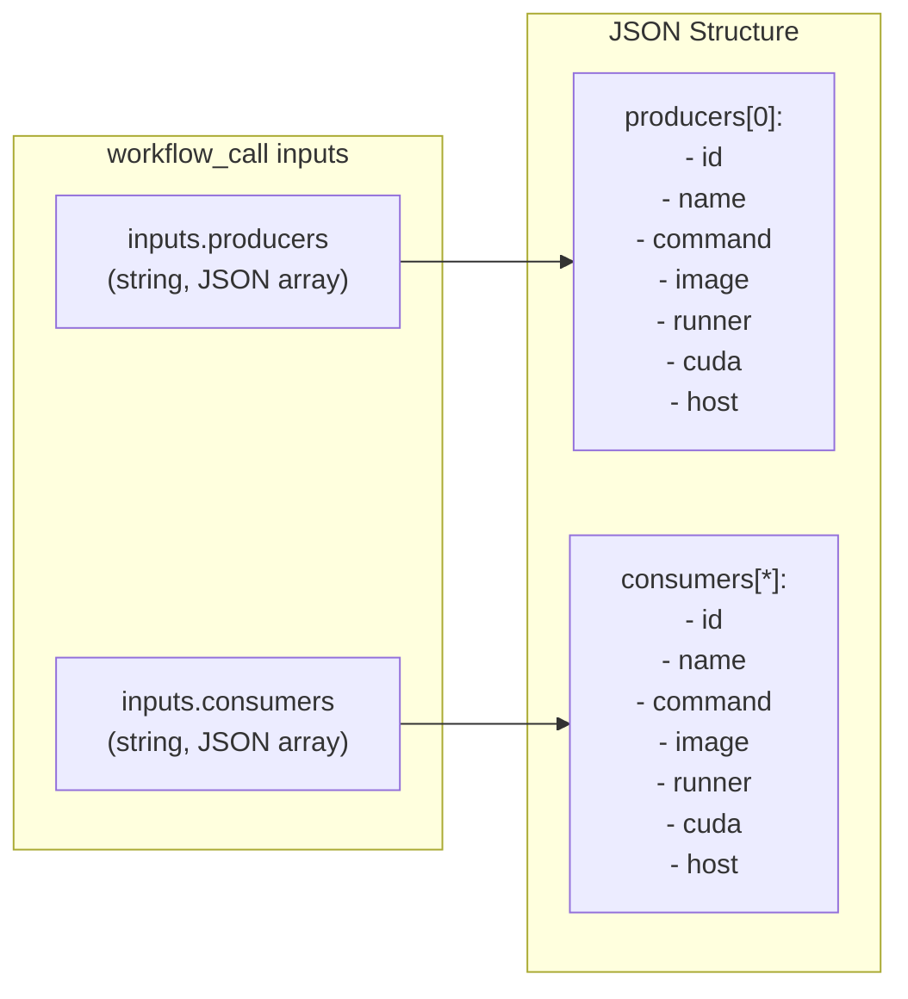
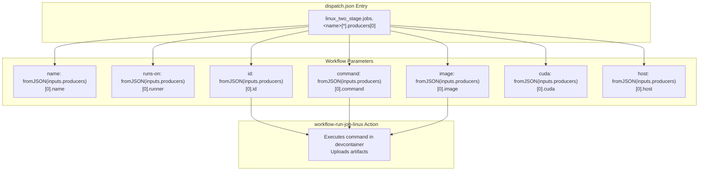
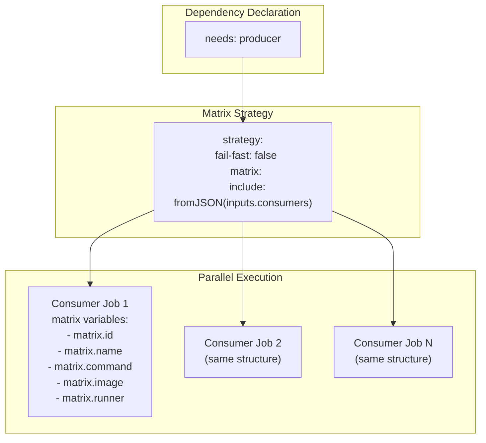
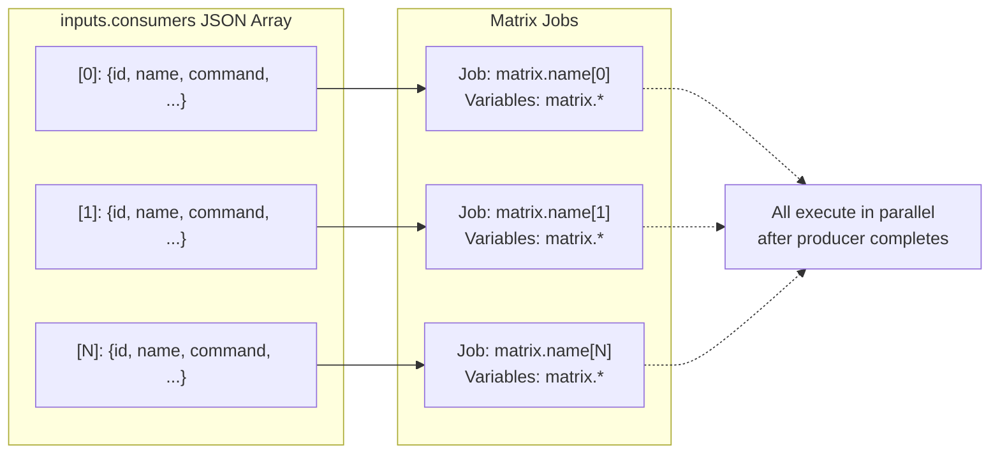
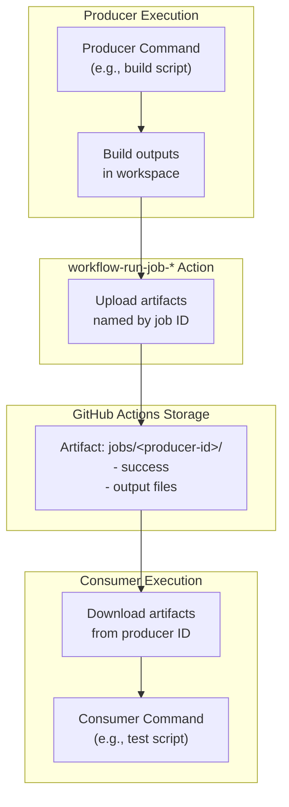
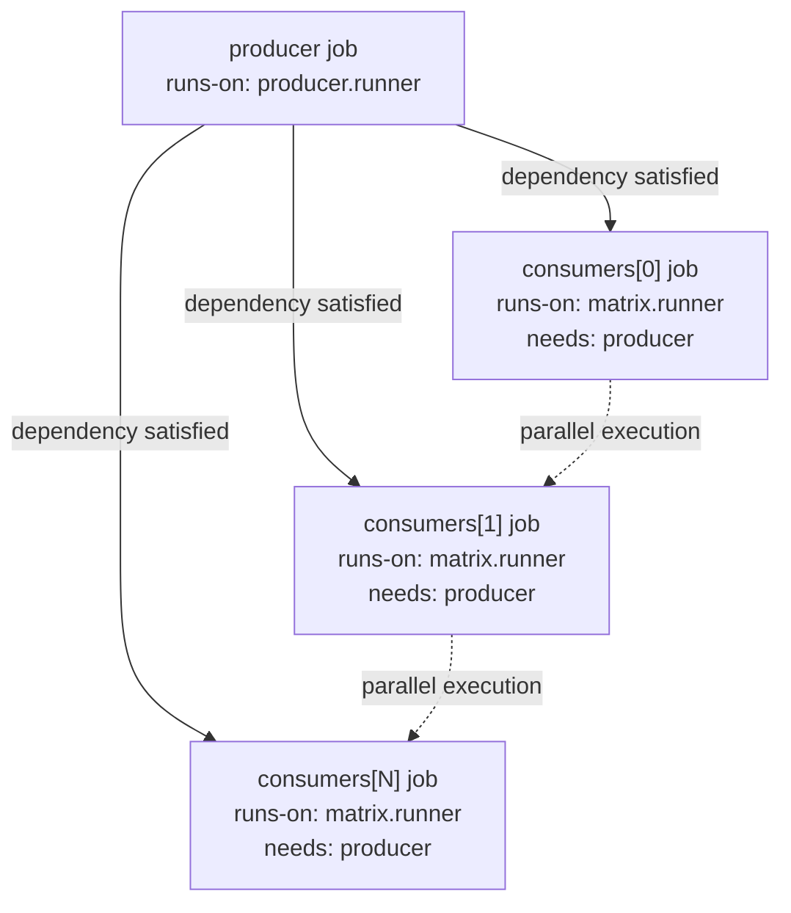
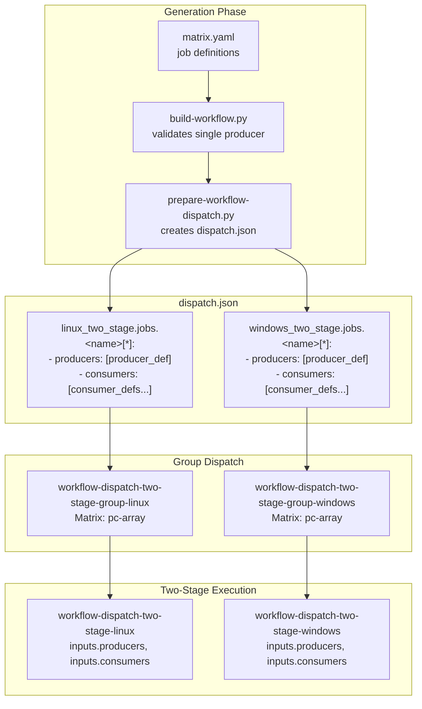

<!-- source: DeepWiki mcp.deepwiki.com · repo NVIDIA/cccl-gha · page 4.3 Producer-Consumer Pattern · fetched 2026-10-26 -->

# Producer-Consumer Pattern

<details>
<summary>Relevant source files</summary>

The following files were used as context for generating this wiki page:

- [.github/workflows/workflow-dispatch-two-stage-linux.yml](.github/workflows/workflow-dispatch-two-stage-linux.yml)
- [.github/workflows/workflow-dispatch-two-stage-windows.yml](.github/workflows/workflow-dispatch-two-stage-windows.yml)

</details>


## Purpose and Scope

This document explains the two-stage producer-consumer execution model used in the cccl-gha workflow system. It covers how a single producer job generates artifacts that multiple consumer jobs utilize, including the dependency ordering mechanism, artifact exchange via GitHub Actions artifact storage, and parallel consumer execution strategies.

For information about how two-stage jobs are dispatched and grouped, see [Two-Stage Job Dispatch](#4.2). For details about the actual execution environments where producer and consumer commands run, see [Linux Execution Environment](#5.1) and [Windows Execution Environment](#5.2).

## Pattern Overview

The producer-consumer pattern enables build-once, test-many workflows where expensive compilation steps (producers) are executed once, and their outputs are consumed by multiple test configurations (consumers) running in parallel. This pattern is particularly valuable for CUDA projects where compilation is time-consuming but testing across different GPU architectures, operating systems, or runtime configurations is necessary.

The pattern is implemented in two separate workflow files that handle Linux and Windows execution environments:
- `.github/workflows/workflow-dispatch-two-stage-linux.yml`
- `.github/workflows/workflow-dispatch-two-stage-windows.yml`

### Execution Flow Sequence



**Sources:** [.github/workflows/workflow-dispatch-two-stage-linux.yml:1-76](), [.github/workflows/workflow-dispatch-two-stage-windows.yml:1-62]()

## Workflow Structure

Both Linux and Windows two-stage workflows follow an identical structural pattern with platform-specific execution actions.

### Workflow Inputs



The workflows receive two string inputs containing JSON-encoded arrays:
- `inputs.producers`: Array of producer job definitions
- `inputs.consumers`: Array of consumer job definitions

Each job definition contains metadata fields parsed from the `dispatch.json` file generated during the workflow generation phase.

**Sources:** [.github/workflows/workflow-dispatch-two-stage-linux.yml:10-17](), [.github/workflows/workflow-dispatch-two-stage-windows.yml:10-17]()

## Producer Job

The producer job executes a single command that generates artifacts for downstream consumption.

### Producer Job Definition

| Aspect | Linux Implementation | Windows Implementation |
|--------|---------------------|------------------------|
| Job name | `producer` | `producer` |
| Job selection | `fromJSON(inputs.producers)[0]` | `fromJSON(inputs.producers)[0]` |
| Execution action | `workflow-run-job-linux` | `workflow-run-job-windows` |
| Container | `cruizba/ubuntu-dind:jammy-26.1.3` | None (native) |
| Permissions | `id-token: write`, `contents: read` | `id-token: write`, `contents: read` |

The producer always uses the **first element** of the `producers` array. This is a current limitation documented in the workflow comments.

**Sources:** [.github/workflows/workflow-dispatch-two-stage-linux.yml:20-46](), [.github/workflows/workflow-dispatch-two-stage-windows.yml:20-39]()

### Producer Configuration Mapping



The producer job extracts configuration from the JSON array using `fromJSON()` and array indexing (`[0]`). On Linux, it also passes CUDA and host information for GPU job configuration.

**Sources:** [.github/workflows/workflow-dispatch-two-stage-linux.yml:23-45](), [.github/workflows/workflow-dispatch-two-stage-windows.yml:23-38]()

## Consumer Jobs

Consumer jobs execute in parallel after the producer completes, utilizing artifacts generated by the producer.

### Consumer Job Configuration



Key characteristics of consumer execution:

| Feature | Value | Purpose |
|---------|-------|---------|
| `needs` | `producer` | Ensures producer completes before any consumer starts |
| `fail-fast` | `false` | Allows all consumers to run even if some fail |
| `strategy.matrix.include` | `fromJSON(inputs.consumers)` | Expands each consumer into a separate parallel job |
| `name` | `${{ matrix.name }}` | Human-readable job name in GitHub UI |

**Sources:** [.github/workflows/workflow-dispatch-two-stage-linux.yml:47-75](), [.github/workflows/workflow-dispatch-two-stage-windows.yml:40-61]()

### Consumer Matrix Expansion

The `matrix.include` strategy creates a separate job for each element in the `consumers` array. Each matrix job receives its configuration through matrix context variables:



Each consumer job accesses its configuration via `matrix.*` variables rather than array indexing, as GitHub Actions automatically populates these variables for each matrix job instance.

**Sources:** [.github/workflows/workflow-dispatch-two-stage-linux.yml:58-61](), [.github/workflows/workflow-dispatch-two-stage-windows.yml:47-50]()

## Artifact Exchange Mechanism

Producer and consumer jobs communicate through GitHub Actions' artifact storage system. The actual artifact upload and download logic is implemented within the `workflow-run-job-linux` and `workflow-run-job-windows` actions.

### Artifact Flow



The artifact naming convention uses the job ID to ensure uniqueness. Consumers must know the producer's job ID to download the correct artifacts. This coordination is handled by the workflow generation phase, which assigns consistent IDs to related producer-consumer chains.

**Sources:** [.github/workflows/workflow-dispatch-two-stage-linux.yml:37-45](), [.github/workflows/workflow-dispatch-two-stage-linux.yml:67-75]()

## Dependency Ordering

The `needs: producer` directive in the consumer job definition enforces strict execution ordering.

### Dependency Graph



GitHub Actions guarantees that:
1. The producer job must complete successfully before any consumer job starts
2. If the producer fails, all consumer jobs are skipped
3. Consumers execute concurrently once the producer succeeds

**Sources:** [.github/workflows/workflow-dispatch-two-stage-linux.yml:49](), [.github/workflows/workflow-dispatch-two-stage-windows.yml:42]()

## Platform-Specific Differences

While both workflows follow the same structural pattern, they differ in execution environment details.

### Linux vs Windows Implementation

| Aspect | Linux | Windows |
|--------|-------|---------|
| Workflow file | `workflow-dispatch-two-stage-linux.yml` | `workflow-dispatch-two-stage-windows.yml` |
| Container image | `cruizba/ubuntu-dind:jammy-26.1.3` | None (runs natively) |
| Execution action | `workflow-run-job-linux` | `workflow-run-job-windows` |
| CUDA parameter | `cuda: ${{ ... .cuda }}` | Not passed |
| Host parameter | `host: ${{ ... .host }}` | Not passed |
| GPU environment | `NVIDIA_VISIBLE_DEVICES` env var | Not used |

Linux jobs run in a Docker-outside-of-Docker (DOOD) configuration with an intermediate container, while Windows jobs execute natively. Linux jobs also support GPU configuration through additional parameters.

**Sources:** [.github/workflows/workflow-dispatch-two-stage-linux.yml:28-31](), [.github/workflows/workflow-dispatch-two-stage-linux.yml:44-45](), [.github/workflows/workflow-dispatch-two-stage-windows.yml:28-38]()

## Current Limitations

### Single Producer Constraint

Both workflow files contain explicit comments noting a critical limitation:

```
# Accumulating results from multiple producers is not easily implemented. For now, only a single producer is supported.
# The build-workflow.py script will emit an error if more than one producer is specified.
```

This means:
- Only `producers[0]` is used; additional elements are ignored
- Multi-stage builds requiring multiple producer outputs are not supported
- The `build-workflow.py` script validates this constraint during workflow generation

The limitation exists because accumulating artifacts from multiple producers and making them all available to consumers requires more complex dependency orchestration than GitHub Actions' simple `needs` directive provides.

**Sources:** [.github/workflows/workflow-dispatch-two-stage-linux.yml:20-21](), [.github/workflows/workflow-dispatch-two-stage-windows.yml:20-21]()

### Fail-Fast Disabled

Consumer jobs use `fail-fast: false` to ensure comprehensive test coverage:

```yaml
strategy:
  fail-fast: false
  matrix:
    include: ${{ fromJSON(inputs.consumers) }}
```

This means:
- All consumer jobs execute even if one fails
- Partial test results are always available
- The workflow continues to completion regardless of individual consumer failures
- Overall workflow status depends on aggregating all consumer results

This design prioritizes comprehensive feedback over fast failure detection.

**Sources:** [.github/workflows/workflow-dispatch-two-stage-linux.yml:58-61](), [.github/workflows/workflow-dispatch-two-stage-windows.yml:47-50]()

## Permissions Model

Both producer and consumer jobs require specific GitHub Actions permissions:

| Permission | Scope | Purpose |
|------------|-------|---------|
| `id-token` | `write` | AWS credential federation for sccache access |
| `contents` | `read` | Repository checkout |

The `id-token: write` permission enables OpenID Connect (OIDC) authentication with AWS, allowing jobs to access the S3-based sccache bucket without storing credentials in repository secrets.

**Sources:** [.github/workflows/workflow-dispatch-two-stage-linux.yml:25-27](), [.github/workflows/workflow-dispatch-two-stage-linux.yml:51-53](), [.github/workflows/workflow-dispatch-two-stage-windows.yml:25-27](), [.github/workflows/workflow-dispatch-two-stage-windows.yml:44-46]()

## Configuration Flow Summary



The producer-consumer pattern integrates with the broader workflow system through a multi-stage generation and dispatch process. The `build-workflow.py` script enforces the single-producer constraint during generation, and `prepare-workflow-dispatch.py` organizes producer-consumer pairs into the `dispatch.json` structure consumed by the two-stage workflows.

**Sources:** [.github/workflows/workflow-dispatch-two-stage-linux.yml:1-76](), [.github/workflows/workflow-dispatch-two-stage-windows.yml:1-62]()

---

