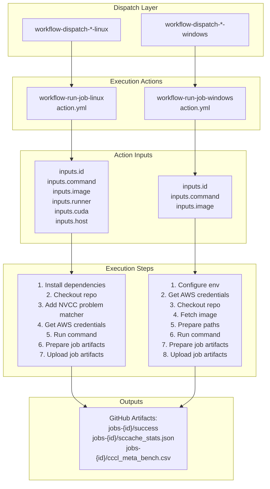
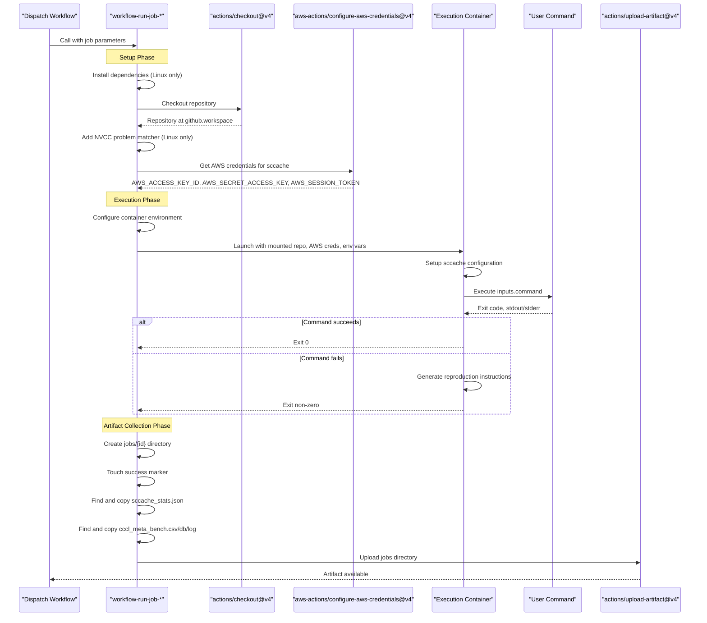
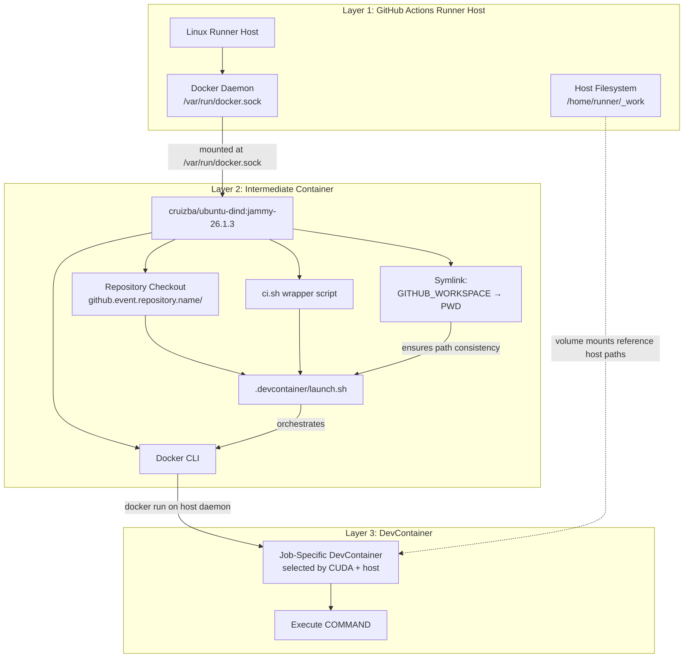
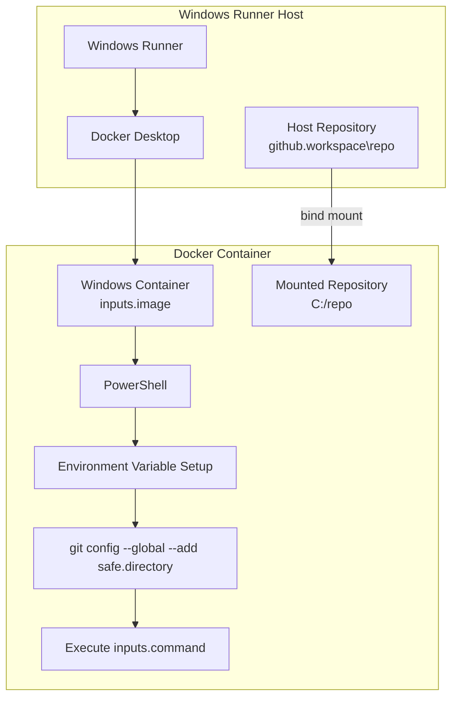
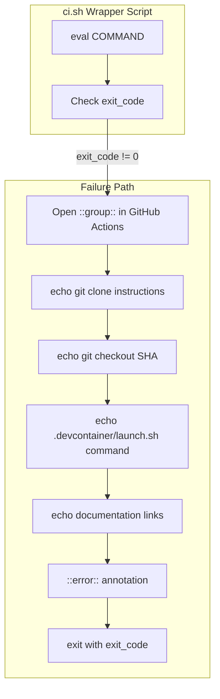

<!-- source: DeepWiki mcp.deepwiki.com · repo NVIDIA/cccl-gha · page 5 Job Execution · fetched 2026-10-26 -->

# Job Execution

<details>
<summary>Relevant source files</summary>

The following files were used as context for generating this wiki page:

- [.github/actions/workflow-run-job-linux/action.yml](.github/actions/workflow-run-job-linux/action.yml)
- [.github/actions/workflow-run-job-windows/action.yml](.github/actions/workflow-run-job-windows/action.yml)

</details>


## Purpose and Scope

This page documents the job execution layer of the cccl-gha system, which is responsible for running individual build and test commands in isolated environments. Job execution occurs after the dispatch layer ([4](#4)) routes jobs to appropriate execution workflows, and before the results collection system ([6](#6)) aggregates outputs.

This page covers the high-level execution architecture, the two platform-specific execution actions (`workflow-run-job-linux` and `workflow-run-job-windows`), execution flow patterns, and artifact collection mechanisms. For detailed information about platform-specific execution environments, see [Linux Execution Environment](#5.1) and [Windows Execution Environment](#5.2). For devcontainer configuration and launching, see [Devcontainer System](#5.3). For AWS credentials and sccache configuration, see [Environment Setup](#5.4). For error handling and local reproduction, see [Error Handling and Reproducibility](#5.5).

## Overview

Job execution is the final phase where actual build and test commands run in containerized environments. Each job executes in an isolated Docker container with:

- A job-specific devcontainer image selected based on CUDA version and compiler
- AWS credentials for distributed compilation caching via sccache
- The repository code checked out at the appropriate commit
- Environment variables propagated from GitHub Actions
- GPU access (when required)

The execution layer produces artifacts including success markers, sccache statistics, and benchmark data that the results collection system consumes for reporting.

Sources: [.github/actions/workflow-run-job-linux/action.yml:1-201](), [.github/actions/workflow-run-job-windows/action.yml:1-99]()

## Execution Actions

The system provides two composite GitHub Actions for job execution, one per operating system:

### Linux Execution Action

**File**: `.github/actions/workflow-run-job-linux/action.yml`

**Inputs**:
- `id`: Unique job identifier used for artifact naming
- `command`: Shell command to execute in the container
- `image`: Docker image name (not directly used; devcontainer selected by CUDA/host)
- `runner`: GitHub Actions runner label (e.g., `linux-amd64-gpu-v100-latest-1`)
- `cuda`: CUDA version for devcontainer selection (e.g., `12.4`)
- `host`: Host compiler for devcontainer selection (e.g., `gcc12`)

**Container Strategy**: Docker-outside-of-Docker (DOOD) using `cruizba/ubuntu-dind:jammy-26.1.3` as intermediate container

### Windows Execution Action

**File**: `.github/actions/workflow-run-job-windows/action.yml`

**Inputs**:
- `id`: Unique job identifier
- `command`: PowerShell command to execute
- `image`: Docker image to use directly (e.g., Windows Server Core with MSVC)

**Container Strategy**: Native Docker execution on Windows host

Sources: [.github/actions/workflow-run-job-linux/action.yml:22-41](), [.github/actions/workflow-run-job-windows/action.yml:4-13]()

## Execution Action Mapping



This diagram maps the dispatch workflows to their corresponding execution actions, showing the specific input parameters each action expects and the sequence of steps they execute. Both actions produce identical artifact structures for consumption by the results collection system.

Sources: [.github/actions/workflow-run-job-linux/action.yml:22-201](), [.github/actions/workflow-run-job-windows/action.yml:4-99]()

## Execution Flow

The following sequence diagram illustrates the complete execution lifecycle for a single job:



This sequence shows the three distinct phases: setup (repository checkout and credential configuration), execution (running the command in a container), and artifact collection (gathering outputs for results processing).

Sources: [.github/actions/workflow-run-job-linux/action.yml:44-201](), [.github/actions/workflow-run-job-windows/action.yml:17-99]()

## Platform Execution Patterns

The following table compares the execution characteristics between Linux and Windows platforms:

| Aspect | Linux Execution | Windows Execution |
|--------|-----------------|-------------------|
| **Container Strategy** | Docker-outside-of-Docker (DOOD) | Native Docker on Windows host |
| **Intermediate Container** | `cruizba/ubuntu-dind:jammy-26.1.3` | None |
| **Devcontainer Selection** | Dynamic via `.devcontainer/launch.sh` with `--cuda` and `--host` flags | Static via `inputs.image` |
| **Repository Mount** | Complex: symlink + volume mount to match host paths | Direct: bind mount from host to `C:/{repo}` |
| **Command Shell** | Bash via generated `ci.sh` wrapper script | PowerShell via inline script |
| **GPU Access** | `--gpus device=${NVIDIA_VISIBLE_DEVICES}` when runner contains `-gpu-` | Not configured (Windows GPU runners not in use) |
| **Path Handling** | Requires `host_path()` transformation for volume mounts | Requires PowerShell path transformation (`\` to `/`) |
| **Environment Variable Injection** | Via `--env` flags to `launch.sh` | Via `[System.Environment]::SetEnvironmentVariable` in PowerShell |
| **Problem Matchers** | NVCC problem matcher added | Not configured |
| **Artifact Files** | `success`, `sccache_stats.json`, `cccl_meta_bench.{csv,db,log}` | `success`, `sccache_stats.json` |

Sources: [.github/actions/workflow-run-job-linux/action.yml:4-164](), [.github/actions/workflow-run-job-windows/action.yml:15-64]()

## Docker-Outside-of-Docker Pattern (Linux)

Linux execution uses a DOOD strategy to avoid performance issues with nested Docker (Docker-in-Docker). The pattern has three layers:



**Key Implementation Details**:

1. **Socket Mounting**: The runner host's Docker socket is mounted into the intermediate container, allowing the Docker CLI in `ubuntu-dind` to communicate with the host daemon: [.github/actions/workflow-run-job-linux/action.yml:6-8]()

2. **Path Symlink**: A critical symlink ensures the intermediate container's working directory matches the host's `github.workspace` path, because Docker volume mounts must reference host paths: [.github/actions/workflow-run-job-linux/action.yml:82-87]()

3. **Host Path Transformation**: The `host_path()` function converts container paths to host paths for volume mount specifications: [.github/actions/workflow-run-job-linux/action.yml:138-140]()

4. **Launch Script Invocation**: The `.devcontainer/launch.sh` script receives the `--docker` flag to use the host daemon, along with CUDA/host parameters to select the appropriate devcontainer: [.github/actions/workflow-run-job-linux/action.yml:144-164]()

Sources: [.github/actions/workflow-run-job-linux/action.yml:4-164]()

## Native Docker Pattern (Windows)

Windows execution uses a simpler pattern with direct Docker container invocation:



**Key Implementation Details**:

1. **Path Transformation**: PowerShell converts Windows backslash paths to forward slashes for Docker mount compatibility: [.github/actions/workflow-run-job-windows/action.yml:40-46]()

2. **Environment Variable Injection**: PowerShell's `[System.Environment]::SetEnvironmentVariable` sets AWS credentials and sccache configuration inside the container: [.github/actions/workflow-run-job-windows/action.yml:55-62]()

3. **Git Safe Directory**: The repository mount path is added to Git's safe directory list to prevent ownership errors: [.github/actions/workflow-run-job-windows/action.yml:63]()

4. **Direct Docker Run**: Unlike Linux, Windows executes `docker run` directly from the runner without an intermediate container: [.github/actions/workflow-run-job-windows/action.yml:50-64]()

Sources: [.github/actions/workflow-run-job-windows/action.yml:40-64]()

## Artifact Collection

Both Linux and Windows execution actions follow an identical artifact collection pattern:

```mermaid
graph LR
    subgraph "Post-Execution"
        Complete["Command Completes"]
    end
    
    subgraph "Artifact Preparation"
        CreateDir["Create jobs/{id} directory"]
        TouchSuccess["Touch success marker"]
        FindFiles["Find and copy files"]
    end
    
    subgraph "Artifact Files"
        Success["jobs/{id}/success"]
        Sccache["jobs/{id}/sccache_stats.json"]
        Bench["jobs/{id}/cccl_meta_bench.csv"]
        BenchDB["jobs/{id}/cccl_meta_bench.db"]
        BenchLog["jobs/{id}/cccl_meta_bench.log"]
    end
    
    subgraph "Upload"
        Upload["actions/upload-artifact@v4<br/>name: jobs-{id}<br/>path: jobs"]
    end
    
    Complete --> CreateDir
    CreateDir --> TouchSuccess
    TouchSuccess --> FindFiles
    
    FindFiles --> Success
    FindFiles --> Sccache
    FindFiles --> Bench
    FindFiles --> BenchDB
    FindFiles --> BenchLog
    
    Success --> Upload
    Sccache --> Upload
    Bench --> Upload
    BenchDB --> Upload
    BenchLog --> Upload
```

**Artifact File Specifications**:

| File | Purpose | Always Present |
|------|---------|----------------|
| `success` | Marker file indicating job completed (even if tests failed) | Yes |
| `sccache_stats.json` | Compilation cache statistics from sccache | No (only if sccache used) |
| `cccl_meta_bench.csv` | Benchmark results in CSV format | No (only if benchmarks run) |
| `cccl_meta_bench.db` | Benchmark database | No (only if benchmarks run) |
| `cccl_meta_bench.log` | Benchmark execution log | No (only if benchmarks run) |

**Implementation Details**:

1. **Success Marker**: The `success` file is always created, even if the command failed. Its presence indicates the job executed, not that tests passed. Absence indicates the workflow or container setup failed: [.github/actions/workflow-run-job-linux/action.yml:173](), [.github/actions/workflow-run-job-windows/action.yml:74]()

2. **Find and Copy Pattern**: The `find_and_copy()` bash function searches the repository directory recursively for specific filenames and copies them to the results directory. Missing files are tolerated: [.github/actions/workflow-run-job-linux/action.yml:176-189](), [.github/actions/workflow-run-job-windows/action.yml:76-88]()

3. **Artifact Naming**: Artifacts are uploaded with the name pattern `jobs-{id}` where `id` is the unique job identifier. This allows the results collection system to download and merge artifacts from all jobs: [.github/actions/workflow-run-job-linux/action.yml:198-199](), [.github/actions/workflow-run-job-windows/action.yml:96-97]()

4. **No Compression**: Artifacts use `compression-level: 0` to speed up upload/download at the cost of storage space: [.github/actions/workflow-run-job-linux/action.yml:200](), [.github/actions/workflow-run-job-windows/action.yml:98]()

Sources: [.github/actions/workflow-run-job-linux/action.yml:166-201](), [.github/actions/workflow-run-job-windows/action.yml:65-99]()

## Error Handling and Reproduction Instructions

When a command fails during execution, the Linux action generates detailed reproduction instructions:



**Generated Instructions Example**:

The failure output includes:
1. Repository clone command with correct branch: `git clone --branch $GITHUB_REF_NAME --single-branch`
2. Commit checkout: `git checkout $GITHUB_SHA`
3. Docker launch command with exact parameters: `.devcontainer/launch.sh -d -c {cuda} -H {host} -- {command}`
4. Links to devcontainer documentation and CI overview

This allows developers to reproduce CI failures locally with identical container, compiler, and CUDA versions.

Sources: [.github/actions/workflow-run-job-linux/action.yml:94-108]()

## Integration Points

The execution layer integrates with several external systems:

| System | Integration Point | Purpose |
|--------|-------------------|---------|
| **GitHub Actions API** | `actions/checkout@v4` | Repository code checkout at specific commit |
| **GitHub Actions API** | `actions/upload-artifact@v4` | Artifact upload for results collection |
| **AWS IAM** | `aws-actions/configure-aws-credentials@v4` | OIDC authentication for sccache S3 bucket |
| **AWS S3** | Environment variables in container | sccache distributed compilation cache |
| **DevContainer System** | `.devcontainer/launch.sh` (Linux) | Dynamic container selection and launching |
| **Problem Matchers** | `.github/problem-matchers/problem-matcher.json` | NVCC error annotation in GitHub Actions UI |
| **Dispatch Layer** | Action inputs from workflow matrix | Job parameters and configuration |
| **Results Collection** | Uploaded artifacts | Success verification and reporting |

Sources: [.github/actions/workflow-run-job-linux/action.yml:52-65](), [.github/actions/workflow-run-job-linux/action.yml:144-164](), [.github/actions/workflow-run-job-windows/action.yml:26-31]()

---

