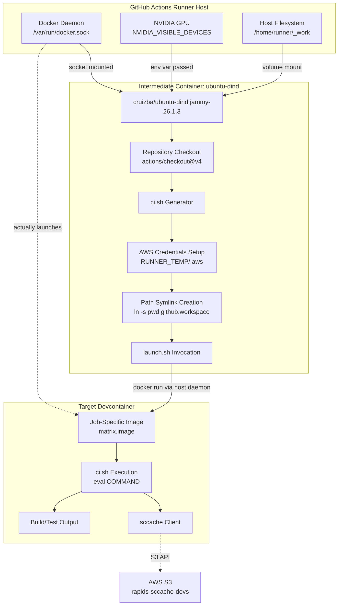
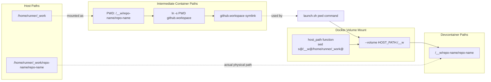
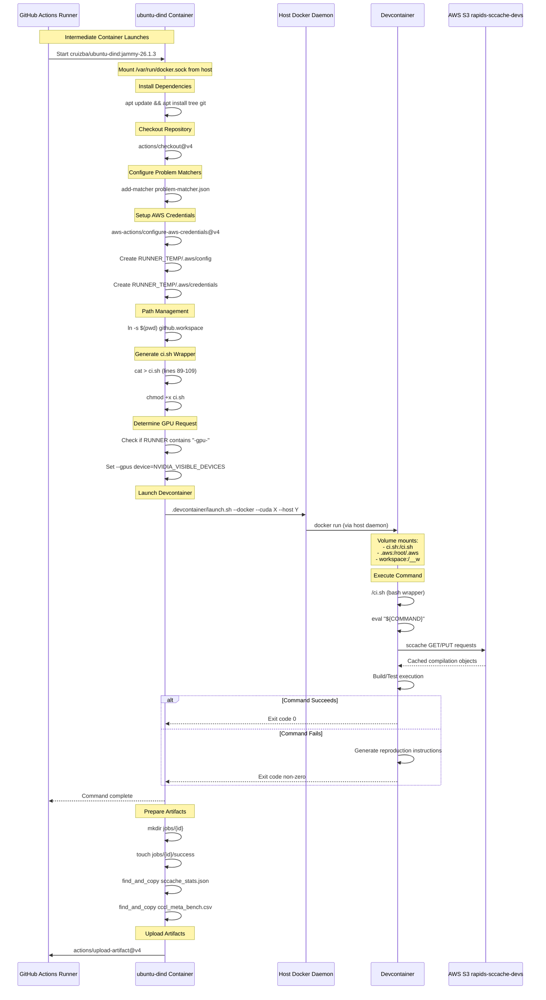
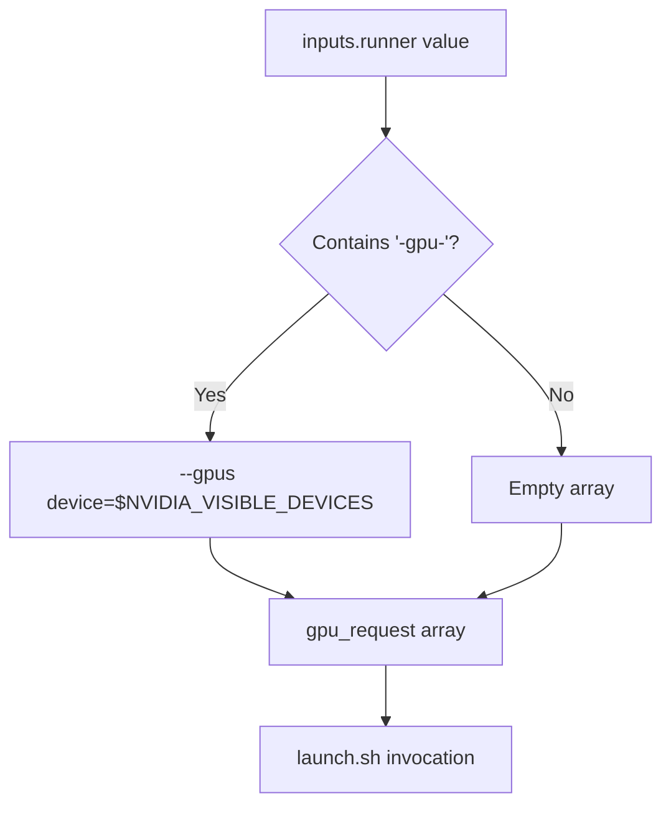
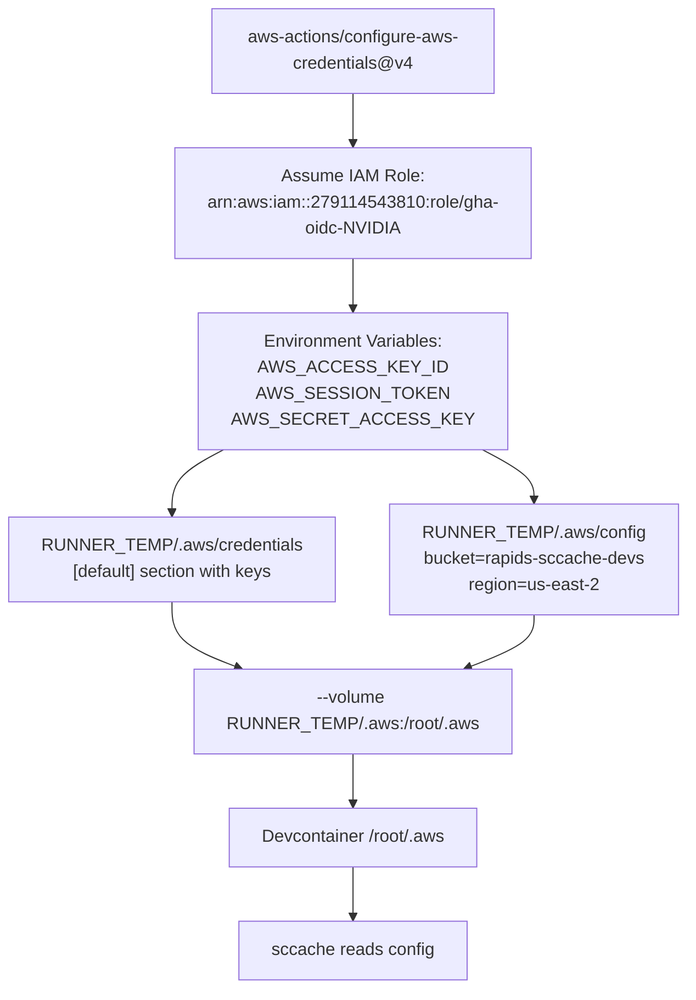
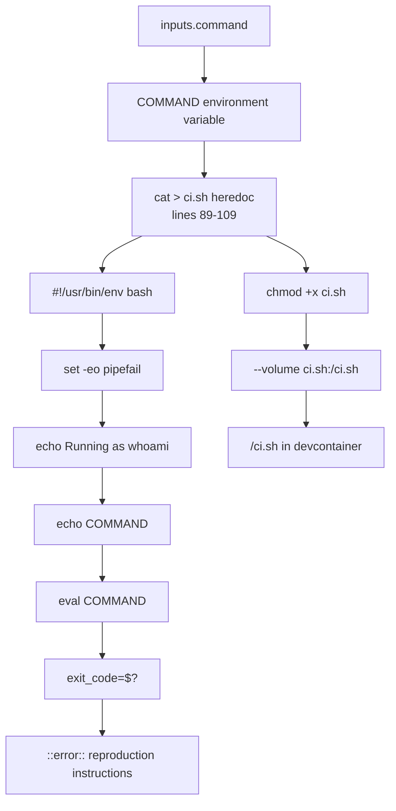
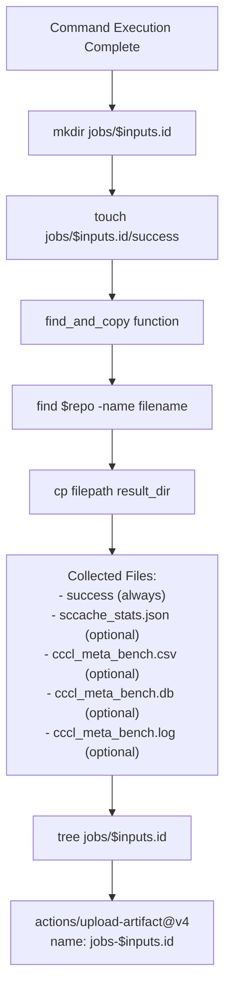

<!-- source: DeepWiki mcp.deepwiki.com · repo NVIDIA/cccl-gha · page 5.1 Linux Execution Environment · fetched 2026-10-26 -->

# Linux Execution Environment

<details>
<summary>Relevant source files</summary>

The following files were used as context for generating this wiki page:

- [.github/actions/workflow-run-job-linux/action.yml](.github/actions/workflow-run-job-linux/action.yml)

</details>


## Purpose and Scope

This document describes the Linux job execution environment used by the cccl-gha system. It covers the Docker-outside-of-Docker (DOOD) architecture, path management strategies, GPU resource allocation, and how jobs execute commands within devcontainers on Linux runners.

For Windows execution details, see [Windows Execution Environment](#5.2). For devcontainer configuration and verification, see [Devcontainer System](#5.3). For AWS credentials and sccache setup, see [Environment Setup](#5.4). For error handling and the `ci.sh` wrapper script, see [Error Handling and Reproducibility](#5.5).

---

## Architecture Overview

The Linux execution environment uses a **Docker-outside-of-Docker (DOOD)** pattern to avoid performance degradation and complexity issues associated with Docker-in-Docker. This three-layer architecture allows the system to run GitHub Actions (which require Node.js v20) while also supporting legacy Ubuntu 18.04-based devcontainers needed for older GCC versions.

**Container Hierarchy Diagram**



**Sources:** [.github/actions/workflow-run-job-linux/action.yml:4-20]()

### Key Components

| Component | Description | Implementation |
|-----------|-------------|----------------|
| **Runner Host** | GitHub Actions runner with Docker daemon | Native Linux host with GPU support |
| **Intermediate Container** | `cruizba/ubuntu-dind:jammy-26.1.3` | Provides Docker CLI + Node.js v20 for GHA actions |
| **Target Devcontainer** | Job-specific image (e.g., `ubuntu18.04-gcc7-cuda11.1`) | Executes actual build/test commands |
| **Docker Socket** | `/var/run/docker.sock` | Mounted from host to intermediate container |
| **launch.sh** | Devcontainer launch script | Located in `.devcontainer/launch.sh` |
| **ci.sh** | Generated command wrapper | Created at runtime, mounted into devcontainer |

**Sources:** [.github/actions/workflow-run-job-linux/action.yml:1-21]()

---

## Path Management and Symlinks

A critical challenge in the DOOD architecture is that Docker volume mounts must reference **host filesystem paths**, not paths as seen within the intermediate container. The system solves this through a symlink strategy.

**Path Transformation Strategy**



**Sources:** [.github/actions/workflow-run-job-linux/action.yml:82-87](), [.github/actions/workflow-run-job-linux/action.yml:138-140]()

### Symlink Creation

The intermediate container creates a symlink to ensure that `$(pwd)` matches the `github.workspace` value used by GitHub Actions:

[.github/actions/workflow-run-job-linux/action.yml:82-87]()
```yaml
# Make a symlink in the container that matches the host's ${{github.workspace}}
mkdir -p "$(dirname "${{github.workspace}}")"
ln -s "$(pwd)" "${{github.workspace}}"
cd "${{github.workspace}}"
```

### Path Translation Function

The `host_path()` function translates container paths to host paths for Docker volume mounts:

[.github/actions/workflow-run-job-linux/action.yml:138-140]()
```bash
host_path() {
  sed "s@/__w@$(dirname "$(dirname "${{github.workspace}}")")@" <<< "$1"
}
```

This function replaces the container's `/__w` prefix with the host's actual workspace parent directory (typically `/home/runner/_work`).

**Sources:** [.github/actions/workflow-run-job-linux/action.yml:78-87](), [.github/actions/workflow-run-job-linux/action.yml:138-164]()

---

## Job Execution Flow

**Execution Sequence Diagram**



**Sources:** [.github/actions/workflow-run-job-linux/action.yml:44-201]()

### Step-by-Step Breakdown

| Step | Description | Lines |
|------|-------------|-------|
| **Install Dependencies** | Install `tree` and `git` in intermediate container | [45-50]() |
| **Checkout Repo** | Clone repository using `actions/checkout@v4` | [51-55]() |
| **Add Problem Matcher** | Register NVCC error pattern matcher | [56-59]() |
| **AWS Credentials** | Obtain temporary credentials via OIDC | [60-65]() |
| **Run Command** | Core execution step (name matters for parsing) | [66-165]() |
| **Prepare Artifacts** | Create success marker and copy result files | [166-193]() |
| **Upload Artifacts** | Upload to GitHub Actions artifact storage | [195-200]() |

**Sources:** [.github/actions/workflow-run-job-linux/action.yml:44-201]()

---

## GPU Resource Allocation

The system detects GPU runners by examining the `RUNNER` input value and configures GPU access accordingly.

**GPU Detection and Configuration**



**Sources:** [.github/actions/workflow-run-job-linux/action.yml:131-136]()

### GPU Detection Logic

[.github/actions/workflow-run-job-linux/action.yml:131-136]()
```bash
declare -a gpu_request=()

# Explicitly pass which GPU to use if on a GPU runner
if [[ "${RUNNER}" = *"-gpu-"* ]]; then
  gpu_request+=(--gpus "device=${NVIDIA_VISIBLE_DEVICES}")
fi
```

The `NVIDIA_VISIBLE_DEVICES` environment variable is set by the GitHub Actions runner and contains the specific GPU device ID(s) allocated to the job. This value is passed through to the devcontainer via the `--gpus` Docker flag.

**Sources:** [.github/actions/workflow-run-job-linux/action.yml:131-148]()

---

## Environment Variable Propagation

The system propagates critical GitHub Actions context variables and AWS credentials into the devcontainer to maintain CI environment consistency.

**Environment Variables Passed to Devcontainer**

| Variable | Purpose | Source |
|----------|---------|--------|
| `CI` | Indicates CI environment | Set to `true` in action |
| `COMMAND` | The command to execute | From `inputs.command` |
| `GITHUB_ENV` | Env file for setting variables | GitHub Actions context |
| `GITHUB_SHA` | Commit SHA being tested | GitHub Actions context |
| `GITHUB_PATH` | Path modification file | GitHub Actions context |
| `GITHUB_OUTPUT` | Output variable file | GitHub Actions context |
| `GITHUB_ACTIONS` | GitHub Actions flag | GitHub Actions context |
| `GITHUB_REF_NAME` | Branch/tag name | GitHub Actions context |
| `GITHUB_WORKSPACE` | Workspace directory path | GitHub Actions context |
| `GITHUB_REPOSITORY` | Repository slug (owner/repo) | GitHub Actions context |
| `GITHUB_STEP_SUMMARY` | Summary markdown file | GitHub Actions context |
| `VAULT_HOST` | Vault host (set to empty) | Explicitly disabled |

**Sources:** [.github/actions/workflow-run-job-linux/action.yml:149-160]()

### launch.sh Invocation

[.github/actions/workflow-run-job-linux/action.yml:144-164]()
```bash
${{github.event.repository.name}}/.devcontainer/launch.sh \
  --docker \
  --cuda ${{inputs.cuda}} \
  --host ${{inputs.host}} \
  "${gpu_request[@]}" \
  --env "CI=$CI" \
  --env "VAULT_HOST=" \
  --env "COMMAND=$COMMAND" \
  --env "GITHUB_ENV=$GITHUB_ENV" \
  --env "GITHUB_SHA=$GITHUB_SHA" \
  --env "GITHUB_PATH=$GITHUB_PATH" \
  --env "GITHUB_OUTPUT=$GITHUB_OUTPUT" \
  --env "GITHUB_ACTIONS=$GITHUB_ACTIONS" \
  --env "GITHUB_REF_NAME=$GITHUB_REF_NAME" \
  --env "GITHUB_WORKSPACE=$GITHUB_WORKSPACE" \
  --env "GITHUB_REPOSITORY=$GITHUB_REPOSITORY" \
  --env "GITHUB_STEP_SUMMARY=$GITHUB_STEP_SUMMARY" \
  --volume "${{github.workspace}}/ci.sh:/ci.sh" \
  --volume "$(host_path "$RUNNER_TEMP")/.aws:/root/.aws" \
  --volume "$(dirname "$(dirname "${{github.workspace}}")"):/__w" \
  -- /ci.sh
```

The `launch.sh` script (documented in [Devcontainer System](#5.3)) uses these arguments to:
1. Select the appropriate devcontainer image based on `--cuda` and `--host` values
2. Configure Docker run arguments including GPU flags
3. Mount volumes for the repository, `ci.sh` script, and AWS credentials
4. Pass environment variables into the container
5. Execute `/ci.sh` as the container entrypoint

**Sources:** [.github/actions/workflow-run-job-linux/action.yml:144-164]()

---

## AWS Credentials Configuration

AWS credentials are configured for sccache to access the `rapids-sccache-devs` S3 bucket for distributed compilation caching.

**AWS Credentials Flow**



**Sources:** [.github/actions/workflow-run-job-linux/action.yml:60-65](), [.github/actions/workflow-run-job-linux/action.yml:113-129]()

### IAM Role Assumption

[.github/actions/workflow-run-job-linux/action.yml:60-65]()
```yaml
- name: Get AWS credentials for sccache bucket
  uses: aws-actions/configure-aws-credentials@v4
  with:
    role-to-assume: arn:aws:iam::279114543810:role/gha-oidc-NVIDIA
    aws-region: us-east-2
    role-duration-seconds: 43200 # 12 hours
```

This action uses OpenID Connect (OIDC) to obtain temporary AWS credentials without storing long-lived secrets. The role duration is set to 12 hours to cover long-running build jobs.

### Credentials File Generation

[.github/actions/workflow-run-job-linux/action.yml:113-129]()
```bash
mkdir "$RUNNER_TEMP/.aws";

cat <<EOF > "$RUNNER_TEMP/.aws/config"
[default]
bucket=rapids-sccache-devs
region=us-east-2
EOF

cat <<EOF > "$RUNNER_TEMP/.aws/credentials"
[default]
aws_access_key_id=$AWS_ACCESS_KEY_ID
aws_session_token=$AWS_SESSION_TOKEN
aws_secret_access_key=$AWS_SECRET_ACCESS_KEY
EOF

chmod 0600 "$RUNNER_TEMP/.aws/credentials"
chmod 0664 "$RUNNER_TEMP/.aws/config"
```

These files are mounted into the devcontainer at `/root/.aws`, where sccache automatically discovers them.

**Sources:** [.github/actions/workflow-run-job-linux/action.yml:113-129](), [.github/actions/workflow-run-job-linux/action.yml:162]()

---

## ci.sh Wrapper Script

The `ci.sh` wrapper script provides command execution with error handling and reproduction instructions.

**ci.sh Generation**



**Sources:** [.github/actions/workflow-run-job-linux/action.yml:89-111]()

### Script Contents

[.github/actions/workflow-run-job-linux/action.yml:89-109]()
```bash
cat <<"EOF" > ci.sh
#! /usr/bin/env bash
set -eo pipefail
echo -e "\e[1;34mRunning as '$(whoami)' user in $(pwd):\e[0m"
echo -e "\e[1;34m${COMMAND}\e[0m"
eval "${COMMAND}" || exit_code=$?
if [ ! -z "$exit_code" ]; then
  echo -e "::group::️❗ \e[1;31mInstructions to Reproduce CI Failure Locally\e[0m"
  echo "::error:: To replicate this failure locally, follow the steps below:"
  echo "1. Clone the repository, and navigate to the correct branch and commit:"
  echo "   git clone --branch $GITHUB_REF_NAME --single-branch https://github.com/$GITHUB_REPOSITORY.git && cd $(echo $GITHUB_REPOSITORY | cut -d'/' -f2) && git checkout $GITHUB_SHA"
  echo ""
  echo "2. Run the failed command inside the same Docker container used by this CI job:"
  echo "   .devcontainer/launch.sh -d -c ${{inputs.cuda}} -H ${{inputs.host}} -- ${COMMAND}"
  echo ""
  echo "For additional information, see:"
  echo "   - DevContainer Documentation: https://github.com/NVIDIA/cccl/blob/main/.devcontainer/README.md"
  echo "   - Continuous Integration (CI) Overview: https://github.com/NVIDIA/cccl/blob/main/ci-overview.md"
  exit $exit_code
fi
EOF
```

The script uses:
- `set -eo pipefail`: Exit on error and propagate pipe failures
- `eval "${COMMAND}"`: Execute the command string (supports complex commands with semicolons, pipes, etc.)
- Conditional error handling that only triggers on failure
- GitHub Actions annotations (`::error::` and `::group::`) for UI integration
- Detailed reproduction instructions with exact git commands and Docker invocation

**Note:** The name "Run command" at [line 66]() is significant—it is parsed by `parse-job-times.py` to extract timing data.

**Sources:** [.github/actions/workflow-run-job-linux/action.yml:66-109]()

---

## Artifact Collection

After command execution, the system collects job artifacts for result reporting.

**Artifact Collection Process**



**Sources:** [.github/actions/workflow-run-job-linux/action.yml:166-200]()

### find_and_copy Function

[.github/actions/workflow-run-job-linux/action.yml:176-184]()
```bash
find_and_copy() {
  filename="$1"
  filepath="$(find ${{github.event.repository.name}} -name "${filename}" -print -quit)"
  if [[ -z "$filepath" ]]; then
    echo "${filename} does not exist in repo directory."
    return 1
  fi
  cp -v "$filepath" "$result_dir"
}
```

This function searches the repository directory for files by name and copies them to the results directory. The `|| :` suffix makes failures non-fatal.

### Collected Artifacts

| Artifact | Purpose | Always Present |
|----------|---------|----------------|
| `success` | Marker indicating job completed | Yes |
| `sccache_stats.json` | Compilation cache statistics | No (build jobs only) |
| `cccl_meta_bench.csv` | Benchmark results CSV | No (benchmark jobs only) |
| `cccl_meta_bench.db` | Benchmark database | No (benchmark jobs only) |
| `cccl_meta_bench.log` | Benchmark execution log | No (benchmark jobs only) |

The artifacts are uploaded with `compression-level: 0` to minimize upload time, as the files are typically already compressed or small.

**Sources:** [.github/actions/workflow-run-job-linux/action.yml:166-200]()

---

## Action Inputs

The `workflow-run-job-linux` action accepts the following inputs:

| Input | Description | Required | Example |
|-------|-------------|----------|---------|
| `id` | Unique job identifier | Yes | `libcudacxx-gcc7-cuda11.1-tests` |
| `command` | Command to execute | Yes | `cmake --build build && ctest` |
| `image` | Docker image name | Yes | `ubuntu18.04-gcc7-cuda11.1` |
| `runner` | GitHub Actions runner label | Yes | `linux-amd64-cpu16` or `linux-amd64-gpu-v100-latest-1` |
| `cuda` | CUDA version for devcontainer selection | Yes | `11.1` |
| `host` | Host compiler for devcontainer selection | Yes | `gcc7` |

**Sources:** [.github/actions/workflow-run-job-linux/action.yml:22-40]()

---

## Summary

The Linux execution environment implements a sophisticated Docker-outside-of-Docker pattern that enables:

1. **Compatibility**: Running modern GitHub Actions (Node.js v20) while supporting legacy Ubuntu 18.04 devcontainers
2. **Isolation**: Each job executes in a dedicated devcontainer with specific CUDA and compiler versions
3. **Performance**: DOOD avoids nested Docker overhead while maintaining containerization benefits
4. **GPU Access**: Seamless GPU allocation via `NVIDIA_VISIBLE_DEVICES` passthrough
5. **Distributed Caching**: Automatic sccache integration with AWS S3 for faster compilation
6. **Developer Experience**: Detailed error messages with exact reproduction instructions
7. **Path Consistency**: Symlink strategy ensures volume mounts work correctly across container layers

The system is implemented primarily in [.github/actions/workflow-run-job-linux/action.yml]() with integration points to `.devcontainer/launch.sh` for devcontainer selection and launching.

**Sources:** [.github/actions/workflow-run-job-linux/action.yml:1-201]()

---

