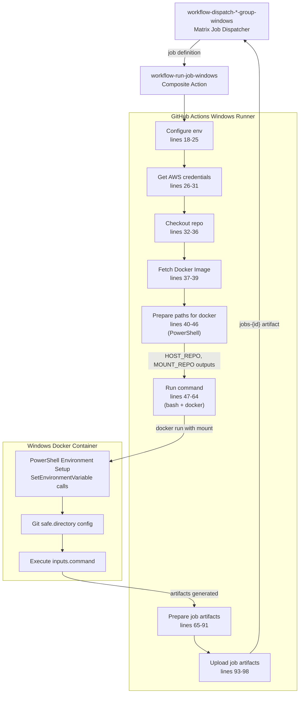
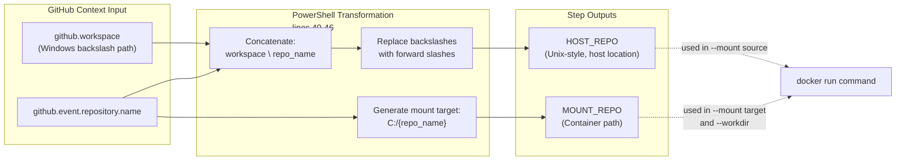
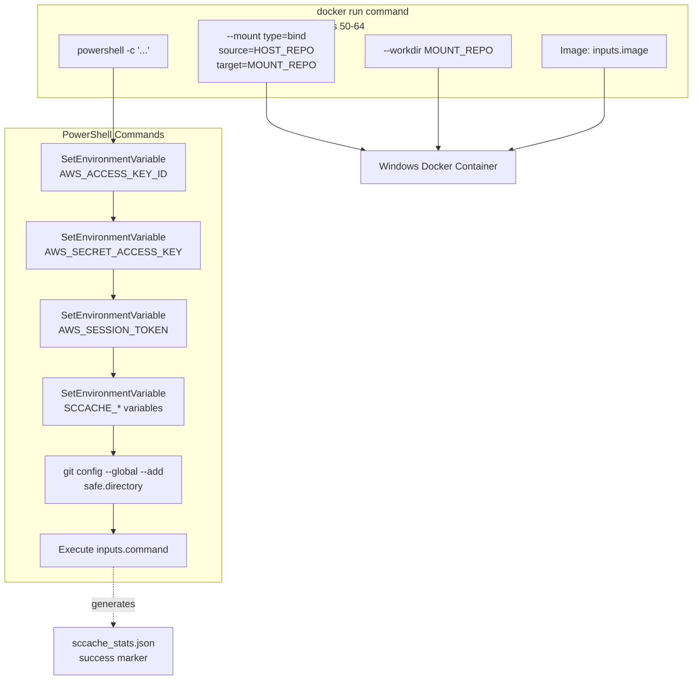
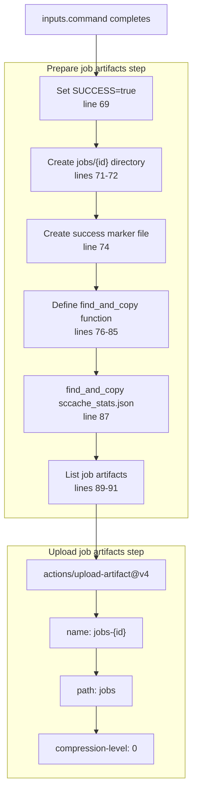

<!-- source: DeepWiki mcp.deepwiki.com · repo NVIDIA/cccl-gha · page 5.2 Windows Execution Environment · fetched 2026-10-26 -->

# Windows Execution Environment

<details>
<summary>Relevant source files</summary>

The following files were used as context for generating this wiki page:

- [.github/actions/workflow-run-job-windows/action.yml](.github/actions/workflow-run-job-windows/action.yml)

</details>


## Purpose and Scope

This document describes how jobs execute on Windows runners in the CCCL GitHub Actions workflow orchestration system. Unlike the Linux execution environment which uses a Docker-outside-of-Docker (DOOD) pattern [see page 5.1](#5.1), Windows jobs run Docker containers directly on the Windows host. This page covers the path transformation system, container configuration, environment variable propagation, and artifact collection specific to Windows execution.

For information about devcontainer configurations that define the Docker images used, see [Devcontainer System](#5.3). For details on environment setup including AWS credentials and sccache configuration, see [Environment Setup](#5.4).

## Execution Architecture

Windows job execution is implemented in the composite action `workflow-run-job-windows`, which runs directly on Windows GitHub Actions runners without an intermediate container layer. The architecture is simpler than the Linux DOOD pattern but requires special handling for path transformations between Windows and Unix conventions.

### Execution Flow Diagram



**Sources:** [.github/actions/workflow-run-job-windows/action.yml:1-99]()

## Action Inputs and Outputs

The `workflow-run-job-windows` action accepts three required inputs:

| Input | Description | Example |
|-------|-------------|---------|
| `id` | Unique job identifier used for artifact naming | `libcudacxx-build-gcc11-cuda11.1` |
| `command` | Command to execute inside the container | `ci/windows_build.ps1` |
| `image` | Docker image to run | `rapidsai/devcontainers:25.02-cpp-gcc11-cuda11.8` |

The action produces one output from the "Prepare job artifacts" step:

| Output | Description | Value |
|--------|-------------|-------|
| `SUCCESS` | Indicates job completion (artifact upload success) | `true` |

**Sources:** [.github/actions/workflow-run-job-windows/action.yml:4-13](), [.github/actions/workflow-run-job-windows/action.yml:66-69]()

## Path Transformation System

Windows uses backslash-separated paths (e.g., `D:\a\repository\cccl`) while Docker expects Unix-style forward-slash paths. The action performs path transformation in the "Prepare paths for docker" step using PowerShell.

### Path Transformation Logic



**Path Transformation Implementation:**

The PowerShell script at lines 40-46 performs the following operations:

1. **HOST_REPO**: Constructs the full host path by joining `github.workspace` and repository name, then replaces all backslashes with forward slashes using `.Replace('\', '/')`. This produces a Unix-style path that Docker on Windows can understand, such as `D:/a/cccl-gha/cccl-gha/cccl`.

2. **MOUNT_REPO**: Creates a simple container-internal path as `C:/{repository_name}`, such as `C:/cccl`. This becomes both the mount target and working directory inside the container.

The outputs are written to `$env:GITHUB_OUTPUT` and consumed by the subsequent "Run command" step.

**Sources:** [.github/actions/workflow-run-job-windows/action.yml:40-46]()

## Container Execution

The "Run command" step (lines 47-64) launches a Windows Docker container with the repository mounted and command executed. This step uses bash shell to invoke Docker, but the container itself runs PowerShell.

### Docker Run Command Structure



The Docker command uses:
- **Bind mount**: Connects the Windows host repository path to the container filesystem
- **Working directory**: Sets the container's current directory to the mounted repository
- **PowerShell execution**: All environment setup and command execution happens in PowerShell

**Sources:** [.github/actions/workflow-run-job-windows/action.yml:47-64]()

## Environment Variable Propagation

Environment variables cannot be passed directly to Windows Docker containers via `-e` flags in the same way as Linux. Instead, the action uses PowerShell's `[System.Environment]::SetEnvironmentVariable` method inside the container to configure the execution environment.

### Environment Setup Process

| Variable Category | Variables | Purpose | Lines |
|-------------------|-----------|---------|-------|
| AWS Credentials | `AWS_ACCESS_KEY_ID`, `AWS_SECRET_ACCESS_KEY`, `AWS_SESSION_TOKEN` | Enable sccache S3 access | 55-57 |
| sccache Configuration | `SCCACHE_BUCKET`, `SCCACHE_REGION`, `SCCACHE_IDLE_TIMEOUT`, `SCCACHE_S3_USE_SSL`, `SCCACHE_S3_NO_CREDENTIALS` | Configure distributed compilation caching | 58-62 |

The environment variables are initially set in the GitHub Actions runner environment through two mechanisms:

1. **Static Configuration** (lines 18-25): The "Configure env" step appends sccache configuration to `$GITHUB_ENV`:
   - `SCCACHE_BUCKET=rapids-sccache-devs`
   - `SCCACHE_REGION=us-east-2`
   - `SCCACHE_IDLE_TIMEOUT=0`
   - `SCCACHE_S3_USE_SSL=true`
   - `SCCACHE_S3_NO_CREDENTIALS=false`

2. **Dynamic AWS Credentials** (lines 26-31): The `aws-actions/configure-aws-credentials@v4` action assumes an IAM role and sets `AWS_ACCESS_KEY_ID`, `AWS_SECRET_ACCESS_KEY`, and `AWS_SESSION_TOKEN` in the runner environment.

These runner-level environment variables are then explicitly propagated into the Docker container using PowerShell (lines 54-62), where each variable is accessed via `${{env.VARIABLE_NAME}}` and set inside the container using `SetEnvironmentVariable`.

**Sources:** [.github/actions/workflow-run-job-windows/action.yml:18-31](), [.github/actions/workflow-run-job-windows/action.yml:54-62]()

## Git Configuration

The action configures Git's `safe.directory` setting to allow operations in the mounted repository. This is necessary because the repository is owned by a different user in the container context.

The command executed at line 63:
```
git config --global --add safe.directory '${{steps.paths.outputs.MOUNT_REPO}}'
```

This adds the container's mount path (e.g., `C:/cccl`) to Git's safe directory list, preventing "dubious ownership" errors when the `inputs.command` attempts to perform Git operations.

**Sources:** [.github/actions/workflow-run-job-windows/action.yml:63]()

## Artifact Collection and Upload

After command execution completes, the "Prepare job artifacts" step (lines 65-91) collects job outputs and prepares them for upload. This step runs on the Windows runner (not in the container) and uses bash shell.

### Artifact Collection Flow



### Artifact Files

The action collects the following artifacts:

| File | Location | Purpose | Required |
|------|----------|---------|----------|
| `success` | `jobs/{id}/success` | Marker file indicating job completion | Yes |
| `sccache_stats.json` | Found via `find` in repository | sccache statistics for cache hit rate analysis | No |

The `find_and_copy` function (lines 76-85) searches the repository checkout for matching files and copies them to the results directory. The function:
1. Uses `find` to locate the file by name anywhere in `${{github.event.repository.name}}` directory
2. Takes the first match (`-print -quit`)
3. Copies it to `jobs/{id}/` directory
4. Returns error code 1 if not found (suppressed with `|| true` for optional files)

**Sources:** [.github/actions/workflow-run-job-windows/action.yml:65-98]()

## Artifact Upload Configuration

The `actions/upload-artifact@v4` action uploads collected artifacts with specific configuration:

- **Artifact Name**: `jobs-{id}` where `{id}` is the unique job identifier input. This naming convention allows the results collection system to download artifacts by job ID.
- **Artifact Path**: `jobs` directory containing the nested `{id}` subdirectory structure.
- **Compression Level**: `0` (no compression) to optimize upload speed, as the artifacts are typically small JSON files.

The uploaded artifacts are consumed by the `workflow-results` action [see page 6.1](#6.1) which downloads all `jobs-*` artifacts and aggregates their contents for summary generation.

**Sources:** [.github/actions/workflow-run-job-windows/action.yml:93-98]()

## Comparison with Linux Execution

| Aspect | Windows | Linux |
|--------|---------|-------|
| **Container Launch** | Direct `docker run` from runner | Docker-outside-of-Docker via intermediate `ubuntu-dind` container |
| **Path Handling** | PowerShell transformation (backslash to forward-slash) | Symlink system for path consistency |
| **Environment Variables** | PowerShell `SetEnvironmentVariable` inside container | Passed via `-e` flags in `docker run` |
| **Shell Context** | PowerShell for setup and command execution | Bash for orchestration, devcontainer-specific shell for execution |
| **Script Wrapper** | Direct command execution | `ci.sh` wrapper script generated and mounted |
| **GPU Access** | Not documented in this action | `--gpus` flag and `NVIDIA_VISIBLE_DEVICES` |
| **Complexity** | Simpler single-layer architecture | Complex multi-layer with intermediate container |

The Windows execution model trades some features (like the reproduction script wrapper) for architectural simplicity, reflecting the differences in Docker implementation between Windows and Linux hosts.

**Sources:** [.github/actions/workflow-run-job-windows/action.yml:1-99]()

---

