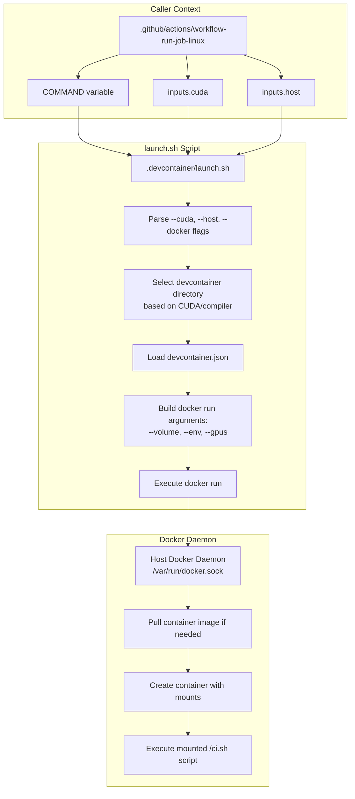
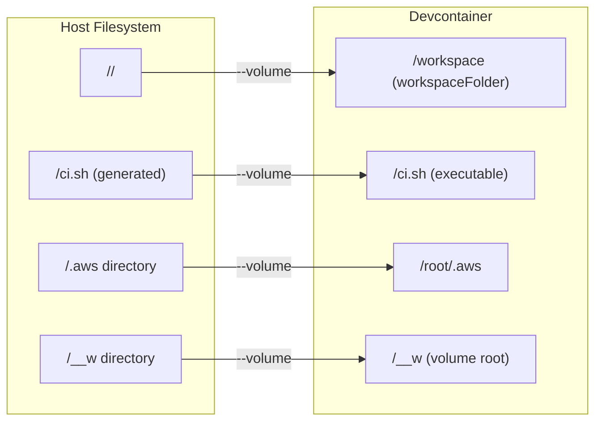
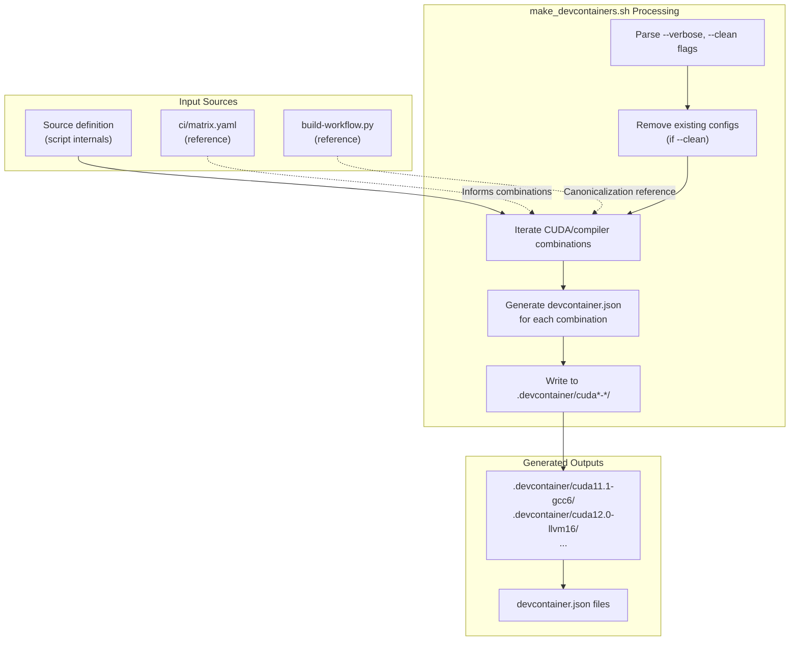
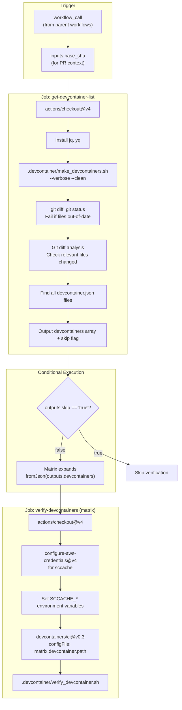
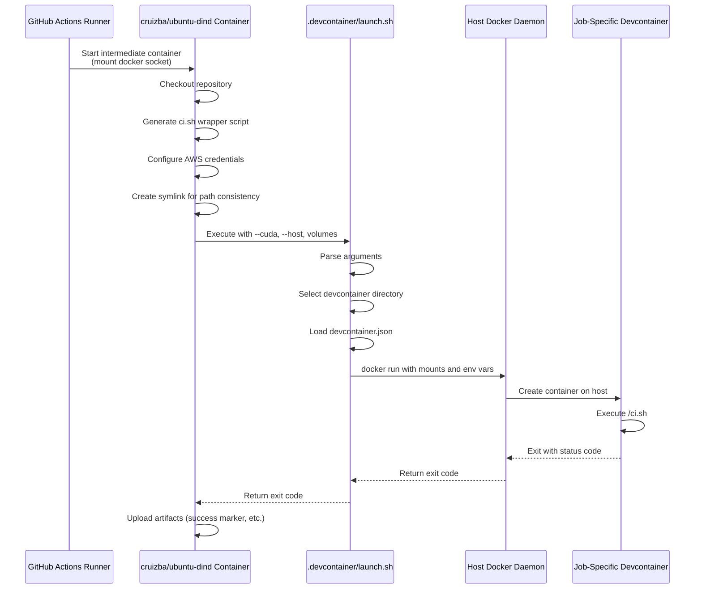

<!-- source: DeepWiki mcp.deepwiki.com · repo NVIDIA/cccl-gha · page 5.3 Devcontainer System · fetched 2026-10-26 -->

# Devcontainer System

<details>
<summary>Relevant source files</summary>

The following files were used as context for generating this wiki page:

- [.github/actions/workflow-run-job-linux/action.yml](.github/actions/workflow-run-job-linux/action.yml)
- [.github/workflows/verify-devcontainers.yml](.github/workflows/verify-devcontainers.yml)

</details>


## Purpose and Scope

The devcontainer system provides isolated, reproducible build environments for CCCL jobs across different CUDA versions, compilers, and operating systems. This page documents the devcontainer configuration directory structure, the container selection and launching mechanism (`launch.sh`), the generation process (`make_devcontainers.sh`), and the verification workflow that ensures configurations remain synchronized with their generation source.

For information about how devcontainers are invoked during Linux job execution, see [Linux Execution Environment](#5.1). For Windows execution environments which do not use devcontainers, see [Windows Execution Environment](#5.2). For AWS credential and sccache configuration within devcontainers, see [Environment Setup](#5.4).

---

## Devcontainer Directory Structure

The `.devcontainer/` directory contains pre-configured development container definitions organized by CUDA version and compiler. Each configuration consists of a `devcontainer.json` file that specifies the Docker image, environment variables, and container settings.

### Directory Organization

```
.devcontainer/
├── make_devcontainers.sh          # Generation script
├── launch.sh                      # Container selection and launch script
├── verify_devcontainer.sh         # Validation script for CI
├── cuda<VERSION>-<COMPILER>/      # Configuration directories
│   └── devcontainer.json          # DevContainer specification
└── ...
```

The directory structure follows a naming convention where each subdirectory is named `cuda<VERSION>-<COMPILER>` (e.g., `cuda11.1-gcc6`, `cuda12.0-llvm16`). Each subdirectory contains a `devcontainer.json` file that defines the container image, environment variables, mounts, and other configuration for that specific CUDA/compiler combination.

### DevContainer JSON Structure

Each `devcontainer.json` file typically specifies:

| Field | Purpose |
|-------|---------|
| `name` | Human-readable identifier (e.g., "CUDA 11.1 GCC 6") |
| `image` | Docker image reference (e.g., `rapidsai/devcontainers:...`) |
| `hostRequirements` | GPU requirements (`{"gpu": true}` for CUDA jobs) |
| `capAdd` | Linux capabilities (e.g., `["SYS_PTRACE"]` for debugging) |
| `securityOpt` | Security options (e.g., `["seccomp=unconfined"]`) |
| `remoteEnv` | Environment variables to set in the container |
| `workspaceFolder` | Working directory inside the container |
| `mounts` | Volume mounts for host filesystem access |

**Sources:** [.github/workflows/verify-devcontainers.yml:91-93]()

---

## Container Selection and Launching: launch.sh

The `launch.sh` script is the primary interface for selecting and launching devcontainers. It maps CUDA version and compiler arguments to the appropriate devcontainer configuration directory and invokes Docker with the correct parameters.

### Launch Script Invocation



**Diagram: launch.sh Container Selection and Execution Flow**

### Launch Script Parameters

The `launch.sh` script is invoked with the following flags (as seen in [.github/actions/workflow-run-job-linux/action.yml:144-164]()):

| Flag | Description | Example |
|------|-------------|---------|
| `--docker` | Use Docker execution mode (vs VSCode) | N/A |
| `--cuda <VERSION>` | CUDA version for container selection | `12.0`, `11.1` |
| `--host <COMPILER>` | Host compiler for container selection | `gcc10`, `llvm16` |
| `--gpus <SPEC>` | GPU device specification | `device=${NVIDIA_VISIBLE_DEVICES}` |
| `--env <VAR>` | Environment variables to pass through | `CI=true` |
| `--volume <MOUNT>` | Additional volume mounts | `/path/on/host:/path/in/container` |
| `-- <COMMAND>` | Command to execute in container | `/ci.sh` |

### GPU Request Handling

The script conditionally adds GPU access based on the runner type (lines 132-136 in action.yml):

```bash
declare -a gpu_request=()

# Explicitly pass which GPU to use if on a GPU runner
if [[ "${RUNNER}" = *"-gpu-"* ]]; then
  gpu_request+=(--gpus "device=${NVIDIA_VISIBLE_DEVICES}")
fi
```

The `--gpus` flag is then passed to `launch.sh` which includes it in the Docker command, enabling CUDA workloads to access GPU hardware.

**Sources:** [.github/actions/workflow-run-job-linux/action.yml:132-149]()

---

## Environment Variable Propagation

The `launch.sh` script receives numerous environment variables through `--env` flags that must be propagated into the devcontainer for proper GitHub Actions integration:

| Environment Variable | Purpose |
|---------------------|---------|
| `CI` | Indicates CI environment (triggers specific behaviors) |
| `COMMAND` | The actual command to execute (avoids shell escaping issues) |
| `GITHUB_WORKSPACE` | Workspace path for GitHub Actions context |
| `GITHUB_SHA` | Current commit SHA for reproduction instructions |
| `GITHUB_REF_NAME` | Branch or tag name |
| `GITHUB_REPOSITORY` | Repository slug (owner/repo) |
| `GITHUB_ENV` | Path to environment file for setting outputs |
| `GITHUB_PATH` | Path to path file for modifying PATH |
| `GITHUB_OUTPUT` | Path to output file for setting step outputs |
| `GITHUB_STEP_SUMMARY` | Path to step summary file for UI output |
| `GITHUB_ACTIONS` | Boolean indicating GitHub Actions environment |

These variables enable the devcontainer to interact with GitHub Actions' workflow commands and provide proper context for error reporting and reproduction instructions (see [.github/actions/workflow-run-job-linux/action.yml:149-160]()).

**Sources:** [.github/actions/workflow-run-job-linux/action.yml:149-160]()

---

## Volume Mounts and Path Management

The `launch.sh` script configures three critical volume mounts to provide the devcontainer with access to necessary resources:

### Mount Configuration



**Diagram: Devcontainer Volume Mount Configuration**

The three volume mounts are configured as (from [.github/actions/workflow-run-job-linux/action.yml:161-163]()):

1. **CI Script Mount:** `--volume "${{github.workspace}}/ci.sh:/ci.sh"`
   - Mounts the generated wrapper script containing the command to execute
   - The script includes error handling and reproduction instructions

2. **AWS Credentials Mount:** `--volume "$(host_path "$RUNNER_TEMP")/.aws:/root/.aws"`
   - Provides sccache with S3 bucket credentials
   - The `host_path` function transforms container paths to host paths for DOOD

3. **Workspace Mount:** `--volume "$(dirname "$(dirname "${{github.workspace}}")"):/__w"`
   - Mounts the entire GitHub Actions workspace directory
   - Maintains path consistency between intermediate container and devcontainer

### Path Transformation: host_path Function

Because of the Docker-outside-of-Docker (DOOD) strategy, volume mounts must reference host paths, not intermediate container paths. The `host_path` function performs this transformation (lines 138-140):

```bash
host_path() {
  sed "s@/__w@$(dirname "$(dirname "${{github.workspace}}")")@" <<< "$1"
}
```

This function replaces the `/__w` prefix (the container's view) with the actual host path to the GitHub Actions workspace root, ensuring Docker can locate the files when creating mounts.

**Sources:** [.github/actions/workflow-run-job-linux/action.yml:138-164]()

---

## Container Generation: make_devcontainers.sh

The `make_devcontainers.sh` script generates all devcontainer configurations programmatically from a source definition. This ensures consistency across configurations and allows centralized management of common settings.

### Generation Process



**Diagram: make_devcontainers.sh Generation Pipeline**

### Script Invocation

The script is invoked during the verification workflow with specific flags (from [.github/workflows/verify-devcontainers.yml:39]()):

```bash
./.devcontainer/make_devcontainers.sh --verbose --clean
```

| Flag | Purpose |
|------|---------|
| `--verbose` | Enable detailed logging during generation |
| `--clean` | Remove all existing devcontainer directories before generation |

The `--clean` flag ensures a complete regeneration, preventing stale configurations from persisting if combinations are removed from the generation logic.

### Post-Generation Validation

After running the generation script, the verification workflow checks for modifications to ensure the checked-in files match the generated output (lines 40-49):

```bash
if [[ $(git diff --stat) != '' || $(git status --porcelain | grep '^??') != '' ]]; then
  git diff --minimal
  git status --porcelain
  echo "::error:: Dev Container files are out of date or there are untracked files..."
  exit 1
fi
```

This enforcement ensures that any changes to the generation logic are accompanied by updates to the generated files, maintaining synchronization between source and output.

**Sources:** [.github/workflows/verify-devcontainers.yml:37-49]()

---

## Verification Workflow

The `verify-devcontainers.yml` workflow validates that devcontainer configurations are up-to-date and functional. It runs in two phases: file synchronization checking and functional container testing.

### Verification Workflow Architecture



**Diagram: verify-devcontainers Workflow Execution Flow**

### Phase 1: File Synchronization Check

The `get-devcontainer-list` job ensures devcontainer files are synchronized with their generation script:

#### Steps

1. **Setup Tools** (lines 31-36): Install `jq` for JSON processing and `yq` for YAML processing
2. **Generate Files** (line 39): Run `make_devcontainers.sh --verbose --clean` to regenerate all configurations
3. **Detect Changes** (lines 41-49): Use `git diff` and `git status` to detect modifications or untracked files
4. **Fail on Desync**: If changes are detected, fail with an error message instructing developers to run the generation script and commit changes

This check enforces that all devcontainer configurations in the repository are generated files, not manually edited, ensuring consistency and reproducibility.

**Sources:** [.github/workflows/verify-devcontainers.yml:20-49]()

### Phase 2: Change Detection (PR Context)

When the workflow is called with a `base_sha` input (indicating a pull request context), the verification workflow performs change detection to conditionally skip testing if irrelevant files changed:

#### Relevant File Patterns

The workflow checks for modifications to files matching the regex (from line 72):

```regex
^(.devcontainer|ci/matrix.yaml|.github/actions/workflow-build/build-workflow.py)
```

| Pattern | Rationale |
|---------|-----------|
| `.devcontainer` | Direct changes to devcontainer configurations |
| `ci/matrix.yaml` | Matrix changes may affect devcontainer requirements |
| `.github/actions/workflow-build/build-workflow.py` | Workflow generation logic may change container selection |

If no files matching these patterns have changed between the PR base and current HEAD, the workflow sets `skip=true` and bypasses container testing (lines 80-86).

**Sources:** [.github/workflows/verify-devcontainers.yml:50-86]()

### Phase 3: Container List Generation

The workflow discovers all devcontainer configurations by finding `devcontainer.json` files (lines 91-94):

```bash
devcontainers=$(find .devcontainer/ -name 'devcontainer.json' | while read -r devcontainer; do
  jq --arg path "$devcontainer" '{path: $path, name: .name}' "$devcontainer"
done | jq -s -c .)
```

This bash pipeline:
1. Finds all `devcontainer.json` files recursively
2. Extracts the `path` and `name` fields from each file using `jq`
3. Combines all entries into a JSON array with `jq -s -c`
4. Outputs the array as a matrix configuration for the next job

The output format is an array of objects: `[{path: "...", name: "..."}, ...]`

**Sources:** [.github/workflows/verify-devcontainers.yml:87-94]()

### Phase 4: Functional Container Testing

The `verify-devcontainers` job tests each devcontainer configuration using a GitHub Actions matrix strategy:

```yaml
strategy:
  fail-fast: false
  matrix:
    devcontainer: ${{fromJson(needs.get-devcontainer-list.outputs.devcontainers)}}
```

Each matrix entry represents one devcontainer configuration, allowing parallel testing with `fail-fast: false` to ensure all containers are tested even if some fail.

#### Testing Steps

1. **Checkout Repository** (lines 109-112)
2. **Configure AWS Credentials** (lines 116-121): Required for sccache, even though it's not actively used during verification
3. **Set Environment Variables** (lines 122-129): Configure sccache environment variables
4. **Run Devcontainer** (lines 130-141): Use `devcontainers/ci@v0.3` action with the configuration path from the matrix
5. **Execute Verification Script** (line 141): Run `.devcontainer/verify_devcontainer.sh` inside the container to validate functionality

The `devcontainers/ci` action handles pulling the Docker image, creating the container according to the `devcontainer.json` specification, and executing the `runCmd` within that environment.

#### Environment Variable Configuration

The workflow passes AWS credentials to the devcontainer through the `env:` field (lines 135-139):

```yaml
env: |
  SCCACHE_REGION=${{ env.SCCACHE_REGION }}
  AWS_ACCESS_KEY_ID=${{ env.AWS_ACCESS_KEY_ID }}
  AWS_SESSION_TOKEN=${{ env.AWS_SESSION_TOKEN }}
  AWS_SECRET_ACCESS_KEY=${{ env.AWS_SECRET_ACCESS_KEY }}
```

This ensures the container has access to sccache credentials, preventing the container from hanging while waiting for GitHub authentication (as noted in the comment on lines 114-115).

**Sources:** [.github/workflows/verify-devcontainers.yml:96-142]()

---

## Integration with Job Execution

Devcontainers are the primary execution environment for all Linux jobs in the CCCL CI/CD system. The integration follows the Docker-outside-of-Docker (DOOD) pattern described in [Linux Execution Environment](#5.1).

### Execution Flow Integration



**Diagram: Devcontainer Integration with Linux Job Execution**

### Key Integration Points

| Component | Integration Detail |
|-----------|-------------------|
| **Container Selection** | `launch.sh` maps `inputs.cuda` and `inputs.host` from job definition to devcontainer directory |
| **Command Execution** | Generated `ci.sh` script is mounted as `/ci.sh` and executed as the container's command |
| **Path Consistency** | Symlink creation in intermediate container ensures `github.workspace` paths match host paths |
| **Credential Access** | AWS credentials for sccache are mounted from `$RUNNER_TEMP/.aws` to `/root/.aws` |
| **GPU Access** | `--gpus` flag passed to `launch.sh` enables CUDA workloads on GPU runners |
| **Artifact Collection** | Container has access to workspace for writing build outputs and test results |

The devcontainer system provides isolation, reproducibility, and flexibility while maintaining the performance benefits of DOOD (avoiding nested virtualization overhead). Each job runs in a clean container environment with only the necessary dependencies for its specific CUDA/compiler combination.

**Sources:** [.github/actions/workflow-run-job-linux/action.yml:66-164](), [.github/workflows/verify-devcontainers.yml:1-142]()

---

## Summary

The devcontainer system is a critical component of CCCL's CI/CD infrastructure, providing:

- **Isolation:** Each job runs in its own container with specific CUDA and compiler versions
- **Reproducibility:** Standardized configurations ensure consistent build environments across CI and local development
- **Maintainability:** Generated configurations from `make_devcontainers.sh` ensure consistency and simplify updates
- **Verification:** Automated testing via `verify-devcontainers.yml` ensures containers remain functional
- **Integration:** Seamless integration with GitHub Actions through the DOOD pattern and `launch.sh` script

The system supports local development through the same `launch.sh` interface used in CI, enabling developers to reproduce CI failures by running the exact same container configuration locally (see [Error Handling and Reproducibility](#5.5) for details on local reproduction workflows).

**Sources:** [.github/actions/workflow-run-job-linux/action.yml:1-201](), [.github/workflows/verify-devcontainers.yml:1-142]()

---

