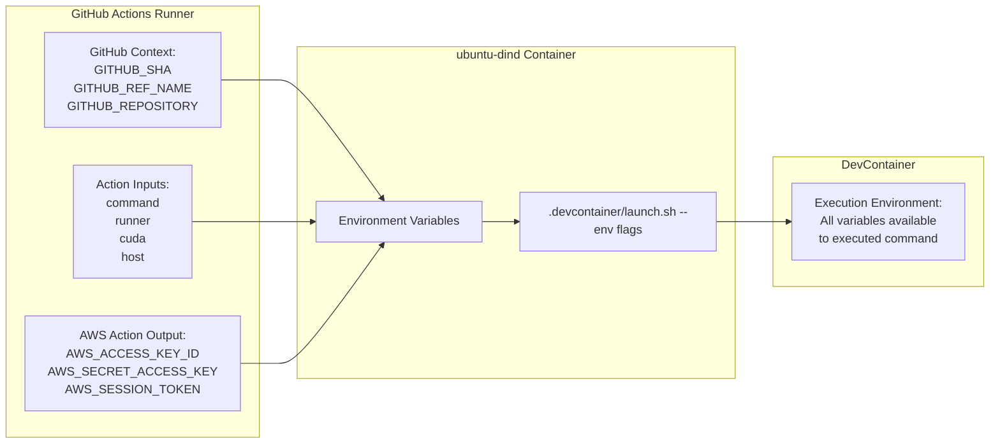
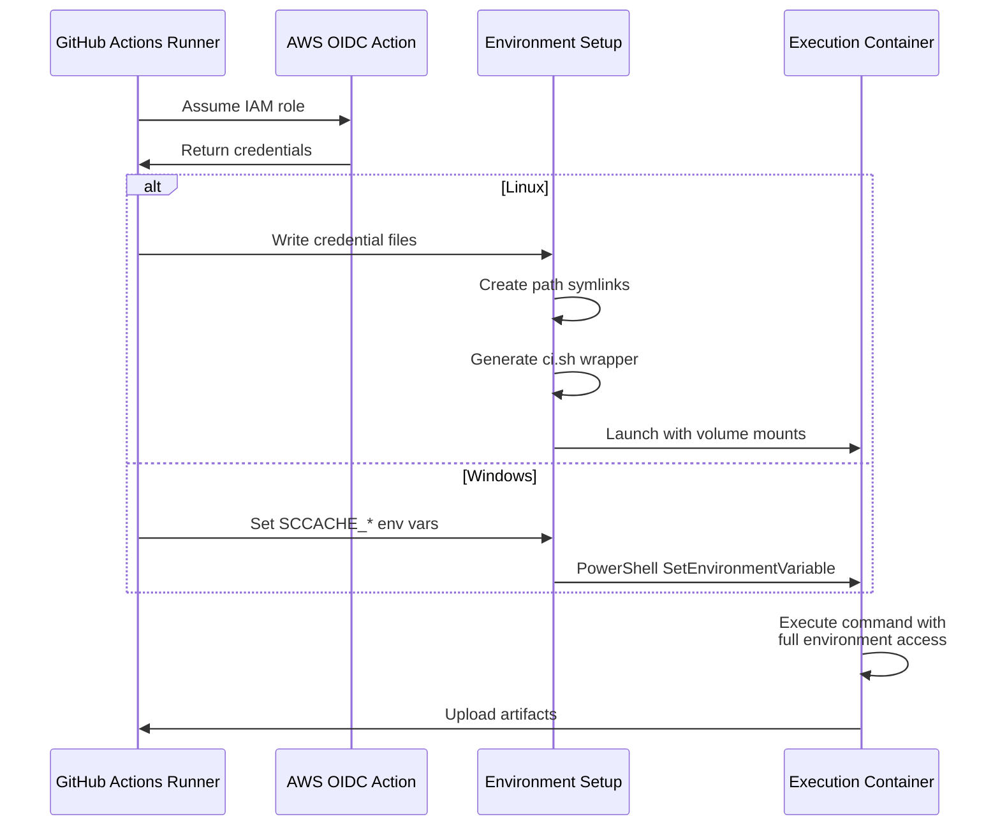

<!-- source: DeepWiki mcp.deepwiki.com · repo NVIDIA/cccl-gha · page 5.4 Environment Setup · fetched 2026-10-26 -->

# Environment Setup

Relevant source files

The following files were used as context for generating this wiki page:

- [.github/actions/workflow-run-job-linux/action.yml](.github/actions/workflow-run-job-linux/action.yml)
- [.github/actions/workflow-run-job-windows/action.yml](.github/actions/workflow-run-job-windows/action.yml)

## Purpose and Scope

This document describes the environment configuration process that occurs before job commands execute in their respective containers. This includes AWS credential acquisition for distributed compilation caching, sccache configuration, environment variable propagation to containers, and problem matcher installation for error detection. 

For information about the actual command execution and error handling, see [Error Handling and Reproducibility](#5.5). For details on devcontainer selection and launching, see [Devcontainer System](#5.3).

---

## AWS Credential Configuration

Both Linux and Windows execution environments acquire AWS credentials using OpenID Connect (OIDC) authentication to access the sccache S3 bucket for distributed compilation caching.

### OIDC Role Assumption

The system uses the `aws-actions/configure-aws-credentials@v4` action to assume an AWS IAM role without requiring long-lived credentials:

**Linux:**
[.github/actions/workflow-run-job-linux/action.yml:60-65]()

**Windows:**
[.github/actions/workflow-run-job-windows/action.yml:26-31]()

| Parameter | Value | Description |
|-----------|-------|-------------|
| `role-to-assume` | `arn:aws:iam::279114543810:role/gha-oidc-NVIDIA` | IAM role with S3 bucket access |
| `aws-region` | `us-east-2` | AWS region containing the sccache bucket |
| `role-duration-seconds` | `43200` | 12-hour session duration to cover long-running jobs |

The action populates three environment variables that are subsequently propagated to execution containers:
- `AWS_ACCESS_KEY_ID`
- `AWS_SECRET_ACCESS_KEY`
- `AWS_SESSION_TOKEN`

### Credential File Generation (Linux Only)

On Linux, the intermediate `ubuntu-dind` container generates AWS credential and configuration files that are mounted into the devcontainer:

[.github/actions/workflow-run-job-linux/action.yml:113-129]()

The files are created in `$RUNNER_TEMP/.aws/` with appropriate permissions (`0600` for credentials, `0664` for config) and mounted into the devcontainer at `/root/.aws/` to enable sccache to authenticate with S3.

**Sources:** [.github/actions/workflow-run-job-linux/action.yml:60-129](), [.github/actions/workflow-run-job-windows/action.yml:26-31]()

---

## Sccache Configuration

Sccache requires several environment variables to connect to the S3 bucket and manage compilation artifacts.

### Configuration Environment Variables

**Linux:**
Sccache configuration on Linux is provided through the AWS credential files (see above). The devcontainer reads these files automatically.

**Windows:**
Windows explicitly sets sccache environment variables before AWS credential acquisition:

[.github/actions/workflow-run-job-windows/action.yml:18-25]()

| Variable | Value | Purpose |
|----------|-------|---------|
| `SCCACHE_BUCKET` | `rapids-sccache-devs` | S3 bucket name for caching artifacts |
| `SCCACHE_REGION` | `us-east-2` | AWS region of the bucket |
| `SCCACHE_IDLE_TIMEOUT` | `0` | Prevents sccache from shutting down during long builds |
| `SCCACHE_S3_USE_SSL` | `true` | Enforces SSL for S3 connections |
| `SCCACHE_S3_NO_CREDENTIALS` | `false` | Indicates credentials are required |

These variables are then explicitly set inside the Docker container using PowerShell:

[.github/actions/workflow-run-job-windows/action.yml:54-62]()

### Credential Propagation Differences

```mermaid
graph TB
    subgraph Linux["Linux Environment"]
        LinuxAWS["aws-actions/configure-aws-credentials@v4"]
        LinuxEnv["Environment Variables:<br/>AWS_ACCESS_KEY_ID<br/>AWS_SECRET_ACCESS_KEY<br/>AWS_SESSION_TOKEN"]
        LinuxFiles["Credential Files:<br/>$RUNNER_TEMP/.aws/config<br/>$RUNNER_TEMP/.aws/credentials"]
        LinuxMount["Volume Mount:<br/>--volume $RUNNER_TEMP/.aws:/root/.aws"]
        LinuxContainer["DevContainer:<br/>sccache reads from /root/.aws/"]
        
        LinuxAWS --> LinuxEnv
        LinuxEnv --> LinuxFiles
        LinuxFiles --> LinuxMount
        LinuxMount --> LinuxContainer
    end
    
    subgraph Windows["Windows Environment"]
        WinSccache["Set SCCACHE_* env vars"]
        WinAWS["aws-actions/configure-aws-credentials@v4"]
        WinEnv["Environment Variables:<br/>SCCACHE_BUCKET<br/>SCCACHE_REGION<br/>AWS_ACCESS_KEY_ID<br/>AWS_SECRET_ACCESS_KEY<br/>AWS_SESSION_TOKEN"]
        WinPS["PowerShell SetEnvironmentVariable:<br/>Explicit propagation to container"]
        WinContainer["Windows Container:<br/>sccache reads env vars"]
        
        WinSccache --> WinEnv
        WinAWS --> WinEnv
        WinEnv --> WinPS
        WinPS --> WinContainer
    end
```

**Diagram: Sccache Credential Propagation on Linux vs Windows**

Linux uses file-based credential propagation through volume mounts, while Windows uses explicit environment variable injection via PowerShell commands inside the container.

**Sources:** [.github/actions/workflow-run-job-linux/action.yml:113-162](), [.github/actions/workflow-run-job-windows/action.yml:18-64]()

---

## Environment Variable Propagation

Jobs require access to GitHub Actions context variables and custom CI variables to function correctly.

### GitHub Actions Context Variables

The Linux workflow explicitly propagates critical GitHub Actions environment variables to the devcontainer:

[.github/actions/workflow-run-job-linux/action.yml:149-160]()

| Variable | Purpose |
|----------|---------|
| `CI` | Indicates running in CI environment |
| `GITHUB_ACTIONS` | Indicates running in GitHub Actions |
| `GITHUB_SHA` | Current commit SHA for reproducibility instructions |
| `GITHUB_REF_NAME` | Branch or tag name |
| `GITHUB_REPOSITORY` | Repository identifier (owner/repo) |
| `GITHUB_WORKSPACE` | Workspace path for file operations |
| `GITHUB_ENV` | File path for setting environment variables |
| `GITHUB_PATH` | File path for modifying PATH |
| `GITHUB_OUTPUT` | File path for setting step outputs |
| `GITHUB_STEP_SUMMARY` | File path for markdown summary |
| `VAULT_HOST` | Cleared to prevent vault access attempts |

### Command Environment Variable

The actual command to execute is passed as an environment variable rather than directly as a GitHub Actions input to avoid escaping issues with special characters:

[.github/actions/workflow-run-job-linux/action.yml:68-73]()

This approach prevents problems with commands containing semicolons, quotes, or other shell metacharacters (e.g., `-arch "60;70;80"`).

### Environment Variable Flow Diagram

**Diagram: Environment Variable Propagation Chain**

**Sources:** [.github/actions/workflow-run-job-linux/action.yml:66-164](), [.github/actions/workflow-run-job-windows/action.yml:54-64]()

---

## Problem Matcher Configuration

Problem matchers enable GitHub Actions to automatically detect and annotate errors in build output.

### NVCC Problem Matcher

The Linux workflow installs an NVCC problem matcher before command execution:

[.github/actions/workflow-run-job-linux/action.yml:56-59]()

This problem matcher is defined in the repository at the path `.github/problem-matchers/problem-matcher.json` and recognizes NVCC compiler error messages, converting them into GitHub Actions annotations that appear inline in pull request diffs and workflow logs.

Problem matchers scan output lines using regular expressions to extract:
- Error severity (warning, error)
- File path and line number
- Error message

These structured errors improve developer experience by highlighting failures directly in the GitHub UI rather than requiring manual log parsing.

**Sources:** [.github/actions/workflow-run-job-linux/action.yml:56-59]()

---

## Path Management

Path handling differs significantly between Linux and Windows due to Docker-outside-of-Docker (DOOD) requirements on Linux and native Windows path conventions.

### Linux Path Symlink Strategy

The Linux DOOD architecture requires special path handling because volume mounts executed from the intermediate `ubuntu-dind` container must reference the host's filesystem paths, not the intermediate container's paths.

[.github/actions/workflow-run-job-linux/action.yml:78-87]()

**Path Resolution Strategy:**

1. **Host Path:** The GitHub runner uses `${{github.workspace}}` (e.g., `/home/runner/work/cccl/cccl`)
2. **Container View:** The `ubuntu-dind` container sees a different path (e.g., `/__w/cccl/cccl`)
3. **Symlink Creation:** A symlink is created in the container at the host's `${{github.workspace}}` path pointing to the container's current directory
4. **Volume Mount Translation:** The `host_path()` function translates container paths to host paths by replacing `/__w` with the actual host workspace parent directory

[.github/actions/workflow-run-job-linux/action.yml:138-140]()

This ensures that when `.devcontainer/launch.sh` constructs volume mounts using `$(pwd)`, the resulting paths are valid on the host's Docker daemon.

### Linux Volume Mounts

The devcontainer receives three critical volume mounts:

[.github/actions/workflow-run-job-linux/action.yml:161-163]()

| Mount | Source | Target | Purpose |
|-------|--------|--------|---------|
| `ci.sh` script | `${{github.workspace}}/ci.sh` | `/ci.sh` | Wrapper script with command and error handling |
| AWS credentials | `$RUNNER_TEMP/.aws/` | `/root/.aws` | Sccache S3 authentication |
| Workspace | Host workspace parent | `/__w` | Repository code and build artifacts |

### Windows Path Transformation

Windows uses PowerShell to transform Windows-style paths to Docker-compatible paths:

[.github/actions/workflow-run-job-windows/action.yml:40-46]()

Example transformation:
- **Host Path:** `D:\a\cccl\cccl` → `D:/a/cccl`
- **Container Mount:** `C:/cccl`

The forward-slash conversion is necessary for Docker's mount syntax, while the drive letter mapping ensures the container has a clean working directory structure.

### Path Management Comparison

```mermaid
graph TB
    subgraph Linux["Linux Path Management"]
        L1["Host: /home/runner/work/cccl/cccl"]
        L2["ubuntu-dind Container: /__w/cccl/cccl"]
        L3["Symlink: /home/runner/work/cccl/cccl → /__w/cccl/cccl"]
        L4["host_path function: /__w → /home/runner/work"]
        L5["DevContainer Mount: /__w"]
        
        L1 -.->|"docker socket mount"| L2
        L2 --> L3
        L3 --> L4
        L4 --> L5
    end
    
    subgraph Windows["Windows Path Management"]
        W1["Host: D:\\a\\cccl\\cccl"]
        W2["PowerShell Transform: D:/a/cccl"]
        W3["Container Mount: C:/cccl"]
        
        W1 --> W2
        W2 --> W3
    end
```

**Diagram: Path Management Strategies by Operating System**

**Sources:** [.github/actions/workflow-run-job-linux/action.yml:78-140](), [.github/actions/workflow-run-job-windows/action.yml:40-52]()

---

## Environment Setup Summary

The following table summarizes the environment setup differences between Linux and Windows execution:

| Aspect | Linux | Windows |
|--------|-------|---------|
| **AWS Credentials** | File-based (`/root/.aws/`) | Environment variables |
| **Credential Propagation** | Volume mount | PowerShell `SetEnvironmentVariable` |
| **Sccache Config** | AWS credential files | Explicit `SCCACHE_*` environment variables |
| **Path Handling** | Symlinks + `host_path()` translation | PowerShell string replacement |
| **GitHub Context** | Explicit `--env` flags to devcontainer | Inherited from runner (limited) |
| **Problem Matchers** | Installed via `::add-matcher::` | Not used |
| **Container Strategy** | DOOD with intermediate container | Direct Docker run |
| **Volume Mounts** | Repository + ci.sh + AWS credentials | Repository only |

**Environment Setup Execution Flow:**

**Diagram: Environment Setup Sequence**

**Sources:** [.github/actions/workflow-run-job-linux/action.yml:45-165](), [.github/actions/workflow-run-job-windows/action.yml:18-98]()

---

