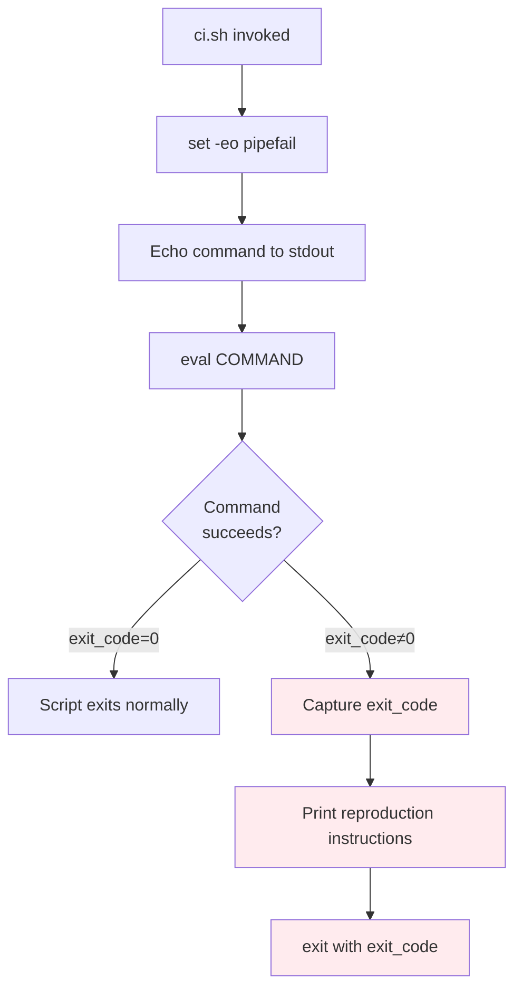
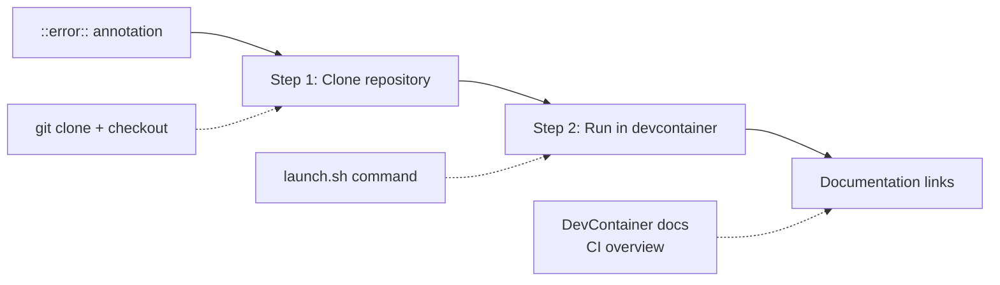
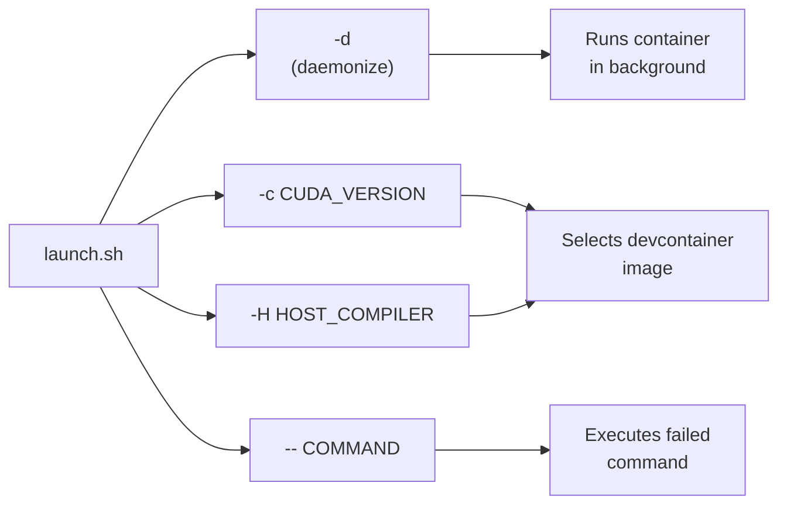
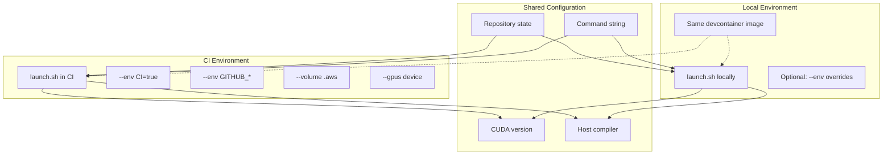
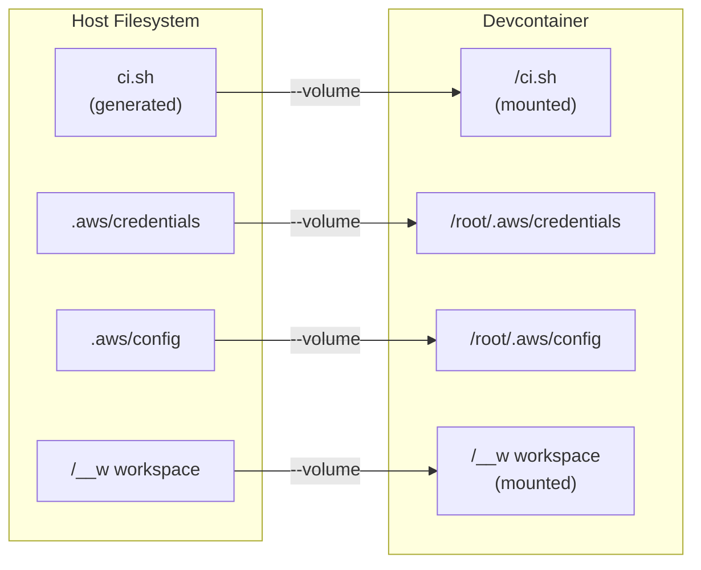
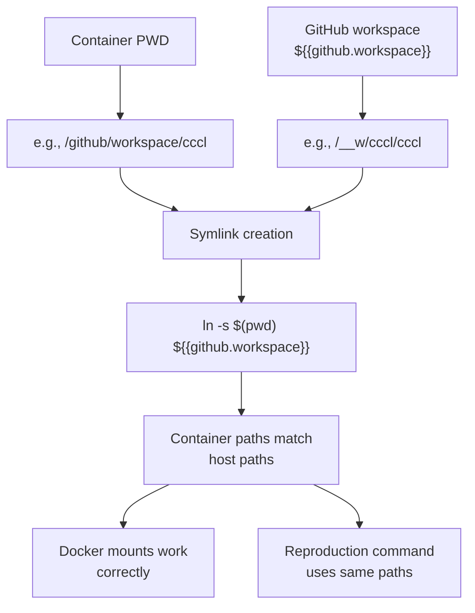
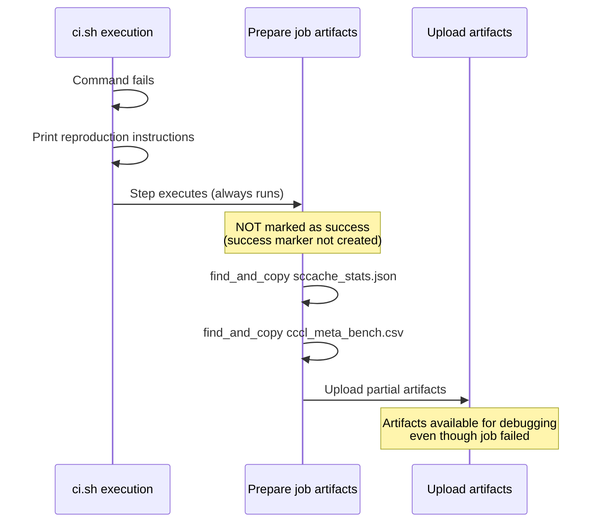

<!-- source: DeepWiki mcp.deepwiki.com · repo NVIDIA/cccl-gha · page 5.5 Error Handling and Reproducibility · fetched 2026-10-26 -->

# Error Handling and Reproducibility

<details>
<summary>Relevant source files</summary>

The following files were used as context for generating this wiki page:

- [.github/actions/workflow-run-job-linux/action.yml](.github/actions/workflow-run-job-linux/action.yml)

</details>


## Purpose and Scope

This page documents the error handling mechanisms and reproducibility features built into the job execution system. It focuses on the `ci.sh` wrapper script that executes commands within devcontainers, the error detection logic, and the automatic generation of reproduction instructions when jobs fail.

For information about the execution environment setup, see [Linux Execution Environment](#5.1) and [Windows Execution Environment](#5.2). For environment variable configuration, see [Environment Setup](#5.4). For debugging strategies and troubleshooting common issues, see [Troubleshooting Guide](#8.4).

## The ci.sh Wrapper Script

All commands executed within devcontainers are wrapped in a dynamically generated `ci.sh` script. This wrapper provides error detection, user feedback, and reproduction instructions.

### Script Generation

The `ci.sh` script is generated inline during the "Run command" step of the `workflow-run-job-linux` action:

```bash
cat <<"EOF" > ci.sh
#! /usr/bin/env bash
set -eo pipefail
echo -e "\e[1;34mRunning as '$(whoami)' user in $(pwd):\e[0m"
echo -e "\e[1;34m${COMMAND}\e[0m"
eval "${COMMAND}" || exit_code=$?
if [ ! -z "$exit_code" ]; then
  # ... reproduction instructions ...
  exit $exit_code
fi
EOF
```

**Sources:** [.github/actions/workflow-run-job-linux/action.yml:89-109]()

### Error Handling Configuration

The script uses strict error handling modes via `set -eo pipefail`:

| Flag | Purpose |
|------|---------|
| `-e` | Exit immediately if any command returns non-zero exit status |
| `-o pipefail` | Pipelines return the exit status of the last command to exit with non-zero status |

This ensures that errors are detected at the earliest point, preventing subsequent commands from executing with corrupted state.

### Error Detection Flow



**Title:** Error Detection and Handling Flow in ci.sh

The error detection mechanism captures the exit code from the `eval "${COMMAND}"` statement using the `||` operator. If the command fails, `exit_code` is set to the non-zero status, triggering the reproduction instruction block.

**Sources:** [.github/actions/workflow-run-job-linux/action.yml:94-108]()

## Reproduction Instructions

When a command fails, the system automatically generates comprehensive reproduction instructions using GitHub Actions' error annotation syntax.

### Instruction Template

The reproduction instructions follow a standardized format:



**Title:** Reproduction Instruction Components

**Sources:** [.github/actions/workflow-run-job-linux/action.yml:96-107]()

### Generated Output

When a failure occurs, the following instructions are printed:

| Instruction Element | Value | Purpose |
|---------------------|-------|---------|
| Repository clone | `git clone --branch $GITHUB_REF_NAME --single-branch https://github.com/$GITHUB_REPOSITORY.git` | Ensures correct branch |
| Commit checkout | `git checkout $GITHUB_SHA` | Ensures exact commit match |
| Devcontainer command | `.devcontainer/launch.sh -d -c {cuda} -H {host} -- {COMMAND}` | Reproduces exact environment |
| DevContainer docs | `https://github.com/NVIDIA/cccl/blob/main/.devcontainer/README.md` | Reference material |
| CI overview | `https://github.com/NVIDIA/cccl/blob/main/ci-overview.md` | System context |

The instructions use GitHub Actions environment variables to populate exact values:

| Variable | Usage |
|----------|-------|
| `$GITHUB_REF_NAME` | Branch name for cloning |
| `$GITHUB_REPOSITORY` | Full repository path (e.g., `NVIDIA/cccl`) |
| `$GITHUB_SHA` | Exact commit SHA for checkout |
| `${{inputs.cuda}}` | CUDA version passed to `launch.sh` |
| `${{inputs.host}}` | Host compiler passed to `launch.sh` |

**Sources:** [.github/actions/workflow-run-job-linux/action.yml:98-106]()

## Local Testing Workflow

Developers can reproduce CI failures locally using the provided `launch.sh` command.

### Reproduction Command Structure



**Title:** launch.sh Command Structure for Local Reproduction

The `-d` flag runs the container in detached mode, allowing interactive debugging. The CUDA version and host compiler arguments must match the CI job's configuration to ensure environment parity.

**Sources:** [.github/actions/workflow-run-job-linux/action.yml:102]()

### Environment Consistency

The local execution environment matches the CI environment through several mechanisms:



**Title:** Environment Consistency Between CI and Local Execution

**Sources:** [.github/actions/workflow-run-job-linux/action.yml:144-164]()

## Command Execution Environment

The `ci.sh` script executes within a carefully configured environment to ensure reproducibility.

### Environment Variable Propagation

The following environment variables are explicitly passed to the devcontainer:

| Variable | Purpose | Required for Reproducibility |
|----------|---------|------------------------------|
| `CI` | Indicates CI execution context | Optional |
| `COMMAND` | The actual command to execute | **Required** |
| `GITHUB_SHA` | Commit identifier | **Required** |
| `GITHUB_REF_NAME` | Branch name | **Required** |
| `GITHUB_REPOSITORY` | Repository path | **Required** |
| `GITHUB_WORKSPACE` | Working directory path | **Required** |
| `AWS_ACCESS_KEY_ID` | sccache credentials | Optional |
| `AWS_SESSION_TOKEN` | sccache credentials | Optional |
| `AWS_SECRET_ACCESS_KEY` | sccache credentials | Optional |

The variables marked as **Required** are essential for the reproduction instructions to work correctly. The AWS credentials enable sccache functionality but are not necessary for basic reproduction.

**Sources:** [.github/actions/workflow-run-job-linux/action.yml:149-160](), [.github/actions/workflow-run-job-linux/action.yml:74-76]()

### Volume Mounts for Reproducibility

The `ci.sh` script and supporting files are mounted into the devcontainer:



**Title:** File Mounts for ci.sh Execution

The `ci.sh` script is mounted at the root of the devcontainer filesystem, while the workspace maintains its path structure to ensure path consistency between host and container.

**Sources:** [.github/actions/workflow-run-job-linux/action.yml:161-163]()

## Error Output Formatting

The system uses GitHub Actions' logging annotations to make errors highly visible in the CI logs.

### Annotation Syntax

The error output uses the following GitHub Actions commands:

| Command | Purpose | Example |
|---------|---------|---------|
| `::error::` | Creates an error annotation in the workflow summary | `::error:: To replicate this failure locally...` |
| `::group::` | Creates collapsible log section | `::group::️❗ Instructions to Reproduce...` |
| `::endgroup::` | Closes collapsible section | Implied by subsequent group or end of step |

### Visual Formatting

The script uses ANSI color codes for terminal output:

| Color Code | Usage | Visual Effect |
|------------|-------|---------------|
| `\e[1;34m` | Command echo | Blue, bold |
| `\e[1;31m` | Error header | Red, bold |
| `\e[0m` | Reset | Returns to default |

Example output:

```
[1;34mRunning as 'root' user in /github/workspace:[0m
[1;34mmake -C libcudacxx/test[0m
... command output ...
::group::️❗ [1;31mInstructions to Reproduce CI Failure Locally[0m
::error:: To replicate this failure locally, follow the steps below:
...
```

**Sources:** [.github/actions/workflow-run-job-linux/action.yml:92-93](), [.github/actions/workflow-run-job-linux/action.yml:96]()

## Path Management for Reproducibility

The Linux execution environment uses a symlink strategy to ensure path consistency between the CI environment and local reproduction.

### Host Path Resolution



**Title:** Path Symlink Strategy for Reproducibility

The `host_path()` function transforms container paths to host paths when constructing Docker mount arguments:

```bash
host_path() {
  sed "s@/__w@$(dirname "$(dirname "${{github.workspace}}")")@" <<< "$1"
}
```

This transformation is critical because the intermediate `ubuntu-dind` container launches devcontainers on the host daemon, so mount paths must reference the host filesystem, not the intermediate container's view.

**Sources:** [.github/actions/workflow-run-job-linux/action.yml:82-87](), [.github/actions/workflow-run-job-linux/action.yml:138-140]()

## Artifact Collection After Errors

Even when jobs fail, the system attempts to collect diagnostic artifacts.

### Artifact Collection Flow



**Title:** Artifact Collection in Failed Jobs

The "Prepare job artifacts" step does not create the `success` marker file when a command fails, but it still attempts to collect diagnostic files like `sccache_stats.json` and benchmark data. This allows post-mortem analysis of failed jobs.

**Sources:** [.github/actions/workflow-run-job-linux/action.yml:166-200]()

### Conditional Artifact Collection

The `find_and_copy()` function uses the `|| :` operator to prevent failures in artifact collection from masking the original command failure:

```bash
find_and_copy() {
  filename="$1"
  filepath="$(find ${{github.event.repository.name}} -name "${filename}" -print -quit)"
  if [[ -z "$filepath" ]]; then
    echo "${filename} does not exist in repo directory."
    return 1
  fi
  cp -v "$filepath" "$result_dir"
}

find_and_copy "sccache_stats.json" || :
find_and_copy "cccl_meta_bench.csv" || :
```

The `|| :` pattern means "if this command fails, execute `:` (no-op) and continue," preventing artifact collection failures from affecting the job's final exit code.

**Sources:** [.github/actions/workflow-run-job-linux/action.yml:176-189]()

## Reproducibility Guarantees

The system provides the following reproducibility guarantees:

| Aspect | Guarantee | Implementation |
|--------|-----------|----------------|
| **Code Version** | Exact commit match | Instructions use `$GITHUB_SHA` for checkout |
| **Container Image** | Deterministic selection | CUDA version + host compiler uniquely identify devcontainer |
| **Command String** | Exact match | `$COMMAND` environment variable preserved in reproduction instructions |
| **Working Directory** | Path consistency | Symlink strategy ensures paths match between CI and local |
| **Error Exit Code** | Preserved | `ci.sh` exits with original command's exit code |

### Non-Reproducible Elements

The following elements are not guaranteed to be reproducible locally:

| Element | Reason | Mitigation |
|---------|--------|------------|
| **AWS sccache access** | Requires credentials | Local builds work without sccache, but slower |
| **GitHub API access** | Requires authentication | Not needed for command reproduction |
| **GPU availability** | Requires NVIDIA hardware | CPU-only commands still reproducible |
| **Timing** | Different hardware | Functional behavior reproducible, timing may vary |

**Sources:** [.github/actions/workflow-run-job-linux/action.yml:98-106]()

---

