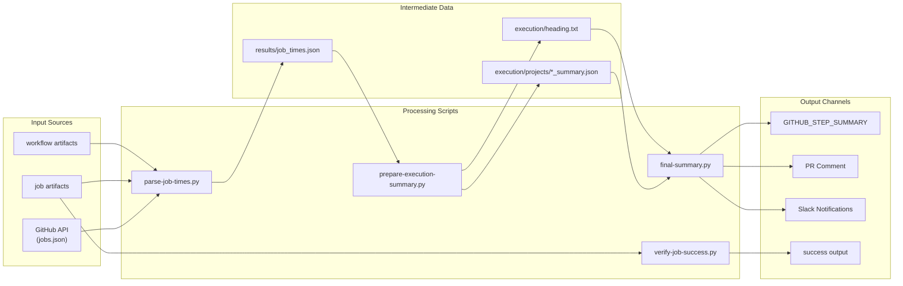
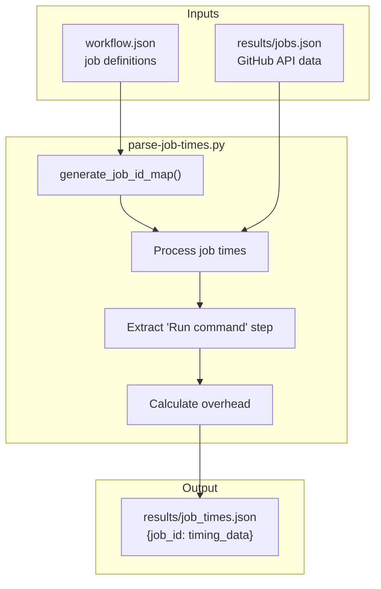
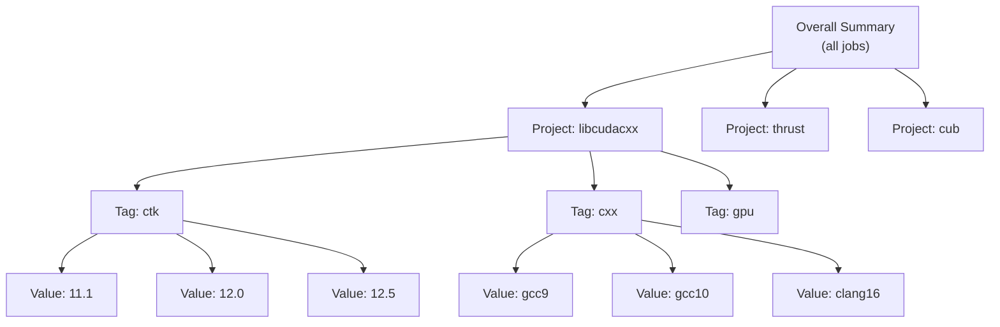
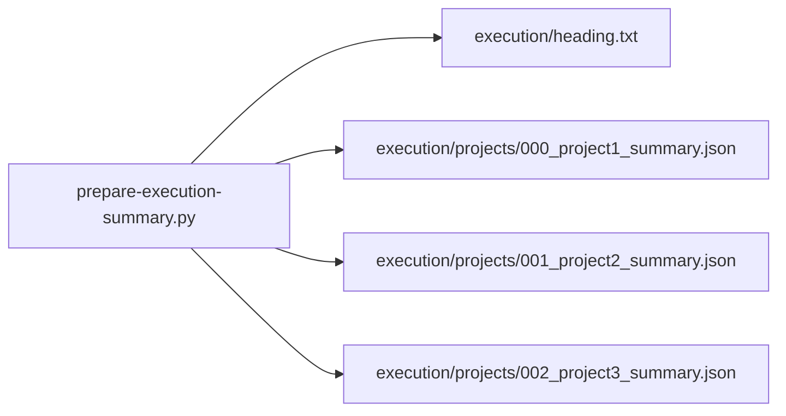
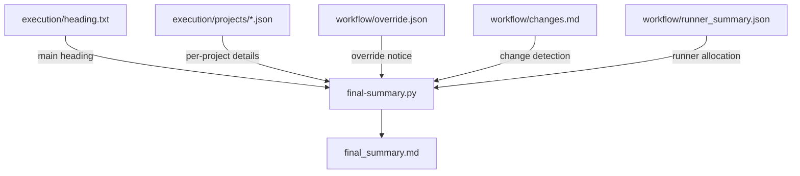
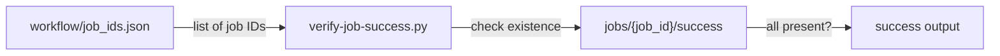
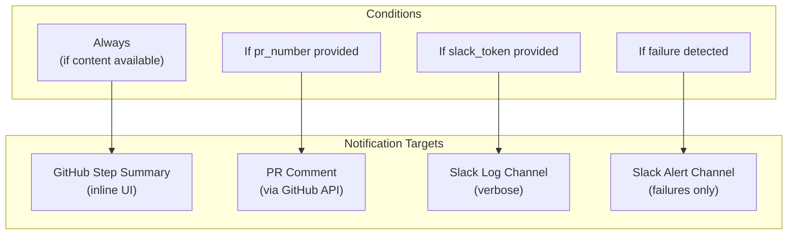

<!-- source: DeepWiki mcp.deepwiki.com · repo NVIDIA/cccl-gha · page 6 Results and Reporting · fetched 2026-10-26 -->

# Results and Reporting

<details>
<summary>Relevant source files</summary>

The following files were used as context for generating this wiki page:

- [.github/actions/workflow-results/action.yml](.github/actions/workflow-results/action.yml)
- [.github/actions/workflow-results/final-summary.py](.github/actions/workflow-results/final-summary.py)
- [.github/actions/workflow-results/parse-job-times.py](.github/actions/workflow-results/parse-job-times.py)
- [.github/actions/workflow-results/prepare-execution-summary.py](.github/actions/workflow-results/prepare-execution-summary.py)

</details>


The results and reporting subsystem aggregates execution data from all dispatched jobs, performs timing and success analysis, generates hierarchical summaries, and delivers notifications to multiple channels. This system operates after all jobs complete (or fail) and provides comprehensive feedback to developers through GitHub Step Summary, PR comments, and Slack notifications.

For information about how jobs execute and produce artifacts, see [Job Execution](#5). For details on the workflow generation that precedes job execution, see [Workflow Generation](#3).

## Overview

The `workflow-results` composite action ([.github/actions/workflow-results/action.yml]()) orchestrates a multi-stage pipeline that transforms raw job artifacts and GitHub API data into formatted reports. The pipeline is designed with fault tolerance: most steps use `continue-on-error: true` to ensure partial results are reported even if data collection fails.

**Pipeline Stages:**



**Sources:** [.github/actions/workflow-results/action.yml:1-213]()

## Artifact Collection

Job artifacts are produced during execution and uploaded to GitHub Actions artifact storage. The `workflow-results` action downloads these artifacts for analysis.

### Artifact Types

| Artifact Name | Content | Produced By |
|---------------|---------|-------------|
| `workflow` | `workflow.json`, `job_ids.json`, `runner_summary.json`, `override.json` (if applicable) | `workflow-build` action |
| `jobs-*` | Per-job artifacts: `success` marker, `sccache_stats.json`, `cccl_meta_bench.csv` | Individual job executions |

### Download Process

The action downloads artifacts in two stages:

1. **Workflow Artifacts** ([.github/actions/workflow-results/action.yml:30-34]()): Downloaded to `workflow/` directory using `actions/download-artifact@v4` with explicit `name: workflow`.

2. **Job Artifacts** ([.github/actions/workflow-results/action.yml:36-42]()): Downloaded to `jobs/` directory using pattern matching (`pattern: jobs-*`) with `merge-multiple: true` to consolidate all job artifacts into a single directory structure.

### Artifact Cleanup

Windows-produced artifacts may have incorrect line endings. The cleanup step ([.github/actions/workflow-results/action.yml:44-57]()) installs `dos2unix` and converts all files in the `jobs/` directory to Unix line endings.

**Directory Structure After Download:**

```
workflow/
├── workflow.json
├── job_ids.json
├── runner_summary.json
└── override.json (optional)

jobs/
├── <job_id_1>/
│   ├── success (marker file)
│   ├── sccache_stats.json
│   └── cccl_meta_bench.csv
├── <job_id_2>/
│   └── ... (may be incomplete if job failed)
└── ...
```

**Sources:** [.github/actions/workflow-results/action.yml:30-57]()

## Job Timing Analysis

The `parse-job-times.py` script ([.github/actions/workflow-results/parse-job-times.py]()) extracts timing data from the GitHub API and correlates it with job definitions to calculate execution durations and overhead.

### Data Sources



**Sources:** [.github/actions/workflow-results/parse-job-times.py:1-130]()

### Job Name to ID Mapping

The `generate_job_id_map()` function ([.github/actions/workflow-results/parse-job-times.py:29-45]()) creates a mapping from GitHub's full job names to internal job IDs:

- **Standalone jobs**: `"{group_name} / {job['name']}"` → `job['id']`
- **Two-stage jobs**: `"{group_name} / {pc['id']} / {job['name']}"` → `job['id']`

This mapping is necessary because GitHub's job names differ from the internal job IDs used in artifact paths.

### Timing Calculations

For each job, the script extracts ([.github/actions/workflow-results/parse-job-times.py:68-108]()):

| Field | Calculation | Format |
|-------|-------------|--------|
| `started_at` | From `job['started_at']` | ISO 8601 timestamp |
| `completed_at` | From `job['completed_at']` | ISO 8601 timestamp |
| `started_epoch_secs` | Converted to Unix epoch | Seconds since 1970-01-01 |
| `completed_epoch_secs` | Converted to Unix epoch | Seconds since 1970-01-01 |
| `job_seconds` | `completed - started` | Float seconds |
| `job_duration` | Formatted `job_seconds` | HH:MM:SS string |
| `command_seconds` | Duration of "Run command" step | Float seconds |
| `command_duration` | Formatted `command_seconds` | HH:MM:SS string |

**Overhead Calculation:**
```
overhead_percent = (job_seconds - command_seconds) / command_seconds * 100
```

This identifies time spent on non-command activities (checkout, setup, artifact upload, etc.).

### Output Format: job_times.json

```json
{
  "job_id_abc123": {
    "name": "linux / Job Name",
    "started_at": "2024-05-09T06:52:20Z",
    "completed_at": "2024-05-09T07:15:35Z",
    "started_epoch_secs": 1715239940.0,
    "completed_epoch_secs": 1715241335.0,
    "job_duration": "0:23:15",
    "job_seconds": 1395.0,
    "command_duration": "0:20:10",
    "command_seconds": 1210.0
  }
}
```

**Sources:** [.github/actions/workflow-results/parse-job-times.py:48-111](), [.github/actions/workflow-results/action.yml:92-97]()

## Execution Summary Generation

The `prepare-execution-summary.py` script ([.github/actions/workflow-results/prepare-execution-summary.py]()) builds hierarchical summaries organized by project, tag, and tag value. It implements sophisticated logic to identify "likely culprits" for failures.

### Summary Hierarchy



**Sources:** [.github/actions/workflow-results/prepare-execution-summary.py:102-162]()

### Summary Entry Structure

Each node in the hierarchy maintains ([.github/actions/workflow-results/prepare-execution-summary.py:55-99]()):

| Field | Type | Description |
|-------|------|-------------|
| `passed` | int | Count of successful jobs |
| `failed` | int | Count of failed jobs |
| `job_time` | float | Sum of `job_seconds` for all jobs |
| `command_time` | float | Sum of `command_seconds` for all jobs |
| `max_job_time` | float | Maximum `job_seconds` among all jobs |
| `sccache` | object | `{requests: int, hits: int}` aggregated across jobs |

### Likely Culprit Detection

The script identifies problematic tag values using two-level analysis ([.github/actions/workflow-results/prepare-execution-summary.py:254-280]()):

**Tag-Level Analysis:**
```python
def rank_tag(tag_summary):
    num_values = len(tag_summary['values'])
    num_failing_values = sum(1 for v in tag_summary['values'].values() if v['failed'] > 0)
    
    if num_values > 1 and num_failing_values == 1:
        return 0  # Likely culprit tag (rank highest)
    elif num_failing_values > 0 and num_failing_values < num_values:
        return 1  # Mixed results
    elif tag_failures > 0:
        return 2  # All values failing
    return 3  # No failures
```

**Value-Level Flags:**

| Condition | Flag | Meaning |
|-----------|------|---------|
| `failed == parent_failed` and `passed == 0` and `parent_size > 1` | 🔥 | Likely culprit: all tag failures attributable to this value, zero passes |
| `failed == parent_failed` and `passed > 0` and `parent_size > 1` | 🔍 | Suspicious: all tag failures include this value, but it has some passes |
| `passed == 0` | 🟥 | All jobs with this value failed |
| `failed > 0` | 🟨 | Some jobs with this value failed |
| `failed == 0` | 🟩 | All jobs with this value passed |

### Summary Statistics Formatting

The `get_summary_stats()` function ([.github/actions/workflow-results/prepare-execution-summary.py:195-221]()) formats metrics:

```
Pass: {percent:3}%/{total} | Total: {duration} | Avg: {duration} | Max: {duration} | Hits: {percent:3}%/{requests}
```

**Time Formatting** ([.github/actions/workflow-results/prepare-execution-summary.py:179-192]()):
- `>= 1 day`: `{days}d {hours:02}h`
- `>= 1 hour`: `{hours}h {minutes:02}m`
- `< 1 hour`: `{minutes}m {seconds:02}s`

### Output Files



**execution/heading.txt** ([.github/actions/workflow-results/prepare-execution-summary.py:334]()): Single-line overall summary with walltime and aggregate statistics.

**execution/projects/NNN_projectname_summary.json** ([.github/actions/workflow-results/prepare-execution-summary.py:319-325]()): Per-project JSON with `heading` and `body` fields. Projects are sorted by failure count (descending), then total job count.

**Sources:** [.github/actions/workflow-results/prepare-execution-summary.py:328-344](), [.github/actions/workflow-results/action.yml:99-104]()

## Final Summary Assembly

The `final-summary.py` script ([.github/actions/workflow-results/final-summary.py]()) assembles all summary components into a single Markdown/HTML document with collapsible sections.

### Document Structure



**Sources:** [.github/actions/workflow-results/final-summary.py:1-67]()

### Summary Components

The script reads and formats ([.github/actions/workflow-results/final-summary.py:41-63]()):

1. **Main Heading** (from `execution/heading.txt`): Wraps all content in a `<details>` tag with the heading as the summary.

2. **Project Summaries** (from `execution/projects/*.json`): Each project rendered as a nested `<details>` within an unordered list.

3. **Override Matrix** (from `workflow/override.json`, optional): If present, displays the override matrix as a JSON code block.

4. **Change Detection** (from `workflow/changes.md`, optional): Displays detected file changes.

5. **Runner Summary** (from `workflow/runner_summary.json`, optional): Shows runner allocation statistics.

### Project Summary Format

Each `*_summary.json` file has the structure ([.github/actions/workflow-results/final-summary.py:19-22]()):

```json
{
  "heading": "🟨 project_name: Pass: 85%/120 | Total: 2h 15m | ...",
  "body": "```\n🚨 ctk: 12.5 🚨\n  🔥 12.5 ...\n  🟩 11.1 ...\n```"
}
```

The body is pre-formatted as a Markdown code block with emoji flags and statistics.

### Output Processing

The final summary is output to three destinations ([.github/actions/workflow-results/action.yml:106-128]()):

1. **stdout**: For GitHub Actions log viewing
2. **GITHUB_OUTPUT** (`SUMMARY`): URL-encoded for use in subsequent steps (PR comments)
3. **GITHUB_STEP_SUMMARY**: Direct copy for inline workflow UI display

**URL Encoding** ([.github/actions/workflow-results/action.yml:116-122]()): The summary is URL-encoded using Python's `urllib.parse.quote()` to safely pass special characters and newlines through GitHub Actions outputs.

**Sources:** [.github/actions/workflow-results/final-summary.py:41-63](), [.github/actions/workflow-results/action.yml:106-128]()

## Success Verification

The `verify-job-success.py` script ([.github/actions/workflow-results/action.yml:155-177]()) determines overall workflow success by checking for job success markers.

### Success Marker Detection



The script reads `workflow/job_ids.json` to obtain the list of expected job IDs, then checks if each job's `success` marker file exists at `jobs/{job_id}/success`. The script ([.github/actions/workflow-results/action.yml:160]()):

- Returns exit code `0` if all success markers exist
- Returns non-zero exit code if any markers are missing

### Override Matrix Handling

If `workflow/override.json` exists, the workflow was run with a manually specified matrix, indicating a non-standard configuration. In this case, the action fails all jobs unconditionally ([.github/actions/workflow-results/action.yml:169-175]()) to prevent accidental merges with incomplete testing.

### Success Output

The `success` output ([.github/actions/workflow-results/action.yml:22-24](), [.github/actions/workflow-results/action.yml:164-177]()) is set to:

- `true`: All jobs succeeded and no override matrix was used
- `false`: Any job failed or an override matrix was present

This boolean output can be used by calling workflows to determine whether to proceed with subsequent steps (e.g., deployment, merging).

**Sources:** [.github/actions/workflow-results/action.yml:155-177]()

## Notification System

The action delivers notifications to multiple channels based on workflow outcomes and configured credentials.

### Notification Channels



**Sources:** [.github/actions/workflow-results/action.yml:128-212]()

### GitHub Step Summary

Written directly to `${GITHUB_STEP_SUMMARY}` ([.github/actions/workflow-results/action.yml:128]()), this displays the full summary inline in the GitHub Actions workflow UI. No conditions required.

### PR Comment

Posted if both `github_token` and `pr_number` inputs are provided ([.github/actions/workflow-results/action.yml:130-153]()):

**Process:**
1. Retrieve `SUMMARY` output from `final-summary` step (URL-encoded)
2. Decode using `decodeURIComponent()` in JavaScript
3. Post comment via `github.rest.issues.createComment()`

**API Call:**
```javascript
github.rest.issues.createComment({
  owner: context.repo.owner,
  repo: context.repo.repo,
  issue_number: pr_number,
  body: decodedSummary
});
```

### Slack Log Notification

Sent to `slack_log` channel if both `slack_token` and `slack_log` are provided ([.github/actions/workflow-results/action.yml:179-195]()). Triggered with `if: always()` to ensure notification even on failure.

**Message Format:**
```
Workflow '{workflow_type}' has finished with status `{status}`:

{exec_summary}

Details: {summary_url}
```

**Variables:**
- `workflow_type`: `${{ github.workflow }}` (e.g., "nightly", "pull_request")
- `status`: `${{ steps.check-success.outcome }}` (e.g., "success", "failure")
- `exec_summary`: Content of `execution/heading.txt`
- `summary_url`: GitHub Actions run URL

### Slack Alert Notification

Sent to `slack_alert` channel only on failure ([.github/actions/workflow-results/action.yml:197-212]()). Triggered with `if: failure()`.

**Message Format:**
```
Workflow '{workflow_type}' has failed:

{exec_summary}

Details: {summary_url}
```

This provides a dedicated channel for critical alerts without verbose log noise.

### Action Inputs for Notifications

| Input | Required | Purpose |
|-------|----------|---------|
| `github_token` | No | Enables PR commenting and GitHub API access |
| `pr_number` | No | PR to comment on (requires `github_token`) |
| `slack_token` | No | Enables Slack notifications |
| `slack_log` | No | Slack channel ID for verbose logs |
| `slack_alert` | No | Slack channel ID for failure alerts |

**Sources:** [.github/actions/workflow-results/action.yml:4-19](), [.github/actions/workflow-results/action.yml:130-212]()

## Fault Tolerance

Most processing steps use `continue-on-error: true` to ensure partial results are reported:

| Step | continue-on-error | Rationale |
|------|-------------------|-----------|
| Download job artifacts | ✓ | Jobs may have failed before producing artifacts |
| Clean up job artifacts | ✓ | Line ending conversion is non-critical |
| Fetch workflow job info | ✓ | Timing data is optional |
| Parse job times | ✓ | Summary can be generated without timing |
| Prepare execution summary | ✓ | Partial summaries are better than none |
| Prepare final summary | ✓ | Step summary can still be written |
| Comment on PR | ✓ | PR comments are optional |
| Check for job success | ✗ | Success determination must be definitive |

The `check-success` step ([.github/actions/workflow-results/action.yml:155-177]()) does not use `continue-on-error` because it sets the `success` output that determines overall workflow status. This ensures that failures in success verification propagate correctly.

**Sources:** [.github/actions/workflow-results/action.yml:37-109](), [.github/actions/workflow-results/action.yml:155-177]()

---

