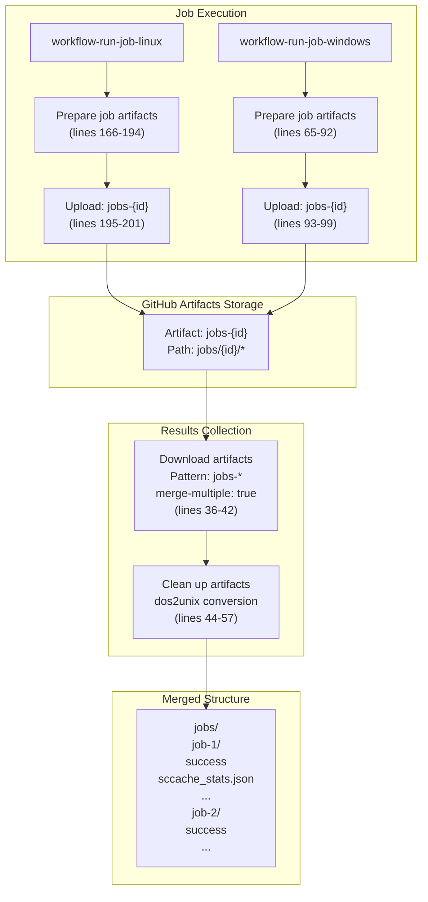
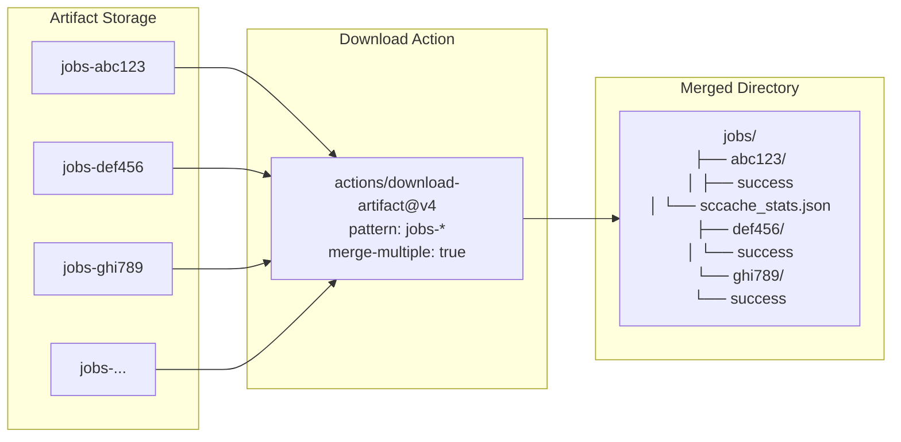
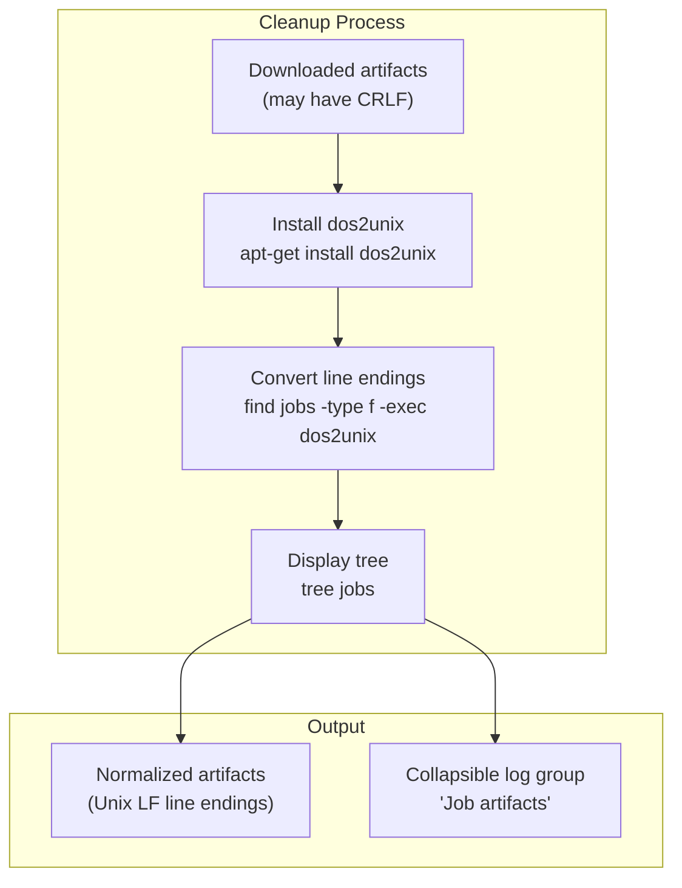

<!-- source: DeepWiki mcp.deepwiki.com · repo NVIDIA/cccl-gha · page 6.1 Artifact Collection · fetched 2026-10-26 -->

# Artifact Collection

<details>
<summary>Relevant source files</summary>

The following files were used as context for generating this wiki page:

- [.github/actions/workflow-results/action.yml](.github/actions/workflow-results/action.yml)
- [.github/actions/workflow-run-job-linux/action.yml](.github/actions/workflow-run-job-linux/action.yml)
- [.github/actions/workflow-run-job-windows/action.yml](.github/actions/workflow-run-job-windows/action.yml)

</details>


## Purpose and Scope

This page documents the artifact collection system used to gather outputs from executed jobs for analysis and reporting. It covers the types of artifacts produced by jobs, the upload mechanisms in both Linux and Windows execution environments, and the download and cleanup processes performed by the results collection action.

For information about how these artifacts are analyzed for timing data, see [Job Timing Analysis](#6.2). For success verification using these artifacts, see [Success Verification](#6.5).

## Overview

The artifact collection system enables communication between job execution workflows and the results aggregation workflow. Each job produces a set of standard artifacts that indicate success status and provide performance metrics. These artifacts are uploaded to GitHub Actions artifact storage with structured naming conventions, then downloaded and merged by the `workflow-results` action for centralized analysis.

**Artifact Collection Flow**



Sources: [.github/actions/workflow-run-job-linux/action.yml:166-201](), [.github/actions/workflow-run-job-windows/action.yml:65-99](), [.github/actions/workflow-results/action.yml:30-57]()

## Artifact Types

Each job produces a standard set of artifacts that serve different purposes in the results analysis pipeline.

| Artifact File | Purpose | Produced By | Required |
|--------------|---------|-------------|----------|
| `success` | Marker file indicating job completed successfully | All jobs | Yes |
| `sccache_stats.json` | Distributed compilation cache statistics | Jobs using sccache | No |
| `cccl_meta_bench.csv` | Benchmark results in CSV format | Benchmark jobs | No |
| `cccl_meta_bench.db` | Benchmark results database | Benchmark jobs | No |
| `cccl_meta_bench.log` | Benchmark execution logs | Benchmark jobs | No |

The `success` marker file is the only required artifact. Its presence or absence determines whether a job is considered successful by the verification system (see [Success Verification](#6.5)).

Sources: [.github/actions/workflow-run-job-linux/action.yml:173-189](), [.github/actions/workflow-run-job-windows/action.yml:74-87]()

## Upload Process

### Linux Job Artifacts

The Linux execution action collects artifacts after the job command completes in the devcontainer. The artifact preparation step is defined in [.github/actions/workflow-run-job-linux/action.yml:166-194]().

**Artifact Preparation Steps:**

1. **Create result directory**: `jobs/${{inputs.id}}/`
2. **Write success marker**: `touch "$result_dir/success"`
3. **Search and copy optional artifacts**: Uses `find_and_copy()` helper function
4. **Log artifact tree**: Displays collected artifacts in collapsible group

**File Search Implementation**

The `find_and_copy()` function searches the repository checkout directory for specific filenames and copies them to the results directory:

```bash
find_and_copy() {
  filename="$1"
  filepath="$(find ${{github.event.repository.name}} -name "${filename}" -print -quit)"
  if [[ -z "$filepath" ]]; then
    echo "${filename} does not exist in repo directory."
    return 1
  fi
  cp -v "$filepath" "$result_dir"
}
```

The search uses `find ... -print -quit` to locate the first matching file and terminates immediately. If no file is found, the function returns a non-zero exit code, but these failures are ignored using the `|| :` shell operator to prevent pipeline failures for optional artifacts.

**Upload Configuration**

Artifacts are uploaded using `actions/upload-artifact@v4` with the following parameters:

- **Name**: `jobs-${{inputs.id}}` (e.g., `jobs-abc123def456`)
- **Path**: `jobs` directory (contains `jobs/{id}/*` structure)
- **Compression Level**: `0` (no compression for performance)

Sources: [.github/actions/workflow-run-job-linux/action.yml:166-201]()

### Windows Job Artifacts

The Windows execution action follows a similar pattern but with platform-specific considerations. The artifact preparation is defined in [.github/actions/workflow-run-job-windows/action.yml:65-92]().

**Key Differences from Linux:**

1. **Limited artifact types**: Only collects `success` and `sccache_stats.json` (no benchmark artifacts)
2. **Tree command unavailable**: Uses `find` instead of `tree` for directory listing
3. **Line ending issues**: Windows artifacts may contain CRLF line endings that require cleanup

The `find_and_copy()` implementation is identical to Linux, but the invocation uses `|| true` instead of `|| :` (functionally equivalent).

Sources: [.github/actions/workflow-run-job-windows/action.yml:65-99]()

## Download and Merge Process

The `workflow-results` action downloads artifacts from all completed jobs and merges them into a unified directory structure.

**Download Workflow**



Sources: [.github/actions/workflow-results/action.yml:36-42]()

**Download Configuration**

The download step is defined in [.github/actions/workflow-results/action.yml:36-42]():

```yaml
- name: Download job artifacts
  continue-on-error: true
  uses: actions/download-artifact@v4
  with:
    path: jobs
    pattern: jobs-*
    merge-multiple: true
```

**Key Configuration Details:**

- **Pattern matching**: `jobs-*` matches all artifacts uploaded with the standardized naming convention
- **Merge strategy**: `merge-multiple: true` combines all matching artifacts into a single directory tree
- **Error tolerance**: `continue-on-error: true` allows the workflow to continue even if no jobs succeeded (the verification step will catch this failure)
- **Destination path**: `jobs` directory relative to the workflow workspace

The merge strategy preserves the internal directory structure from each artifact. Since each job uploads its artifacts in a `jobs/{id}/` subdirectory, the merged result contains all job directories side-by-side: `jobs/job1/`, `jobs/job2/`, etc.

Sources: [.github/actions/workflow-results/action.yml:36-42]()

## Artifact Cleanup

After downloading artifacts, a cleanup step normalizes line endings and displays the merged directory structure. This step is defined in [.github/actions/workflow-results/action.yml:44-57]().

**Cleanup Operations**



Sources: [.github/actions/workflow-results/action.yml:44-57]()

**Line Ending Normalization**

Windows jobs produce artifacts with CRLF (Carriage Return + Line Feed) line endings, which can cause issues when parsing files on Linux-based runners. The cleanup step converts all files to Unix-style LF line endings using `dos2unix`:

```bash
# Fix artifacts written on windows:
echo "::group::Fixing line endings in job artifacts"
sudo apt-get update
sudo apt-get install -y dos2unix
find jobs -type f -exec dos2unix -v {} \;
echo "::endgroup::"
```

The `find` command recursively processes all files in the `jobs` directory, applying `dos2unix` to each file. The `-v` flag provides verbose output showing which files were converted.

**Directory Visualization**

After normalization, the step displays the complete artifact directory tree in a collapsible GitHub Actions log group:

```bash
echo "::group::Job artifacts"
tree jobs
echo "::endgroup::"
```

This provides visibility into which artifacts were successfully collected from each job, aiding debugging when artifacts are missing.

**Error Tolerance**

The entire cleanup step uses `continue-on-error: true` to ensure the workflow proceeds even if:
- `dos2unix` installation fails
- Some files cannot be converted (binary files, permission issues)
- The `tree` command is unavailable

This resilience is critical because partial artifact collection is valuable even when some steps fail.

Sources: [.github/actions/workflow-results/action.yml:44-57]()

## Directory Structure

The artifact collection system produces a standardized directory hierarchy that subsequent analysis steps depend on.

**Complete Artifact Hierarchy**

```
workflow/                          # Downloaded from 'workflow' artifact
├── workflow.json                  # Complete job definitions
├── job_ids.json                   # Job ID mappings
├── runner_summary.json            # Runner allocation info
└── dispatch.json                  # Dispatch group categorization

jobs/                              # Downloaded from 'jobs-*' artifacts, merged
├── {job-id-1}/                    # Each job has its own subdirectory
│   ├── success                    # Marker file (required)
│   ├── sccache_stats.json         # sccache statistics (optional)
│   ├── cccl_meta_bench.csv        # Benchmark CSV (optional)
│   ├── cccl_meta_bench.db         # Benchmark database (optional)
│   └── cccl_meta_bench.log        # Benchmark logs (optional)
├── {job-id-2}/
│   ├── success
│   └── sccache_stats.json
└── {job-id-3}/
    └── success

results/                           # Created by analysis scripts
├── jobs.json                      # GitHub API job data
└── job_times.json                 # Parsed timing data

execution/                         # Created by summary scripts
├── heading.txt                    # Overall execution summary
└── projects/                      # Per-project summaries
    ├── project1_summary.json
    └── project2_summary.json
```

**Directory Usage by Analysis Steps**

| Directory | Created By | Used By | Purpose |
|-----------|------------|---------|---------|
| `workflow/` | workflow-build action | All analysis scripts | Job definitions and metadata |
| `jobs/` | workflow-run-job-* actions | verify-job-success.py, prepare-execution-summary.py | Job outputs and status |
| `results/` | workflow-results action | prepare-execution-summary.py, final-summary.py | Intermediate analysis data |
| `execution/` | prepare-execution-summary.py | final-summary.py | Hierarchical summaries |

**Job ID Format**

Job IDs in artifact names and directory paths follow the format generated by the workflow generation system. These IDs are deterministic based on job configuration and are used to correlate artifacts with job definitions in `workflow.json`.

Sources: [.github/actions/workflow-results/action.yml:30-57](), [.github/actions/workflow-run-job-linux/action.yml:170-172](), [.github/actions/workflow-run-job-windows/action.yml:71-72]()

## Artifact Naming Conventions

**Upload Naming**

Each job uploads its artifacts with a unique name combining a fixed prefix and the job ID:

```
jobs-{job-id}
```

For example:
- `jobs-libcudacxx-cpp17-gcc10-cuda12.0`
- `jobs-thrust-cpp20-nvcc11.8-gpu-v100`

This naming scheme enables:
1. **Pattern matching**: The `jobs-*` pattern downloads all job artifacts
2. **Uniqueness**: Each job's artifacts are isolated
3. **Traceability**: Artifact names correspond to job definitions in `workflow.json`

**Download Pattern Matching**

The download action uses glob pattern `jobs-*` which matches all artifacts starting with `jobs-`. The `merge-multiple: true` option instructs the action to extract all matching artifacts into the same `jobs/` directory, preserving their internal subdirectory structure.

**Artifact Name Collision Handling**

Since each job creates artifacts in a subdirectory named after its ID (`jobs/{id}/`), and job IDs are guaranteed unique by the workflow generation system, there are no collisions when merging multiple artifacts into the same parent directory.

Sources: [.github/actions/workflow-run-job-linux/action.yml:195-201](), [.github/actions/workflow-run-job-windows/action.yml:93-99](), [.github/actions/workflow-results/action.yml:36-42]()

## Error Handling

The artifact collection system implements multiple layers of error tolerance to ensure maximum data recovery even when individual jobs or collection steps fail.

**Upload-Side Error Handling**

1. **Optional artifact search**: The `find_and_copy()` function returns non-zero for missing files, but failures are ignored using `|| :` (Linux) or `|| true` (Windows)
2. **Success marker always written**: The `success` file is written unconditionally before attempting to collect optional artifacts
3. **Upload always attempted**: Even if optional artifacts fail to copy, the upload step executes

**Download-Side Error Handling**

1. **Download continues on error**: `continue-on-error: true` prevents workflow failure if no artifacts exist (e.g., all jobs failed before artifact upload)
2. **Cleanup continues on error**: Line ending conversion and tree display failures don't block subsequent analysis
3. **Verification detects missing artifacts**: The verify-job-success.py script explicitly checks for missing `success` markers (see [Success Verification](#6.5))

**Partial Success Scenarios**

The system gracefully handles these common failure modes:

| Scenario | Behavior | Impact |
|----------|----------|--------|
| Job fails before artifact upload | Download step continues; verify-job-success.py detects missing artifact | Workflow reports failure with specific job ID |
| Optional artifact missing | Success marker uploaded; analysis proceeds with available data | No sccache stats or benchmarks for that job |
| All jobs fail | Download returns no artifacts; continue-on-error prevents workflow abort | Verification step fails workflow with clear message |
| Line ending conversion fails | Subsequent scripts may encounter parse errors | Minimal impact; most scripts handle CRLF |

Sources: [.github/actions/workflow-run-job-linux/action.yml:176-189](), [.github/actions/workflow-run-job-windows/action.yml:77-87](), [.github/actions/workflow-results/action.yml:36-57]()

---

