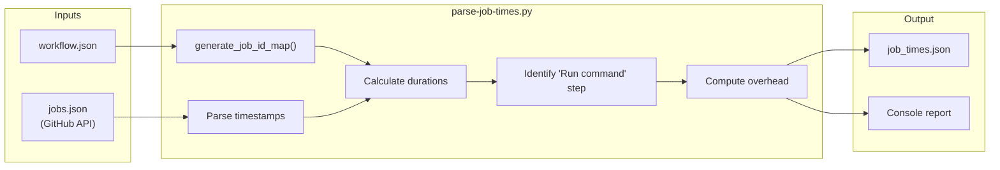
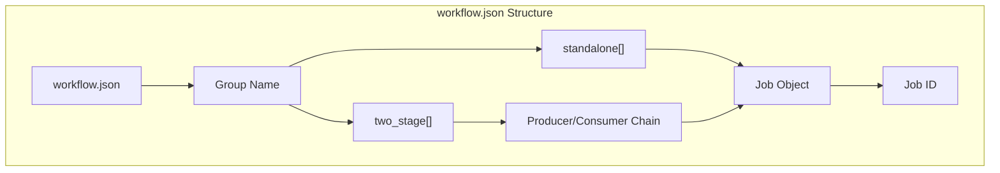
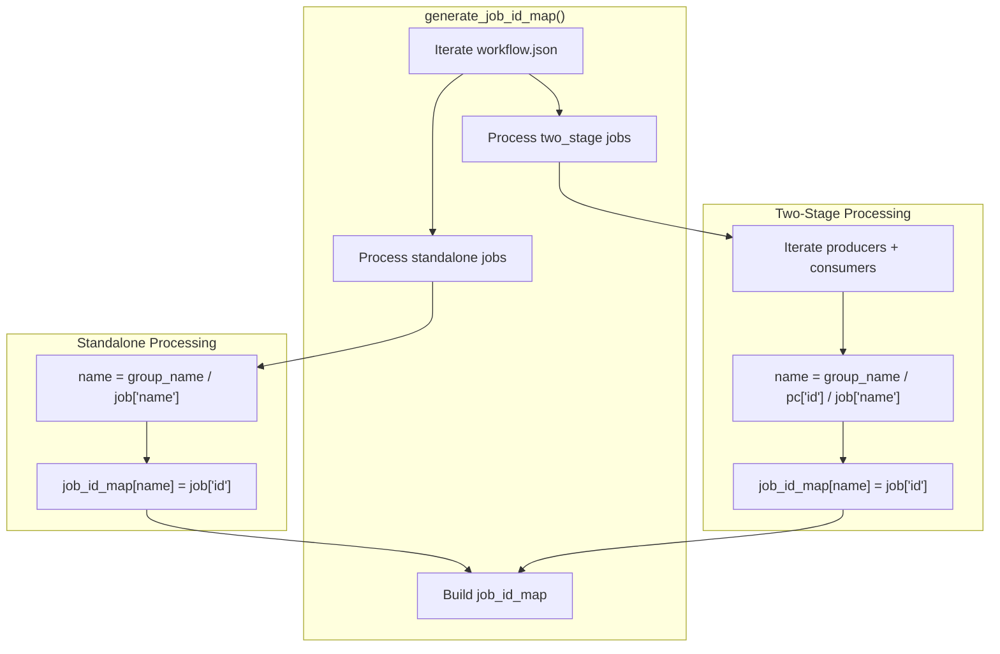
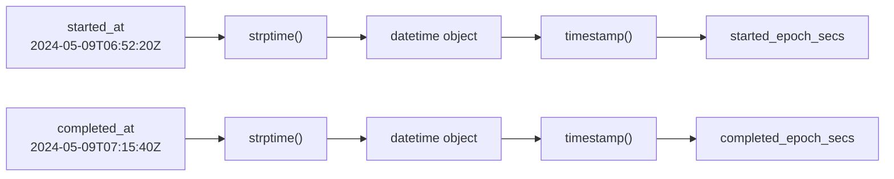
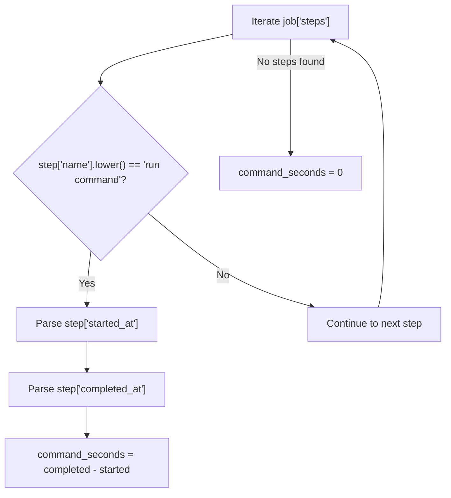
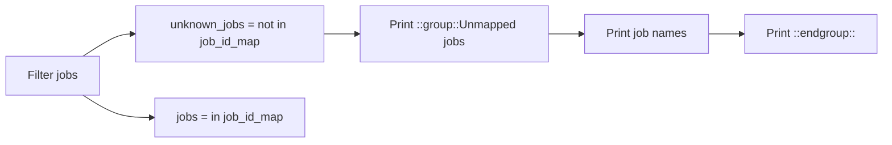
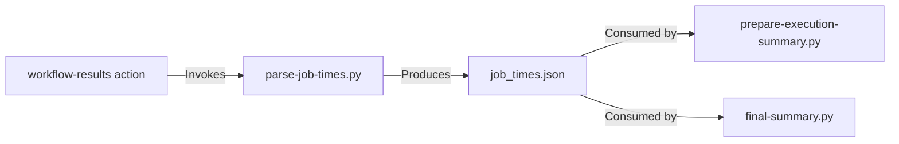

<!-- source: DeepWiki mcp.deepwiki.com · repo NVIDIA/cccl-gha · page 6.2 Job Timing Analysis · fetched 2026-10-26 -->

# Job Timing Analysis

<details>
<summary>Relevant source files</summary>

The following files were used as context for generating this wiki page:

- [.github/actions/workflow-results/parse-job-times.py](.github/actions/workflow-results/parse-job-times.py)

</details>


## Purpose and Scope

This document describes the `parse-job-times.py` script, which extracts timing data from GitHub Actions job execution and correlates it with workflow definitions. The script processes job duration information from the GitHub API, identifies the actual command execution time within each job, and calculates overhead from environment setup and teardown operations.

For information about how these timing results are aggregated and organized into execution summaries, see [Execution Summary Generation](#6.3). For details on artifact collection that precedes timing analysis, see [Artifact Collection](#6.1).

**Sources:** [.github/actions/workflow-results/parse-job-times.py:1-130]()

---

## Overview

The timing analysis system bridges GitHub Actions job execution data with the workflow configuration to produce structured timing metrics. It operates as part of the `workflow-results` action after all jobs complete.



**Diagram: Timing Analysis Data Flow**

**Sources:** [.github/actions/workflow-results/parse-job-times.py:48-129]()

---

## Input Requirements

### workflow.json Structure

The `workflow.json` file defines the expected job hierarchy with group names, job names, and unique job IDs. This is the authoritative source for mapping GitHub Actions job names to internal job identifiers.



**Diagram: workflow.json Hierarchy**

**Sources:** [.github/actions/workflow-results/parse-job-times.py:29-45]()

### jobs.json Structure

The `jobs.json` file is fetched from the GitHub Actions API and contains actual execution data for all jobs in the workflow run. Each job includes:

| Field | Description | Format |
|-------|-------------|--------|
| `name` | Full GitHub Actions job name | String (includes group and job name) |
| `started_at` | Job start timestamp | ISO 8601 (UTC) |
| `completed_at` | Job completion timestamp | ISO 8601 (UTC) |
| `steps[]` | Array of step execution data | Array of step objects |

**Sources:** [.github/actions/workflow-results/parse-job-times.py:10-15](), [.github/actions/workflow-results/parse-job-times.py:68-93]()

---

## Job ID Mapping

The `generate_job_id_map()` function creates a mapping from GitHub Actions job names to internal job IDs defined in `workflow.json`. This mapping is essential because GitHub's job names follow a hierarchical format while the timing analysis requires compact job IDs.

### Standalone Job Name Format

For standalone jobs:
```
{group_name} / {job_name}
```

Example: `pull_request / linux-gcc12-cuda12.2-x86_64-test`

### Two-Stage Job Name Format

For producer/consumer jobs:
```
{group_name} / {producer_consumer_id} / {job_name}
```

Example: `pull_request / thrust-linux-gcc12-cuda12.2-x86_64 / build`



**Diagram: Job ID Mapping Algorithm**

**Sources:** [.github/actions/workflow-results/parse-job-times.py:29-45]()

---

## Time Extraction and Calculation

### Timestamp Parsing

Job timestamps are provided by GitHub in ISO 8601 format with UTC timezone. The script parses these using Python's `datetime.strptime()` with the format string `"%Y-%m-%dT%H:%M:%SZ"`.



**Diagram: Timestamp Processing Pipeline**

**Sources:** [.github/actions/workflow-results/parse-job-times.py:73-92]()

### Duration Calculation

The script calculates three timing metrics:

| Metric | Calculation | Purpose |
|--------|-------------|---------|
| `job_seconds` | `completed_time - started_time` (total seconds) | Total job duration |
| `job_duration` | `str(timedelta(seconds=job_seconds))` | Human-readable total duration |
| `command_seconds` | Duration of "Run command" step | Actual command execution time |
| `command_duration` | `str(timedelta(seconds=command_seconds))` | Human-readable command duration |

**Sources:** [.github/actions/workflow-results/parse-job-times.py:82-108]()

### Command Step Identification

The script identifies the actual command execution time by searching for a step named `"run command"` (case-insensitive) within the job's step array.



**Diagram: Command Step Detection Algorithm**

**Sources:** [.github/actions/workflow-results/parse-job-times.py:94-108]()

---

## Output Format

### job_times.json Structure

The script produces `results/job_times.json` with job IDs as keys and timing data as values:

```json
{
  "job_id_12345": {
    "name": "pull_request / linux-gcc12-cuda12.2-x86_64-test",
    "started_at": "2024-05-09T06:52:20Z",
    "completed_at": "2024-05-09T07:15:40Z",
    "started_epoch_secs": 1715238740.0,
    "completed_epoch_secs": 1715240140.0,
    "job_duration": "0:23:20",
    "job_seconds": 1400.0,
    "command_duration": "0:18:45",
    "command_seconds": 1125.0
  }
}
```

| Field | Type | Description |
|-------|------|-------------|
| `name` | string | Full GitHub Actions job name |
| `started_at` | string | ISO 8601 start timestamp |
| `completed_at` | string | ISO 8601 completion timestamp |
| `started_epoch_secs` | float | Unix epoch seconds (start) |
| `completed_epoch_secs` | float | Unix epoch seconds (completion) |
| `job_duration` | string | Human-readable total duration (H:MM:SS) |
| `job_seconds` | float | Total job duration in seconds |
| `command_duration` | string | Human-readable command duration (H:MM:SS) |
| `command_seconds` | float | Command execution duration in seconds |

**Sources:** [.github/actions/workflow-results/parse-job-times.py:85-108](), [.github/actions/workflow-results/parse-job-times.py:110-111]()

---

## Console Reporting

The script outputs two diagnostic reports to the GitHub Actions console using `::group::` annotations for collapsible display.

### Unmapped Jobs Report

Lists any jobs from `jobs.json` that could not be mapped to a job ID in `workflow.json`. This typically indicates:
- Jobs from other workflows in the same run
- Infrastructure jobs (e.g., workflow-build, workflow-results)
- Malformed job names



**Diagram: Unmapped Jobs Processing**

**Sources:** [.github/actions/workflow-results/parse-job-times.py:64-115]()

### Job Times Report

Displays timing information in tabular format with overhead calculation:

```
Job        Command    Overhead   Name
---------- ---------- ---------- ----------
0:23:20    0:18:45    25         pull_request / linux-gcc12-cuda12.2-x86_64-test
0:15:30    0:12:00    29         pull_request / windows-msvc-cuda12.2-test
```

**Overhead Calculation:**
```
overhead = (job_seconds - command_seconds) * 100 / command_seconds
```

If `command_seconds` is zero (command step not found), overhead is set to 100% as a sentinel value.

**Sources:** [.github/actions/workflow-results/parse-job-times.py:117-125]()

---

## Integration with Results Pipeline

The `parse-job-times.py` script is invoked by the `workflow-results` action as the first data processing step. Its output (`job_times.json`) is consumed by subsequent analysis scripts:



**Diagram: Results Pipeline Integration**

The timing data enables:
- Per-project aggregation of execution times (see [Execution Summary Generation](#6.3))
- Identification of slow jobs requiring optimization
- Historical trending of build/test performance
- Overhead analysis for infrastructure improvements

**Sources:** [.github/actions/workflow-results/parse-job-times.py:1-130]()

---

