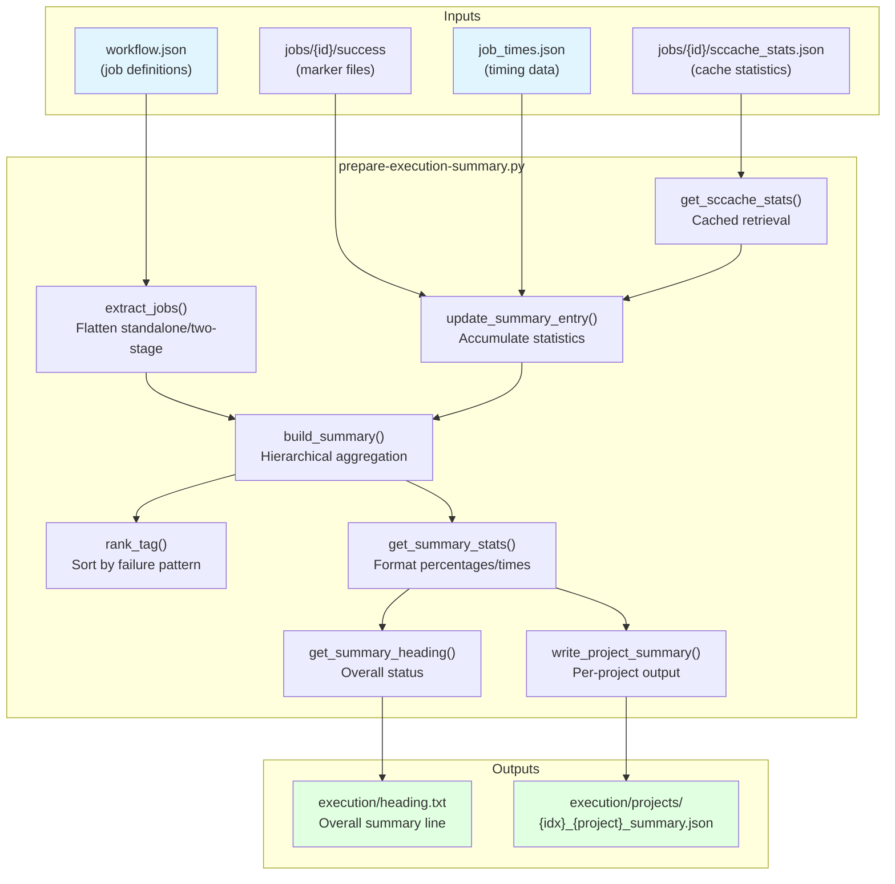
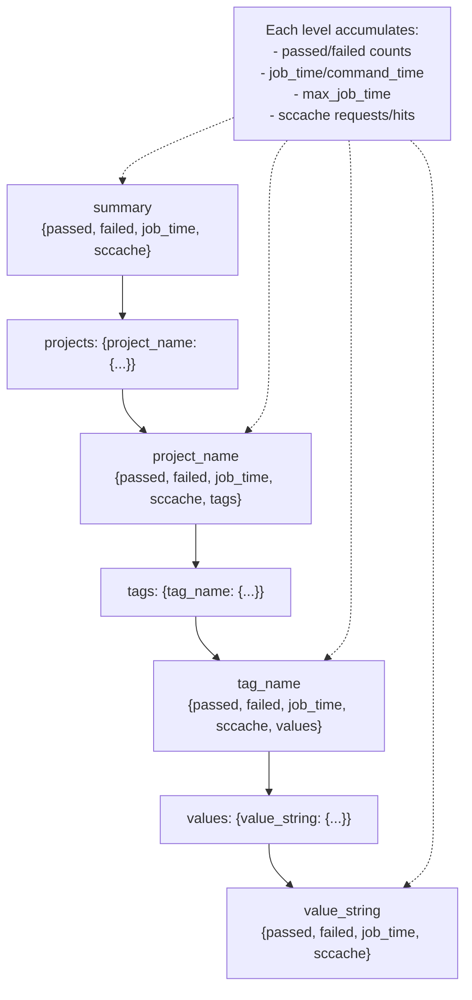
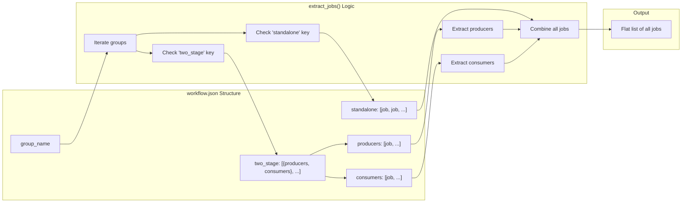
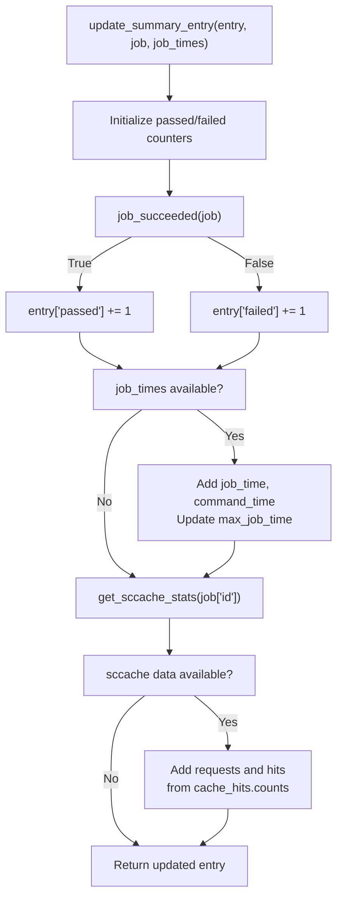
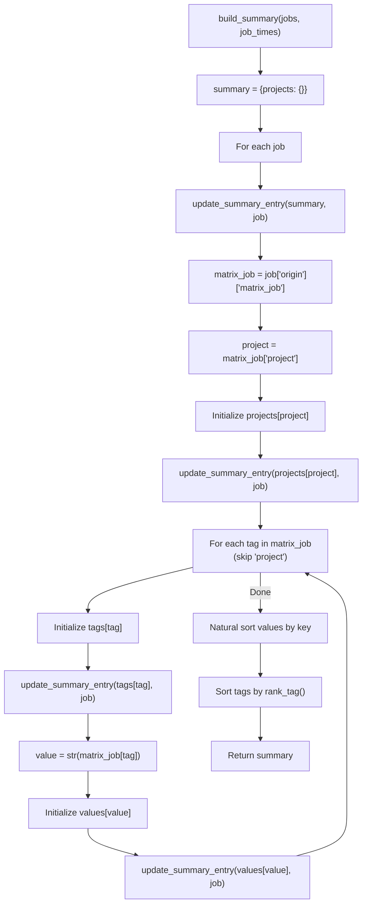
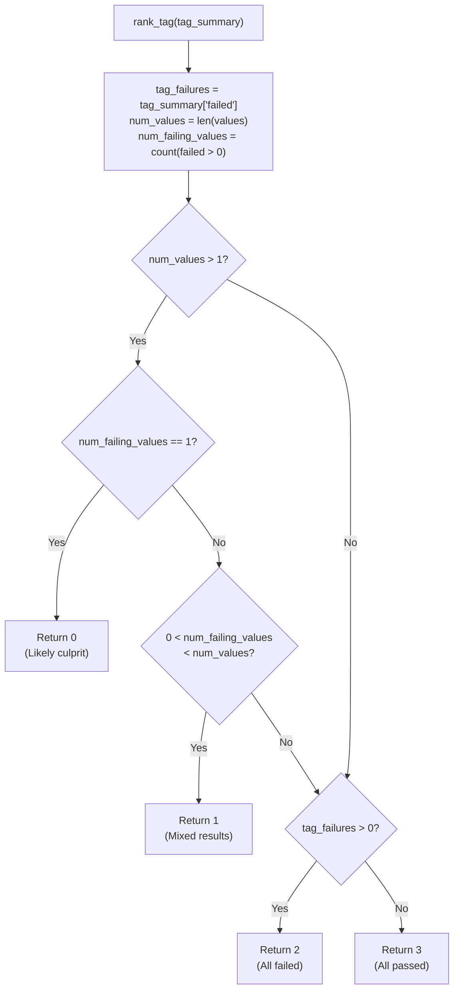
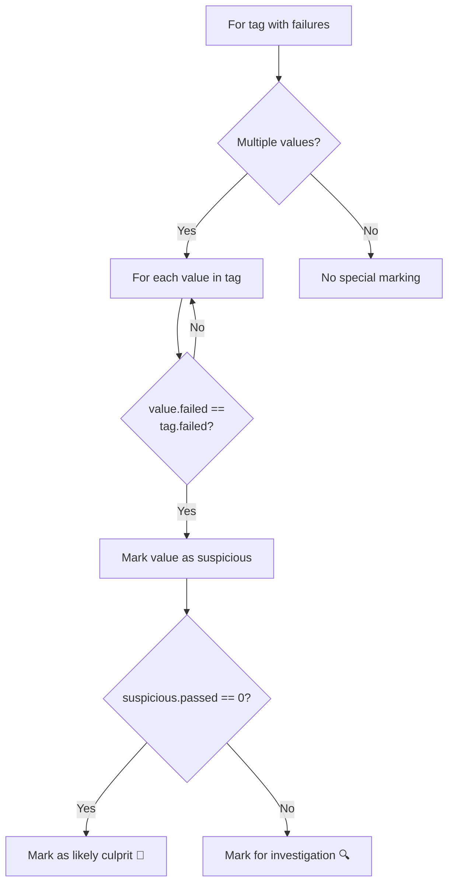
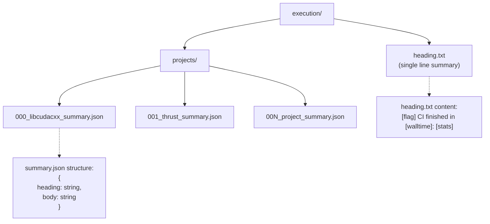

<!-- source: DeepWiki mcp.deepwiki.com · repo NVIDIA/cccl-gha · page 6.3 Execution Summary Generation · fetched 2026-10-26 -->

# Execution Summary Generation

<details>
<summary>Relevant source files</summary>

The following files were used as context for generating this wiki page:

- [.github/actions/workflow-results/prepare-execution-summary.py](.github/actions/workflow-results/prepare-execution-summary.py)

</details>


## Purpose and Scope

This document explains the execution summary generation subsystem, implemented in `prepare-execution-summary.py`, which transforms raw job data and timing information into hierarchical, human-readable summaries organized by project, tag, and value. The system calculates pass rates, timing statistics, sccache hit rates, and identifies likely culprits for failures.

For information about collecting timing data from GitHub Actions API, see [Job Timing Analysis](#6.2). For information about assembling these summaries into final reports for display, see [Final Summary and Reporting](#6.4).

Sources: [.github/actions/workflow-results/prepare-execution-summary.py:1-366]()

## System Overview

The execution summary generator is a Python script that aggregates job results into a three-level hierarchy: **projects** → **tags** → **values**. Each level accumulates pass/fail counts, execution times, and sccache statistics. The system implements intelligent failure analysis that ranks tags to surface likely culprits—specific tag values that account for all failures in a dimension.

### Pipeline Diagram



Sources: [.github/actions/workflow-results/prepare-execution-summary.py:34-44](), [.github/actions/workflow-results/prepare-execution-summary.py:102-162](), [.github/actions/workflow-results/prepare-execution-summary.py:328-344]()

## Data Structures

### Summary Hierarchy

The system builds a nested dictionary structure with three levels of aggregation:



Sources: [.github/actions/workflow-results/prepare-execution-summary.py:102-138]()

### Entry Statistics Schema

Each node in the hierarchy contains these fields:

| Field | Type | Description |
|-------|------|-------------|
| `passed` | `int` | Number of jobs that succeeded |
| `failed` | `int` | Number of jobs that failed |
| `job_time` | `float` | Total wall-clock time for all jobs (seconds) |
| `command_time` | `float` | Total command execution time (seconds) |
| `max_job_time` | `float` | Maximum single job duration (seconds) |
| `sccache.requests` | `int` | Total compilation requests |
| `sccache.hits` | `int` | Total cache hits |

Sources: [.github/actions/workflow-results/prepare-execution-summary.py:55-98]()

## Job Extraction

The `extract_jobs()` function flattens the workflow structure to produce a single list of jobs, handling both standalone and two-stage patterns:



Sources: [.github/actions/workflow-results/prepare-execution-summary.py:34-43]()

## Statistics Accumulation

### Job Success Detection

The `job_succeeded()` function determines whether a job passed by checking for a success marker file:

```python
# Returns True if jobs/{job_id}/success exists
job_succeeded(job)  # Line 12-14
```

Sources: [.github/actions/workflow-results/prepare-execution-summary.py:12-14]()

### Update Algorithm

The `update_summary_entry()` function accumulates statistics into a summary entry:



Sources: [.github/actions/workflow-results/prepare-execution-summary.py:55-99]()

### Sccache Statistics

The system retrieves and caches sccache statistics using an LRU cache decorator:

```python
@functools.lru_cache(maxsize=None)
def get_sccache_stats(job_id)
```

The function reads `jobs/{job_id}/sccache_stats.json` and extracts:
- Total `compile_requests`
- Sum of hits across all languages in `cache_hits.counts`

Sources: [.github/actions/workflow-results/prepare-execution-summary.py:46-52](), [.github/actions/workflow-results/prepare-execution-summary.py:82-97]()

## Hierarchical Aggregation

### Build Summary Process

The `build_summary()` function constructs the three-level hierarchy:



Sources: [.github/actions/workflow-results/prepare-execution-summary.py:102-162]()

### Natural Sorting

Values within each tag are sorted using natural sort, which correctly handles embedded numbers:

```python
def natural_sort_key(key):
    return [(int(text) if text.isdigit() else text.lower()) 
            for text in re.split('(\d+)', key)]
```

Examples:
- `["gcc10", "gcc11", "gcc9"]` → `["gcc9", "gcc10", "gcc11"]`
- `["11", "17", "20"]` → `["11", "17", "20"]`

Sources: [.github/actions/workflow-results/prepare-execution-summary.py:17-19](), [.github/actions/workflow-results/prepare-execution-summary.py:137-138]()

## Likely Culprit Detection

### Tag Ranking Algorithm

The `rank_tag()` function assigns a priority rank to each tag based on failure patterns:

| Rank | Condition | Description | Priority |
|------|-----------|-------------|----------|
| 0 | Multiple values, exactly 1 failing | **Likely culprit**: One value causes all failures | Highest |
| 1 | Multiple values, some failing | Mixed results suggest interaction effects | High |
| 2 | Single value, all failing | Entire dimension failed | Medium |
| 3 | No failures | All passed | Lowest |



Sources: [.github/actions/workflow-results/prepare-execution-summary.py:145-160]()

### Culprit Identification Logic

Within each tag, the system identifies suspicious values:



A value is a **likely culprit** if:
1. The tag has multiple values
2. The value's failure count equals the tag's total failure count
3. The value has zero passing jobs

A value is **suspicious** if conditions 1 and 2 are met but some jobs passed.

Sources: [.github/actions/workflow-results/prepare-execution-summary.py:254-264](), [.github/actions/workflow-results/prepare-execution-summary.py:291-295]()

## Formatting and Display

### Summary Statistics Formatting

The `get_summary_stats()` function generates a compact statistics line:

**Format**: `Pass: XXX%/total | Total: HHhMMm | Avg: HHhMMm | Max: HHhMMm | Hits: XXX%/requests`

```mermaid
graph LR
    Entry["summary entry"]
    CalcPass["percent = 100 * passed / total"]
    PassStr["Pass: XXX%/total"]
    CheckTime{"job_time<br/>available?"}
    FormatTotal["format_seconds(job_time)"]
    FormatAvg["format_seconds(job_time/total)"]
    FormatMax["format_seconds(max_job_time)"]
    TimeStr["Total/Avg/Max times"]
    CheckSccache{"sccache<br/>available?"}
    CalcHit["hit_percent = 100 * hits / requests"]
    HitStr["Hits: XXX%/requests"]
    Combine["Concatenate all parts"]
    
    Entry --> CalcPass
    CalcPass --> PassStr
    PassStr --> CheckTime
    CheckTime -->|Yes| FormatTotal
    CheckTime -->|No| CheckSccache
    FormatTotal --> FormatAvg
    FormatAvg --> FormatMax
    FormatMax --> TimeStr
    TimeStr --> CheckSccache
    CheckSccache -->|Yes| CalcHit
    CheckSccache -->|No| Combine
    CalcHit --> HitStr
    HitStr --> Combine
```



Sources: [.github/actions/workflow-results/prepare-execution-summary.py:195-221]()

### Time Formatting

The `format_seconds()` function produces human-readable durations:

| Duration | Format |
|----------|--------|
| < 1 hour | `MMmSSs` |
| 1-23 hours | `HhMMm` |
| ≥ 24 hours | `DdHHh` |

Sources: [.github/actions/workflow-results/prepare-execution-summary.py:179-192]()

### Status Flags

The system uses emoji flags to indicate status at each level:

| Flag | Meaning | Condition |
|------|---------|-----------|
| 🟩 | Success | All jobs passed |
| 🟨 | Partial failure | Some jobs passed, some failed |
| 🟥 | Total failure | No jobs passed |
| 🚨 | Likely culprit | Value responsible for all failures (0% pass rate) |
| 🔍 | Suspicious | Value responsible for all failures (but some passed) |
| 🔥 | High priority | Value marked as likely culprit in value line |

Sources: [.github/actions/workflow-results/prepare-execution-summary.py:228-280](), [.github/actions/workflow-results/prepare-execution-summary.py:294-303]()

## Output Generation

### Overall Heading

The `get_summary_heading()` function creates the top-level summary line:

**Format**: `[flag] CI finished in [walltime]: [stats]`

Walltime is calculated by `get_walltime()`, which finds the earliest start and latest completion across all jobs:

```python
walltime = max(completed_epoch_secs) - min(started_epoch_secs)
```

Sources: [.github/actions/workflow-results/prepare-execution-summary.py:224-235](), [.github/actions/workflow-results/prepare-execution-summary.py:165-176](), [.github/actions/workflow-results/prepare-execution-summary.py:334]()

### Project Summaries

Each project generates two components written to `execution/projects/{idx:03}_{project}_summary.json`:

```json
{
  "heading": "🟨 libcudacxx: Pass:  85%/234 | Total: 2h34m | Avg: 0m39s | Max: 4m12s | Hits:  78%/45231",
  "body": "```\n🚨 compiler: gcc9 🚨\n  🟩 gcc9              Pass:  45%/67 | ...\n  🔥 gcc10             Pass:   0%/12 | ...\n...\n```"
}
```

The body contains formatted tag and value lines within a code block.

Sources: [.github/actions/workflow-results/prepare-execution-summary.py:319-325]()

### Tag and Value Lines

**Tag Line Format**: `[flag] tag_name[: value flag]`

The tag line includes a note with the suspicious or culprit value name when detected.

**Value Line Format**: `  [flag] value_name [stats]`

Value lines are indented two spaces and include left-aligned value names (padded to 20 characters) followed by statistics.

Sources: [.github/actions/workflow-results/prepare-execution-summary.py:249-280](), [.github/actions/workflow-results/prepare-execution-summary.py:283-306](), [.github/actions/workflow-results/prepare-execution-summary.py:309-316]()

### Project Sorting

Projects are sorted to prioritize failures:

1. Primary sort: Number of failures (descending)
2. Secondary sort: Total number of jobs (descending)

This ensures projects with the most failures appear first in the output.

Sources: [.github/actions/workflow-results/prepare-execution-summary.py:336-344]()

## File Outputs

### Output File Structure



Sources: [.github/actions/workflow-results/prepare-execution-summary.py:332-334](), [.github/actions/workflow-results/prepare-execution-summary.py:319-325]()

### Output Locations

| File | Purpose | Created By |
|------|---------|------------|
| `execution/heading.txt` | Overall CI status summary | `write_text()` called from `write_workflow_summary()` |
| `execution/projects/{idx:03}_{project}_summary.json` | Per-project detailed summary | `write_project_summary()` for each project |

The directory `execution/projects/` is created if it doesn't exist using `os.makedirs('execution/projects', exist_ok=True)`.

Sources: [.github/actions/workflow-results/prepare-execution-summary.py:23-31](), [.github/actions/workflow-results/prepare-execution-summary.py:332]()

## Integration Points

### Input Dependencies

The script requires two command-line arguments:

```bash
prepare-execution-summary.py workflow.json job_times.json
```

- `workflow.json`: Generated by `build-workflow.py` (see [Workflow Generation](#3))
- `job_times.json`: Generated by `parse-job-times.py` (see [Job Timing Analysis](#6.2))

The job timing file is optional; if unavailable, timing statistics are omitted from the output.

Sources: [.github/actions/workflow-results/prepare-execution-summary.py:347-361]()

### Artifact Dependencies

The script reads job-specific artifacts from the filesystem:

- `jobs/{job_id}/success`: Marker file indicating job success
- `jobs/{job_id}/sccache_stats.json`: Sccache compilation statistics

These artifacts are downloaded by the workflow-results action before this script runs (see [Artifact Collection](#6.1)).

Sources: [.github/actions/workflow-results/prepare-execution-summary.py:12-14](), [.github/actions/workflow-results/prepare-execution-summary.py:46-52]()

### Downstream Consumers

The generated files are consumed by:

- `final-summary.py`: Assembles heading and project summaries into complete reports (see [Final Summary and Reporting](#6.4))
- GitHub Actions workflows: Display in job summaries and PR comments

Sources: See [Final Summary and Reporting](#6.4)

## Example Output

### Heading Example

```
🟨 CI finished in 1h23m: Pass:  87%/456 | Total: 12h45m | Avg: 1m40s | Max: 8m23s | Hits:  82%/123456
```

### Project Summary Example

```json
{
  "heading": "🟨 thrust: Pass:  75%/128 | Total: 3h12m | Avg: 1m30s | Max: 5m45s | Hits:  85%/34567",
  "body": "```\n🚨 compiler: gcc10 🚨\n  🟩 gcc9              Pass: 100%/32 | Total:  48m | Avg: 1m30s | Max: 3m12s | Hits:  90%/8901\n  🔥 gcc10             Pass:   0%/16 | Total:  24m | Avg: 1m30s | Max: 2m45s | Hits:  75%/4567\n  🟩 gcc11             Pass: 100%/32 | Total:  52m | Avg: 1m37s | Max: 3m45s | Hits:  88%/9012\n🟩 ctk\n  🟩 11.1              Pass: 100%/32 | Total:  48m | Avg: 1m30s | Max: 3m12s | Hits:  87%/8901\n  🟨 12.0              Pass:  67%/48 | Total:  72m | Avg: 1m30s | Max: 4m23s | Hits:  83%/12345\n```"
}
```

In this example:
- The `compiler` tag is ranked first (rank 0) because `gcc10` is a likely culprit
- All failures occur with `gcc10`, which has 0% pass rate
- The `ctk` tag is ranked lower because failures are distributed across multiple values

---

