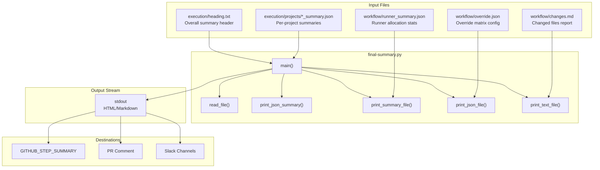
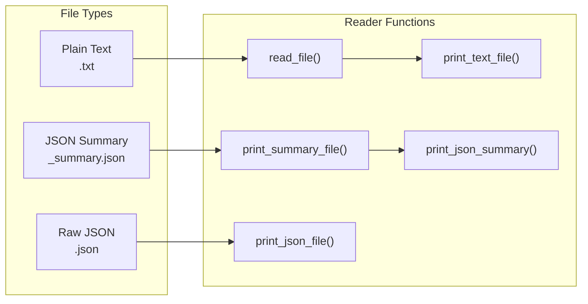
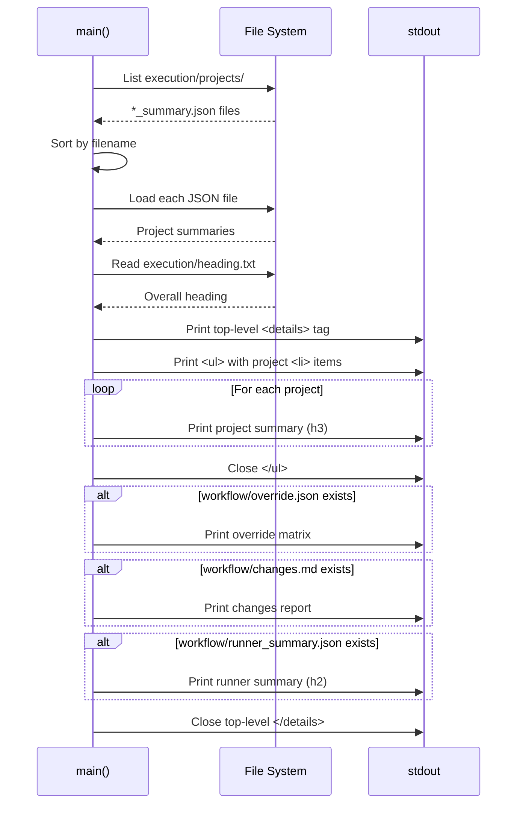
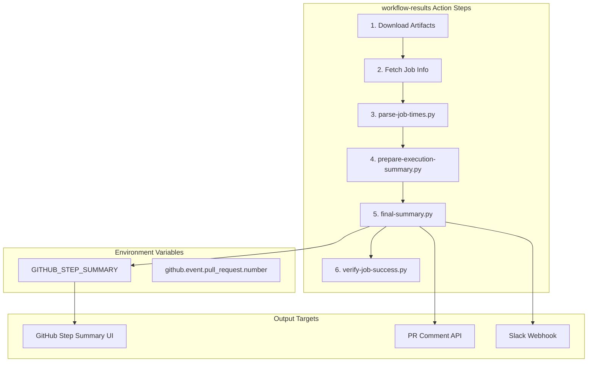

<!-- source: DeepWiki mcp.deepwiki.com · repo NVIDIA/cccl-gha · page 6.4 Final Summary and Reporting · fetched 2026-10-26 -->

# Final Summary and Reporting

<details>
<summary>Relevant source files</summary>

The following files were used as context for generating this wiki page:

- [.github/actions/workflow-results/final-summary.py](.github/actions/workflow-results/final-summary.py)

</details>


## Purpose and Scope

This document describes the final assembly stage of the results collection pipeline, specifically the `final-summary.py` script that generates the comprehensive HTML/Markdown report displayed to users. This script combines outputs from earlier processing stages into a unified, human-readable summary with collapsible sections.

For information about the artifact collection stage that precedes this, see [Artifact Collection](#6.1). For details on timing analysis, see [Job Timing Analysis](#6.2). For execution summary generation, see [Execution Summary Generation](#6.3). For multi-channel distribution of this final summary, see [Notification System](#6.6).

## System Overview

The `final-summary.py` script serves as the final aggregation point in the results pipeline. It reads structured data files produced by earlier stages and assembles them into a single HTML document with collapsible `<details>` sections. This document is rendered in GitHub's Step Summary UI, posted as PR comments, and sent to Slack channels.



**Sources:** [.github/actions/workflow-results/final-summary.py:1-68]()

## Output Format Structure

The generated report uses HTML `<details>` and `<summary>` tags to create collapsible sections, allowing users to drill down into specific projects or skip irrelevant information. The overall structure is:

| Section | Source File | Description |
|---------|------------|-------------|
| Top-level heading | `execution/heading.txt` | Overall pass/fail status and job counts |
| Project summaries | `execution/projects/*_summary.json` | Per-project details in collapsible `<li>` items |
| Override matrix | `workflow/override.json` | Optional override configuration (if present) |
| Changed files | `workflow/changes.md` | Git diff report (if present) |
| Runner summary | `workflow/runner_summary.json` | Runner allocation statistics |

The entire report is wrapped in a top-level `<details>` block that uses the heading text as its `<summary>`, making even the overall summary collapsible.

**Sources:** [.github/actions/workflow-results/final-summary.py:41-63]()

## Script Components

### File Reading Functions

The script provides several specialized functions for reading and printing different file formats:



#### `read_file(filepath)`

Reads a text file and returns its contents with trailing whitespace stripped. Used as a building block by other functions.

**Sources:** [.github/actions/workflow-results/final-summary.py:9-11]()

#### `print_text_file(filepath)`

Prints the contents of a plain text file if it exists, followed by two newlines. Used for `workflow/changes.md`.

**Sources:** [.github/actions/workflow-results/final-summary.py:14-16]()

#### `print_json_summary(summary, heading_level)`

Prints a JSON object containing `heading` and `body` fields as a collapsible HTML section. The `heading_level` parameter (e.g., `3` for `<h3>`) controls the heading tag used in the `<summary>` element. The structure is:

```html
<details><summary><h{level}>{heading}</h{level}></summary>
{body}
</details>
```

**Sources:** [.github/actions/workflow-results/final-summary.py:19-22]()

#### `print_summary_file(filepath, heading_level)`

Loads a JSON file containing `heading` and `body` fields and passes it to `print_json_summary()`. Used for `workflow/runner_summary.json`.

**Sources:** [.github/actions/workflow-results/final-summary.py:25-28]()

#### `print_json_file(filepath, heading)`

Prints a raw JSON file in a code block within a collapsible section. Used for `workflow/override.json` to display the override matrix configuration. The JSON is formatted with 2-space indentation.

**Sources:** [.github/actions/workflow-results/final-summary.py:31-38]()

## Assembly Process

The `main()` function orchestrates the assembly of the final report in a specific order:



### Project Summary Collection

The script scans the `execution/projects/` directory for files matching the regex `[0-9]+_.+_summary.json`. These files are named with a numeric prefix that indicates the number of failed jobs (e.g., `0_libcudacxx_summary.json` or `5_thrust_summary.json`), allowing them to be sorted alphabetically to list failing projects first.

**Sources:** [.github/actions/workflow-results/final-summary.py:42-49]()

### Hierarchical Structure Generation

The projects are rendered as an unordered list (`<ul>`) where each project is a list item (`<li>`) containing a collapsible section with heading level 3 (`<h3>`). This creates a visually organized hierarchy:

```
<details><summary>Overall Heading</summary>
  <ul>
    <li>
      <details><summary><h3>Project 1</h3></summary>
        Project 1 body
      </details>
    </li>
    <li>
      <details><summary><h3>Project 2</h3></summary>
        Project 2 body
      </details>
    </li>
  </ul>
</details>
```

**Sources:** [.github/actions/workflow-results/final-summary.py:51-57]()

### Optional Sections

The script conditionally includes additional sections if their source files exist:

1. **Override Matrix** (`workflow/override.json`): Displayed with heading "🛠️ Override Matrix" at heading level 3
2. **Changes Report** (`workflow/changes.md`): Plain text/markdown content from change detection
3. **Runner Summary** (`workflow/runner_summary.json`): Runner allocation statistics at heading level 2

**Sources:** [.github/actions/workflow-results/final-summary.py:59-61]()

## Integration with workflow-results Action

The `final-summary.py` script is invoked by the `workflow-results` composite action as the final step in the results processing pipeline:



The action redirects the script's stdout to the `GITHUB_STEP_SUMMARY` file, which GitHub automatically renders in the workflow run UI. The same content is also used for PR comments and Slack notifications by downstream steps in the action.

**Sources:** [.github/actions/workflow-results/final-summary.py:1-68]()

## Output Destinations

The final summary report is distributed to multiple destinations to reach different audiences:

| Destination | Purpose | When Displayed |
|-------------|---------|----------------|
| GitHub Step Summary | Inline workflow UI display | Always |
| PR Comment | Developer feedback on pull requests | When `pr-number` input is provided |
| Slack Log Channel | Team visibility for all runs | Always (if Slack credentials configured) |
| Slack Alert Channel | Urgent failure notifications | Only on workflow failure |

Each destination receives the same HTML content, but may render it differently based on their Markdown/HTML support. GitHub's Step Summary and PR comments support full HTML with collapsible sections, while Slack converts the content to its block format.

For details on how these distributions are configured and executed, see [Notification System](#6.6).

**Sources:** [.github/actions/workflow-results/final-summary.py:1-68]()

## File Path Dependencies

The script expects the following directory structure to be present in the GitHub Actions workspace:

```
workspace/
├── execution/
│   ├── heading.txt              # Required: Overall summary header
│   └── projects/
│       ├── 0_project1_summary.json   # One or more project summaries
│       ├── 0_project2_summary.json
│       └── 5_project3_summary.json
└── workflow/
    ├── override.json            # Optional: Override matrix config
    ├── changes.md               # Optional: Changed files report
    └── runner_summary.json      # Optional: Runner statistics
```

These files are created by the `prepare-execution-summary.py` script (see [Execution Summary Generation](#6.3)) and the `build-workflow.py` script during workflow generation (see [Workflow Generation](#3)).

The script gracefully handles missing optional files by checking `os.path.exists()` before attempting to print them. If `execution/heading.txt` or the `execution/projects/` directory is missing, the script will fail with a Python exception.

**Sources:** [.github/actions/workflow-results/final-summary.py:14-61]()

## Summary JSON Schema

Each project summary JSON file follows the schema produced by `prepare-execution-summary.py`:

```json
{
  "heading": "Project Name (Passed: X/Y)",
  "body": "HTML/Markdown content with tables and collapsible sections"
}
```

The `heading` field contains a concise summary line, while the `body` field contains detailed HTML including:
- Pass/fail statistics tables
- Tag dimension breakdowns (e.g., by GPU, CUDA version, compiler)
- Likely culprit analysis
- sccache statistics
- Individual job failure details

**Sources:** [.github/actions/workflow-results/final-summary.py:19-28]()

---

