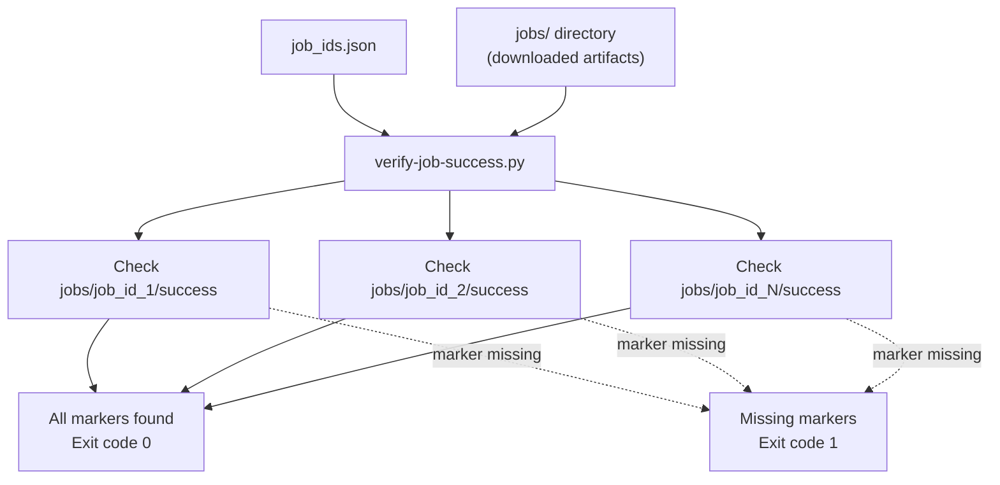
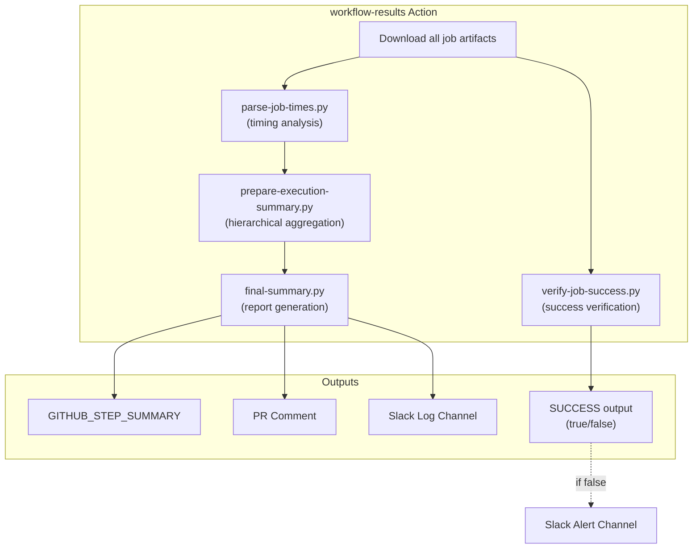

<!-- source: DeepWiki mcp.deepwiki.com · repo NVIDIA/cccl-gha · page 6.5 Success Verification · fetched 2026-10-26 -->

# Success Verification

<details>
<summary>Relevant source files</summary>

The following files were used as context for generating this wiki page:

- [.github/actions/workflow-results/verify-job-success.py](.github/actions/workflow-results/verify-job-success.py)

</details>


## Purpose and Scope

This document describes the success verification subsystem, which determines the overall success or failure status of a workflow run by checking for the presence of success marker artifacts produced by individual jobs. This subsystem is part of the broader results collection pipeline and produces the final boolean output that determines workflow status.

For information about artifact collection mechanics, see [Artifact Collection](#6.1). For information about how the success status is incorporated into notifications, see [Notification System](#6.6). For details on final summary generation, see [Final Summary and Reporting](#6.4).

---

## Success Marker System

Each job that executes in the workflow produces a success marker artifact if and only if it completes successfully. This marker is a simple empty file located at a predictable path within the artifact structure.

### Marker File Convention

```
jobs/{job_id}/success
```

The presence of this file indicates successful job completion. The file has no contents—its existence is the signal. Jobs create this marker as the final step in their execution, after all commands have completed successfully.

**Sources:** [.github/actions/workflow-results/verify-job-success.py:19]()

### Job ID Mapping

The verification process uses a job ID mapping file that associates numeric job IDs with human-readable job names. This mapping is generated during the workflow generation phase and provides the complete list of jobs that should have executed.

The mapping has the structure:
```json
{
  "job_id_1": "job_name_1",
  "job_id_2": "job_name_2"
}
```

**Sources:** [.github/actions/workflow-results/verify-job-success.py:14]()

---

## Verification Process

### Script Overview

The success verification is performed by `verify-job-success.py`, a Python script that implements a simple but critical check: for every job that was supposed to run, verify that its success marker exists.



**Diagram: verify-job-success.py Execution Flow**

**Sources:** [.github/actions/workflow-results/verify-job-success.py:1-31]()

### Command-Line Interface

The script accepts a single positional argument:

| Argument | Type | Description |
|----------|------|-------------|
| `job_id_map` | file path | Path to JSON file containing job ID to job name mappings |

Example invocation:
```bash
./verify-job-success.py job_ids.json
```

**Sources:** [.github/actions/workflow-results/verify-job-success.py:10-12]()

### Verification Algorithm

The verification algorithm is straightforward:

1. **Load job ID mapping**: Parse the JSON file to obtain the complete list of jobs that should have executed [.github/actions/workflow-results/verify-job-success.py:14]()

2. **Initialize success flag**: Start with `success = True` [.github/actions/workflow-results/verify-job-success.py:17]()

3. **Iterate through jobs**: For each job ID in the mapping [.github/actions/workflow-results/verify-job-success.py:18]():
   - Construct the expected success marker path: `jobs/{job_id}/success` [.github/actions/workflow-results/verify-job-success.py:19]()
   - Print verification message with job ID and name [.github/actions/workflow-results/verify-job-success.py:20]()
   - Check if the success marker file exists [.github/actions/workflow-results/verify-job-success.py:21]()
   - If missing, print failure message and set `success = False` [.github/actions/workflow-results/verify-job-success.py:22-23]()

4. **Exit with status**: If any markers are missing, exit with code 1; otherwise exit with code 0 [.github/actions/workflow-results/verify-job-success.py:25-26]()

**Sources:** [.github/actions/workflow-results/verify-job-success.py:9-31]()

### Output Format

The script produces console output for each job verification:

**Success case:**
```
Verifying job with id "12345": "libcudacxx-build-gcc12-cuda12.0"
```

**Failure case:**
```
Verifying job with id "12345": "libcudacxx-build-gcc12-cuda12.0"
Failed: Artifact "jobs/12345/success" not found
```

This output appears in the workflow-results action logs and helps identify which specific jobs failed.

**Sources:** [.github/actions/workflow-results/verify-job-success.py:20-22]()

---

## Integration with workflow-results Action

### Action Orchestration

The `verify-job-success.py` script is invoked as part of the `workflow-results` composite action. This action orchestrates multiple result processing steps in sequence.



**Diagram: workflow-results Action Data Flow**

**Sources:** [.github/actions/workflow-results/verify-job-success.py:1-31]()

### Conditional Execution Pattern

The success verification step typically uses `continue-on-error: true` in the action configuration, allowing the verification to fail without preventing subsequent reporting steps from executing. This ensures that even when jobs fail, developers receive comprehensive summary reports with information about which jobs failed and why.

The verification script's exit code is captured separately and converted to a boolean output that can be consumed by subsequent workflow steps, typically to:
1. Determine whether to post to the Slack alert channel (failures only)
2. Set the overall workflow status (success vs failure)
3. Provide a machine-readable signal for automation tools

---

## Failure Scenarios

### Missing Success Markers

The most common failure scenario occurs when one or more jobs fail to complete successfully. Failed jobs do not create success marker artifacts, causing the verification script to detect their absence.

| Scenario | Cause | Verification Result |
|----------|-------|---------------------|
| Job command fails | Non-zero exit code in job execution | Marker not created, verification fails |
| Job times out | GitHub Actions timeout exceeded | Marker not created, verification fails |
| Job cancelled | Manual cancellation or dependency failure | Marker not created, verification fails |
| Artifact upload fails | GitHub API error during upload | Marker exists locally but not in artifacts, verification fails |
| Job skipped | Conditional logic skipped job execution | Job not in job_id_map, verification unaffected |

**Sources:** [.github/actions/workflow-results/verify-job-success.py:21-23]()

### Partial Workflow Execution

In some cases, a workflow may experience partial execution due to infrastructure issues, resource constraints, or GitHub Actions platform problems. The verification script detects these scenarios by comparing the expected job list (from job_ids.json) against the actual artifacts present.

### Non-Failure Early Termination

If a job completes all required steps but is marked as skipped or cancelled through GitHub Actions conditionals (e.g., `if:` expressions), it may not appear in the job_id_map at all. This is distinct from a failure—the verification script only checks jobs that were supposed to execute.

---

## Exit Code Contract

The script follows standard Unix conventions for exit codes:

| Exit Code | Meaning | Workflow Behavior |
|-----------|---------|-------------------|
| 0 | All jobs have success markers | Workflow considered successful |
| 1 | One or more jobs missing success markers | Workflow considered failed |

This exit code is typically captured and transformed into a boolean output by the workflow-results action:
- Exit code 0 → `SUCCESS=true`
- Exit code 1 → `SUCCESS=false`

The boolean output is then available to subsequent steps for conditional logic, such as posting to alert channels or setting final workflow status.

**Sources:** [.github/actions/workflow-results/verify-job-success.py:25-26]()

---

## Relationship to Other Verification Mechanisms

### Comparison with Job Status API

The verify-job-success.py script provides artifact-based verification, which is independent of GitHub Actions' job status API. This dual verification approach provides defense-in-depth:

1. **API-based status**: GitHub Actions reports job conclusions (success, failure, cancelled) through its API
2. **Artifact-based status**: Jobs explicitly signal success by creating marker files

The artifact-based approach is more reliable for detecting certain failure modes, such as:
- Jobs that appear successful in GitHub UI but failed to produce expected outputs
- Jobs where artifact upload succeeded but execution failed
- Jobs where final cleanup steps were skipped

### Interaction with Execution Summary

While `verify-job-success.py` provides a binary success/failure determination, the execution summary (see [Execution Summary Generation](#6.3)) provides detailed breakdowns of which specific job dimensions contributed to failures. The two mechanisms serve complementary purposes:

- **verify-job-success.py**: Authoritative success/failure determination for workflow status
- **prepare-execution-summary.py**: Diagnostic information about failure patterns and likely culprits

**Sources:** [.github/actions/workflow-results/verify-job-success.py:1-31]()

---

