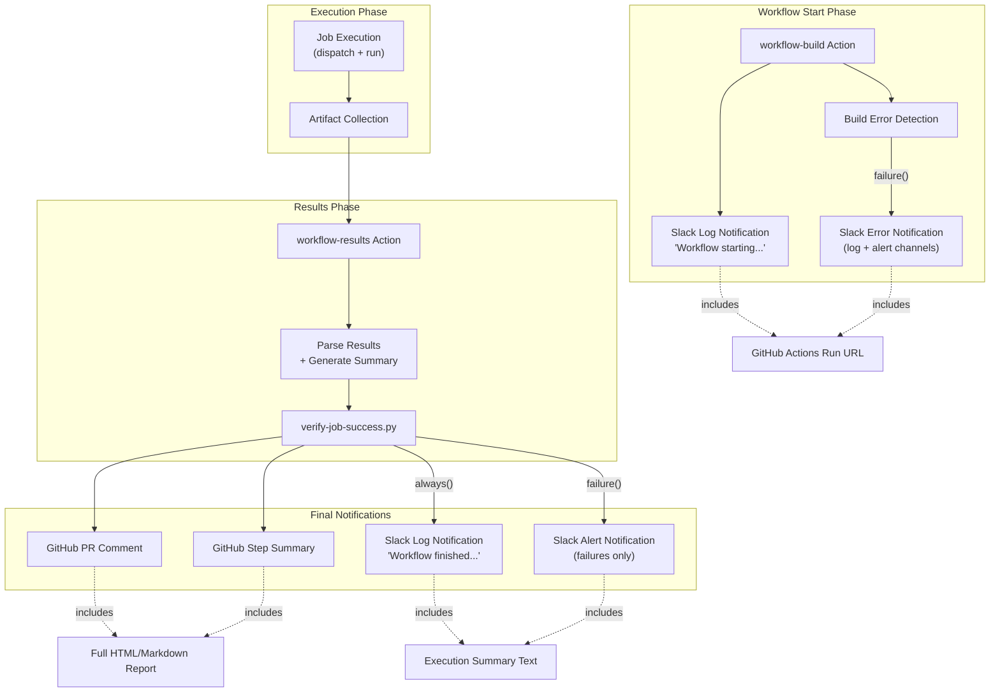
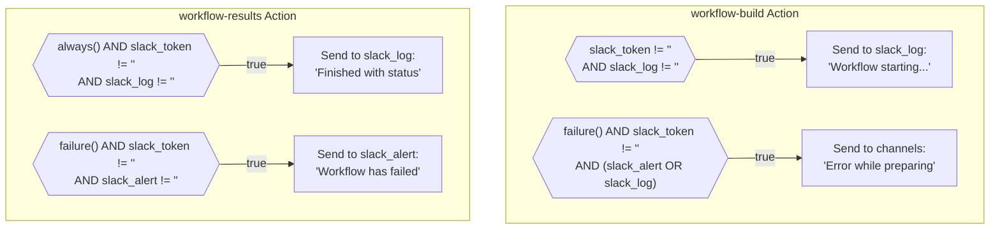
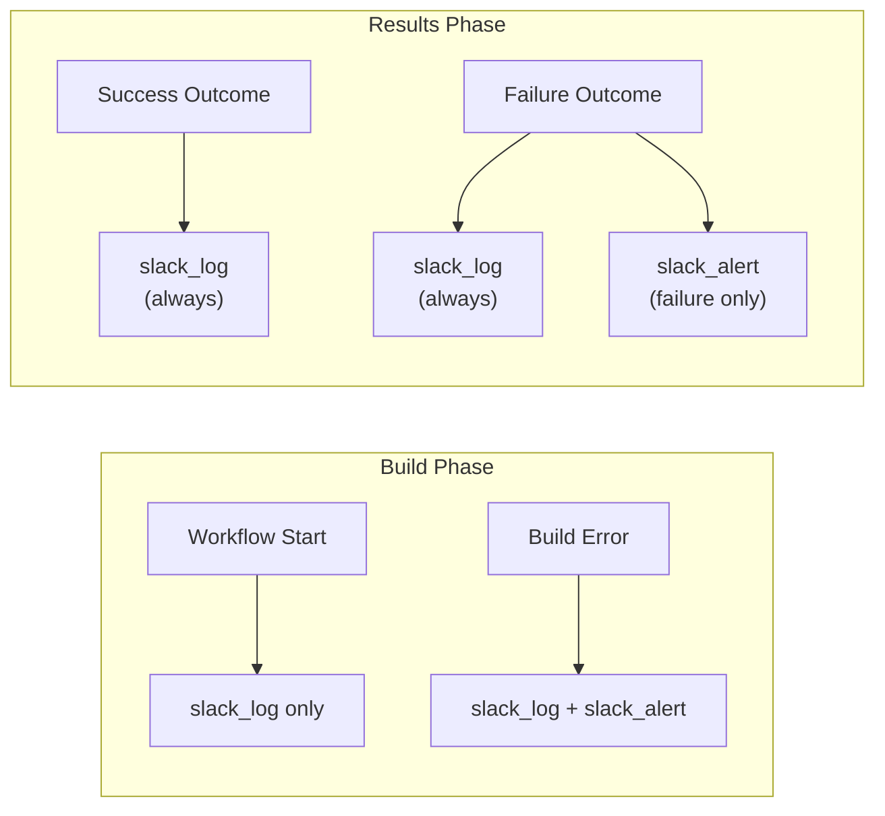
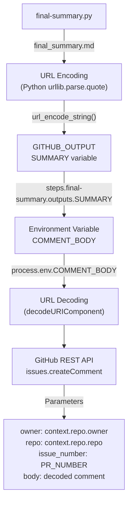
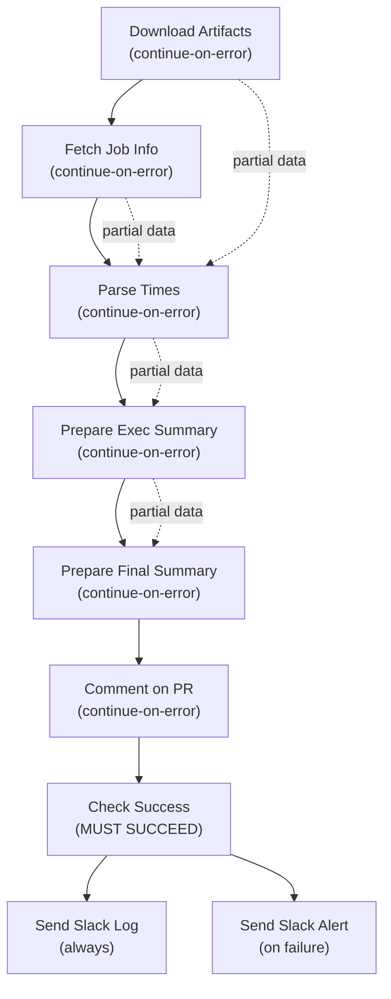

<!-- source: DeepWiki mcp.deepwiki.com · repo NVIDIA/cccl-gha · page 6.6 Notification System · fetched 2026-10-26 -->

# Notification System

<details>
<summary>Relevant source files</summary>

The following files were used as context for generating this wiki page:

- [.github/actions/workflow-build/action.yml](.github/actions/workflow-build/action.yml)
- [.github/actions/workflow-results/action.yml](.github/actions/workflow-results/action.yml)

</details>


## Purpose and Scope

This document describes the notification system that delivers workflow status and results to multiple channels: Slack (log and alert channels), GitHub Pull Request comments, and GitHub Step Summary. The system provides real-time feedback on workflow execution, allowing teams to monitor CI/CD progress and quickly respond to failures.

For details on how execution summaries and timing data are generated, see [Execution Summary Generation](#6.3) and [Final Summary and Reporting](#6.4). For artifact collection mechanics, see [Artifact Collection](#6.1).

---

## Notification Channels Overview

The system delivers notifications through three primary channels, each serving different audiences and use cases:

| Channel | Audience | Trigger | Content |
|---------|----------|---------|---------|
| **Slack Log** | Team members, CI monitors | Always sent (start and completion) | Verbose details, execution summary, job statistics |
| **Slack Alert** | On-call engineers, maintainers | Failures only | Condensed error information, execution summary |
| **GitHub PR Comment** | PR authors, reviewers | PR workflows only | Comprehensive results with collapsible sections |
| **GitHub Step Summary** | Workflow viewers | Always generated | Same as PR comment, rendered in Actions UI |

Sources: [.github/actions/workflow-build/action.yml:1-140](), [.github/actions/workflow-results/action.yml:1-213]()

---

## Notification Architecture

The following diagram shows when and where notifications are sent throughout the workflow lifecycle:

**Diagram: Notification Flow Through Workflow Phases**



Sources: [.github/actions/workflow-build/action.yml:47-139](), [.github/actions/workflow-results/action.yml:179-212]()

---

## Slack Integration

### Configuration Inputs

The Slack integration requires three inputs to function:

| Input | Purpose | Required |
|-------|---------|----------|
| `slack_token` | Bot token for authentication (`SLACK_BOT_TOKEN`) | Yes for any Slack notifications |
| `slack_log` | Channel ID for verbose notifications | Optional |
| `slack_alert` | Channel ID for critical alerts | Optional |

Both `workflow-build` and `workflow-results` actions accept these inputs identically. Notifications are skipped entirely if `slack_token` is empty.

Sources: [.github/actions/workflow-build/action.yml:28-36](), [.github/actions/workflow-results/action.yml:11-19]()

### Notification Timing and Conditions

**Diagram: Slack Notification Decision Logic**



Key behavioral notes:
- **Start notification**: Sent only to `slack_log`, only if both token and channel are provided [.github/actions/workflow-build/action.yml:47-59]()
- **Build error notification**: Sent to both `slack_log` and `slack_alert` if error occurs, channel IDs concatenated with comma separator [.github/actions/workflow-build/action.yml:126-139]()
- **Completion notification**: Always sent to `slack_log` regardless of workflow outcome [.github/actions/workflow-results/action.yml:179-195]()
- **Alert notification**: Sent only to `slack_alert` on failure [.github/actions/workflow-results/action.yml:197-212]()

Sources: [.github/actions/workflow-build/action.yml:47-139](), [.github/actions/workflow-results/action.yml:179-212]()

### Message Content and Format

The Slack messages use the `slackapi/slack-github-action@v1.26.0` action with the following structure:

**Start Notification** ([.github/actions/workflow-build/action.yml:47-59]()):
```
Workflow '[workflow_type]' starting...

Details: [github_actions_url]
```

**Error Notification** ([.github/actions/workflow-build/action.yml:126-139]()):
```
Workflow '[workflow_type]' encountered an error while preparing to run.

Details: [github_actions_url]
```

**Completion Notification** ([.github/actions/workflow-results/action.yml:179-195]()):
```
Workflow '[workflow_type]' has finished with status `[outcome]`:

[execution_summary]

Details: [github_actions_url]
```

**Alert Notification** ([.github/actions/workflow-results/action.yml:197-212]()):
```
Workflow '[workflow_type]' has failed:

[execution_summary]

Details: [github_actions_url]
```

The variables are populated from GitHub Actions context:
- `WORKFLOW_TYPE`: `${{ github.workflow }}` (e.g., "nightly", "weekly", "pr")
- `STATUS`: `${{ steps.check-success.outcome }}` ("success" or "failure")
- `EXEC_SUMMARY`: `${{ steps.final-summary.outputs.EXEC_SUMMARY }}` (from [execution/heading.txt]())
- `SUMMARY_URL`: Constructed as `https://github.com/${{github.repository}}/actions/runs/${{github.run_id}}`

Sources: [.github/actions/workflow-build/action.yml:50-59](), [.github/actions/workflow-results/action.yml:183-212]()

### Channel Selection Strategy

**Diagram: Channel Routing Logic**



The error notification in `workflow-build` uses a dynamic channel ID construction [.github/actions/workflow-build/action.yml:133-135]():
```yaml
CHANNEL_SEP: ${{ (inputs.slack_log != '' && inputs.slack_alert != '') && ',' || ''}}
# ...
channel-id: '${{ inputs.slack_log }}${{env.CHANNEL_SEP}}${{ inputs.slack_alert }}'
```

This concatenates both channels with a comma separator if both are provided, ensuring the error reaches maximum visibility.

Sources: [.github/actions/workflow-build/action.yml:133-135](), [.github/actions/workflow-results/action.yml:189-206]()

---

## GitHub PR Comments

### Comment Generation and Posting

PR comments are posted via the `actions/github-script@v7` action, which uses the GitHub REST API to create issue comments. The comment is only posted when all of the following conditions are met:

1. Workflow is not cancelled: `${{ !cancelled() }}`
2. PR number is provided: `inputs.pr_number != ''`
3. GitHub token is provided: `inputs.github_token != ''`

[.github/actions/workflow-results/action.yml:130-153]()

**Diagram: PR Comment Data Flow**



The URL encoding/decoding mechanism handles multiline strings and special characters that would otherwise break GitHub Actions output passing [.github/actions/workflow-results/action.yml:116-122]():

```yaml
url_encode_string() {
  python3 -c "import sys; from urllib.parse import quote; print(quote(sys.stdin.read()))"
}

printf "SUMMARY=%s\n" "$(cat final_summary.md | url_encode_string)" | tee -a "${GITHUB_OUTPUT}"
```

The JavaScript in the `github-script` action then decodes it [.github/actions/workflow-results/action.yml:144]():
```javascript
const commentBody = decodeURIComponent(process.env.COMMENT_BODY);
```

Sources: [.github/actions/workflow-results/action.yml:106-153]()

### Comment Content

The comment body is identical to the GitHub Step Summary content, generated by `final-summary.py`. This includes:

- Overall workflow status header
- Project-by-project results with pass/fail counts
- Collapsible sections for detailed job information
- Links to individual job logs
- Sccache statistics
- Timing information

For details on summary generation, see [Final Summary and Reporting](#6.4).

Sources: [.github/actions/workflow-results/action.yml:112-128]()

---

## GitHub Step Summary

The GitHub Step Summary is written to the special `GITHUB_STEP_SUMMARY` file, which GitHub Actions automatically renders in the workflow UI [.github/actions/workflow-results/action.yml:128]():

```bash
cp final_summary.md ${GITHUB_STEP_SUMMARY}
```

This occurs in the "Prepare final summary" step, which uses `continue-on-error: true` to ensure partial results are displayed even if summary generation encounters errors [.github/actions/workflow-results/action.yml:106-128]().

The step summary is always generated regardless of:
- Whether PR comments are enabled
- Whether Slack notifications are configured
- Workflow success or failure status

This ensures workflow viewers always have access to results directly in the Actions UI.

Sources: [.github/actions/workflow-results/action.yml:106-128]()

---

## Notification Lifecycle and Error Handling

### Resilience Strategy

The notification system employs defensive programming to maximize information delivery even when components fail:

| Step | Error Handling | Rationale |
|------|----------------|-----------|
| Download job artifacts | `continue-on-error: true` | Some jobs may fail to upload artifacts |
| Clean up job artifacts | `continue-on-error: true` | Line ending conversion may fail on some files |
| Fetch workflow job info | `continue-on-error: true` | GitHub API rate limits or timeouts |
| Parse job times | `continue-on-error: true` | Missing or malformed timing data |
| Prepare execution summary | `continue-on-error: true` | Partial artifact collection |
| Prepare final summary | `continue-on-error: true` | Missing intermediate data |
| Comment on PR | `continue-on-error: true` | API permissions or rate limits |

[.github/actions/workflow-results/action.yml:37-132]()

The only step that does NOT use `continue-on-error` is "Check for job success" [.github/actions/workflow-results/action.yml:155-177](), which determines the overall workflow outcome and must fail if jobs failed.

**Diagram: Error Handling Flow**



Sources: [.github/actions/workflow-results/action.yml:30-213]()

### Notification Ordering

Notifications are sent in this specific order:

1. **Workflow start** (Slack log) - First action in `workflow-build` [.github/actions/workflow-build/action.yml:47-59]()
2. **Build errors** (Slack log + alert) - If `workflow-build` fails [.github/actions/workflow-build/action.yml:126-139]()
3. **Job execution** - Jobs run, no notifications
4. **PR comment** - Posted after results are parsed [.github/actions/workflow-results/action.yml:130-153]()
5. **Workflow completion** (Slack log) - Always sent, uses `always()` condition [.github/actions/workflow-results/action.yml:179-195]()
6. **Workflow failure alert** (Slack alert) - Only on failure, uses `failure()` condition [.github/actions/workflow-results/action.yml:197-212]()

This ordering ensures that Slack logs receive a complete notification timeline (start → completion), while PR comments and alerts are sent only after all results are available.

Sources: [.github/actions/workflow-build/action.yml:47-139](), [.github/actions/workflow-results/action.yml:130-212]()

---

## Configuration Reference

### Required Credentials

| Credential | Source | Purpose | Scope |
|------------|--------|---------|-------|
| `SLACK_BOT_TOKEN` | Repository/Organization secret | Authenticate with Slack API | `chat:write` permission for specified channels |
| `GITHUB_TOKEN` | Built-in Actions token or PAT | Post PR comments, fetch job data | `pull-requests: write`, `actions: read` |

The GitHub token is typically provided as `${{ secrets.GITHUB_TOKEN }}`, which has appropriate permissions by default in the workflow's repository.

### Channel ID Format

Slack channel IDs are alphanumeric strings (e.g., `C01234ABCDE`), not channel names. To find a channel ID:

1. Right-click the channel in Slack
2. Select "View channel details"
3. Scroll to bottom, copy the Channel ID

Both `slack_log` and `slack_alert` can point to the same channel if desired, though this reduces alert signal-to-noise ratio.

Sources: [.github/actions/workflow-build/action.yml:28-36](), [.github/actions/workflow-results/action.yml:11-19]()

### Example Workflow Configuration

```yaml
- name: Build workflow
  uses: ./.github/actions/workflow-build
  with:
    workflows: "pull_request"
    slack_token: ${{ secrets.SLACK_BOT_TOKEN }}
    slack_log: "C01234ABCDE"  # #cccl-ci-log channel
    slack_alert: "C56789FGHIJ"  # #cccl-ci-alerts channel

# ... dispatch and execute jobs ...

- name: Collect results
  uses: ./.github/actions/workflow-results
  with:
    github_token: ${{ secrets.GITHUB_TOKEN }}
    pr_number: ${{ github.event.pull_request.number }}
    slack_token: ${{ secrets.SLACK_BOT_TOKEN }}
    slack_log: "C01234ABCDE"
    slack_alert: "C56789FGHIJ"
```

Sources: [.github/actions/workflow-build/action.yml:4-36](), [.github/actions/workflow-results/action.yml:4-19]()

---

## Integration Points

The notification system integrates with other subsystems:

- **Execution Summary Generation** ([#6.3](#6.3)): Provides the `execution/heading.txt` file used in Slack messages
- **Final Summary** ([#6.4](#6.4)): Generates `final_summary.md` used for PR comments and Step Summary
- **Success Verification** ([#6.5](#6.5)): Determines when to send alert notifications
- **Job Timing Analysis** ([#6.2](#6.2)): Provides timing data included in summaries

Sources: [.github/actions/workflow-results/action.yml:92-212]()

---

