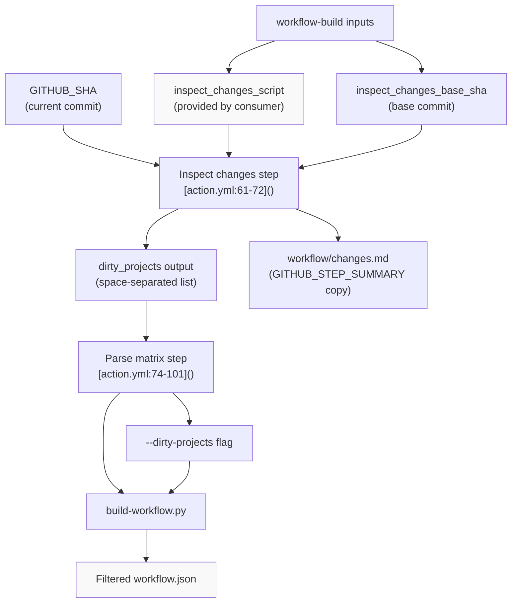
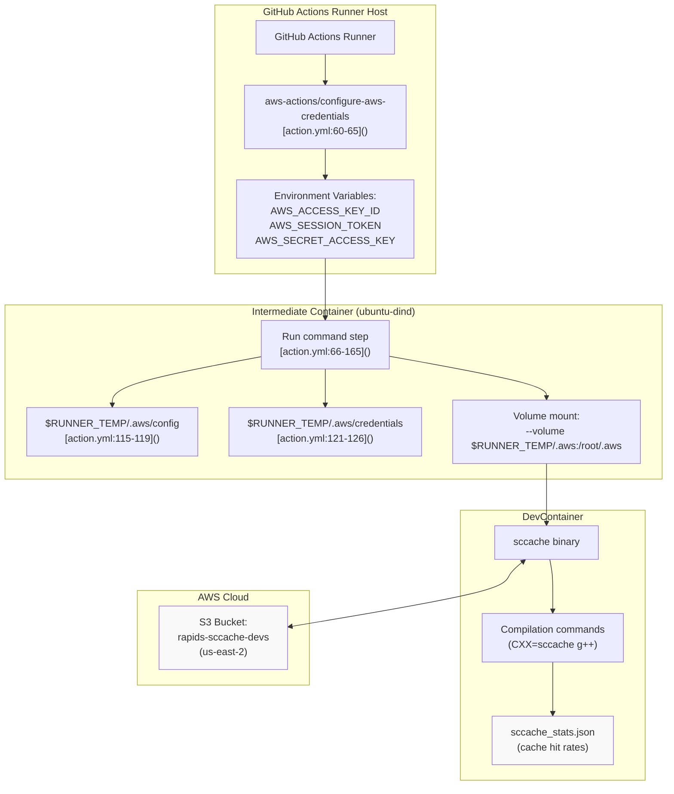
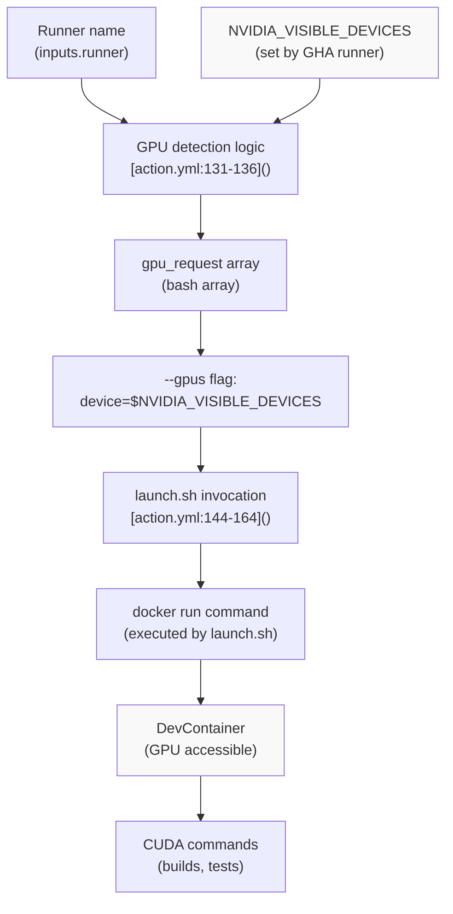
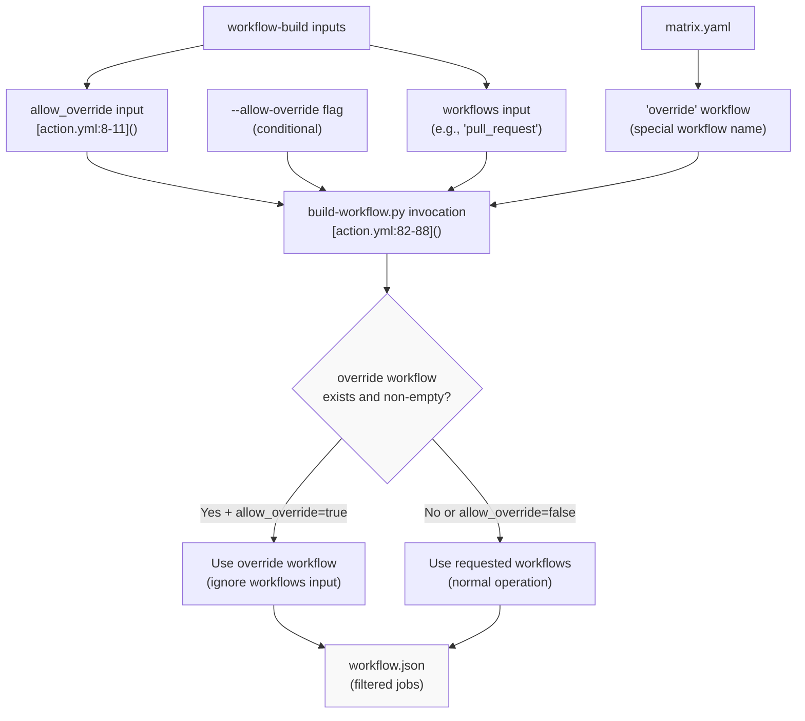

<!-- source: DeepWiki mcp.deepwiki.com · repo NVIDIA/cccl-gha · page 7 Advanced Topics · fetched 2026-10-26 -->

# Advanced Topics

<details>
<summary>Relevant source files</summary>

The following files were used as context for generating this wiki page:

- [.github/actions/workflow-build/action.yml](.github/actions/workflow-build/action.yml)
- [.github/actions/workflow-run-job-linux/action.yml](.github/actions/workflow-run-job-linux/action.yml)

</details>


This page covers specialized features and integration points designed for advanced users and system maintainers. These topics include intelligent change detection for efficient CI runs, distributed compilation caching via AWS S3, GPU resource management for CUDA workloads, and override matrix mechanisms for workflow customization.

For core workflow generation concepts, see [Workflow Generation](#3). For basic execution environment setup, see [Job Execution](#5). For results collection fundamentals, see [Results and Reporting](#6).

---

## Overview

The cccl-gha system provides four main advanced features:

| Feature | Purpose | Primary Configuration |
|---------|---------|----------------------|
| **Change Detection** | Skip unnecessary jobs when only specific files change | `inspect_changes_script` input |
| **Distributed Compilation Caching** | Accelerate builds via shared sccache on AWS S3 | AWS credentials + `.aws/config` |
| **GPU Resource Management** | Control GPU visibility and allocation for CUDA jobs | `NVIDIA_VISIBLE_DEVICES` + runner naming |
| **Override Matrix** | Replace standard workflow configurations with custom matrix | `allow_override` + override workflow in matrix.yaml |

These features operate at different phases of the workflow lifecycle: change detection occurs during configuration, GPU management during execution, sccache throughout the build process, and override matrix at the generation phase.

---

## Change Detection System

The change detection system performs git diff analysis to determine which projects need testing, allowing entire workflows to be skipped or filtered when irrelevant files change. This significantly reduces compute costs for large pull requests that only modify specific subsystems.

### Detection Workflow



**Change Detection Flow**

The detection process flows through the `workflow-build` action in two stages. First, if both `inspect_changes_script` and `inspect_changes_base_sha` inputs are provided, the script executes with the base SHA and current SHA as arguments. The script must output a `dirty_projects` variable to `GITHUB_OUTPUT` containing a space-separated list of affected projects.

Sources: [.github/actions/workflow-build/action.yml:61-72]()

### Configuration Interface

The change detection system integrates via three action inputs:

**Input: `inspect_changes_script`**
- Type: String (file path)
- Default: Empty (detection disabled)
- Example: `./ci/inspect-changes.sh`
- Purpose: Script that performs git diff analysis and identifies modified projects

**Input: `inspect_changes_base_sha`**
- Type: String (git SHA)
- Default: Empty
- Example: `${{ github.event.pull_request.base.sha }}`
- Purpose: Base commit reference for diff comparison

The script receives two positional arguments: `${base_ref} ${GITHUB_SHA}` and must produce output suitable for GitHub Actions' output mechanism.

Sources: [.github/actions/workflow-build/action.yml:12-19](), [.github/actions/workflow-build/action.yml:66-69]()

### Integration with Workflow Generation

When change detection is active, the workflow generation step receives modified flags:

```yaml
# Conditional flag generation
dirty_projects_flag: ${{ inputs.inspect_changes_script != '' && '--dirty-projects' || ''}}
dirty_projects: ${{ inputs.inspect_changes_script != '' && steps.inspect-changes.outputs.dirty_projects || ''}}

# build-workflow.py invocation with optional filtering
${{ env.matrix_parser }} ${{ inputs.matrix_file }}
    --workflows ${{ inputs.workflows }}
    ${{ env.dirty_projects_flag }} ${{ env.dirty_projects }}
```

The `--dirty-projects` flag passes the space-separated project list to `build-workflow.py`, which filters the matrix to include only jobs associated with modified projects. If no relevant projects changed, the generated workflow may be empty, avoiding all job execution.

Sources: [.github/actions/workflow-build/action.yml:79-88]()

### Artifacts and Summaries

The inspect changes step creates two outputs:

1. **`dirty_projects` output variable**: Space-separated list consumed by workflow generation
2. **`workflow/changes.md`**: Copy of `GITHUB_STEP_SUMMARY` for archival

The changes summary is uploaded as part of the workflow artifact bundle, providing a historical record of which files triggered testing.

Sources: [.github/actions/workflow-build/action.yml:70-72]()

---

## Distributed Compilation Caching

The system integrates Mozilla's `sccache` tool with AWS S3 to provide shared compilation caching across all CI jobs. This dramatically reduces build times for incremental changes by reusing compilation artifacts from previous runs and parallel jobs.

### AWS S3 Integration Architecture



**Sccache AWS S3 Integration Flow**

The integration uses AWS OIDC authentication to obtain temporary credentials without storing secrets in the repository. The credentials propagate through three layers: GitHub Actions environment variables, intermediate container files, and finally into the devcontainer via volume mounts.

Sources: [.github/actions/workflow-run-job-linux/action.yml:60-65](), [.github/actions/workflow-run-job-linux/action.yml:113-129](), [.github/actions/workflow-run-job-linux/action.yml:162]()

### AWS Credential Configuration

The credential acquisition and propagation occurs in three steps:

**Step 1: OIDC Authentication**

The `aws-actions/configure-aws-credentials@v4` action uses GitHub's OIDC provider to assume an AWS IAM role without requiring long-lived credentials:

```yaml
- name: Get AWS credentials for sccache bucket
  uses: aws-actions/configure-aws-credentials@v4
  with:
    role-to-assume: arn:aws:iam::279114543810:role/gha-oidc-NVIDIA
    aws-region: us-east-2
    role-duration-seconds: 43200 # 12 hours
```

This action sets three environment variables: `AWS_ACCESS_KEY_ID`, `AWS_SESSION_TOKEN`, and `AWS_SECRET_ACCESS_KEY`. The 12-hour duration ensures credentials remain valid for long-running nightly builds.

Sources: [.github/actions/workflow-run-job-linux/action.yml:60-65]()

**Step 2: Environment Variable Capture**

The Run command step explicitly captures these credentials as environment variables to pass them into the intermediate container:

```yaml
env:
  AWS_ACCESS_KEY_ID: "${{env.AWS_ACCESS_KEY_ID}}"
  AWS_SESSION_TOKEN: "${{env.AWS_SESSION_TOKEN}}"
  AWS_SECRET_ACCESS_KEY: "${{env.AWS_SECRET_ACCESS_KEY}}"
```

This explicit capture is necessary because the intermediate container doesn't automatically inherit the runner's environment.

Sources: [.github/actions/workflow-run-job-linux/action.yml:74-76]()

**Step 3: Configuration File Generation**

The intermediate container creates AWS configuration files in the runner's temporary directory:

```bash
# Create config file
cat <<EOF > "$RUNNER_TEMP/.aws/config"
[default]
bucket=rapids-sccache-devs
region=us-east-2
EOF

# Create credentials file
cat <<EOF > "$RUNNER_TEMP/.aws/credentials"
[default]
aws_access_key_id=$AWS_ACCESS_KEY_ID
aws_session_token=$AWS_SESSION_TOKEN
aws_secret_access_key=$AWS_SECRET_ACCESS_KEY
EOF

# Set permissions
chmod 0600 "$RUNNER_TEMP/.aws/credentials"
chmod 0664 "$RUNNER_TEMP/.aws/config"
```

These files are then mounted into the devcontainer at `/root/.aws`, making them available to the `sccache` binary.

Sources: [.github/actions/workflow-run-job-linux/action.yml:113-129]()

### S3 Bucket Configuration

The S3 bucket `rapids-sccache-devs` is configured in the AWS config file and located in the `us-east-2` region. The bucket name appears in the config file's `[default]` section, where sccache automatically reads it.

Sccache uses this configuration to:
1. Check for cached compilation results before compiling
2. Upload new compilation results after successful compilation
3. Share artifacts across all CI jobs and developers

The shared cache provides significant speedups for:
- Template instantiation caching (C++ templates)
- Incremental builds after small changes
- Parallel job execution with overlapping compilation units

Sources: [.github/actions/workflow-run-job-linux/action.yml:115-119]()

### Statistics Collection

After job completion, sccache statistics are collected and uploaded as artifacts:

```bash
find_and_copy "sccache_stats.json" || :
```

The `sccache_stats.json` file contains cache hit rates, miss rates, compilation counts, and error information. These statistics are later aggregated by the results system to provide project-wide cache performance metrics.

Sources: [.github/actions/workflow-run-job-linux/action.yml:186]()

### Volume Mount Path Translation

A critical implementation detail: the AWS credentials directory is mounted using the `host_path()` function to translate container paths to host paths:

```bash
host_path() {
  sed "s@/__w@$(dirname "$(dirname "${{github.workspace}}")")@" <<< "$1"
}

# Mount AWS credentials
--volume "$(host_path "$RUNNER_TEMP")/.aws:/root/.aws"
```

This translation is necessary because the Docker CLI runs inside the intermediate container but launches containers on the host's Docker daemon. Volume mounts must reference paths as they exist on the host, not as seen by the intermediate container.

Sources: [.github/actions/workflow-run-job-linux/action.yml:138-140](), [.github/actions/workflow-run-job-linux/action.yml:162]()

---

## GPU Resource Management

The system provides sophisticated GPU resource management for CUDA workloads, including GPU detection, explicit device selection, and container-level GPU isolation. This ensures jobs on multi-GPU runners only access their allocated GPU device.

### GPU Detection and Allocation Flow



**GPU Resource Management Flow**

GPU allocation occurs through a combination of GitHub Actions runner naming conventions, environment variable detection, and Docker runtime GPU flags. The system automatically detects GPU availability and passes appropriate flags to the Docker daemon.

Sources: [.github/actions/workflow-run-job-linux/action.yml:131-136]()

### Runner-Based GPU Detection

The GPU detection logic uses runner name pattern matching to determine if GPU access should be requested:

```bash
declare -a gpu_request=()

# Explicitly pass which GPU to use if on a GPU runner
if [[ "${RUNNER}" = *"-gpu-"* ]]; then
  gpu_request+=(--gpus "device=${NVIDIA_VISIBLE_DEVICES}")
fi
```

This logic assumes GPU-enabled runners follow a naming convention that includes the substring `-gpu-`. When detected, the script constructs a `--gpus` flag that will be passed to Docker.

The `NVIDIA_VISIBLE_DEVICES` environment variable is set by the GitHub Actions runner infrastructure and contains a comma-separated list of GPU device IDs (e.g., `0`, `1,2`, or `GPU-<uuid>`). By passing this directly to Docker's `--gpus device=` parameter, the system ensures containers only see the specific GPU(s) allocated to the job.

Sources: [.github/actions/workflow-run-job-linux/action.yml:131-136]()

### Docker Runtime Integration

The GPU request array is passed to `launch.sh` using bash array expansion:

```bash
${{github.event.repository.name}}/.devcontainer/launch.sh \
  --docker \
  --cuda ${{inputs.cuda}} \
  --host ${{inputs.host}} \
  "${gpu_request[@]}" \
  --env "CI=$CI" \
  # ... additional flags
```

The `"${gpu_request[@]}"` expansion inserts the GPU flags into the argument list. If no GPU is detected, the array is empty and no flags are added. If a GPU is detected, the array contains `--gpus "device=${NVIDIA_VISIBLE_DEVICES}"`.

The `launch.sh` script forwards these flags to the underlying `docker run` command, which communicates with the NVIDIA Container Runtime to provide GPU access inside the devcontainer.

Sources: [.github/actions/workflow-run-job-linux/action.yml:144-164]()

### NVIDIA Container Runtime Requirements

The GPU integration depends on the host runner having:

1. **NVIDIA GPU drivers** installed on the host
2. **NVIDIA Container Runtime** (`nvidia-docker2`) installed
3. **Docker daemon configuration** that includes the NVIDIA runtime

The GitHub Actions runner environment provides these prerequisites for runners with names containing `-gpu-`. The container sees the GPU as if it were directly attached to the system, allowing full CUDA functionality including compilation, profiling, and execution.

### Multi-GPU Isolation

For runners with multiple GPUs, the `NVIDIA_VISIBLE_DEVICES` environment variable provides job-level isolation. GitHub Actions may schedule multiple concurrent jobs on the same multi-GPU runner, with each job seeing only its allocated GPU(s). This prevents resource contention and ensures reproducible performance.

Example scenarios:

| Runner GPUs | `NVIDIA_VISIBLE_DEVICES` | Container GPU View |
|-------------|--------------------------|-------------------|
| Single GPU (ID 0) | `0` | Single GPU at index 0 |
| Two GPUs, job 1 | `0` | Single GPU at index 0 |
| Two GPUs, job 2 | `1` | Single GPU at index 0 (remapped) |
| All GPUs | `0,1,2,3` | Four GPUs at indices 0-3 |

The NVIDIA Container Runtime automatically remaps device indices inside the container, so a container with `device=1` sees that GPU as index 0 from the container's perspective.

---

## Override Matrix Mechanism

The override matrix mechanism allows the requested workflows to be completely replaced when a non-empty `override` workflow exists in the matrix file. This enables testing custom configurations without modifying the standard workflow definitions.

### Override Decision Flow



**Override Matrix Decision Flow**

The override mechanism operates at the workflow generation phase, before any jobs are dispatched. When enabled, it checks for a special `override` workflow definition in the matrix file and uses it instead of the requested workflows.

Sources: [.github/actions/workflow-build/action.yml:8-11](), [.github/actions/workflow-build/action.yml:78]()

### Configuration Interface

The override system is controlled by a single action input:

**Input: `allow_override`**
- Type: String (boolean)
- Default: `"false"`
- Values: `"true"` or `"false"` (string literals)
- Purpose: Enable override matrix substitution

When set to `"true"`, the input is converted to the `--allow-override` flag for `build-workflow.py`:

```yaml
env:
  allow_override: ${{ inputs.allow_override == 'true' && '--allow-override' || ''}}
```

This conditional expression produces either `--allow-override` (if true) or an empty string (if false or unset).

Sources: [.github/actions/workflow-build/action.yml:78]()

### Build Workflow Invocation

The override flag is passed to the workflow generation script:

```bash
${{ env.matrix_parser }} ${{ inputs.matrix_file }} \
    --workflows ${{ inputs.workflows }} \
    ${{ env.allow_override }} \
    ${{ env.dirty_projects_flag }} ${{ env.dirty_projects }}
```

When `build-workflow.py` receives the `--allow-override` flag, it checks if a workflow named `override` exists in the matrix file and contains at least one job. If so, it ignores the `--workflows` argument and uses the override workflow instead.

This mechanism is particularly useful for:
- **Testing experimental configurations** without affecting standard CI
- **Debugging workflow generation** with minimal job sets
- **Running custom test matrices** in pull requests
- **Temporary workflow modifications** without changing workflow files

Sources: [.github/actions/workflow-build/action.yml:85-88]()

### Matrix File Structure

The override workflow is defined in `matrix.yaml` like any other workflow:

```yaml
workflows:
  pull_request:
    # ... standard PR jobs
  
  nightly:
    # ... nightly jobs
  
  override:
    # Custom jobs that replace requested workflows when allow_override=true
    - {project: 'libcudacxx', std: 17, ctk: '12.0', cxx: 'gcc12'}
```

If the `override` workflow is empty or absent, the system behaves normally and uses the requested workflows. This allows the override workflow to be committed to the repository without affecting standard CI operation unless explicitly enabled.

### Use Cases and Patterns

Common override patterns include:

**Minimal Test Set**: Quickly validate workflow generation changes with a single job
```yaml
override:
  - {project: 'libcudacxx', std: 17, ctk: '12.0', cxx: 'gcc12'}
```

**Specific Configuration Debugging**: Test a problematic compiler/CUDA combination in isolation
```yaml
override:
  - {project: 'thrust', std: 20, ctk: '11.8', cxx: 'clang16', gpu: 'v100'}
```

**Cross-Project Testing**: Validate changes across multiple projects with minimal configurations
```yaml
override:
  - {project: 'libcudacxx', std: 17, ctk: '12.0', cxx: 'gcc12'}
  - {project: 'cub', std: 17, ctk: '12.0', cxx: 'gcc12'}
  - {project: 'thrust', std: 17, ctk: '12.0', cxx: 'gcc12'}
```

The override workflow respects all standard matrix processing: tag expansion, canonicalization, exclusions, and two-stage job handling. It simply replaces the input workflow selection step.

---

## Summary of Advanced Features

| Feature | Trigger | Configuration Location | Output Impact |
|---------|---------|------------------------|---------------|
| Change Detection | PR file changes | `inspect_changes_script` input | Filters workflow.json by dirty_projects |
| Sccache Integration | Every job | AWS OIDC + `.aws/config` | Generates sccache_stats.json artifacts |
| GPU Management | Runner name pattern | Automatic via `-gpu-` runners | Adds --gpus flag to Docker invocation |
| Override Matrix | Explicit flag | `allow_override` input + matrix.yaml | Replaces requested workflows entirely |

These advanced features operate independently and can be combined. For example, a workflow can simultaneously use change detection to filter jobs, sccache for faster builds, GPU management for CUDA testing, and override matrix for custom configurations.

For implementation details of change detection filtering, see [Exclusions and Filtering](#2.3). For sccache statistics collection in results processing, see [Execution Summary Generation](#6.3). For GPU runner configuration and devcontainer integration, see [Linux Execution Environment](#5.1).

---

