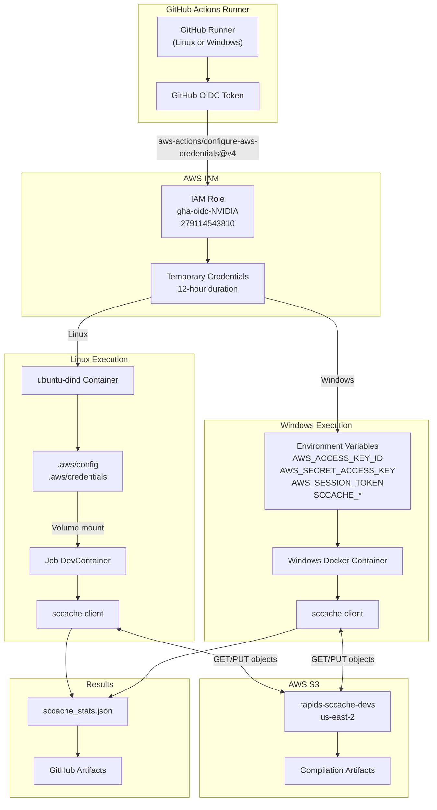
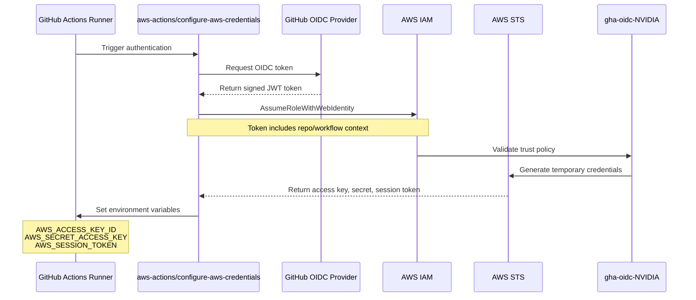

<!-- source: DeepWiki mcp.deepwiki.com · repo NVIDIA/cccl-gha · page 7.2 Distributed Compilation Caching · fetched 2026-10-26 -->

# Distributed Compilation Caching

<details>
<summary>Relevant source files</summary>

The following files were used as context for generating this wiki page:

- [.github/actions/workflow-run-job-linux/action.yml](.github/actions/workflow-run-job-linux/action.yml)
- [.github/actions/workflow-run-job-windows/action.yml](.github/actions/workflow-run-job-windows/action.yml)
- [.github/workflows/verify-devcontainers.yml](.github/workflows/verify-devcontainers.yml)

</details>


This document explains the integration of sccache (shared compilation cache) with AWS S3 for distributed compilation caching across GitHub Actions runners. It covers S3 bucket configuration, OIDC-based credential management, platform-specific integration strategies for Linux and Windows execution environments, and statistics collection.

For information about how jobs are executed in containers, see [Job Execution](#5). For details on artifact collection and reporting, see [Artifact Collection](#6.1).

## Overview

The cccl-gha system uses [sccache](https://github.com/mozilla/sccache) to cache compilation artifacts in AWS S3, significantly reducing build times by reusing previously compiled object files across workflow runs and different jobs. When a compiler invocation occurs, sccache checks if the same input has been compiled before; if so, it retrieves the cached result from S3 instead of recompiling.

The system implements different credential management strategies for Linux and Windows runners to provide seamless access to the shared S3 bucket while maintaining security through short-lived OIDC tokens.

**Key Components:**
- **S3 Bucket**: `rapids-sccache-devs` in `us-east-2` region
- **IAM Role**: `arn:aws:iam::279114543810:role/gha-oidc-NVIDIA`
- **Authentication**: GitHub OIDC-based temporary credentials (12-hour duration)
- **Statistics**: `sccache_stats.json` collected per job

## System Architecture



**Sources:** [.github/actions/workflow-run-job-linux/action.yml:60-162](), [.github/actions/workflow-run-job-windows/action.yml:20-64]()

## AWS S3 Configuration

The system uses a dedicated S3 bucket for caching compilation artifacts across all CCCL builds.

**Configuration Details:**

| Parameter | Value | Purpose |
|-----------|-------|---------|
| Bucket Name | `rapids-sccache-devs` | Shared cache storage |
| Region | `us-east-2` | AWS region (US East - Ohio) |
| IAM Role | `arn:aws:iam::279114543810:role/gha-oidc-NVIDIA` | OIDC-based authentication |
| Session Duration | 43200 seconds (12 hours) | Maximum job runtime allowance |
| SSL | Enabled | Secure data transfer |

The bucket is configured in AWS credential files (Linux) or environment variables (Windows) depending on the execution platform.

**Sources:** [.github/actions/workflow-run-job-linux/action.yml:115-119](), [.github/actions/workflow-run-job-windows/action.yml:21-22]()

## Credential Management

### OIDC Authentication Flow



**Sources:** [.github/actions/workflow-run-job-linux/action.yml:60-65](), [.github/actions/workflow-run-job-windows/action.yml:26-31]()

### IAM Role Configuration

The `aws-actions/configure-aws-credentials@v4` action is invoked at the beginning of each job execution to obtain temporary AWS credentials:

[.github/actions/workflow-run-job-linux/action.yml:60-65]()
```
- name: Get AWS credentials for sccache bucket
  uses: aws-actions/configure-aws-credentials@v4
  with:
    role-to-assume: arn:aws:iam::279114543810:role/gha-oidc-NVIDIA
    aws-region: us-east-2
    role-duration-seconds: 43200 # 12 hours
```

The action sets the following environment variables that are subsequently used by sccache:
- `AWS_ACCESS_KEY_ID`: Temporary access key
- `AWS_SECRET_ACCESS_KEY`: Temporary secret key  
- `AWS_SESSION_TOKEN`: Session token for temporary credentials

**Sources:** [.github/actions/workflow-run-job-linux/action.yml:60-65](), [.github/actions/workflow-run-job-windows/action.yml:26-31]()

## Linux Credential Integration

On Linux, credentials are provided to devcontainers through AWS credential files mounted as volumes. This approach allows the sccache client inside containers to authenticate without requiring environment variable propagation.

### Credential File Generation

The workflow generates standard AWS credential files in the runner's temporary directory:

[.github/actions/workflow-run-job-linux/action.yml:113-129]()
```bash
mkdir "$RUNNER_TEMP/.aws";

cat <<EOF > "$RUNNER_TEMP/.aws/config"
[default]
bucket=rapids-sccache-devs
region=us-east-2
EOF

cat <<EOF > "$RUNNER_TEMP/.aws/credentials"
[default]
aws_access_key_id=$AWS_ACCESS_KEY_ID
aws_session_token=$AWS_SESSION_TOKEN
aws_secret_access_key=$AWS_SECRET_ACCESS_KEY
EOF

chmod 0600 "$RUNNER_TEMP/.aws/credentials"
chmod 0664 "$RUNNER_TEMP/.aws/config"
```

### Volume Mounting Strategy

The `.aws` directory is mounted into the devcontainer at `/root/.aws`, making credentials available to sccache:

[.github/actions/workflow-run-job-linux/action.yml:162]()
```bash
--volume "$(host_path "$RUNNER_TEMP")/.aws:/root/.aws"
```

The `host_path` function transforms container paths to host paths, necessary for the Docker-outside-of-Docker (DOOD) architecture:

[.github/actions/workflow-run-job-linux/action.yml:138-140]()
```bash
host_path() {
  sed "s@/__w@$(dirname "$(dirname "${{github.workspace}}")")@" <<< "$1"
}
```

**Sources:** [.github/actions/workflow-run-job-linux/action.yml:113-162]()

## Windows Credential Integration

On Windows, credentials are propagated as environment variables directly into the Docker container, as Windows Docker does not support the same volume mounting patterns as Linux.

### Environment Variable Configuration

Prior to credential acquisition, sccache-specific environment variables are configured:

[.github/actions/workflow-run-job-windows/action.yml:18-25]()
```bash
echo "SCCACHE_BUCKET=rapids-sccache-devs" | tee -a "${GITHUB_ENV}"
echo "SCCACHE_REGION=us-east-2" | tee -a "${GITHUB_ENV}"
echo "SCCACHE_IDLE_TIMEOUT=0" | tee -a "${GITHUB_ENV}"
echo "SCCACHE_S3_USE_SSL=true" | tee -a "${GITHUB_ENV}"
echo "SCCACHE_S3_NO_CREDENTIALS=false" | tee -a "${GITHUB_ENV}"
```

### Container Environment Propagation

AWS credentials and sccache configuration are injected into the container environment using PowerShell's `SetEnvironmentVariable`:

[.github/actions/workflow-run-job-windows/action.yml:54-64]()
```powershell
powershell -c "
  [System.Environment]::SetEnvironmentVariable('AWS_ACCESS_KEY_ID','${{env.AWS_ACCESS_KEY_ID}}');
  [System.Environment]::SetEnvironmentVariable('AWS_SECRET_ACCESS_KEY','${{env.AWS_SECRET_ACCESS_KEY}}');
  [System.Environment]::SetEnvironmentVariable('AWS_SESSION_TOKEN','${{env.AWS_SESSION_TOKEN }}');
  [System.Environment]::SetEnvironmentVariable('SCCACHE_BUCKET','${{env.SCCACHE_BUCKET}}');
  [System.Environment]::SetEnvironmentVariable('SCCACHE_REGION','${{env.SCCACHE_REGION}}');
  [System.Environment]::SetEnvironmentVariable('SCCACHE_IDLE_TIMEOUT','${{env.SCCACHE_IDLE_TIMEOUT}}');
  [System.Environment]::SetEnvironmentVariable('SCCACHE_S3_USE_SSL','${{env.SCCACHE_S3_USE_SSL}}');
  [System.Environment]::SetEnvironmentVariable('SCCACHE_S3_NO_CREDENTIALS','${{env.SCCACHE_S3_NO_CREDENTIALS}}');
  ...
"
```

**Sources:** [.github/actions/workflow-run-job-windows/action.yml:18-64]()

## Statistics Collection

After job execution, sccache statistics are collected as artifacts for analysis and reporting. The statistics file provides cache hit rates, data transfer metrics, and compilation counts.

### Artifact Collection Process

Both Linux and Windows execution workflows search for `sccache_stats.json` in the repository directory after command completion:

[.github/actions/workflow-run-job-linux/action.yml:186]()
```bash
find_and_copy "sccache_stats.json" || :
```

[.github/actions/workflow-run-job-windows/action.yml:87]()
```bash
find_and_copy "sccache_stats.json" || true # Ignore failures
```

The `find_and_copy` function locates the statistics file and copies it to the job results directory:

[.github/actions/workflow-run-job-linux/action.yml:176-184]()
```bash
find_and_copy() {
  filename="$1"
  filepath="$(find ${{github.event.repository.name}} -name "${filename}" -print -quit)"
  if [[ -z "$filepath" ]]; then
    echo "${filename} does not exist in repo directory."
    return 1
  fi
  cp -v "$filepath" "$result_dir"
}
```

### Artifact Structure

Statistics are uploaded with job-specific artifact names:

[.github/actions/workflow-run-job-linux/action.yml:195-200]()
```yaml
- name: Upload job artifacts
  uses: actions/upload-artifact@v4
  with:
    name: jobs-${{inputs.id}}
    path: jobs
    compression-level: 0
```

The uploaded artifact contains:
- `jobs/<job-id>/success`: Success marker file
- `jobs/<job-id>/sccache_stats.json`: Cache statistics (if generated)
- `jobs/<job-id>/cccl_meta_bench.csv`: Benchmark data (if generated)
- Additional benchmark files

**Sources:** [.github/actions/workflow-run-job-linux/action.yml:166-200](), [.github/actions/workflow-run-job-windows/action.yml:65-98]()

## DevContainer Verification

The `verify-devcontainers` workflow also configures sccache credentials to ensure devcontainers can build without hanging on authentication prompts.

[.github/workflows/verify-devcontainers.yml:116-128]()
```yaml
- name: Get AWS credentials for sccache bucket
  uses: aws-actions/configure-aws-credentials@v4
  with:
    role-to-assume: arn:aws:iam::279114543810:role/gha-oidc-NVIDIA
    aws-region: us-east-2
    role-duration-seconds: 43200 # 12 hours
- name: Set environment variables
  run: |
    echo "SCCACHE_BUCKET=rapids-sccache-devs" >> $GITHUB_ENV
    echo "SCCACHE_REGION=us-east-2" >> $GITHUB_ENV
    echo "SCCACHE_IDLE_TIMEOUT=32768" >> $GITHUB_ENV
    echo "SCCACHE_S3_USE_SSL=true" >> $GITHUB_ENV
    echo "SCCACHE_S3_NO_CREDENTIALS=false" >> $GITHUB_ENV
```

Credentials are then passed to the `devcontainers/ci@v0.3` action:

[.github/workflows/verify-devcontainers.yml:135-139]()
```yaml
env: |
  SCCACHE_REGION=${{ env.SCCACHE_REGION }}
  AWS_ACCESS_KEY_ID=${{ env.AWS_ACCESS_KEY_ID }}
  AWS_SESSION_TOKEN=${{ env.AWS_SESSION_TOKEN }}
  AWS_SECRET_ACCESS_KEY=${{ env.AWS_SECRET_ACCESS_KEY }}
```

**Sources:** [.github/workflows/verify-devcontainers.yml:116-139]()

## Environment Variables Reference

The following table documents all environment variables related to sccache and AWS credentials:

| Variable | Platform | Value/Source | Purpose |
|----------|----------|--------------|---------|
| `AWS_ACCESS_KEY_ID` | Both | Set by `configure-aws-credentials` | Temporary access key for S3 |
| `AWS_SECRET_ACCESS_KEY` | Both | Set by `configure-aws-credentials` | Temporary secret key for S3 |
| `AWS_SESSION_TOKEN` | Both | Set by `configure-aws-credentials` | Session token for temporary credentials |
| `SCCACHE_BUCKET` | Windows | `rapids-sccache-devs` | S3 bucket name |
| `SCCACHE_REGION` | Windows | `us-east-2` | AWS region |
| `SCCACHE_IDLE_TIMEOUT` | Windows | `0` | Idle timeout (0 = infinite) |
| `SCCACHE_S3_USE_SSL` | Windows | `true` | Enable SSL/TLS for S3 |
| `SCCACHE_S3_NO_CREDENTIALS` | Windows | `false` | Use AWS credentials (not anonymous) |

### Platform Differences

**Linux:**
- Credentials stored in `$RUNNER_TEMP/.aws/credentials` and `$RUNNER_TEMP/.aws/config`
- Files mounted into container at `/root/.aws/`
- Bucket and region configured in `.aws/config`
- sccache reads credentials from standard AWS credential chain

**Windows:**
- All credentials passed as environment variables
- No credential files created
- Environment variables set directly in Docker container
- sccache reads credentials from environment

**Sources:** [.github/actions/workflow-run-job-linux/action.yml:74-76,113-129](), [.github/actions/workflow-run-job-windows/action.yml:20-25,55-62]()

## Integration Flow

```mermaid
graph LR
    subgraph "Job Initialization"
        A["Workflow starts"]
        B["configure-aws-credentials"]
        C["Set AWS env vars"]
    end
    
    subgraph "Credential Setup"
        D1["Linux: Create .aws files"]
        D2["Windows: Set SCCACHE_* env"]
    end
    
    subgraph "Container Launch"
        E1["Linux: Mount .aws volume"]
        E2["Windows: Pass env vars"]
        F["DevContainer starts"]
    end
    
    subgraph "Compilation"
        G["sccache initialized"]
        H["Compiler invoked"]
        I["Cache check"]
        J1["Cache hit: Download"]
        J2["Cache miss: Compile + Upload"]
    end
    
    subgraph "Artifact Collection"
        K["Generate sccache_stats.json"]
        L["find_and_copy"]
        M["Upload to GitHub Artifacts"]
    end
    
    A --> B
    B --> C
    C --> D1
    C --> D2
    D1 --> E1
    D2 --> E2
    E1 --> F
    E2 --> F
    F --> G
    G --> H
    H --> I
    I --> J1
    I --> J2
    J1 --> K
    J2 --> K
    K --> L
    L --> M
```



**Sources:** [.github/actions/workflow-run-job-linux/action.yml:60-200](), [.github/actions/workflow-run-job-windows/action.yml:18-98]()

---

