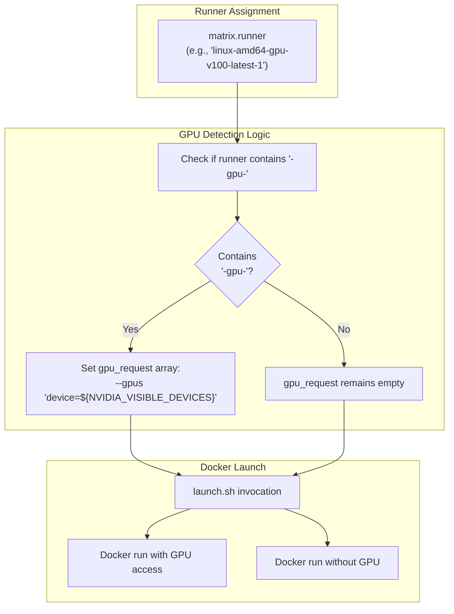
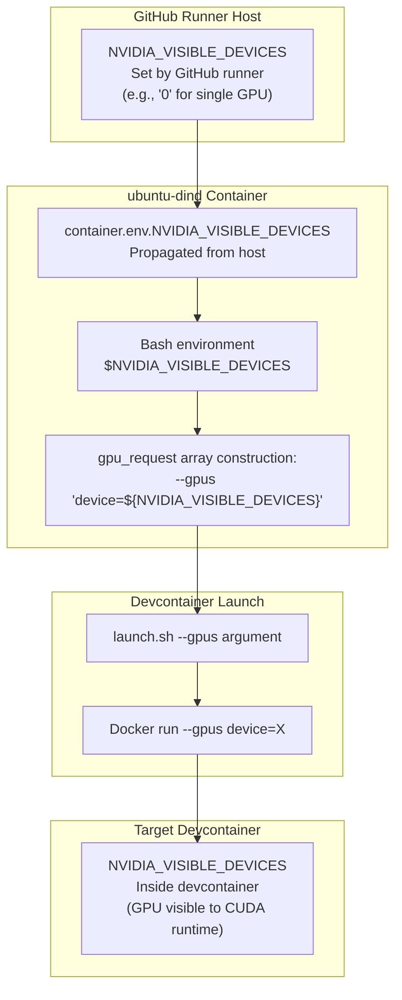
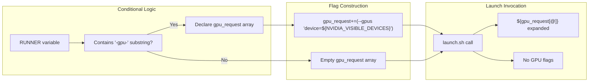
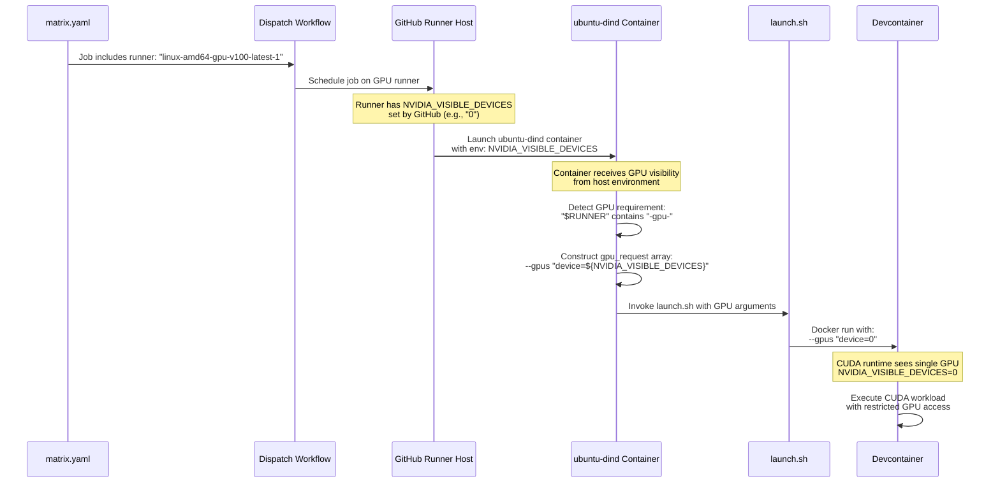
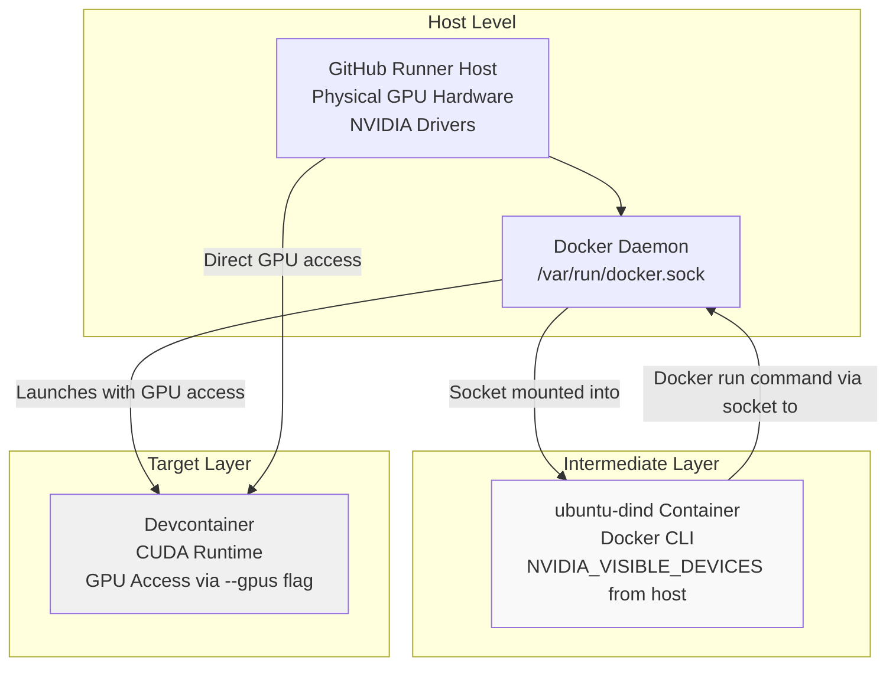

<!-- source: DeepWiki mcp.deepwiki.com · repo NVIDIA/cccl-gha · page 7.3 GPU Resource Management · fetched 2026-10-26 -->

# GPU Resource Management

<details>
<summary>Relevant source files</summary>

The following files were used as context for generating this wiki page:

- [.github/actions/workflow-run-job-linux/action.yml](.github/actions/workflow-run-job-linux/action.yml)
- [.github/workflows/workflow-dispatch-standalone-group-linux.yml](.github/workflows/workflow-dispatch-standalone-group-linux.yml)

</details>


## Purpose and Scope

This document describes how the cccl-gha system detects, allocates, and manages NVIDIA GPU resources for CUDA workloads. It covers GPU detection logic, the `NVIDIA_VISIBLE_DEVICES` environment variable propagation, and Docker GPU access configuration through the container execution layers.

For general Linux job execution architecture, see [Linux Execution Environment](#5.1). For environment variable setup and configuration, see [Environment Setup](#5.4).

---

## GPU Detection and Allocation

The system automatically detects whether a job requires GPU access by examining the runner identifier string. Jobs scheduled on runners with names containing the substring `"-gpu-"` are identified as GPU-enabled jobs and receive appropriate GPU resource configuration.

### Runner-Based GPU Detection

The GPU detection logic occurs in the command execution step:



**Sources:** [.github/actions/workflow-run-job-linux/action.yml:131-148]()

The detection implementation:

| Component | Implementation | Location |
|-----------|----------------|----------|
| **Detection Pattern** | String match: `[[ "${RUNNER}" = *"-gpu-"* ]]` | [action.yml:134]() |
| **GPU Request Array** | `gpu_request+=(--gpus "device=${NVIDIA_VISIBLE_DEVICES}")` | [action.yml:135]() |
| **Launch Integration** | `"${gpu_request[@]}"` in launch.sh call | [action.yml:148]() |

---

## NVIDIA_VISIBLE_DEVICES Environment Variable

The `NVIDIA_VISIBLE_DEVICES` environment variable controls which GPU devices are visible to containerized processes. This variable originates at the GitHub Actions runner host level and must propagate through multiple container layers to reach the final devcontainer execution environment.

### Variable Propagation Architecture



**Sources:** [.github/workflows/workflow-dispatch-standalone-group-linux.yml:28-29](), [.github/actions/workflow-run-job-linux/action.yml:134-136]()

### Propagation Mechanism

The variable propagates through three distinct layers:

1. **Runner Host → ubuntu-dind Container**
   - Configured in workflow YAML: `container.env.NVIDIA_VISIBLE_DEVICES: ${{env.NVIDIA_VISIBLE_DEVICES}}`
   - Location: [.github/workflows/workflow-dispatch-standalone-group-linux.yml:28-29]()

2. **ubuntu-dind Container → Docker CLI Argument**
   - Shell expands variable: `--gpus "device=${NVIDIA_VISIBLE_DEVICES}"`
   - Location: [.github/actions/workflow-run-job-linux/action.yml:135]()

3. **Docker Argument → Target Devcontainer**
   - Docker runtime configures GPU visibility based on `--gpus` flag
   - Final container receives GPU access restricted to specified device

---

## Docker GPU Access Configuration

The `--gpus` flag is a Docker runtime parameter that controls GPU resource allocation to containers. The system uses this flag with the `device=` parameter to restrict GPU visibility to specific devices.

### GPU Flag Construction



**Sources:** [.github/actions/workflow-run-job-linux/action.yml:131-148]()

### Implementation Details

The GPU configuration implementation uses bash array expansion for clean optional argument handling:

| Step | Code Pattern | Purpose |
|------|--------------|---------|
| **Array Declaration** | `declare -a gpu_request=()` | Initialize empty array for GPU arguments |
| **Conditional Population** | `gpu_request+=(--gpus "device=${NVIDIA_VISIBLE_DEVICES}")` | Add GPU flag only for GPU runners |
| **Array Expansion** | `"${gpu_request[@]}"` | Expand to nothing (empty runners) or GPU flag (GPU runners) |

**Source:** [.github/actions/workflow-run-job-linux/action.yml:131-148]()

The constructed flag format is: `--gpus "device=${NVIDIA_VISIBLE_DEVICES}"`, where the device parameter specifies which GPU indices are accessible. For example, if `NVIDIA_VISIBLE_DEVICES=0`, only GPU 0 becomes visible to the container.

---

## GPU Resource Flow

The complete GPU resource management flow spans from runner assignment through container execution:



**Sources:** [.github/workflows/workflow-dispatch-standalone-group-linux.yml:25-29](), [.github/actions/workflow-run-job-linux/action.yml:131-148]()

---

## GPU Allocation Strategy

The system implements a **single GPU per job** allocation strategy. Each job receives exclusive access to exactly one GPU device, enforced through `NVIDIA_VISIBLE_DEVICES` restriction.

### Single GPU Allocation Model

| Aspect | Implementation | Rationale |
|--------|----------------|-----------|
| **Device Isolation** | `NVIDIA_VISIBLE_DEVICES` set to single device ID | Prevents resource contention between parallel jobs |
| **Exclusive Access** | GitHub runner assignment to specific GPU | Ensures predictable performance characteristics |
| **Device Selection** | Controlled by GitHub runner infrastructure | GitHub manages physical GPU allocation |
| **Visibility Restriction** | Docker `--gpus device=` parameter | CUDA runtime only sees assigned GPU |

**Sources:** [.github/workflows/workflow-dispatch-standalone-group-linux.yml:29](), [.github/actions/workflow-run-job-linux/action.yml:135]()

### Allocation Enforcement Points

The allocation is enforced at three levels:

1. **Runner Level**: GitHub assigns jobs to runners with specific GPU hardware
2. **Container Environment**: `NVIDIA_VISIBLE_DEVICES` limits device visibility
3. **Docker Runtime**: `--gpus device=` parameter restricts container access

This multi-layer enforcement ensures that even if CUDA applications attempt to enumerate all GPUs, they only discover the single allocated device.

---

## Docker-Outside-of-Docker (DOOD) Considerations

The DOOD architecture introduces special considerations for GPU access, as GPU resources must be accessible through multiple container layers while maintaining proper device isolation.

### GPU Access Through Container Layers



**Sources:** [.github/actions/workflow-run-job-linux/action.yml:1-21]()

The DOOD pattern means the intermediate `ubuntu-dind` container does not need GPU access itself—it only needs the `NVIDIA_VISIBLE_DEVICES` environment variable to construct the correct `--gpus` argument. The actual GPU access is established directly between the host and the devcontainer when the Docker daemon (running on the host) launches the devcontainer.

### Key DOOD GPU Properties

| Property | Behavior | Implication |
|----------|----------|-------------|
| **Socket-Based Communication** | ubuntu-dind uses host Docker daemon | GPU resources managed by host daemon |
| **Environment Variable Visibility** | NVIDIA_VISIBLE_DEVICES visible in ubuntu-dind | Used for command construction only |
| **Direct GPU Mapping** | Host GPU mapped directly to devcontainer | No GPU access needed in intermediate container |
| **Driver Consistency** | Single driver instance on host | Avoids driver version mismatch issues |

**Sources:** [.github/actions/workflow-run-job-linux/action.yml:4-20]()

---

## Environment Variable Reference

The following environment variables are involved in GPU resource management:

| Variable | Set By | Used By | Purpose |
|----------|--------|---------|---------|
| **NVIDIA_VISIBLE_DEVICES** | GitHub runner infrastructure | ubuntu-dind container, Docker CLI | Specifies which GPU device(s) are visible |
| **RUNNER** | GitHub Actions | GPU detection logic | Identifies runner type for GPU requirement detection |
| **CUDA** | Job configuration input | launch.sh | Selects devcontainer with appropriate CUDA version |

**Sources:** [.github/workflows/workflow-dispatch-standalone-group-linux.yml:29](), [.github/actions/workflow-run-job-linux/action.yml:35-40](), [.github/actions/workflow-run-job-linux/action.yml:70](), [.github/actions/workflow-run-job-linux/action.yml:134]()

### Variable Lifecycle

1. **NVIDIA_VISIBLE_DEVICES**: Set by GitHub at runner creation → Propagated to ubuntu-dind → Used in `--gpus` flag → Visible in devcontainer
2. **RUNNER**: Set by GitHub Actions → Read in action.yml → Used for GPU detection
3. **CUDA**: Defined in matrix.yaml → Passed as input → Used for devcontainer selection

---

## Error Conditions and Edge Cases

### GPU Not Available

If a job is assigned to a GPU runner but the GPU is not accessible (driver issues, hardware failure), the devcontainer launch will fail when Docker attempts to attach GPU resources. The error typically manifests as:

```
Error response from daemon: could not select device driver "" with capabilities: [[gpu]]
```

### Incorrect Runner Assignment

If a job requiring GPU is mistakenly assigned to a non-GPU runner, the GPU detection logic will correctly skip GPU configuration. However, the CUDA runtime in the devcontainer will fail with:

```
CUDA error: no CUDA-capable device is detected
```

**Source:** [.github/actions/workflow-run-job-linux/action.yml:134-136]()

### Multiple GPU Visibility

The current implementation does not support jobs that require multiple GPUs. If `NVIDIA_VISIBLE_DEVICES` is set to multiple device IDs (e.g., "0,1"), the devcontainer will see all specified GPUs, but the system is designed and tested for single-GPU workloads.

---

