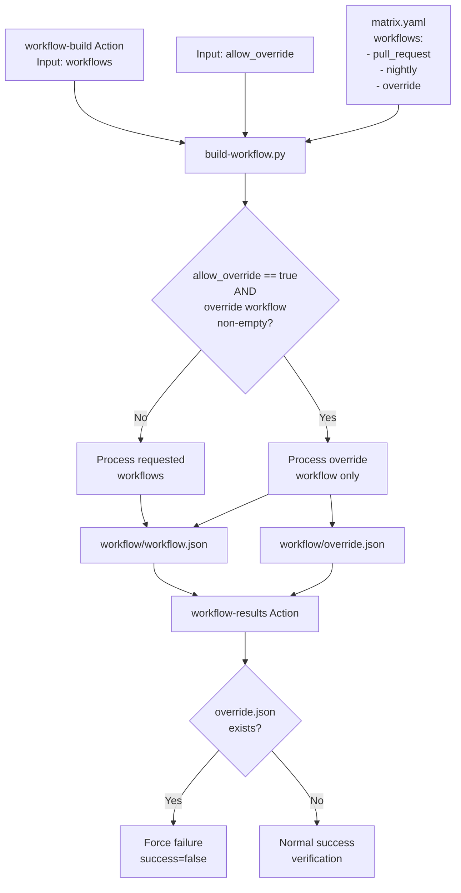
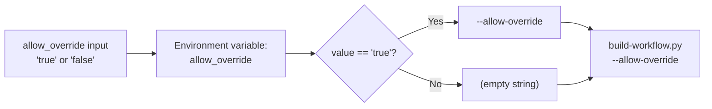
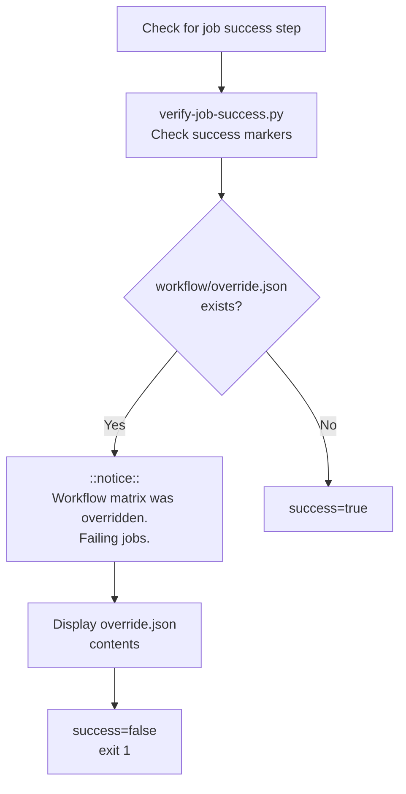
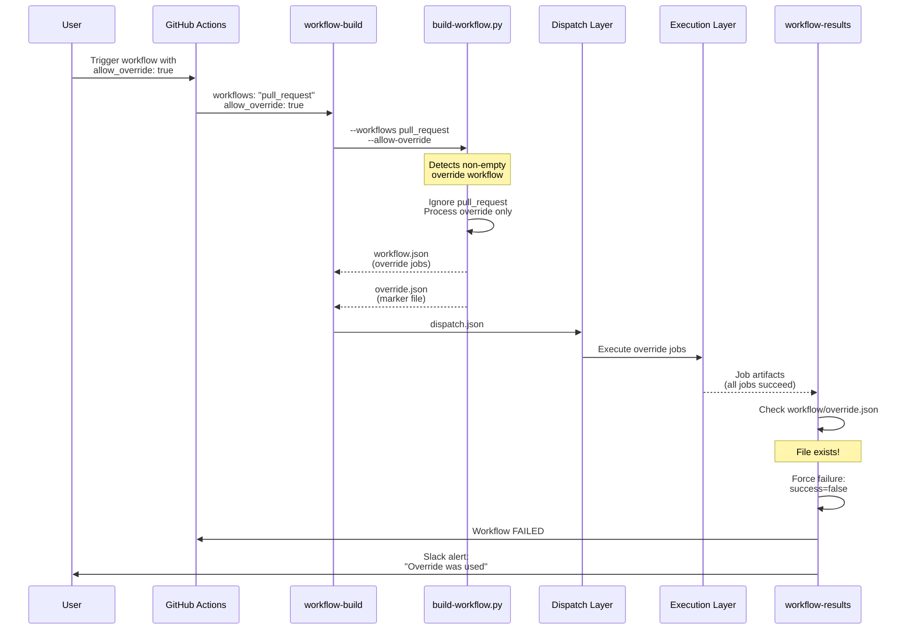

<!-- source: DeepWiki mcp.deepwiki.com · repo NVIDIA/cccl-gha · page 7.4 Override Matrix · fetched 2026-10-26 -->

# Override Matrix

<details>
<summary>Relevant source files</summary>

The following files were used as context for generating this wiki page:

- [.github/actions/workflow-build/action.yml](.github/actions/workflow-build/action.yml)
- [.github/actions/workflow-results/action.yml](.github/actions/workflow-results/action.yml)

</details>


## Purpose and Scope

This document explains the override matrix mechanism, which allows a special `override` workflow in the matrix configuration to supersede standard workflow selections. This feature is designed for testing, debugging, and emergency scenarios where a specific subset of jobs must run instead of the normal workflow configuration.

For general matrix configuration, see [Configuration Guide](#2). For workflow generation details, see [Workflow Generation](#3).

---

## Overview

The override matrix mechanism provides a way to temporarily replace the requested workflows with a custom job configuration. When enabled, the system ignores the `workflows` input parameter and instead executes jobs defined in a special `override` workflow within the matrix file. As a safety measure, workflows run with override configurations always fail in the results phase to prevent accidental merges of code tested only with non-standard job sets.

**Sources:** [.github/actions/workflow-build/action.yml:8-11](), [.github/actions/workflow-results/action.yml:169-175]()

---

## Override Workflow Flow

The following diagram illustrates how the override mechanism intercepts the normal workflow generation process:



**Sources:** [.github/actions/workflow-build/action.yml:8-11,78,86-88](), [.github/actions/workflow-results/action.yml:169-175]()

---

## Configuration

### Defining an Override Workflow

The override workflow is defined in `matrix.yaml` alongside normal workflows like `pull_request`, `nightly`, and `weekly`. It uses the same structure as any other workflow definition:

```yaml
workflows:
  pull_request:
    # Normal PR jobs...
  
  nightly:
    # Normal nightly jobs...
  
  override:
    # Custom test jobs
    - {project: 'libcudacxx', ctk: '12.4', cxx: 'gcc12', std: '17', gpu: 'v100'}
    - {project: 'thrust', ctk: '12.4', cxx: 'clang18', std: '20'}
```

The `override` workflow can contain any valid job specifications using the standard tag system. It can be empty (no jobs) or contain a minimal set of jobs for targeted testing.

**Sources:** [.github/actions/workflow-build/action.yml:5-7]()

---

## Activation

### The allow_override Input

The override mechanism is controlled by the `allow_override` input to the `workflow-build` action:

| Input Parameter | Type | Default | Description |
|----------------|------|---------|-------------|
| `allow_override` | boolean | `false` | When `true`, requested workflows are ignored if a non-empty override workflow exists |

**Sources:** [.github/actions/workflow-build/action.yml:8-11]()

### Flag Processing

The `allow_override` input is converted to a command-line flag for the matrix parser:



The environment variable is constructed at [.github/actions/workflow-build/action.yml:78]() using a ternary expression:

```yaml
allow_override: ${{ inputs.allow_override == 'true' && '--allow-override' || ''}}
```

This is then passed to the matrix parser at [.github/actions/workflow-build/action.yml:87]():

```bash
${{ env.matrix_parser }} ${{ inputs.matrix_file }}           \
    --workflows ${{ inputs.workflows }}                      \
    ${{ env.allow_override }}                                \
    ${{ env.dirty_projects_flag }} ${{ env.dirty_projects }}
```

**Sources:** [.github/actions/workflow-build/action.yml:74-88]()

---

## Override Detection and Processing

### Matrix Parser Behavior

When `build-workflow.py` receives the `--allow-override` flag, it checks if:
1. An `override` workflow is defined in the matrix file
2. The `override` workflow contains at least one job

If both conditions are met, the parser ignores the `--workflows` argument and processes only the `override` workflow. Otherwise, it proceeds with the requested workflows normally.

### Override Marker File

When an override workflow is processed, the system creates a marker file at `workflow/override.json`. This file serves two purposes:
1. Documents that the workflow run used an override configuration
2. Triggers the failure mechanism in the results phase

**Sources:** [.github/actions/workflow-build/action.yml:85-88]()

---

## Override Enforcement

### Results Phase Detection

The `workflow-results` action checks for the presence of `workflow/override.json` during the success verification step:



The detection logic at [.github/actions/workflow-results/action.yml:169-175]():

```yaml
if [ -f workflow/override.json ]; then
  echo "::notice::Workflow matrix was overridden. Failing jobs."
  echo "Override matrix:"
  cat workflow/override.json | jq -c '.'
  echo "success=false" >> "${GITHUB_OUTPUT}"
  exit 1
fi
```

This ensures that even if all override jobs succeed, the overall workflow fails. This prevents code from being merged when it has only been tested against a non-standard job subset.

**Sources:** [.github/actions/workflow-results/action.yml:155-177]()

---

## Use Cases

### Testing New Job Configurations

The override mechanism is valuable when testing new job configurations before adding them to production workflows:

```yaml
override:
  # Test new CUDA 12.5 support
  - {project: 'cub', ctk: '12.5', cxx: 'gcc13', std: '20', gpu: 'h100'}
  - {project: 'thrust', ctk: '12.5', cxx: 'gcc13', std: '20', gpu: 'h100'}
```

### Debugging Specific Failures

When a specific combination fails in production, the override workflow allows isolated reproduction:

```yaml
override:
  # Reproduce clang18 + CUDA 12.4 + std=20 failure
  - {project: 'thrust', ctk: '12.4', cxx: 'clang18', std: '20', gpu: 'v100'}
```

### Emergency Hotfix Validation

In emergency situations requiring rapid validation of a critical fix, override can run a minimal job set:

```yaml
override:
  # Quick smoke test on primary platforms only
  - {project: 'libcudacxx', ctk: '12.4', cxx: 'gcc12', gpu: 'v100'}
  - {project: 'thrust', ctk: '12.4', cxx: 'gcc12', gpu: 'v100'}
  - {project: 'cub', ctk: '12.4', cxx: 'gcc12', gpu: 'v100'}
```

### Development Workflow Testing

Developers can test changes to the workflow generation system itself using controlled override configurations without affecting production workflow definitions.

**Sources:** [.github/actions/workflow-build/action.yml:8-11]()

---

## Safety Mechanisms

The override system includes multiple safety mechanisms to prevent misuse:

| Mechanism | Location | Purpose |
|-----------|----------|---------|
| Opt-in activation | `allow_override` input must be explicitly set to `true` | Prevents accidental override activation |
| Forced failure | Results phase always fails when override detected | Prevents merging code tested only with override jobs |
| Visual notification | GitHub Actions notice annotation | Makes override usage visible in workflow logs |
| Override marker file | `workflow/override.json` persisted as artifact | Provides audit trail of override usage |

**Sources:** [.github/actions/workflow-build/action.yml:8-11](), [.github/actions/workflow-results/action.yml:169-175]()

---

## Integration with Other Features

### Change Detection Compatibility

The override mechanism works alongside change detection (see [Change Detection](#7.1)). When both are active:
1. If override is triggered, `--dirty-projects` filtering is still applied
2. Override jobs not matching dirty projects are excluded
3. This allows testing specific configurations for only the changed code

### Dispatch Group Processing

Override jobs are processed through the same dispatch group mechanism as normal jobs:
- Split into standalone vs. two-stage patterns
- Categorized by operating system (Linux/Windows)
- Executed with identical infrastructure

This ensures override jobs have the same execution environment and reliability as production jobs.

**Sources:** [.github/actions/workflow-build/action.yml:79-88]()

---

## Limitations and Considerations

### Automatic Failure Requirement

The forced failure in the results phase is by design and cannot be disabled. This is a critical safety feature. If override jobs need to be merged, they must first be migrated to a production workflow (e.g., `pull_request`, `nightly`).

### Artifact Preservation

Even though override workflows fail, all artifacts (job results, timing data, summaries) are preserved and accessible for analysis.

### Notification Behavior

Override workflow failures trigger Slack alert notifications (if configured) like any other failure. Teams should be aware that override usage will generate these alerts.

**Sources:** [.github/actions/workflow-results/action.yml:197-212]()

---

## Example: Complete Override Workflow

The following example demonstrates a complete workflow run using override:



**Sources:** [.github/actions/workflow-build/action.yml:74-88](), [.github/actions/workflow-results/action.yml:155-177,197-212]()

---

