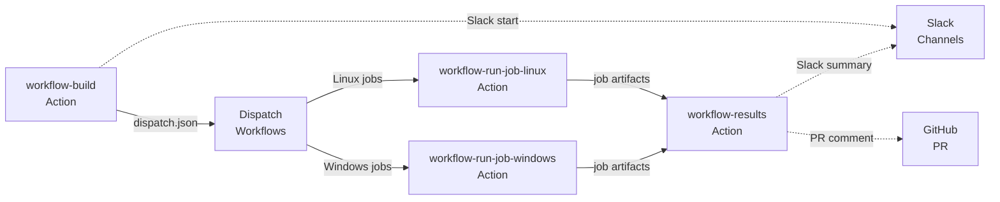
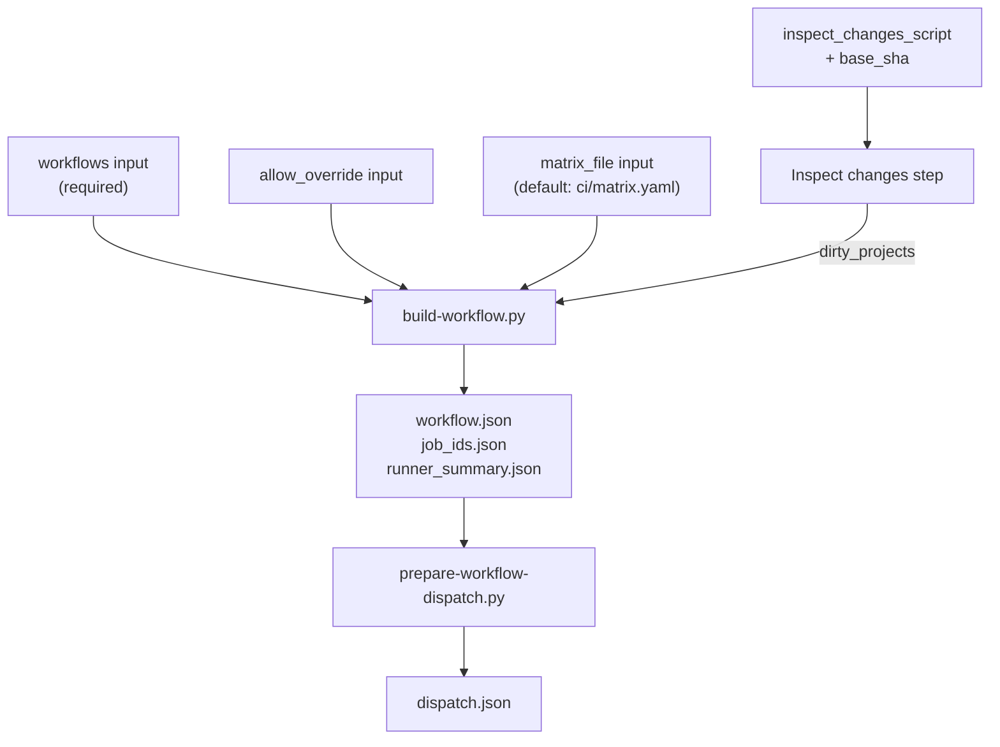
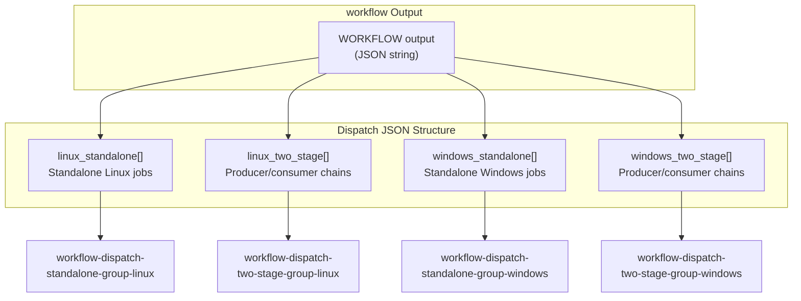
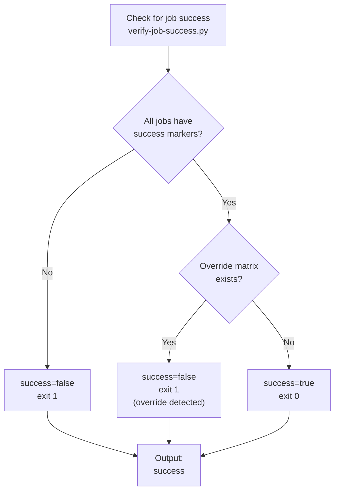
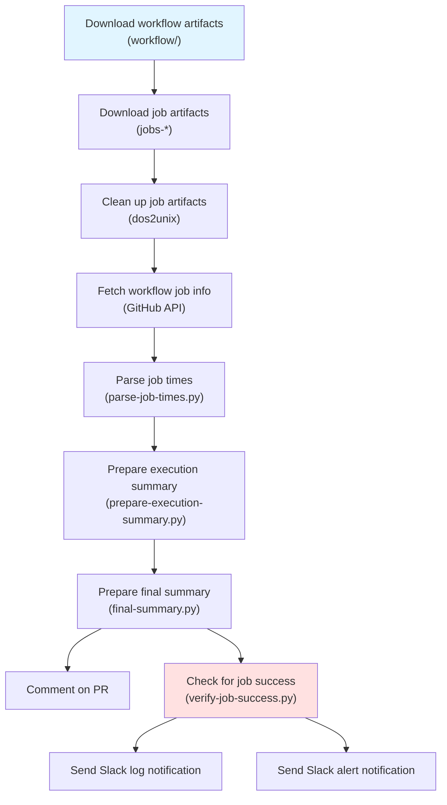
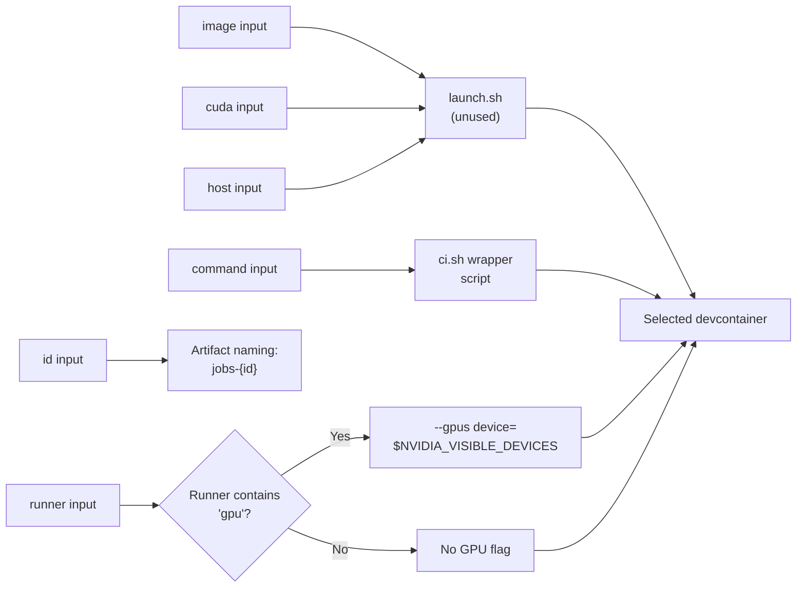
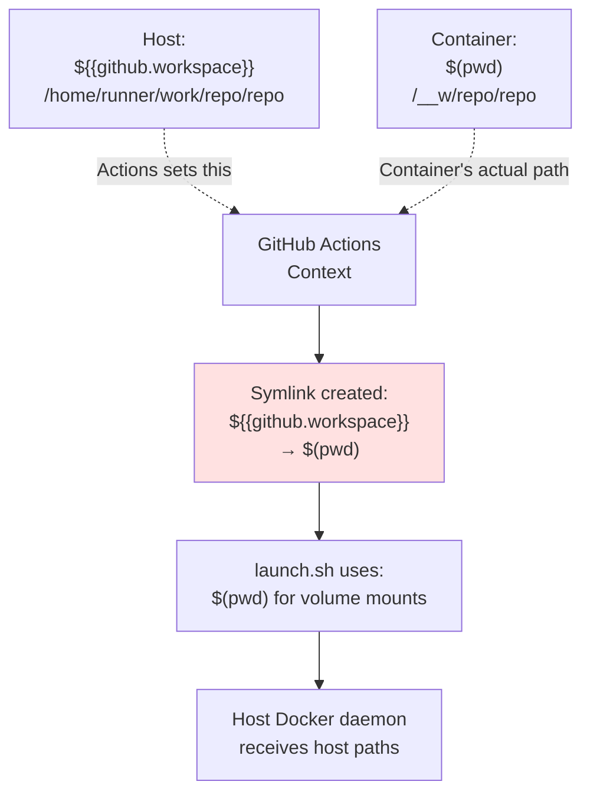
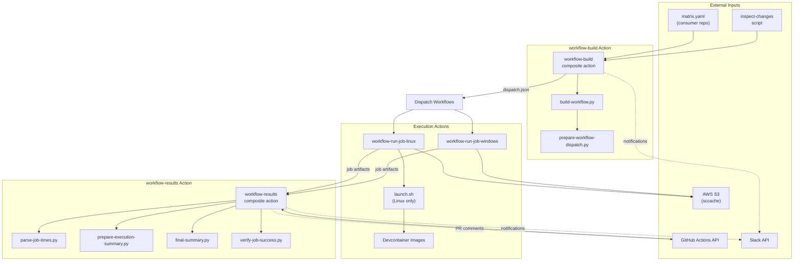
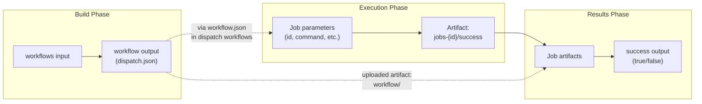

<!-- source: DeepWiki mcp.deepwiki.com · repo NVIDIA/cccl-gha · page 8.1 Action Inputs and Outputs · fetched 2026-10-26 -->

# Action Inputs and Outputs

<details>
<summary>Relevant source files</summary>

The following files were used as context for generating this wiki page:

- [.github/actions/workflow-build/action.yml](.github/actions/workflow-build/action.yml)
- [.github/actions/workflow-results/action.yml](.github/actions/workflow-results/action.yml)
- [.github/actions/workflow-run-job-linux/action.yml](.github/actions/workflow-run-job-linux/action.yml)
- [.github/actions/workflow-run-job-windows/action.yml](.github/actions/workflow-run-job-windows/action.yml)

</details>


This page provides a complete reference of all inputs and outputs for the GitHub Actions in the CCCL workflow orchestration system. These actions encapsulate the core functionality of the CI/CD pipeline, from workflow generation to job execution and results collection.

For information about how these actions are invoked within workflows, see [Job Dispatch](#4). For details about the underlying scripts and data formats, see [File Format Specifications](#8.2).

## Overview of Actions

The CCCL-GHA system defines four composite GitHub Actions that form the execution pipeline:



**Actions by Phase:**
- **Generation Phase**: `workflow-build` - Transforms `matrix.yaml` into dispatchable job definitions
- **Execution Phase**: `workflow-run-job-linux` and `workflow-run-job-windows` - Execute individual jobs in isolated environments
- **Results Phase**: `workflow-results` - Aggregates results, generates summaries, and sends notifications

Sources: [.github/actions/workflow-build/action.yml](), [.github/actions/workflow-results/action.yml](), [.github/actions/workflow-run-job-linux/action.yml](), [.github/actions/workflow-run-job-windows/action.yml]()

---

## workflow-build Action

The `workflow-build` action orchestrates the workflow generation pipeline, transforming a matrix configuration file into dispatchable job definitions organized by OS and execution pattern.

**Location**: [.github/actions/workflow-build/action.yml:1-140]()

### Inputs

| Input Name | Type | Required | Default | Description |
|------------|------|----------|---------|-------------|
| `workflows` | string | **Yes** | - | Space-separated list of workflow names from the matrix file to execute (e.g., `"pull_request"`, `"nightly weekly"`) |
| `allow_override` | boolean | No | `"false"` | If `"true"`, the `workflows` parameter is ignored when a non-empty `override` workflow exists in the matrix file |
| `inspect_changes_script` | string | No | `""` | Path to a script that determines which projects need testing based on file changes. If empty, all jobs are included |
| `inspect_changes_base_sha` | string | No | `""` | Base Git SHA for the inspect-changes script to compare against. Required if `inspect_changes_script` is provided |
| `matrix_file` | string | No | `"ci/matrix.yaml"` | Path to the matrix configuration file in the consumer repository |
| `matrix_parser` | string | No | `""` | Path to a custom matrix parser script. If blank, uses `build-workflow.py` from the action directory |
| `slack_token` | string | No | - | Slack bot token for sending notifications. No notifications are sent if not provided |
| `slack_log` | string | No | - | Slack channel ID for verbose workflow start/error notifications |
| `slack_alert` | string | No | - | Slack channel ID for error-only notifications |

**Input Processing Flow:**



Sources: [.github/actions/workflow-build/action.yml:4-36]()

### Outputs

| Output Name | Type | Description |
|-------------|------|-------------|
| `workflow` | JSON string | Complete dispatch configuration as a JSON string containing the contents of `dispatch.json`. Contains four arrays: `linux_standalone`, `linux_two_stage`, `windows_standalone`, and `windows_two_stage` |

**Output Structure Mapping:**



The `workflow` output is a JSON-encoded string that must be parsed by consuming workflows. It is generated at [.github/actions/workflow-build/action.yml:115-117]() and contains the consolidated dispatch configuration.

Sources: [.github/actions/workflow-build/action.yml:38-41](), [.github/actions/workflow-build/action.yml:111-117]()

### Workflow Steps and Artifacts

The action executes the following steps in sequence:

1. **Send Slack log notification** ([.github/actions/workflow-build/action.yml:47-59]()) - Sends workflow start notification if Slack credentials are provided
2. **Inspect changes** ([.github/actions/workflow-build/action.yml:61-72]()) - Runs change detection script to identify dirty projects
3. **Parse matrix file** ([.github/actions/workflow-build/action.yml:74-100]()) - Executes `build-workflow.py` to generate `workflow.json`
4. **Create dispatch workflows** ([.github/actions/workflow-build/action.yml:102-109]()) - Executes `prepare-workflow-dispatch.py` to create `dispatch.json`
5. **Set outputs** ([.github/actions/workflow-build/action.yml:111-117]()) - Exports the `WORKFLOW` output
6. **Upload artifacts** ([.github/actions/workflow-build/action.yml:119-124]()) - Uploads the `workflow/` directory as an artifact
7. **Send Slack error notification** ([.github/actions/workflow-build/action.yml:126-139]()) - Sends error notification on failure

**Uploaded Artifacts:**

The action uploads a `workflow` artifact containing:
- `workflow.json` - Complete job definitions
- `dispatch.json` - Jobs categorized for dispatch
- `job_ids.json` - Job ID mappings
- `runner_summary.json` - Runner allocation summary
- `job_list.txt` - Human-readable job list
- `changes.md` - Change detection summary (if `inspect_changes_script` was used)

Sources: [.github/actions/workflow-build/action.yml:44-140]()

---

## workflow-results Action

The `workflow-results` action collects job artifacts, analyzes execution results, generates comprehensive summaries, and sends notifications to multiple channels.

**Location**: [.github/actions/workflow-results/action.yml:1-213]()

### Inputs

| Input Name | Type | Required | Default | Description |
|------------|------|----------|---------|-------------|
| `github_token` | string | No | - | GitHub token for API access. Required for fetching job timing data and posting PR comments. No PR comment is made if not provided |
| `pr_number` | string | No | - | Pull request number to comment on. Must be provided along with `github_token` for PR commenting to occur |
| `slack_token` | string | No | - | Slack bot token for sending notifications. No notifications are sent if not provided |
| `slack_log` | string | No | - | Slack channel ID for verbose notifications (always sent with workflow results) |
| `slack_alert` | string | No | - | Slack channel ID for alert notifications (only sent on failure) |

**Input Usage Matrix:**

| Feature | Required Inputs | Optional | Behavior |
|---------|----------------|----------|----------|
| PR Comment | `github_token`, `pr_number` | - | Posts formatted summary as PR comment |
| Job Timing Analysis | `github_token` | - | Fetches job data from GitHub API; timing analysis skipped if not provided |
| Slack Log Notification | `slack_token`, `slack_log` | - | Sends summary to log channel on workflow completion (always) |
| Slack Alert Notification | `slack_token`, `slack_alert` | - | Sends summary to alert channel on workflow failure only |

Sources: [.github/actions/workflow-results/action.yml:4-19]()

### Outputs

| Output Name | Type | Description |
|-------------|------|-------------|
| `success` | boolean | String value `"true"` or `"false"` indicating whether all jobs succeeded. Set to `"false"` if any job failed or if the override matrix was used |

**Success Determination Logic:**



The `success` output is determined at [.github/actions/workflow-results/action.yml:155-177]() by checking for `success` marker files in job artifacts and detecting override matrix usage.

Sources: [.github/actions/workflow-results/action.yml:21-24](), [.github/actions/workflow-results/action.yml:155-177]()

### Workflow Steps and Data Flow

The action executes a multi-stage pipeline with error tolerance (`continue-on-error: true` for most steps):



**Step Details:**

1. **Download workflow artifacts** ([.github/actions/workflow-results/action.yml:30-34]()) - Downloads the `workflow` artifact uploaded by `workflow-build`
2. **Download job artifacts** ([.github/actions/workflow-results/action.yml:36-42]()) - Downloads all `jobs-*` artifacts with pattern matching and merging
3. **Clean up job artifacts** ([.github/actions/workflow-results/action.yml:44-57]()) - Fixes Windows line endings using `dos2unix`
4. **Fetch workflow job info** ([.github/actions/workflow-results/action.yml:59-90]()) - Calls GitHub API to get job timing data, saved to `results/jobs.json`
5. **Parse job times** ([.github/actions/workflow-results/action.yml:92-97]()) - Executes `parse-job-times.py` to extract timing information
6. **Prepare execution summary** ([.github/actions/workflow-results/action.yml:99-104]()) - Executes `prepare-execution-summary.py` to aggregate results by project/tag
7. **Prepare final summary** ([.github/actions/workflow-results/action.yml:106-128]()) - Executes `final-summary.py` to generate HTML/Markdown report
8. **Comment on PR** ([.github/actions/workflow-results/action.yml:130-153]()) - Posts the final summary as a PR comment if credentials are provided
9. **Check for job success** ([.github/actions/workflow-results/action.yml:155-177]()) - Verifies all jobs have success markers
10. **Send Slack log notification** ([.github/actions/workflow-results/action.yml:179-195]()) - Sends summary to log channel (always runs if configured)
11. **Send Slack alert notification** ([.github/actions/workflow-results/action.yml:197-212]()) - Sends alert to alert channel (only on failure)

Sources: [.github/actions/workflow-results/action.yml:26-213]()

### Intermediate Data Files

The action generates several intermediate files in the `results/` and `execution/` directories:

| File Path | Generator | Purpose |
|-----------|-----------|---------|
| `results/jobs.json` | GitHub API fetch | Raw job data from GitHub Actions |
| `results/job_times.json` | `parse-job-times.py` | Extracted timing information |
| `execution/heading.txt` | `prepare-execution-summary.py` | Overall execution summary |
| `execution/projects/*_summary.json` | `prepare-execution-summary.py` | Per-project detailed summaries |
| `final_summary.md` | `final-summary.py` | Complete formatted report |

Sources: [.github/actions/workflow-results/action.yml:59-128]()

---

## workflow-run-job-linux Action

The `workflow-run-job-linux` action executes individual jobs on Linux runners using a Docker-outside-of-Docker (DOOD) pattern to launch job-specific devcontainers.

**Location**: [.github/actions/workflow-run-job-linux/action.yml:1-201]()

**Architecture Overview:**

The action uses a three-layer execution model:
1. **GitHub Actions Runner Host** - Provides the Docker daemon and GPU access
2. **Intermediate Container** (`cruizba/ubuntu-dind:jammy-26.1.3`) - Has Docker CLI, mounts host socket
3. **Target Devcontainer** - Job-specific image selected by `.devcontainer/launch.sh`

Sources: [.github/actions/workflow-run-job-linux/action.yml:4-20]()

### Inputs

| Input Name | Type | Required | Description |
|------------|------|----------|-------------|
| `id` | string | **Yes** | Unique identifier for the job, used for artifact naming and organization |
| `command` | string | **Yes** | The shell command to execute inside the devcontainer |
| `image` | string | **Yes** | Docker image identifier (used by `.devcontainer/launch.sh` for image selection, not directly as a Docker image) |
| `runner` | string | **Yes** | The GitHub Actions `runs-on` value, used to detect GPU availability (e.g., `"linux-amd64-gpu-v100-latest-1"`) |
| `cuda` | string | **Yes** | CUDA version for devcontainer selection (e.g., `"12.4"`) |
| `host` | string | **Yes** | Host compiler for devcontainer selection (e.g., `"gcc12"`) |

**Input Usage in Execution Flow:**



Sources: [.github/actions/workflow-run-job-linux/action.yml:22-40]()

### Outputs

This action has no explicit outputs. Success is communicated through:
- **Artifact upload**: A `jobs-{id}` artifact containing a `success` marker file
- **Job status**: The step's exit code determines workflow success/failure

Sources: [.github/actions/workflow-run-job-linux/action.yml:42]()

### Execution Steps

The action performs the following operations:

1. **Install dependencies** ([.github/actions/workflow-run-job-linux/action.yml:45-50]()) - Installs `tree` and `git` in the `ubuntu-dind` container
2. **Checkout repo** ([.github/actions/workflow-run-job-linux/action.yml:51-55]()) - Clones the repository into a subdirectory
3. **Add NVCC problem matcher** ([.github/actions/workflow-run-job-linux/action.yml:56-59]()) - Registers problem matcher for CUDA compiler errors
4. **Get AWS credentials** ([.github/actions/workflow-run-job-linux/action.yml:60-65]()) - Assumes AWS role for sccache S3 bucket access
5. **Run command** ([.github/actions/workflow-run-job-linux/action.yml:66-164]()) - Executes the job in a devcontainer
6. **Prepare job artifacts** ([.github/actions/workflow-run-job-linux/action.yml:166-193]()) - Collects output files
7. **Upload job artifacts** ([.github/actions/workflow-run-job-linux/action.yml:195-200]()) - Uploads the `jobs-{id}` artifact

**Key Implementation Details:**

### Path Management and DOOD Symlink Strategy

The action implements a critical path synchronization mechanism for DOOD:



The symlink is created at [.github/actions/workflow-run-job-linux/action.yml:82-86]() to ensure that when `.devcontainer/launch.sh` constructs volume mount paths using `$(pwd)`, they match the host's path structure, which is necessary because the Docker CLI runs in the intermediate container but the daemon runs on the host.

Sources: [.github/actions/workflow-run-job-linux/action.yml:77-86]()

### Command Wrapper Script Generation

The action generates a `ci.sh` wrapper script ([.github/actions/workflow-run-job-linux/action.yml:89-109]()) that:
- Sets error handling with `set -eo pipefail`
- Prints the command being executed
- Executes the command from the `COMMAND` environment variable
- On failure, prints detailed reproduction instructions including:
  - Git clone command with correct branch and SHA
  - `.devcontainer/launch.sh` invocation with exact parameters
  - Links to documentation

Sources: [.github/actions/workflow-run-job-linux/action.yml:89-109]()

### AWS Credentials Configuration

AWS credentials are written to `$RUNNER_TEMP/.aws/` ([.github/actions/workflow-run-job-linux/action.yml:113-129]()):

```
$RUNNER_TEMP/.aws/
├── config          (mode 0664)
│   └── [default]
│       ├── bucket=rapids-sccache-devs
│       └── region=us-east-2
└── credentials     (mode 0600)
    └── [default]
        ├── aws_access_key_id
        ├── aws_session_token
        └── aws_secret_access_key
```

These files are mounted into the devcontainer at `/root/.aws/` ([.github/actions/workflow-run-job-linux/action.yml:162]()).

Sources: [.github/actions/workflow-run-job-linux/action.yml:113-129](), [.github/actions/workflow-run-job-linux/action.yml:162]()

### GPU Detection and Allocation

GPU access is conditional based on the `runner` input ([.github/actions/workflow-run-job-linux/action.yml:131-136]()):

```bash
declare -a gpu_request=()

if [[ "${RUNNER}" = *"-gpu-"* ]]; then
  gpu_request+=(--gpus "device=${NVIDIA_VISIBLE_DEVICES}")
fi
```

The `NVIDIA_VISIBLE_DEVICES` environment variable is provided by the GitHub runner and specifies which GPU device(s) should be visible to the container.

Sources: [.github/actions/workflow-run-job-linux/action.yml:131-136]()

### Environment Variable Propagation

The action explicitly propagates GitHub Actions context variables to the devcontainer ([.github/actions/workflow-run-job-linux/action.yml:149-160]()):

| Variable | Purpose |
|----------|---------|
| `CI` | Signals CI environment to scripts |
| `COMMAND` | Contains the command to execute |
| `GITHUB_SHA` | Current commit SHA |
| `GITHUB_REF_NAME` | Branch or tag name |
| `GITHUB_REPOSITORY` | Repository full name (`owner/repo`) |
| `GITHUB_WORKSPACE` | Workspace path for actions |
| `GITHUB_ACTIONS` | Indicates running in GitHub Actions |
| `GITHUB_ENV` | Path to environment file |
| `GITHUB_PATH` | Path to PATH modification file |
| `GITHUB_OUTPUT` | Path to output file |
| `GITHUB_STEP_SUMMARY` | Path to step summary file |

Sources: [.github/actions/workflow-run-job-linux/action.yml:149-160]()

### Artifact Collection

The action searches for specific output files ([.github/actions/workflow-run-job-linux/action.yml:176-189]()):

| Filename | Purpose | Failure Behavior |
|----------|---------|------------------|
| `success` | Created unconditionally to mark job success | Always created |
| `sccache_stats.json` | sccache compilation statistics | Ignored if missing |
| `cccl_meta_bench.csv` | Benchmark results (CSV) | Ignored if missing |
| `cccl_meta_bench.db` | Benchmark database | Ignored if missing |
| `cccl_meta_bench.log` | Benchmark logs | Ignored if missing |

Files are copied from anywhere in the repository to `jobs/{id}/` using a `find` command with `-print -quit` to select the first match.

Sources: [.github/actions/workflow-run-job-linux/action.yml:166-193]()

---

## workflow-run-job-windows Action

The `workflow-run-job-windows` action executes individual jobs on Windows runners using Docker containers with native Windows execution.

**Location**: [.github/actions/workflow-run-job-windows/action.yml:1-99]()

### Inputs

| Input Name | Type | Required | Description |
|------------|------|----------|-------------|
| `id` | string | **Yes** | Unique identifier for the job, used for artifact naming |
| `command` | string | **Yes** | PowerShell command to execute inside the Docker container |
| `image` | string | **Yes** | Full Docker image name to use (e.g., `"rapidsai/devcontainers:24.12-cpp-msvc2022-cuda12.6"`) |

**Comparison with Linux Action:**

| Feature | Linux Action | Windows Action |
|---------|--------------|----------------|
| **Container Strategy** | DOOD with intermediate container | Direct Docker execution |
| **Image Selection** | Via `cuda` + `host` inputs and `launch.sh` | Direct image name |
| **Path Management** | Complex symlink strategy | PowerShell path transformation |
| **GPU Access** | Via `--gpus` flag | Not implemented |
| **Shell** | Bash in devcontainer | PowerShell in container |

Sources: [.github/actions/workflow-run-job-windows/action.yml:4-13]()

### Outputs

This action has no explicit outputs. Success is communicated identically to the Linux action through artifact upload and job exit code.

Sources: [.github/actions/workflow-run-job-windows/action.yml:15]()

### Execution Steps

The action performs the following operations:

1. **Configure env** ([.github/actions/workflow-run-job-windows/action.yml:18-25]()) - Sets sccache environment variables
2. **Get AWS credentials** ([.github/actions/workflow-run-job-windows/action.yml:26-31]()) - Assumes AWS role for sccache access
3. **Checkout repo** ([.github/actions/workflow-run-job-windows/action.yml:32-36]()) - Clones the repository
4. **Fetch image** ([.github/actions/workflow-run-job-windows/action.yml:37-39]()) - Pulls the specified Docker image
5. **Prepare paths** ([.github/actions/workflow-run-job-windows/action.yml:40-46]()) - Converts Windows paths for Docker
6. **Run command** ([.github/actions/workflow-run-job-windows/action.yml:47-64]()) - Executes the command in the container
7. **Prepare job artifacts** ([.github/actions/workflow-run-job-windows/action.yml:65-91]()) - Collects output files
8. **Upload job artifacts** ([.github/actions/workflow-run-job-windows/action.yml:93-98]()) - Uploads the `jobs-{id}` artifact

### sccache Environment Configuration

The action sets sccache environment variables ([.github/actions/workflow-run-job-windows/action.yml:18-25]()):

| Variable | Value | Purpose |
|----------|-------|---------|
| `SCCACHE_BUCKET` | `rapids-sccache-devs` | S3 bucket name |
| `SCCACHE_REGION` | `us-east-2` | AWS region |
| `SCCACHE_IDLE_TIMEOUT` | `0` | Disable idle timeout |
| `SCCACHE_S3_USE_SSL` | `true` | Use HTTPS for S3 |
| `SCCACHE_S3_NO_CREDENTIALS` | `false` | Use provided credentials |

These are set in `GITHUB_ENV` and then propagated into the container via PowerShell's `SetEnvironmentVariable` calls ([.github/actions/workflow-run-job-windows/action.yml:55-62]()).

Sources: [.github/actions/workflow-run-job-windows/action.yml:18-25](), [.github/actions/workflow-run-job-windows/action.yml:55-62]()

### Path Transformation for Docker

Windows paths are transformed for Docker compatibility ([.github/actions/workflow-run-job-windows/action.yml:40-46]()):

```powershell
# Input:  C:\actions-runner\_work\cccl\cccl\cccl
# Output: C:/actions-runner/_work/cccl/cccl/cccl
HOST_REPO=${{ github.workspace }}\${{ github.event.repository.name }}".Replace('\', '/')

# Target mount path in container:
MOUNT_REPO=C:/${{ github.event.repository.name }}
```

The host path is mounted to a simplified path inside the container at [.github/actions/workflow-run-job-windows/action.yml:51]():

```bash
docker run \
  --mount type=bind,source="{HOST_REPO}",target="{MOUNT_REPO}" \
  --workdir "{MOUNT_REPO}" \
  {image} \
  powershell -c "{command}"
```

Sources: [.github/actions/workflow-run-job-windows/action.yml:40-64]()

### Environment Variable Injection

AWS credentials and sccache configuration are injected via PowerShell commands inside the container ([.github/actions/workflow-run-job-windows/action.yml:54-64]()):

```powershell
[System.Environment]::SetEnvironmentVariable('AWS_ACCESS_KEY_ID', '...');
[System.Environment]::SetEnvironmentVariable('AWS_SECRET_ACCESS_KEY', '...');
[System.Environment]::SetEnvironmentVariable('AWS_SESSION_TOKEN', '...');
[System.Environment]::SetEnvironmentVariable('SCCACHE_BUCKET', '...');
# ... etc
```

This approach is necessary because Windows Docker containers don't support the `--env` flag in the same way as Linux containers when using PowerShell commands.

Sources: [.github/actions/workflow-run-job-windows/action.yml:54-64]()

### Artifact Collection Differences

The Windows action collects fewer artifacts than the Linux action ([.github/actions/workflow-run-job-windows/action.yml:76-87]()):

| Artifact | Linux | Windows | Reason |
|----------|-------|---------|--------|
| `success` | ✓ | ✓ | Required marker |
| `sccache_stats.json` | ✓ | ✓ | Common output |
| `cccl_meta_bench.csv` | ✓ | ✗ | Not generated on Windows |
| `cccl_meta_bench.db` | ✓ | ✗ | Not generated on Windows |
| `cccl_meta_bench.log` | ✓ | ✗ | Not generated on Windows |

The Windows action also uses `find` instead of `tree` for listing artifacts due to tool availability ([.github/actions/workflow-run-job-windows/action.yml:89-91]()).

Sources: [.github/actions/workflow-run-job-windows/action.yml:65-91]()

---

## Action Dependency Graph

The following diagram shows how actions depend on each other and external systems:



Sources: [.github/actions/workflow-build/action.yml](), [.github/actions/workflow-results/action.yml](), [.github/actions/workflow-run-job-linux/action.yml](), [.github/actions/workflow-run-job-windows/action.yml]()

---

## Summary of Critical Input/Output Patterns

### Required Input Combinations

The following table summarizes which input combinations are required for common use cases:

| Use Case | Required Inputs | Optional Inputs |
|----------|----------------|-----------------|
| **Basic workflow generation** | `workflows` (build), `matrix_file` | `matrix_parser`, `allow_override` |
| **Change-based filtering** | `workflows`, `inspect_changes_script`, `inspect_changes_base_sha` | - |
| **Slack notifications** | `slack_token`, `slack_log` or `slack_alert` | - |
| **Linux job execution** | `id`, `command`, `image`, `runner`, `cuda`, `host` | - |
| **Linux job with GPU** | All Linux inputs, `runner` containing `"-gpu-"` | - |
| **Windows job execution** | `id`, `command`, `image` | - |
| **Results with PR comment** | `github_token`, `pr_number` | - |
| **Results with job timing** | `github_token` | `pr_number` |
| **Results with Slack** | `slack_token`, `slack_log` or `slack_alert` | - |

### Data Flow Between Actions



**Key Integration Points:**

1. **Build → Dispatch**: The `workflow` output from `workflow-build` is parsed by dispatch workflows to create job matrices
2. **Build → Results**: The `workflow` artifact contains `workflow.json` and `job_ids.json`, which are downloaded by `workflow-results`
3. **Execution → Results**: Each execution action uploads a `jobs-{id}` artifact that is downloaded by `workflow-results`
4. **Results → Caller**: The `success` output from `workflow-results` determines the overall workflow status

Sources: [.github/actions/workflow-build/action.yml:38-41](), [.github/actions/workflow-run-job-linux/action.yml:195-200](), [.github/actions/workflow-run-job-windows/action.yml:93-98](), [.github/actions/workflow-results/action.yml:21-24]()

---

