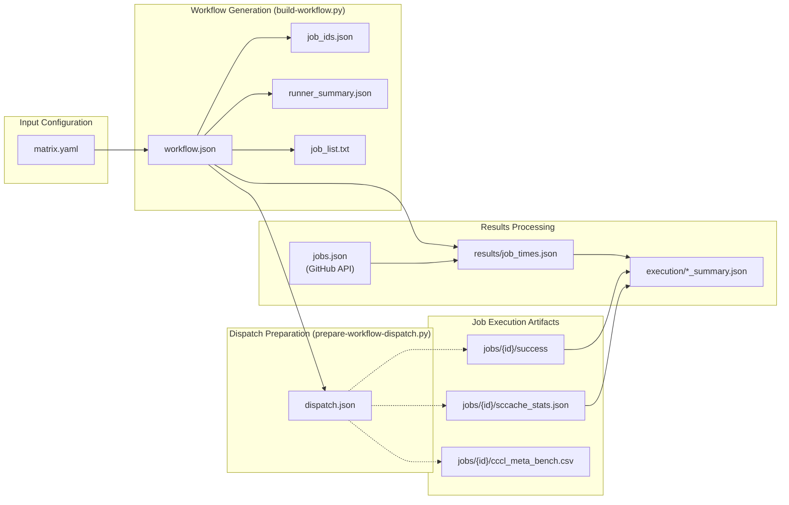
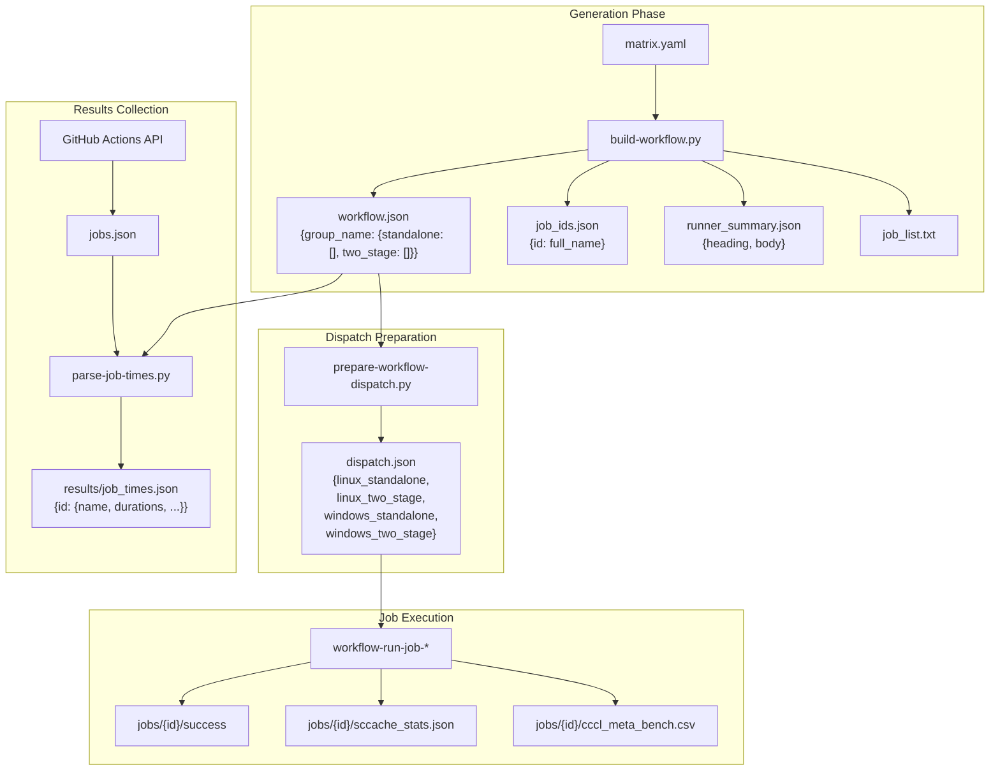
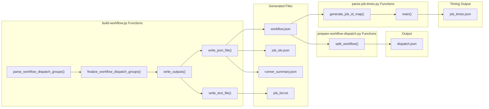

<!-- source: DeepWiki mcp.deepwiki.com · repo NVIDIA/cccl-gha · page 8.2 File Format Specifications · fetched 2026-10-26 -->

# File Format Specifications

<details>
<summary>Relevant source files</summary>

The following files were used as context for generating this wiki page:

- [.github/actions/workflow-build/build-workflow.py](.github/actions/workflow-build/build-workflow.py)
- [.github/actions/workflow-build/prepare-workflow-dispatch.py](.github/actions/workflow-build/prepare-workflow-dispatch.py)
- [.github/actions/workflow-results/parse-job-times.py](.github/actions/workflow-results/parse-job-times.py)

</details>


This page documents the schemas and formats of all configuration files, generated artifacts, and intermediate data structures used throughout the cccl-gha workflow orchestration system. For information about how these files are generated and processed, see [Workflow Generation](#3). For details on artifact collection, see [Artifact Collection](#6.1).

---

## File Lifecycle Overview

The following diagram shows how files flow through the system, from input configuration to final outputs:



Sources: [.github/actions/workflow-build/build-workflow.py:979-1024](), [.github/actions/workflow-build/prepare-workflow-dispatch.py:59-76](), [.github/actions/workflow-results/parse-job-times.py:48-112]()

---

## Input Configuration Files

### matrix.yaml

The `matrix.yaml` file is the primary input configuration that defines all possible job combinations. It is located at `ci/matrix.yaml` in the consuming repository.

**Top-Level Structure:**

| Field | Type | Required | Description |
|-------|------|----------|-------------|
| `devcontainer_version` | string | Yes | Version tag for devcontainer images |
| `all_stds` | list[int] | Yes | All C++ standard versions supported system-wide |
| `workflows` | object | Yes | Named workflow definitions (e.g., `pull_request`, `nightly`) |
| `exclude` | list[object] | No | Matrix jobs to exclude (special workflow name) |
| `override` | list[object] | No | Override matrix (replaces all workflows if present) |
| `projects` | object | Yes | Project definitions (libcudacxx, cub, thrust, etc.) |
| `ctk_versions` | object | Yes | CUDA Toolkit version definitions |
| `host_compilers` | object | Yes | Host compiler definitions (gcc, clang, msvc) |
| `device_compilers` | object | Yes | Device compiler definitions (nvcc, clang) |
| `gpus` | object | Yes | GPU configuration definitions |
| `jobs` | object | Yes | Job type definitions (build, test, etc.) |
| `tags` | object | Yes | Tag metadata (required, defaults, validation) |

**Example Structure:**

```yaml
devcontainer_version: "24.06"
all_stds: [11, 14, 17, 20]

workflows:
  pull_request:
    - {project: libcudacxx, ctk: "12.4", cxx: gcc12, gpu: v100, std: all, jobs: [build, test]}
    - {project: cub, ctk: "11.1", cxx: [gcc9, gcc10], std: 17}
  
exclude:
  - {ctk: "11.1", cxx: gcc12}

projects:
  libcudacxx:
    name: "libcu++"
    stds: [11, 14, 17, 20]
    job_map:
      verify: [build, test]

ctk_versions:
  "11.1":
    stds: [11, 14, 17]
    aka: "11"
  "12.4":
    stds: [11, 14, 17, 20, 23]

host_compilers:
  gcc:
    name: "GCC"
    exe: "g++"
    container_tag: "gcc"
    versions:
      "9":
        stds: [11, 14, 17]
      "12":
        stds: [11, 14, 17, 20, 23]
        aka: "latest"

device_compilers:
  nvcc:
    name: "nvcc"
    exe: "nvcc"
  clang:
    name: "clang"
    exe: "clang++"

gpus:
  v100:
    sm: "70"
    testing: false
  t4:
    sm: "75"

jobs:
  build:
    name: "Build"
    gpu: false
    invoke:
      prefix: "build"
      args: ""
  test:
    name: "Test"
    gpu: true
    needs: build
    invoke:
      prefix: "test"

tags:
  project:
    required: true
  ctk:
    required: true
  cxx:
    required: true
  std:
    default: 17
  gpu:
    required: false
  jobs:
    required: true
```

**Matrix Job Format:**

Each entry in a workflow array becomes a "matrix job" after preprocessing. Matrix jobs support list expansion:

```yaml
# Input (compact)
- {project: [libcudacxx, cub], std: [17, 20], cxx: gcc12}

# Expands to 4 jobs (2 projects × 2 stds)
```

**Special Tag Values:**

- `std: all` - Expands to intersection of supported standards across CTK/compiler/project
- `sm: gpu` - Derives SM architecture from the `gpu` tag value

Sources: [.github/actions/workflow-build/build-workflow.py:1-54](), [.github/actions/workflow-build/build-workflow.py:113-337](), [.github/actions/workflow-build/build-workflow.py:834-876]()

---

## Generated Workflow Files

### workflow.json

Generated by `build-workflow.py`, this file contains the complete set of dispatch groups with fully specified job definitions.

**Structure:**

```json
{
  "<group_name>": {
    "standalone": [
      {
        "id": "<guid>",
        "name": "<human_readable_name>",
        "runner": "<runner_label>",
        "image": "<docker_image>",
        "command": "<shell_command>",
        "cuda": "<ctk_version>",
        "host": "<host_compiler_tag>",
        "origin": {
          "filename": "ci/matrix.yaml",
          "workflow_name": "pull_request",
          "workflow_location": "ci/matrix.yaml:42 (job 1)",
          "original_matrix_job": "{project: libcudacxx, ...}",
          "matrix_job": {
            "project": "libcudacxx",
            "jobs": "Build",
            "cxx": "GCC12",
            "cxx_family": "GCC",
            "cudacxx": "nvcc12.4",
            "cudacxx_family": "nvcc",
            "ctk": "12.4",
            "std": 17
          }
        }
      }
    ],
    "two_stage": [
      {
        "id": "<guid>",
        "producers": [
          {
            "id": "<guid>",
            "name": "<producer_name>",
            "runner": "<runner_label>",
            "image": "<docker_image>",
            "command": "<build_command>",
            "cuda": "<ctk_version>",
            "host": "<host_compiler_tag>",
            "origin": { /* same as above */ }
          }
        ],
        "consumers": [
          {
            "id": "<guid>",
            "name": "<consumer_name>",
            "runner": "<runner_label>",
            "image": "<docker_image>",
            "command": "<test_command>",
            "cuda": "<ctk_version>",
            "host": "<host_compiler_tag>",
            "origin": { /* same as above */ }
          }
        ]
      }
    ]
  }
}
```

**Field Descriptions:**

| Field | Type | Description |
|-------|------|-------------|
| `id` | string | Compact unique identifier (1-3 chars, base64-encoded) |
| `name` | string | Human-readable job name for UI display |
| `runner` | string | GitHub Actions runner label (e.g., `linux-amd64-gpu-v100-latest-1`) |
| `image` | string | Full Docker image path (e.g., `rapidsai/devcontainers:24.06-cpp-gcc12-cuda12.4`) |
| `command` | string | Shell command to execute (e.g., `"./ci/build_libcudacxx.sh -std "17""`) |
| `cuda` | string | CUDA Toolkit version for devcontainer selection |
| `host` | string | Host compiler tag for devcontainer selection |
| `origin` | object | Traceability information linking back to matrix.yaml |

**Group Name Format:**

Group names follow the pattern: `<project_name> CTK<version> <compiler_info>`

Examples:
- `libcu++ CTK12.4 nvcc GCC`
- `CUB CTK11.1 clang`

Sources: [.github/actions/workflow-build/build-workflow.py:28-54](), [.github/actions/workflow-build/build-workflow.py:481-505](), [.github/actions/workflow-build/build-workflow.py:583-721]()

---

### dispatch.json

Generated by `prepare-workflow-dispatch.py`, this file reorganizes `workflow.json` into four categories to optimize GitHub Actions UI presentation.

**Structure:**

```json
{
  "linux_standalone": {
    "keys": ["<group_name_1>", "<group_name_2>"],
    "jobs": {
      "<group_name_1>": [
        {
          "id": "<guid>",
          "name": "<job_name>",
          "runner": "linux-amd64-cpu16",
          "image": "rapidsai/devcontainers:24.06-cpp-gcc12-cuda12.4",
          "command": "\"./ci/build_libcudacxx.sh\" -std \"17\"",
          "cuda": "12.4",
          "host": "gcc12"
        }
      ]
    }
  },
  "linux_two_stage": {
    "keys": ["<group_name_3>"],
    "jobs": {
      "<group_name_3>": [
        {
          "id": "<guid>",
          "producers": [ /* job objects without origin */ ],
          "consumers": [ /* job objects without origin */ ]
        }
      ]
    }
  },
  "windows_standalone": {
    "keys": [],
    "jobs": {}
  },
  "windows_two_stage": {
    "keys": [],
    "jobs": {}
  }
}
```

**Categories:**

| Category | Description | Consumed By |
|----------|-------------|-------------|
| `linux_standalone` | Linux jobs without dependencies | `workflow-dispatch-standalone-group-linux.yml` |
| `linux_two_stage` | Linux producer/consumer chains | `workflow-dispatch-two-stage-group-linux.yml` |
| `windows_standalone` | Windows jobs without dependencies | `workflow-dispatch-standalone-group-windows.yml` |
| `windows_two_stage` | Windows producer/consumer chains | `workflow-dispatch-two-stage-group-windows.yml` |

**Key Differences from workflow.json:**

1. Jobs are categorized by OS (Linux/Windows) and execution pattern (standalone/two-stage)
2. The `origin` field is removed from all job objects to reduce file size
3. Group names are duplicated in `keys` arrays for efficient iteration

Sources: [.github/actions/workflow-build/prepare-workflow-dispatch.py:1-96]()

---

### job_ids.json

A simple mapping file for resolving compact job IDs to human-readable names.

**Structure:**

```json
{
  "A": "libcu++ CTK12.4 nvcc GCC [C++17] Build(amd64, V100): sm{70}",
  "AB": "CUB CTK11.1 nvcc GCC C / libcu++ CTK11.1 nvcc GCC [C++17] Test(amd64, T4)",
  "AC": "Thrust CTK12.0 clang [C++20] Build(amd64)"
}
```

**Usage:**

This file is used by results processing scripts to convert job IDs back to full names for display in summaries and error messages.

Sources: [.github/actions/workflow-build/build-workflow.py:979-1024]()

---

### runner_summary.json

A formatted summary of runner allocations for display in GitHub Actions output.

**Structure:**

```json
{
  "heading": "🏃‍ Runner counts (total jobs: 42)",
  "body": "| #    | Runner\n|------|------\n|   15 | `linux-amd64-cpu16`\n|   12 | `linux-amd64-gpu-v100-latest-1`\n|    8 | `linux-amd64-gpu-t4-latest-1`\n|    5 | `windows-amd64-cpu16`\n|    2 | `linux-arm64-cpu16`\n"
}
```

**Field Descriptions:**

| Field | Type | Description |
|-------|------|-------------|
| `heading` | string | Summary line with total job count |
| `body` | string | Markdown table with runner counts (sorted by count descending) |

Sources: [.github/actions/workflow-build/build-workflow.py:1010-1023]()

---

### job_list.txt

A plain text listing of all jobs with IDs for debugging and verification.

**Format:**

```
libcu++ CTK12.4 nvcc GCC:
   1 id: A      standalone     [C++17] Build(amd64, V100): sm{70}
   2 id: B      standalone     [C++20] Build(amd64, V100): sm{70}
CUB CTK11.1 nvcc GCC:
   3 id: C      producers      [C++17] Build(amd64)
   4 id: D      consumers      [C++17] Test(amd64, T4)
   5 id: E      consumers      [C++17] Test(amd64, V100)
```

**Columns:**

1. Sequential job number
2. Compact job ID
3. Job type (standalone, producers, consumers)
4. Human-readable job name

Sources: [.github/actions/workflow-build/build-workflow.py:979-1024]()

---

## Job Execution Artifacts

### Success Markers

Success markers are empty files created by jobs to indicate successful completion.

**Path:** `jobs/<job_id>/success`

**Format:** Empty file (0 bytes)

**Purpose:** These files are checked by `verify-job-success.py` to determine overall workflow success. The absence of this file for any job ID indicates failure.

**Creation:** Generated by the `workflow-run-job-*` workflows after successful command execution.

Sources: Referenced in workflow execution context

---

### sccache_stats.json

Statistics about distributed compilation cache usage.

**Path:** `jobs/<job_id>/sccache_stats.json`

**Structure:**

```json
{
  "stats": {
    "compile_requests": 1234,
    "cache_hits": {
      "counts": {
        "Rust": 0,
        "C/C++": 1100
      }
    },
    "cache_misses": {
      "counts": {
        "Rust": 0,
        "C/C++": 134
      }
    },
    "cache_timeouts": {
      "counts": {}
    },
    "cache_errors": {
      "counts": {}
    },
    "cache_write_errors": {
      "counts": {}
    }
  }
}
```

**Derived Metrics:**

The results processing computes:
- `cache_hit_rate` = cache_hits / compile_requests
- `total_hits` = sum of all cache_hits.counts values
- `total_misses` = sum of all cache_misses.counts values

**Usage:** Aggregated by `prepare-execution-summary.py` to show compilation cache effectiveness.

Sources: Referenced in sccache integration context

---

### Benchmark Data

**Path:** `jobs/<job_id>/cccl_meta_bench.csv`

**Format:** CSV file with benchmark results

**Structure:**

```csv
benchmark_name,time_ns,iterations,status
thrust.sort.int32,1234567,1000,passed
cub.device_reduce.sum,987654,500,passed
```

**Columns:**

| Column | Description |
|--------|-------------|
| `benchmark_name` | Fully qualified benchmark identifier |
| `time_ns` | Execution time in nanoseconds |
| `iterations` | Number of iterations run |
| `status` | Pass/fail status |

**Usage:** Used for performance regression analysis (future feature).

Sources: Referenced in benchmark artifact context

---

## Timing and Results Files

### jobs.json (GitHub API)

Retrieved from GitHub Actions API, this file contains metadata about all jobs in a workflow run.

**Retrieval:** Fetched via GitHub API by `workflow-results` action

**Relevant Structure (subset):**

```json
[
  {
    "id": 12345678,
    "name": "libcu++ CTK12.4 nvcc GCC / A / [C++17] Build(amd64, V100): sm{70}",
    "status": "completed",
    "conclusion": "success",
    "started_at": "2024-05-09T06:52:20Z",
    "completed_at": "2024-05-09T06:58:45Z",
    "steps": [
      {
        "name": "Run command",
        "status": "completed",
        "conclusion": "success",
        "started_at": "2024-05-09T06:53:10Z",
        "completed_at": "2024-05-09T06:58:30Z"
      }
    ]
  }
]
```

Sources: [.github/actions/workflow-results/parse-job-times.py:10-22]()

---

### job_times.json

Generated by `parse-job-times.py`, this file contains computed timing statistics for each job.

**Path:** `results/job_times.json`

**Structure:**

```json
{
  "A": {
    "name": "libcu++ CTK12.4 nvcc GCC / A / [C++17] Build(amd64, V100): sm{70}",
    "started_at": "2024-05-09T06:52:20Z",
    "completed_at": "2024-05-09T06:58:45Z",
    "started_epoch_secs": 1715239940.0,
    "completed_epoch_secs": 1715240325.0,
    "job_duration": "0:06:25",
    "job_seconds": 385.0,
    "command_duration": "0:05:20",
    "command_seconds": 320.0
  }
}
```

**Field Descriptions:**

| Field | Type | Description |
|-------|------|-------------|
| `name` | string | Full job name from GitHub Actions |
| `started_at` | string | ISO 8601 timestamp when job started |
| `completed_at` | string | ISO 8601 timestamp when job completed |
| `started_epoch_secs` | float | Unix epoch seconds (for sorting) |
| `completed_epoch_secs` | float | Unix epoch seconds (for sorting) |
| `job_duration` | string | Total job duration (HH:MM:SS) |
| `job_seconds` | float | Total job duration in seconds |
| `command_duration` | string | "Run command" step duration (HH:MM:SS) |
| `command_seconds` | float | "Run command" step duration in seconds |

**Overhead Calculation:**

Overhead percentage = `(job_seconds - command_seconds) / command_seconds * 100`

This metric identifies jobs with excessive setup/teardown time.

Sources: [.github/actions/workflow-results/parse-job-times.py:48-129]()

---

## Data Flow Diagram: Generation to Execution



Sources: [.github/actions/workflow-build/build-workflow.py:979-1048](), [.github/actions/workflow-build/prepare-workflow-dispatch.py:25-76](), [.github/actions/workflow-results/parse-job-times.py:48-112]()

---

## Code Entity Mapping: File Generators

This diagram maps file formats to the specific Python functions that generate them:



Sources: [.github/actions/workflow-build/build-workflow.py:962-1048](), [.github/actions/workflow-build/prepare-workflow-dispatch.py:78-95](), [.github/actions/workflow-results/parse-job-times.py:48-129]()

---

## File Location Summary

| File | Path | Generator | Consumer |
|------|------|-----------|----------|
| `matrix.yaml` | `ci/matrix.yaml` | Manual (input) | `build-workflow.py` |
| `workflow.json` | `workflow/workflow.json` | `build-workflow.py` | `prepare-workflow-dispatch.py`, `parse-job-times.py` |
| `dispatch.json` | `workflow/dispatch.json` | `prepare-workflow-dispatch.py` | Dispatch workflows |
| `job_ids.json` | `workflow/job_ids.json` | `build-workflow.py` | Results reporting |
| `runner_summary.json` | `workflow/runner_summary.json` | `build-workflow.py` | `workflow-build` action output |
| `job_list.txt` | `workflow/job_list.txt` | `build-workflow.py` | Manual inspection |
| `override.json` | `workflow/override.json` | `build-workflow.py` | Override detection |
| `success` | `jobs/<id>/success` | Job execution | `verify-job-success.py` |
| `sccache_stats.json` | `jobs/<id>/sccache_stats.json` | Job execution | `prepare-execution-summary.py` |
| `cccl_meta_bench.csv` | `jobs/<id>/cccl_meta_bench.csv` | Job execution | Future processing |
| `jobs.json` | N/A (API) | GitHub API | `parse-job-times.py` |
| `job_times.json` | `results/job_times.json` | `parse-job-times.py` | `prepare-execution-summary.py` |

Sources: [.github/actions/workflow-build/build-workflow.py:1019-1029](), [.github/actions/workflow-build/prepare-workflow-dispatch.py:74-75](), [.github/actions/workflow-results/parse-job-times.py:110-111]()

---

## Validation and Schema Enforcement

### Tag Validation in matrix.yaml

The `validate_tags()` function enforces schema compliance:

**Validation Rules:**

1. All required tags must be present (checked via `tags[tag].required`)
2. Unknown tags are rejected
3. Special constraints:
   - `cudacxx: clang` requires `cxx: clang`
   - `sm: gpu` requires `gpu` tag to be present
4. GPU values must exist in `gpus` dictionary

**Canonicalization:**

Tag values are normalized:
- `ctk: 11` → `ctk: "11.1"` (via `aka` mapping)
- `cxx: gcc` → `cxx: "gcc12"` (latest version)
- `cxx: gcc-12` → `cxx: "gcc12"` (hyphen to direct format)

Sources: [.github/actions/workflow-build/build-workflow.py:811-832](), [.github/actions/workflow-build/build-workflow.py:845-850]()

---

## Job ID Format

Job IDs use a compact base64 encoding scheme to keep GHA workflow names short.

### ID Generation Algorithm

```python
def generate_guids():
    i = 0
    while True:
        # Base64 encode 16-bit integer
        hash = base64.b64encode(struct.pack(">H", i)).decode('ascii')
        # Strip leading 'A's and trailing '='
        guid = re.sub(r'^A{0,2}', '', hash).removesuffix("=")
        yield guid
        i += 1
```

**ID Examples:**

| Index | Base64 | Stripped ID |
|-------|--------|-------------|
| 0 | `AAA=` | `` (empty, not used) |
| 1 | `AAE=` | `E` |
| 10 | `AAo=` | `o` |
| 100 | `AGQ=` | `GQ` |
| 1000 | `A+g=` | `+g` |

**Properties:**

- IDs are 1-3 characters long
- Maximum 65,535 unique IDs supported
- Characters include: `A-Z`, `a-z`, `0-9`, `+`, `/`

Sources: [.github/actions/workflow-build/build-workflow.py:78-96](), [.github/actions/workflow-build/build-workflow.py:708-719]()

---

