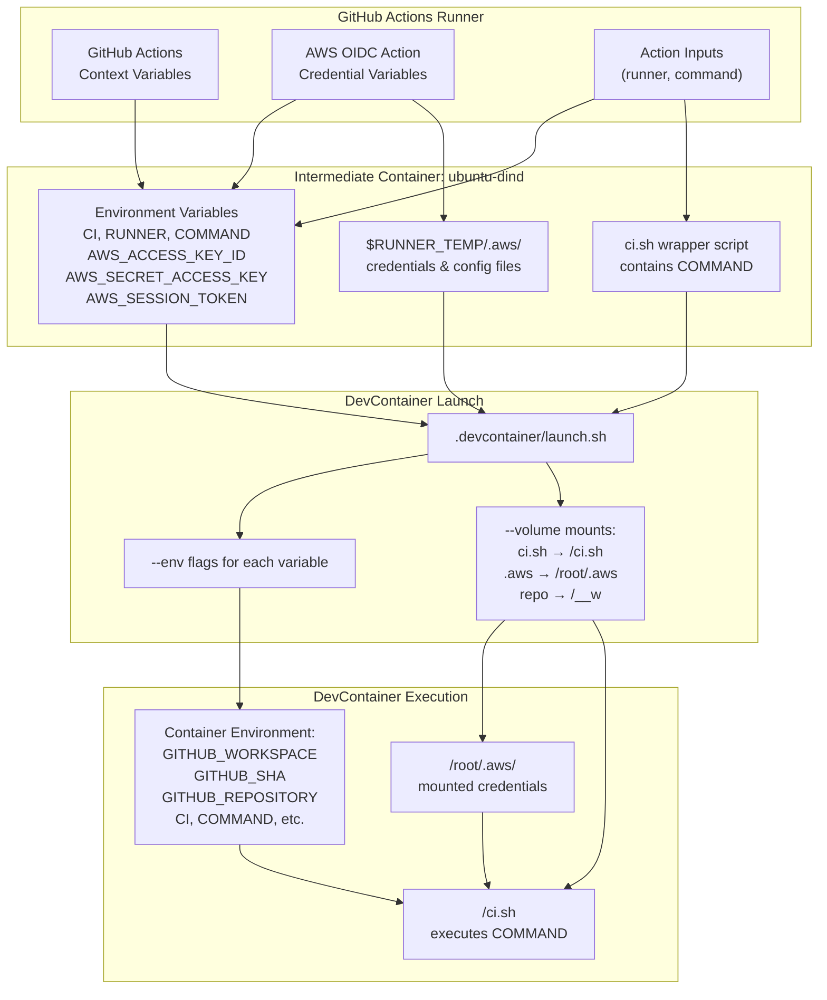
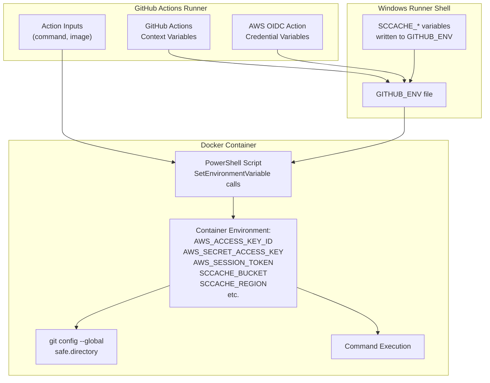

<!-- source: DeepWiki mcp.deepwiki.com · repo NVIDIA/cccl-gha · page 8.3 Environment Variables · fetched 2026-10-26 -->

# Environment Variables

<details>
<summary>Relevant source files</summary>

The following files were used as context for generating this wiki page:

- [.github/actions/workflow-run-job-linux/action.yml](.github/actions/workflow-run-job-linux/action.yml)
- [.github/actions/workflow-run-job-windows/action.yml](.github/actions/workflow-run-job-windows/action.yml)

</details>


This page provides a comprehensive reference of all environment variables used throughout the cccl-gha workflow orchestration system. Environment variables are used to configure AWS credentials for distributed compilation caching, pass GitHub Actions context to devcontainers, control sccache behavior, and customize job execution.

For information about how these variables are configured during job execution, see [Environment Setup](#5.4). For details on AWS credential configuration specifically, see [Distributed Compilation Caching](#7.2).

---

## Overview

Environment variables serve four primary roles in the system:

1. **GitHub Actions Context**: Built-in variables that provide repository, workflow, and execution metadata
2. **AWS Credentials**: Authentication tokens for sccache S3 bucket access
3. **Sccache Configuration**: Settings that control distributed compilation caching behavior
4. **Custom CI Variables**: System-specific variables for command execution and debugging

The propagation of these variables differs between Linux and Windows execution environments due to the Docker-outside-of-Docker (DOOD) architecture used on Linux.

---

## GitHub Actions Context Variables

GitHub Actions automatically provides environment variables that describe the current workflow execution context. The system selectively propagates these variables into devcontainers to enable proper artifact handling, path resolution, and debugging.

### Core Context Variables

| Variable | Description | Used By | Propagated to Container |
|----------|-------------|---------|------------------------|
| `GITHUB_WORKSPACE` | Absolute path to the repository checkout on the runner | Path resolution, artifact collection | Yes (Linux & Windows) |
| `GITHUB_SHA` | Commit SHA that triggered the workflow | Reproduction instructions, debugging | Yes (Linux) |
| `GITHUB_REPOSITORY` | Repository name in `owner/repo` format | Reproduction instructions, debugging | Yes (Linux) |
| `GITHUB_REF_NAME` | Branch or tag name that triggered the workflow | Reproduction instructions | Yes (Linux) |
| `GITHUB_ACTIONS` | Always `true` when running in GitHub Actions | Conditional logic detection | Yes (Linux) |
| `GITHUB_ENV` | Path to file for setting environment variables | Dynamic configuration | Yes (Linux) |
| `GITHUB_PATH` | Path to file for adding to system PATH | Dynamic PATH updates | Yes (Linux) |
| `GITHUB_OUTPUT` | Path to file for setting step outputs | Cross-step communication | Yes (Linux) |
| `GITHUB_STEP_SUMMARY` | Path to file for writing workflow summary markdown | Results reporting | Yes (Linux) |

### Runner Context Variables

| Variable | Description | Set By | Usage |
|----------|-------------|--------|-------|
| `RUNNER_TEMP` | Temporary directory on the runner | GitHub Actions | AWS credential files, intermediate artifacts |
| `github.workspace` | GHA input expression for workspace path | GitHub Actions | Volume mount path calculations |
| `github.event.repository.name` | Repository name without owner | GitHub Actions | Checkout directory naming |

**Sources**: [.github/actions/workflow-run-job-linux/action.yml:66-164]()

---

## AWS Credential Variables

AWS credentials are obtained via OpenID Connect (OIDC) federation with the AWS IAM role and are used exclusively for accessing the sccache S3 bucket. These credentials are temporary and expire after 12 hours.

### Credential Variables

| Variable | Description | Lifecycle | Security |
|----------|-------------|-----------|----------|
| `AWS_ACCESS_KEY_ID` | Temporary AWS access key identifier | Set by `aws-actions/configure-aws-credentials@v4`, expires in 12 hours | Sensitive - never logged |
| `AWS_SECRET_ACCESS_KEY` | Temporary AWS secret access key | Set by `aws-actions/configure-aws-credentials@v4`, expires in 12 hours | Sensitive - never logged |
| `AWS_SESSION_TOKEN` | Temporary session token for assumed role | Set by `aws-actions/configure-aws-credentials@v4`, expires in 12 hours | Sensitive - never logged |

### OIDC Configuration

The system assumes the IAM role `arn:aws:iam::279114543810:role/gha-oidc-NVIDIA` in the `us-east-2` region with a 12-hour session duration.

**Linux Environment**: Credentials are written to `$RUNNER_TEMP/.aws/credentials` and `$RUNNER_TEMP/.aws/config` files, which are then mounted into the devcontainer at `/root/.aws/`.

```
[default]
aws_access_key_id=<value>
aws_session_token=<value>
aws_secret_access_key=<value>
```

**Windows Environment**: Credentials are passed directly as environment variables to the Docker container via PowerShell's `SetEnvironmentVariable` method.

**Sources**: [.github/actions/workflow-run-job-linux/action.yml:60-65](), [.github/actions/workflow-run-job-linux/action.yml:113-129](), [.github/actions/workflow-run-job-windows/action.yml:26-31](), [.github/actions/workflow-run-job-windows/action.yml:55-57]()

---

## Sccache Configuration Variables

Sccache (Shared Compilation Cache) configuration variables control how distributed compilation caching behaves. These variables are platform-specific in their configuration method but identical in function.

### Linux Sccache Configuration

On Linux, sccache configuration is provided via the AWS config file at `/root/.aws/config` mounted into the devcontainer:

```
[default]
bucket=rapids-sccache-devs
region=us-east-2
```

The bucket and region are hardcoded in the configuration file generation logic.

### Windows Sccache Configuration

| Variable | Value | Purpose |
|----------|-------|---------|
| `SCCACHE_BUCKET` | `rapids-sccache-devs` | S3 bucket name for cache storage |
| `SCCACHE_REGION` | `us-east-2` | AWS region for the S3 bucket |
| `SCCACHE_IDLE_TIMEOUT` | `0` | Disable idle timeout (keep daemon alive) |
| `SCCACHE_S3_USE_SSL` | `true` | Use HTTPS for S3 connections |
| `SCCACHE_S3_NO_CREDENTIALS` | `false` | Use AWS credentials (not anonymous) |

These variables are set in `GITHUB_ENV` and then explicitly passed to the Docker container's PowerShell environment.

**Sources**: [.github/actions/workflow-run-job-linux/action.yml:115-119](), [.github/actions/workflow-run-job-windows/action.yml:18-25](), [.github/actions/workflow-run-job-windows/action.yml:58-62]()

---

## Custom CI Variables

The system defines several custom environment variables to control job execution behavior and provide metadata to commands running inside devcontainers.

### Execution Control Variables

| Variable | Description | Set By | Scope |
|----------|-------------|--------|-------|
| `CI` | Set to `true` to indicate CI environment | Action YAML | All jobs (Linux & Windows) |
| `COMMAND` | The actual command string to execute | Action input via env var | Linux job execution |
| `RUNNER` | The GitHub Actions `runs-on` value (e.g., `linux-amd64-gpu-v100-latest-1`) | Action input | Linux GPU detection |
| `VAULT_HOST` | Set to empty string to disable Vault integration | Action logic | Linux devcontainer |

### Variable Usage Patterns

**`CI` Variable**: Set to `true` in all environments to enable CI-specific behavior in build scripts and tests.

```yaml
env:
  CI: true
```

**`COMMAND` Variable**: The command to execute is passed via an environment variable rather than a direct GitHub Actions input to avoid escaping issues with special characters (e.g., `-arch "60;70;80"` with semicolons).

```yaml
env:
  COMMAND: "${{inputs.command}}"
```

**`RUNNER` Variable**: Used to detect GPU availability. If the runner name contains `-gpu-`, the system adds the `--gpus` flag when launching the devcontainer.

```bash
if [[ "${RUNNER}" = *"-gpu-"* ]]; then
  gpu_request+=(--gpus "device=${NVIDIA_VISIBLE_DEVICES}")
fi
```

**`VAULT_HOST` Variable**: Explicitly set to empty string to disable HashiCorp Vault credential fetching in CI environments (credentials are provided via AWS OIDC instead).

**Sources**: [.github/actions/workflow-run-job-linux/action.yml:66-76](), [.github/actions/workflow-run-job-linux/action.yml:134-148]()

---

## GPU Resource Variables

GPU access is controlled via environment variables set by the GitHub Actions runner and passed to Docker containers.

| Variable | Description | Set By | Usage |
|----------|-------------|--------|-------|
| `NVIDIA_VISIBLE_DEVICES` | GPU device identifier(s) visible to the container | GitHub Actions runner | Passed to Docker via `--gpus device=${NVIDIA_VISIBLE_DEVICES}` |

The system detects GPU runners by checking if the `RUNNER` variable contains `-gpu-`. When detected, the `NVIDIA_VISIBLE_DEVICES` value is used to restrict container access to specific GPU devices.

```bash
gpu_request+=(--gpus "device=${NVIDIA_VISIBLE_DEVICES}")
```

This ensures proper GPU isolation when multiple GPU jobs run on the same physical runner.

**Sources**: [.github/actions/workflow-run-job-linux/action.yml:133-136]()

---

## Environment Variable Propagation Architecture

The following diagram illustrates how environment variables flow from GitHub Actions through the intermediate container to the final devcontainer on Linux (the more complex scenario).

### Linux Environment Variable Flow



**Key Points**:

1. **Environment Variables**: Most variables are passed using `--env` flags to `docker run` command via `launch.sh`
2. **AWS Credentials**: Written to files in `$RUNNER_TEMP/.aws/` and mounted as a volume (not passed as environment variables to avoid logging)
3. **Command Execution**: The `COMMAND` string is embedded in `ci.sh` script and mounted as `/ci.sh` to avoid escaping issues
4. **Path Consistency**: Symlinks ensure that paths referenced inside containers match host paths (required for DOOD architecture)

**Sources**: [.github/actions/workflow-run-job-linux/action.yml:77-164]()

---

## Windows Environment Variable Propagation

Windows uses a simpler direct propagation model since it doesn't use the DOOD pattern.



**Key Differences from Linux**:

1. **Direct Propagation**: Environment variables are set directly in the PowerShell environment inside the container using `SetEnvironmentVariable`
2. **No File Mounting**: AWS credentials are passed as environment variables, not via mounted files
3. **Simpler Architecture**: No intermediate container; variables flow directly from runner to target container
4. **Explicit Setting**: Each variable is explicitly set via PowerShell commands in the Docker `run` command

**Sources**: [.github/actions/workflow-run-job-windows/action.yml:18-64]()

---

## Environment Variable Reference Table

This comprehensive table lists all environment variables used across the system:

| Variable | Category | Platform | Set By | Used In | Sensitive |
|----------|----------|----------|--------|---------|-----------|
| `CI` | Custom | Both | Action YAML | Build scripts, test detection | No |
| `COMMAND` | Custom | Linux | Action input | ci.sh execution | No |
| `RUNNER` | Custom | Linux | Action input | GPU detection | No |
| `VAULT_HOST` | Custom | Linux | Action logic | Devcontainer init | No |
| `GITHUB_WORKSPACE` | GitHub | Both | GitHub Actions | Path resolution | No |
| `GITHUB_SHA` | GitHub | Linux | GitHub Actions | Reproduction instructions | No |
| `GITHUB_REPOSITORY` | GitHub | Linux | GitHub Actions | Reproduction instructions | No |
| `GITHUB_REF_NAME` | GitHub | Linux | GitHub Actions | Reproduction instructions | No |
| `GITHUB_ACTIONS` | GitHub | Linux | GitHub Actions | CI detection | No |
| `GITHUB_ENV` | GitHub | Both | GitHub Actions | Dynamic env updates | No |
| `GITHUB_PATH` | GitHub | Linux | GitHub Actions | Dynamic PATH updates | No |
| `GITHUB_OUTPUT` | GitHub | Linux | GitHub Actions | Step outputs | No |
| `GITHUB_STEP_SUMMARY` | GitHub | Linux | GitHub Actions | Workflow summary | No |
| `RUNNER_TEMP` | GitHub | Both | GitHub Actions | Temp file storage | No |
| `AWS_ACCESS_KEY_ID` | AWS | Both | aws-actions/configure-aws-credentials | sccache authentication | Yes |
| `AWS_SECRET_ACCESS_KEY` | AWS | Both | aws-actions/configure-aws-credentials | sccache authentication | Yes |
| `AWS_SESSION_TOKEN` | AWS | Both | aws-actions/configure-aws-credentials | sccache authentication | Yes |
| `SCCACHE_BUCKET` | Sccache | Windows | Action logic | Cache bucket name | No |
| `SCCACHE_REGION` | Sccache | Windows | Action logic | AWS region | No |
| `SCCACHE_IDLE_TIMEOUT` | Sccache | Windows | Action logic | Daemon timeout | No |
| `SCCACHE_S3_USE_SSL` | Sccache | Windows | Action logic | HTTPS enforcement | No |
| `SCCACHE_S3_NO_CREDENTIALS` | Sccache | Windows | Action logic | Credential usage flag | No |
| `NVIDIA_VISIBLE_DEVICES` | GPU | Linux | GitHub runner | GPU device selection | No |

---

## Variable Security and Best Practices

### Sensitive Variables

AWS credentials (`AWS_ACCESS_KEY_ID`, `AWS_SECRET_ACCESS_KEY`, `AWS_SESSION_TOKEN`) are considered sensitive. The system takes precautions to prevent them from appearing in logs:

- **Linux**: Credentials are written to files with restricted permissions (`0600` for credentials, `0664` for config) and mounted as volumes rather than passed as environment variables
- **Windows**: Credentials are set via PowerShell's `SetEnvironmentVariable` which doesn't echo values
- **No Logging**: Credentials are never echoed or logged in any scripts

### File Permissions

```bash
chmod 0600 "$RUNNER_TEMP/.aws/credentials"
chmod 0664 "$RUNNER_TEMP/.aws/config"
```

The credentials file has owner-only read/write permissions, while the config file allows group read.

### Command Escaping

The `COMMAND` variable is passed via environment variable rather than direct GitHub Actions input to avoid shell escaping issues with special characters like semicolons, quotes, and parentheses that are common in compiler flags:

```bash
# Example command with special characters
-arch "60;70;80" -DCUDA_VERSION=12.0
```

Using `${{inputs.command}}` directly in shell scripts would require complex escaping. By dereferencing from `COMMAND` environment variable, the shell handles it correctly.

**Sources**: [.github/actions/workflow-run-job-linux/action.yml:66-76](), [.github/actions/workflow-run-job-linux/action.yml:113-129]()

---

## Debugging Environment Variables

When debugging job execution issues, several environment variables can be inspected:

```bash
# In the ci.sh script, the following are available:
echo "Workspace: ${GITHUB_WORKSPACE}"
echo "SHA: ${GITHUB_SHA}"
echo "Repository: ${GITHUB_REPOSITORY}"
echo "Branch: ${GITHUB_REF_NAME}"
echo "Command: ${COMMAND}"
echo "Runner: ${RUNNER}"
```

The reproduction instructions generated on failure reference these variables:

```bash
git clone --branch $GITHUB_REF_NAME --single-branch \
  https://github.com/$GITHUB_REPOSITORY.git
cd $(echo $GITHUB_REPOSITORY | cut -d'/' -f2)
git checkout $GITHUB_SHA
```

This ensures developers can exactly reproduce the failing commit state locally.

**Sources**: [.github/actions/workflow-run-job-linux/action.yml:89-109]()

---

